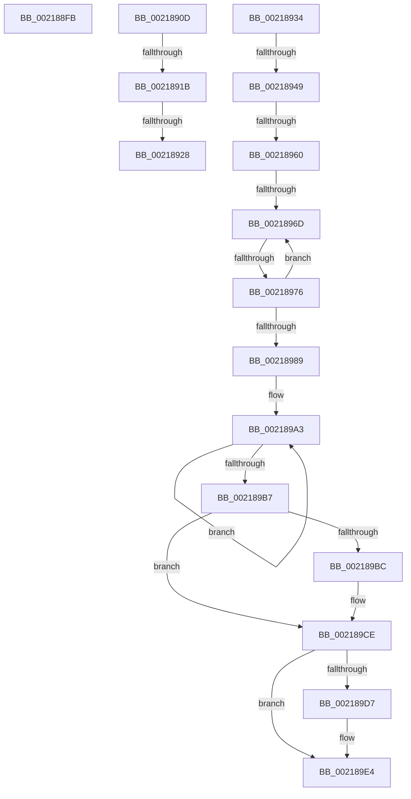

# sub_002188FB

- RVA: `0x002188FB`–`0x002189F1` (길이 `246` bytes)
- VA: `0x00000001402188FB`
- 실행 섹션: `.text`
- PDB 이름 있음: `아니요`; PDB Function 태그: `아니요`
- unwind 정보 RVA: `0x0005EA38`
- 디코드: `55`개 명령, `246/246` bytes 표시
- 미해석 바이트: `0` (있으면 어셈블리에 `.byte`로 보존)

> 이 문서는 커널 이미지의 기계어와 PDB 기호를 분석해 생성했습니다. 4번과 5번은 함수 원형과 자료형을 바이너리 사용 방식에서 추정한 C 해석이며 원본 소스 복구 결과는 아닙니다.

## 1. Dependencies

- 직접 호출 지점: **6**; 고유 호출 대상: **6**
- 직접 호출자로 확인된 함수: **0**
- RIP 상대 이미지 참조: **4**

### Outgoing calls
- `0x00218903` → [KiRaiseIrqlProcessIrqlFlags](../4F/KiRaiseIrqlProcessIrqlFlags_function_004F56FC.md) (function, `0x004F56FC`)
- `0x0021891B` → [KiCheckVpBackingLongSpinWaitHypercall](../30/KiCheckVpBackingLongSpinWaitHypercall_function_0030F490.md) (function, `0x0030F490`)
- `0x0021892A` → [HvlNotifyLongSpinWait](../30/HvlNotifyLongSpinWait_function_0030F460.md) (function, `0x0030F460`)
- `0x0021894C` → [KiAcquireKobjectLockSafe](../25/KiAcquireKobjectLockSafe_function_00251C90.md) (function, `0x00251C90`)
- `0x002189C9` → [KeSetEvent](../33/KeSetEvent_function_0033F310.md) (function, `0x0033F310`)
- `0x002189DF` → [KiLowerIrqlProcessIrqlFlags](../4F/KiLowerIrqlProcessIrqlFlags_function_004F5698.md) (function, `0x004F5698`)

### Direct callers
- 이 함수 시작 RVA로 연결되는 직접 call은 확인되지 않았습니다. 간접 호출은 완전히 역산할 수 없습니다.

### Static image references
- `0x0021890D` → RVA `0x00FC6AB8` (`ALMOSTRO`; read)
- `0x0021893C` → RVA `0x00FC6D20` (`ALMOSTRO`; read)
- `0x00218995` → RVA `0x00F22D40` (`.data`; read)
- `0x002189C2` → RVA `0x00F22D80` (`.data`; read)

## 2. Other-region calls and transfers

- 다른 실행 섹션으로 향하는 call: **0**
- call이 아닌 외부 분기/꼬리 이동: **9**
  - `0x00218908` → [sub_002185C7 + 0x4A](Unknown_function_002185C7.md) (`tail-transfer`)
  - `0x00218915` → [sub_002185C7 + 0x70](Unknown_function_002185C7.md) (`tail-transfer`)
  - `0x00218922` → [sub_002185C7 + 0x70](Unknown_function_002185C7.md) (`tail-transfer`)
  - `0x0021892F` → [sub_002185C7 + 0x72](Unknown_function_002185C7.md) (`tail-transfer`)
  - `0x00218943` → [sub_00218A6D + 0xD](Unknown_function_00218A6D.md) (`tail-transfer`)
  - `0x0021895A` → [sub_00218A6D](Unknown_function_00218A6D.md) (`tail-transfer`)
  - `0x00218967` → [sub_00218A6D](Unknown_function_00218A6D.md) (`tail-transfer`)
  - `0x00218970` → [sub_00218A6D](Unknown_function_00218A6D.md) (`tail-transfer`)
  - `0x002189EC` → [sub_002187BE + 0x2B](Unknown_function_002187BE.md) (`tail-transfer`)

## 3. Assembly (complete function range)

```asm
002188FB  41 0F B6 D4                     movzx edx, r12b
002188FF  40 0F B6 CF                     movzx ecx, dil
00218903  E8 F4 CD 2D 00                  call 0x1404f56fc
00218908  E9 04 FD FF FF                  jmp 0x140218611
0021890D  8B 05 A5 E1 DA 00               mov eax, dword ptr [rip + 0xdae1a5]
00218913  A8 40                           test al, 0x40
00218915  0F 84 1C FD FF FF               je 0x140218637
0021891B  E8 70 6B 0F 00                  call 0x14030f490
00218920  84 C0                           test al, al
00218922  0F 84 0F FD FF FF               je 0x140218637
00218928  8B CF                           mov ecx, edi
0021892A  E8 31 6B 0F 00                  call 0x14030f460
0021892F  E9 05 FD FF FF                  jmp 0x140218639
00218934  44 0F 20 C6                     mov rsi, cr8
00218938  45 0F 22 C4                     mov cr8, r12
0021893C  83 3D DD E3 DA 00 00            cmp dword ptr [rip + 0xdae3dd], 0
00218943  0F 85 31 01 00 00               jne 0x140218a7a
00218949  49 8B CF                        mov rcx, r15
0021894C  E8 3F 93 03 00                  call 0x140251c90
00218951  41 8B 87 08 01 00 00            mov eax, dword ptr [r15 + 0x108]
00218958  A8 07                           test al, 7
0021895A  0F 85 0D 01 00 00               jne 0x140218a6d
00218960  49 8D 4F 30                     lea rcx, [r15 + 0x30]
00218964  48 39 09                        cmp qword ptr [rcx], rcx
00218967  0F 84 00 01 00 00               je 0x140218a6d
0021896D  83 F8 08                        cmp eax, 8
00218970  0F 83 F7 00 00 00               jae 0x140218a6d
00218976  8B C8                           mov ecx, eax
00218978  83 E1 FB                        and ecx, 0xfffffffb
0021897B  83 C9 03                        or ecx, 3
0021897E  F0 41 0F B1 8F 08 01 00 00      lock cmpxchg dword ptr [r15 + 0x108], ecx
00218987  75 E4                           jne 0x14021896d
00218989  F0 41 81 27 7F FF FF FF         lock and dword ptr [r15], 0xffffff7f
00218991  49 83 C7 78                     add r15, 0x78
00218995  0F 0D 0D A4 A3 D0 00            prefetchw byte ptr [rip + 0xd0a3a4]
0021899C  48 8B 05 9D A3 D0 00            mov rax, qword ptr [rip + 0xd0a39d]
002189A3  49 89 07                        mov qword ptr [r15], rax
002189A6  48 8B C8                        mov rcx, rax
002189A9  F0 4C 0F B1 3D 8E A3 D0 00      lock cmpxchg qword ptr [rip + 0xd0a38e], r15
002189B2  48 3B C1                        cmp rax, rcx
002189B5  75 EC                           jne 0x1402189a3
002189B7  48 85 C0                        test rax, rax
002189BA  75 12                           jne 0x1402189ce
002189BC  45 33 C0                        xor r8d, r8d
002189BF  8D 50 0A                        lea edx, [rax + 0xa]
002189C2  48 8D 0D B7 A3 D0 00            lea rcx, [rip + 0xd0a3b7]
002189C9  E8 42 69 12 00                  call 0x14033f310
002189CE  83 3D 4B E3 DA 00 00            cmp dword ptr [rip + 0xdae34b], 0
002189D5  74 0D                           je 0x1402189e4
002189D7  44 0F 20 C1                     mov rcx, cr8
002189DB  40 0F B6 D6                     movzx edx, sil
002189DF  E8 B4 CC 2D 00                  call 0x1404f5698
002189E4  40 0F B6 C6                     movzx eax, sil
002189E8  44 0F 22 C0                     mov cr8, rax
002189EC  E9 F8 FD FF FF                  jmp 0x1402187e9
```

## 4. C-style interpretation (structured pseudocode)

```c
__int64 __fastcall sub_002188FB(__int64 a1, __int64 a2, int a3)
{
    __int64 result;

    result = KiRaiseIrqlProcessIrqlFlags((unsigned __int8)(v_rdi), (unsigned __int8)(v_r12), a3, a4);
}
```

## 5. (Beta) C Style

```c
int64_t sub_002188FB(int64_t Arg1, int64_t Arg2, int32_t Arg3)
{
    int64_t result;

    result = KiRaiseIrqlProcessIrqlFlags((uint8_t)(local_rdi), (uint8_t)(local_r12), Arg3, a4);
}
```

## 6. Execution-region graph

[열기: 2D/3D 그래프와 함수 탐색 컨트롤 패널](../../../control-panel.html?section=text&rva=0x002188FB&view=graph)

- 2D 그래프는 위에서 아래로 흐르고, 3D 그래프는 빈 공간을 드래그해 회전합니다. Shift+드래그는 이동, 휠은 확대·축소, 함수 노드 선택은 대상 보고서 이동입니다.

### Static fallback


