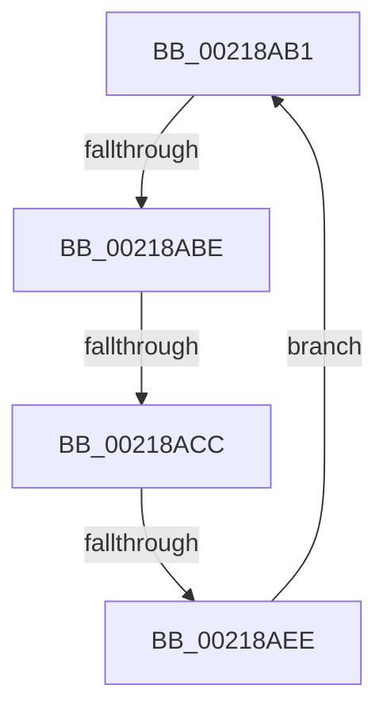

# sub_00218AB1

- RVA: `0x00218AB1`–`0x00218AF0` (길이 `63` bytes)
- VA: `0x0000000140218AB1`
- 실행 섹션: `.text`
- PDB 이름 있음: `아니요`; PDB Function 태그: `아니요`
- unwind 정보 RVA: `0x0005EB20`
- 디코드: `13`개 명령, `63/63` bytes 표시
- 미해석 바이트: `0` (있으면 어셈블리에 `.byte`로 보존)

> 이 문서는 커널 이미지의 기계어와 PDB 기호를 분석해 생성했습니다. 4번과 5번은 함수 원형과 자료형을 바이너리 사용 방식에서 추정한 C 해석이며 원본 소스 복구 결과는 아닙니다.

## 1. Dependencies

- 직접 호출 지점: **2**; 고유 호출 대상: **2**
- 직접 호출자로 확인된 함수: **0**
- RIP 상대 이미지 참조: **0**

### Outgoing calls
- `0x00218ACF` → [KiReleaseThreadLockLowerIrql](../3C/KiReleaseThreadLockLowerIrql_function_003C65D0.md) (function, `0x003C65D0`)
- `0x00218ADC` → [KiAcquireThreadLockRaiseToDpc](../39/KiAcquireThreadLockRaiseToDpc_function_00396280.md) (function, `0x00396280`)

### Direct callers
- 이 함수 시작 RVA로 연결되는 직접 call은 확인되지 않았습니다. 간접 호출은 완전히 역산할 수 없습니다.

### Static image references
- 디코드된 RIP-relative 메모리 참조가 없습니다.

## 2. Other-region calls and transfers

- 다른 실행 섹션으로 향하는 call: **0**
- call이 아닌 외부 분기/꼬리 이동: **3**
  - `0x00218AB8` → [sub_002185C7 + 0x8A](Unknown_function_002185C7.md) (`tail-transfer`)
  - `0x00218AC6` → [sub_002185C7 + 0x8A](Unknown_function_002185C7.md) (`tail-transfer`)
  - `0x00218AE8` → [sub_002185C7 + 0x8A](Unknown_function_002185C7.md) (`tail-transfer`)

## 3. Assembly (complete function range)

```asm
00218AB1  66 39 AB E6 01 00 00            cmp word ptr [rbx + 0x1e6], bp
00218AB8  0F 85 93 FB FF FF               jne 0x140218651
00218ABE  0F B6 54 24 70                  movzx edx, byte ptr [rsp + 0x70]
00218AC3  80 FA 01                        cmp dl, 1
00218AC6  0F 83 85 FB FF FF               jae 0x140218651
00218ACC  48 8B CB                        mov rcx, rbx
00218ACF  E8 FC DA 1A 00                  call 0x1403c65d0
00218AD4  48 8D 54 24 70                  lea rdx, [rsp + 0x70]
00218AD9  48 8B CB                        mov rcx, rbx
00218ADC  E8 9F D7 17 00                  call 0x140396280
00218AE1  40 38 AB C1 00 00 00            cmp byte ptr [rbx + 0xc1], bpl
00218AE8  0F 84 63 FB FF FF               je 0x140218651
00218AEE  EB C1                           jmp 0x140218ab1
```

## 4. C-style interpretation (structured pseudocode)

```c
__int64 __fastcall sub_00218AB1(__int64 a1, __int64 a2, __int64 a3, __int64 a4, __int64 a5, __int64 a6, __int64 a7, __int64 a8, __int64 a9, __int64 a10, __int64 a11, __int64 a12, __int64 a13, unsigned __int8 a14)
{
    __int64 result;

    result = KiReleaseThreadLockLowerIrql(v_rbx, a14, a3, a4);
    result = KiAcquireThreadLockRaiseToDpc(v_rbx, a14, a3, a4);
    goto loc_00218AB1;
}
```

## 5. (Beta) C Style

```c
int64_t sub_00218AB1(int64_t Arg1, int64_t Arg2, int64_t Arg3, int64_t Arg4, uint64_t Arg5, uint64_t Arg6, uint64_t Arg7, uint64_t Arg8, uint64_t Arg9, uint64_t Arg10, uint64_t Arg11, uint64_t Arg12, uint64_t Arg13, uint8_t Arg14)
{
    int64_t result;

    result = KiReleaseThreadLockLowerIrql(local_rbx, Arg14, Arg3, Arg4);
    result = KiAcquireThreadLockRaiseToDpc(local_rbx, Arg14, Arg3, Arg4);
    goto loc_00218AB1;
}
```

## 6. Execution-region graph

[열기: 2D/3D 그래프와 함수 탐색 컨트롤 패널](../../../control-panel.html?section=text&rva=0x00218AB1&view=graph)

- 2D 그래프는 위에서 아래로 흐르고, 3D 그래프는 빈 공간을 드래그해 회전합니다. Shift+드래그는 이동, 휠은 확대·축소, 함수 노드 선택은 대상 보고서 이동입니다.

### Static fallback


