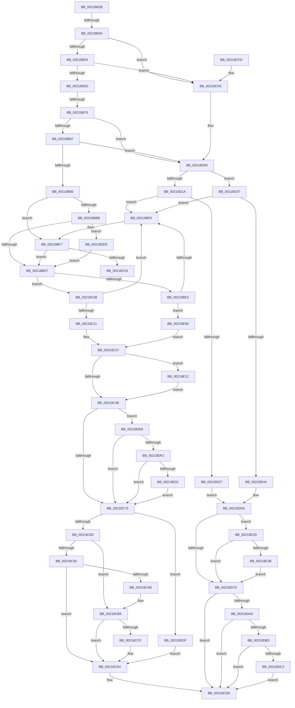

# sub_00218B2B

- RVA: `0x00218B2B`–`0x00218E69` (길이 `830` bytes)
- VA: `0x0000000140218B2B`
- 실행 섹션: `.text`
- PDB 이름 있음: `아니요`; PDB Function 태그: `아니요`
- unwind 정보 RVA: `0x0005EB58`
- 디코드: `186`개 명령, `830/830` bytes 표시
- 미해석 바이트: `0` (있으면 어셈블리에 `.byte`로 보존)

> 이 문서는 커널 이미지의 기계어와 PDB 기호를 분석해 생성했습니다. 4번과 5번은 함수 원형과 자료형을 바이너리 사용 방식에서 추정한 C 해석이며 원본 소스 복구 결과는 아닙니다.

## 1. Dependencies

- 직접 호출 지점: **11**; 고유 호출 대상: **8**
- 직접 호출자로 확인된 함수: **0**
- RIP 상대 이미지 참조: **1**

### Outgoing calls
- `0x00218C61` → [KiUpdateSoftParkElectionStatisticsOnInsertion](KiUpdateSoftParkElectionStatisticsOnInsertion_function_00218F40.md) (function, `0x00218F40`)
- `0x00218C66` → [KeIsForceParkingEnabled](KeIsForceParkingEnabled_function_00218F20.md) (function, `0x00218F20`)
- `0x00218CB0` → [KxWaitForLockChainValid](KxWaitForLockChainValid_function_00217AA0.md) (function, `0x00217AA0`)
- `0x00218CCF` → [KeWakeAddressAll](KeWakeAddressAll_function_00217C20.md) (function, `0x00217C20`)
- `0x00218D97` → [KiUpdateSoftParkElectionStatisticsOnInsertion](KiUpdateSoftParkElectionStatisticsOnInsertion_function_00218F40.md) (function, `0x00218F40`)
- `0x00218D9C` → [KeIsForceParkingEnabled](KeIsForceParkingEnabled_function_00218F20.md) (function, `0x00218F20`)
- `0x00218DB6` → [KiIsThreadExemptFromForcePark](../4D/KiIsThreadExemptFromForcePark_function_004D7B80.md) (function, `0x004D7B80`)
- `0x00218DC6` → [KiArmForceParkDutyCyclingForLocalReadyQueue](../4F/KiArmForceParkDutyCyclingForLocalReadyQueue_function_004FAB54.md) (function, `0x004FAB54`)
- `0x00218DD5` → [KxWaitForLockOwnerShip](../25/KxWaitForLockOwnerShip_function_00257EB0.md) (function, `0x00257EB0`)
- `0x00218DF5` → [KiIsThreadExemptFromForcePark](../4D/KiIsThreadExemptFromForcePark_function_004D7B80.md) (function, `0x004D7B80`)
- `0x00218E08` → [KiArmForceParkDutyCyclingForSharedReadyQueue](../4F/KiArmForceParkDutyCyclingForSharedReadyQueue_function_004FB604.md) (function, `0x004FB604`)

### Direct callers
- 이 함수 시작 RVA로 연결되는 직접 call은 확인되지 않았습니다. 간접 호출은 완전히 역산할 수 없습니다.

### Static image references
- `0x00218BAA` → RVA `0x00FC6B38` (`ALMOSTRO`; read)

## 2. Other-region calls and transfers

- 다른 실행 섹션으로 향하는 call: **0**
- call이 아닌 외부 분기/꼬리 이동: **3**
  - `0x00218B3A` → [sub_00218E7C + 0x8](Unknown_function_00218E7C.md) (`tail-transfer`)
  - `0x00218B70` → [sub_00218E7C](Unknown_function_00218E7C.md) (`tail-transfer`)
  - `0x00218C03` → [sub_006D68B6](../6D/Unknown_function_006D68B6.md) (`tail-transfer`)

## 3. Assembly (complete function range)

```asm
00218B2B  48 89 5C 24 60                  mov qword ptr [rsp + 0x60], rbx
00218B30  48 89 74 24 70                  mov qword ptr [rsp + 0x70], rsi
00218B35  4C 89 74 24 30                  mov qword ptr [rsp + 0x30], r14
00218B3A  0F 85 44 03 00 00               jne 0x140218e84
00218B40  F7 47 78 00 20 00 00            test dword ptr [rdi + 0x78], 0x2000
00218B47  48 8B 8D 40 8E 00 00            mov rcx, qword ptr [rbp + 0x8e40]
00218B4E  0F 84 AA 01 00 00               je 0x140218cfe
00218B54  48 85 C9                        test rcx, rcx
00218B57  0F 84 A1 01 00 00               je 0x140218cfe
00218B5D  48 8B 97 40 02 00 00            mov rdx, qword ptr [rdi + 0x240]
00218B64  33 F6                           xor esi, esi
00218B66  0F B6 85 D0 00 00 00            movzx eax, byte ptr [rbp + 0xd0]
00218B6D  66 3B 02                        cmp ax, word ptr [rdx]
00218B70  0F 83 06 03 00 00               jae 0x140218e7c
00218B76  48 8B 54 C2 08                  mov rdx, qword ptr [rdx + rax*8 + 8]
00218B7B  48 23 D1                        and rdx, rcx
00218B7E  48 3B D1                        cmp rdx, rcx
00218B81  0F 85 79 01 00 00               jne 0x140218d00
00218B87  40 38 B4 24 80 00 00 00         cmp byte ptr [rsp + 0x80], sil
00218B8F  0F 85 6B 01 00 00               jne 0x140218d00
00218B95  48 8B 9D 48 8E 00 00            mov rbx, qword ptr [rbp + 0x8e48]
00218B9C  4D 8D 77 04                     lea r14, [r15 + 4]
00218BA0  49 C1 E6 04                     shl r14, 4
00218BA4  0F 57 C0                        xorps xmm0, xmm0
00218BA7  4C 03 F3                        add r14, rbx
00218BAA  F7 05 84 DF DA 00 00 00 20 00   test dword ptr [rip + 0xdadf84], 0x200000
00218BB4  0F 11 44 24 20                  movups xmmword ptr [rsp + 0x20], xmm0
00218BB9  74 3C                           je 0x140218bf7
00218BBB  48 89 5C 24 28                  mov qword ptr [rsp + 0x28], rbx
00218BC0  48 8D 54 24 20                  lea rdx, [rsp + 0x20]
00218BC5  48 89 74 24 20                  mov qword ptr [rsp + 0x20], rsi
00218BCA  90                              nop
00218BCB  48 87 13                        xchg qword ptr [rbx], rdx
00218BCE  48 85 D2                        test rdx, rdx
00218BD1  0F 85 F9 01 00 00               jne 0x140218dd0
00218BD7  48 8D 87 D8 00 00 00            lea rax, [rdi + 0xd8]
00218BDE  45 85 E4                        test r12d, r12d
00218BE1  75 25                           jne 0x140218c08
00218BE3  49 8B 4E 08                     mov rcx, qword ptr [r14 + 8]
00218BE7  4C 39 31                        cmp qword ptr [rcx], r14
00218BEA  0F 84 66 02 00 00               je 0x140218e56
00218BF0  B9 03 00 00 00                  mov ecx, 3
00218BF5  CD 29                           int 0x29
00218BF7  89 74 24 68                     mov dword ptr [rsp + 0x68], esi
00218BFB  F0 48 0F BA 2B 00               lock bts qword ptr [rbx], 0
00218C01  73 D4                           jae 0x140218bd7
00218C03  E9 AE DC 4B 00                  jmp 0x1406d68b6
00218C08  49 8B 0E                        mov rcx, qword ptr [r14]
00218C0B  4C 39 71 08                     cmp qword ptr [rcx + 8], r14
00218C0F  75 DF                           jne 0x140218bf0
00218C11  48 89 08                        mov qword ptr [rax], rcx
00218C14  4C 89 70 08                     mov qword ptr [rax + 8], r14
00218C18  48 89 41 08                     mov qword ptr [rcx + 8], rax
00218C1C  49 89 06                        mov qword ptr [r14], rax
00218C1F  44 0F B3 BD DC 83 00 00         btr dword ptr [rbp + 0x83dc], r15d
00218C27  8B 43 08                        mov eax, dword ptr [rbx + 8]
00218C2A  44 0F AB F8                     bts eax, r15d
00218C2E  89 43 08                        mov dword ptr [rbx + 8], eax
00218C31  8B 87 18 02 00 00               mov eax, dword ptr [rdi + 0x218]
00218C37  0F BA E8 1F                     bts eax, 0x1f
00218C3B  89 87 18 02 00 00               mov dword ptr [rdi + 0x218], eax
00218C41  FF 43 0C                        inc dword ptr [rbx + 0xc]
00218C44  83 7B 0C 01                     cmp dword ptr [rbx + 0xc], 1
00218C48  0F 84 C4 01 00 00               je 0x140218e12
00218C4E  8B 47 54                        mov eax, dword ptr [rdi + 0x54]
00218C51  48 8B D7                        mov rdx, rdi
00218C54  89 87 F8 06 00 00               mov dword ptr [rdi + 0x6f8], eax
00218C5A  48 8B CB                        mov rcx, rbx
00218C5D  48 01 43 10                     add qword ptr [rbx + 0x10], rax
00218C61  E8 DA 02 00 00                  call 0x140218f40
00218C66  E8 B5 02 00 00                  call 0x140218f20
00218C6B  84 C0                           test al, al
00218C6D  0F 85 75 01 00 00               jne 0x140218de8
00218C73  F7 05 BB DE DA 00 00 00 20 00   test dword ptr [rip + 0xdadebb], 0x200000
00218C7D  0F 84 5C 01 00 00               je 0x140218ddf
00218C83  0F 0D 4C 24 20                  prefetchw byte ptr [rsp + 0x20]
00218C88  48 8B 44 24 20                  mov rax, qword ptr [rsp + 0x20]
00218C8D  48 85 C0                        test rax, rax
00218C90  75 23                           jne 0x140218cb5
00218C92  48 8B 4C 24 28                  mov rcx, qword ptr [rsp + 0x28]
00218C97  48 8D 44 24 20                  lea rax, [rsp + 0x20]
00218C9C  F0 48 0F B1 31                  lock cmpxchg qword ptr [rcx], rsi
00218CA1  48 8D 4C 24 20                  lea rcx, [rsp + 0x20]
00218CA6  48 3B C1                        cmp rax, rcx
00218CA9  74 29                           je 0x140218cd4
00218CAB  48 8D 4C 24 20                  lea rcx, [rsp + 0x20]
00218CB0  E8 EB ED FF FF                  call 0x140217aa0
00218CB5  48 8D 48 08                     lea rcx, [rax + 8]
00218CB9  48 89 74 24 20                  mov qword ptr [rsp + 0x20], rsi
00218CBE  48 8B 54 24 28                  mov rdx, qword ptr [rsp + 0x28]
00218CC3  48 8B C2                        mov rax, rdx
00218CC6  48 87 01                        xchg qword ptr [rcx], rax
00218CC9  32 C2                           xor al, dl
00218CCB  A8 04                           test al, 4
00218CCD  74 05                           je 0x140218cd4
00218CCF  E8 4C EF FF FF                  call 0x140217c20
00218CD4  BE 01 00 00 00                  mov esi, 1
00218CD9  48 8B 84 24 88 00 00 00         mov rax, qword ptr [rsp + 0x88]
00218CE1  4C 8B 74 24 30                  mov r14, qword ptr [rsp + 0x30]
00218CE6  48 8B 5C 24 60                  mov rbx, qword ptr [rsp + 0x60]
00218CEB  89 30                           mov dword ptr [rax], esi
00218CED  48 8B 74 24 70                  mov rsi, qword ptr [rsp + 0x70]
00218CF2  48 83 C4 38                     add rsp, 0x38
00218CF6  41 5F                           pop r15
00218CF8  41 5C                           pop r12
00218CFA  5F                              pop rdi
00218CFB  5D                              pop rbp
00218CFC  C3                              ret
00218CFD  CC                              int3
00218CFE  33 F6                           xor esi, esi
00218D00  49 8D 8F 44 08 00 00            lea rcx, [r15 + 0x844]
00218D07  48 C1 E1 04                     shl rcx, 4
00218D0B  48 8D 97 D8 00 00 00            lea rdx, [rdi + 0xd8]
00218D12  48 03 CD                        add rcx, rbp
00218D15  45 85 E4                        test r12d, r12d
00218D18  75 1D                           jne 0x140218d37
00218D1A  48 8B 41 08                     mov rax, qword ptr [rcx + 8]
00218D1E  48 39 08                        cmp qword ptr [rax], rcx
00218D21  0F 85 C9 FE FF FF               jne 0x140218bf0
00218D27  48 89 0A                        mov qword ptr [rdx], rcx
00218D2A  48 89 42 08                     mov qword ptr [rdx + 8], rax
00218D2E  48 89 10                        mov qword ptr [rax], rdx
00218D31  48 89 51 08                     mov qword ptr [rcx + 8], rdx
00218D35  EB 23                           jmp 0x140218d5a
00218D37  48 8B 01                        mov rax, qword ptr [rcx]
00218D3A  48 39 48 08                     cmp qword ptr [rax + 8], rcx
00218D3E  0F 85 AC FE FF FF               jne 0x140218bf0
00218D44  48 89 02                        mov qword ptr [rdx], rax
00218D47  48 89 4A 08                     mov qword ptr [rdx + 8], rcx
00218D4B  48 89 50 08                     mov qword ptr [rax + 8], rdx
00218D4F  48 89 11                        mov qword ptr [rcx], rdx
00218D52  44 0F AB BD DC 83 00 00         bts dword ptr [rbp + 0x83dc], r15d
00218D5A  8B 85 D8 83 00 00               mov eax, dword ptr [rbp + 0x83d8]
00218D60  FF 85 74 86 00 00               inc dword ptr [rbp + 0x8674]
00218D66  44 0F AB F8                     bts eax, r15d
00218D6A  83 BD 74 86 00 00 01            cmp dword ptr [rbp + 0x8674], 1
00218D71  89 85 D8 83 00 00               mov dword ptr [rbp + 0x83d8], eax
00218D77  0F 84 B0 00 00 00               je 0x140218e2d
00218D7D  8B 47 54                        mov eax, dword ptr [rdi + 0x54]
00218D80  48 8B D7                        mov rdx, rdi
00218D83  89 87 F8 06 00 00               mov dword ptr [rdi + 0x6f8], eax
00218D89  48 8B 8D 48 8E 00 00            mov rcx, qword ptr [rbp + 0x8e48]
00218D90  48 01 85 78 86 00 00            add qword ptr [rbp + 0x8678], rax
00218D97  E8 A4 01 00 00                  call 0x140218f40
00218D9C  E8 7F 01 00 00                  call 0x140218f20
00218DA1  84 C0                           test al, al
00218DA3  0F 84 30 FF FF FF               je 0x140218cd9
00218DA9  F6 45 23 20                     test byte ptr [rbp + 0x23], 0x20
00218DAD  0F 84 26 FF FF FF               je 0x140218cd9
00218DB3  48 8B CF                        mov rcx, rdi
00218DB6  E8 C5 ED 2B 00                  call 0x1404d7b80
00218DBB  84 C0                           test al, al
00218DBD  0F 85 16 FF FF FF               jne 0x140218cd9
00218DC3  48 8B CD                        mov rcx, rbp
00218DC6  E8 89 1D 2E 00                  call 0x1404fab54
00218DCB  E9 09 FF FF FF                  jmp 0x140218cd9
00218DD0  48 8D 4C 24 20                  lea rcx, [rsp + 0x20]
00218DD5  E8 D6 F0 03 00                  call 0x140257eb0
00218DDA  E9 F8 FD FF FF                  jmp 0x140218bd7
00218DDF  F0 48 21 33                     lock and qword ptr [rbx], rsi
00218DE3  E9 EC FE FF FF                  jmp 0x140218cd4
00218DE8  F6 45 23 20                     test byte ptr [rbp + 0x23], 0x20
00218DEC  0F 84 81 FE FF FF               je 0x140218c73
00218DF2  48 8B CF                        mov rcx, rdi
00218DF5  E8 86 ED 2B 00                  call 0x1404d7b80
00218DFA  84 C0                           test al, al
00218DFC  0F 85 71 FE FF FF               jne 0x140218c73
00218E02  48 8B D3                        mov rdx, rbx
00218E05  48 8B CD                        mov rcx, rbp
00218E08  E8 F7 27 2E 00                  call 0x1404fb604
00218E0D  E9 61 FE FF FF                  jmp 0x140218c73
00218E12  48 8B 8B D0 02 00 00            mov rcx, qword ptr [rbx + 0x2d0]
00218E19  48 8B 83 C8 02 00 00            mov rax, qword ptr [rbx + 0x2c8]
00218E20  F0 48 09 81 88 01 00 00         lock or qword ptr [rcx + 0x188], rax
00218E28  E9 21 FE FF FF                  jmp 0x140218c4e
00218E2D  48 83 BD 30 84 00 00 00         cmp qword ptr [rbp + 0x8430], 0
00218E35  0F 85 42 FF FF FF               jne 0x140218d7d
00218E3B  48 8B 8D C0 00 00 00            mov rcx, qword ptr [rbp + 0xc0]
00218E42  48 8B 85 C8 00 00 00            mov rax, qword ptr [rbp + 0xc8]
00218E49  F0 48 09 81 80 01 00 00         lock or qword ptr [rcx + 0x180], rax
00218E51  E9 27 FF FF FF                  jmp 0x140218d7d
00218E56  4C 89 30                        mov qword ptr [rax], r14
00218E59  48 89 48 08                     mov qword ptr [rax + 8], rcx
00218E5D  48 89 01                        mov qword ptr [rcx], rax
00218E60  49 89 46 08                     mov qword ptr [r14 + 8], rax
00218E64  E9 BE FD FF FF                  jmp 0x140218c27
```

## 4. C-style interpretation (structured pseudocode)

```c
__int64 __fastcall sub_00218B2B(__int64 a1, __int64 a2, __int64 a3, __int64 a4, __int64 a5, __int64 a6, __int64 a7, __int64 a8, __int64 a9, __int64 a10, __int64 a11, __int64 a12, __int64 a13, __int64 a14, __int64 a15, unsigned __int8 a16, __int64 a17)
{
    __int64 result;
    __int64 v_r14;
    __int64 v_rsi;
    __int64 v_rsp;
    unsigned __int64 v_stack_p20;
    unsigned __int64 v_stack_p28;
    unsigned __int64 v_stack_p30;
    unsigned __int64 v_stack_p60;
    unsigned int v_stack_p68;
    unsigned __int64 v_stack_p70;
    unsigned __int64 v_stack_p78;

    v_stack_p60 = v_rbx;
    v_stack_p70 = v_rsi;
    v_stack_p30 = v_r14;
    if (((*(unsigned int *)(v_rdi + 120)) & (0x2000ULL)) == 0) goto loc_00218CFE;
    if (*(unsigned __int64 *)(v_rbp + 36416) == 0) goto loc_00218CFE;
    v_rsi = 0;
    a2 = (*(unsigned __int64 *)(*(unsigned __int64 *)(v_rdi + 576) + *(unsigned __int8 *)(v_rbp + 208) * 8 + 8)) & (*(unsigned __int64 *)(v_rbp + 36416));
    if (a2 != (*(unsigned __int64 *)(v_rbp + 36416))) goto loc_00218D00;
    if (a16 != 0) goto loc_00218D00;
    v_r14 = (v_r15 + 4) << (4);
    v_r14 = (v_r14) + (*(unsigned __int64 *)(v_rbp + 36424));
    v_stack_p20 = v_xmm0;
    if (((*(unsigned int *)(v_rip + 14344068)) & (0x200000ULL)) == 0) goto loc_00218BF7;
    v_stack_p28 = *(unsigned __int64 *)(v_rbp + 36424);
    v_stack_p20 = 0;
    if (v_stack_p20 != 0) goto loc_00218DD0;
loc_00218BD7:
    if ((unsigned int)(v_r12) != 0) goto loc_00218C08;
    if ((*(unsigned __int64 *)(*(unsigned __int64 *)(v_r14 + 8))) == v_r14) goto loc_00218E56;
loc_00218BF0:
loc_00218BF7:
    v_stack_p68 = 0;
    if ((*(unsigned __int64 *)(*(unsigned __int64 *)(v_r14 + 8))) >= v_r14) goto loc_00218BD7;
loc_00218C08:
    if ((*(unsigned __int64 *)(*(unsigned __int64 *)(v_r14) + 8)) != v_r14) goto loc_00218BF0;
    *(unsigned __int64 *)(v_rdi + 216) = *(unsigned __int64 *)(v_r14);
    *(unsigned __int64 *)(v_rdi + 216 + 8) = v_r14;
    *(unsigned __int64 *)(*(unsigned __int64 *)(v_r14) + 8) = v_rdi + 216;
    *(unsigned __int64 *)(v_r14) = v_rdi + 216;
loc_00218C27:
    *(unsigned int *)(*(unsigned __int64 *)(v_rbp + 36424) + 8) = (unsigned int)((unsigned int)(*(unsigned int *)(*(unsigned __int64 *)(v_rbp + 36424) + 8)));
    *(unsigned int *)(v_rdi + 536) = (unsigned int)((unsigned int)(*(unsigned int *)(v_rdi + 536)));
    if ((*(unsigned int *)(*(unsigned __int64 *)(v_rbp + 36424) + 12)) == 1) goto loc_00218E12;
loc_00218C4E:
    *(unsigned int *)(v_rdi + 1784) = (unsigned int)((unsigned int)(*(unsigned int *)(v_rdi + 84)));
    result = KiUpdateSoftParkElectionStatisticsOnInsertion(*(unsigned __int64 *)(v_rbp + 36424), v_rdi, a3, a4);
    result = KeIsForceParkingEnabled(*(unsigned __int64 *)(v_rbp + 36424), v_rdi, a3, a4);
    if ((unsigned __int8)(result) != 0) goto loc_00218DE8;
loc_00218C73:
    if (((*(unsigned int *)(v_rip + 14343867)) & (0x200000ULL)) == 0) goto loc_00218DDF;
    if (v_stack_p20 != 0) goto loc_00218CB5;
    if (v_stack_p20 == v_stack_p20) goto loc_00218CD4;
    result = KxWaitForLockChainValid(v_stack_p20, v_rdi, a3, a4);
loc_00218CB5:
    v_stack_p20 = 0;
    result = (unsigned __int8)((a5) ^ ((unsigned __int8)(a5)));
    if ((((unsigned __int8)(result)) & (4)) != 0) {
        result = KeWakeAddressAll(result + 8, a5, a3, a4);
    }
loc_00218CD9:
    *(unsigned int *)(a17) = 1;
    v_rsp = (v_rsp) + (56);
    return a17;
loc_00218CFE:
    v_rsi = 0;
loc_00218D00:
    a1 = (v_r15 + 2116) << (4);
    a1 = (a1) + (v_rbp);
    if ((unsigned int)(v_r12) != 0) goto loc_00218D37;
    if ((*(unsigned __int64 *)(*(unsigned __int64 *)(a1 + 8))) != a1) goto loc_00218BF0;
    *(unsigned __int64 *)(v_rdi + 216) = a1;
    *(unsigned __int64 *)(v_rdi + 216 + 8) = *(unsigned __int64 *)(a1 + 8);
    *(unsigned __int64 *)(*(unsigned __int64 *)(a1 + 8)) = v_rdi + 216;
    *(unsigned __int64 *)(a1 + 8) = v_rdi + 216;
    goto loc_00218D5A;
loc_00218D37:
    if ((*(unsigned __int64 *)(*(unsigned __int64 *)(a1) + 8)) != a1) goto loc_00218BF0;
    *(unsigned __int64 *)(v_rdi + 216) = *(unsigned __int64 *)(a1);
    *(unsigned __int64 *)(v_rdi + 216 + 8) = a1;
    *(unsigned __int64 *)(*(unsigned __int64 *)(a1) + 8) = v_rdi + 216;
    *(unsigned __int64 *)(a1) = v_rdi + 216;
loc_00218D5A:
    *(unsigned int *)(v_rbp + 33752) = (unsigned int)((unsigned int)(*(unsigned int *)(v_rbp + 33752)));
    if ((*(unsigned int *)(v_rbp + 34420)) == 1) goto loc_00218E2D;
loc_00218D7D:
    *(unsigned int *)(v_rdi + 1784) = (unsigned int)((unsigned int)(*(unsigned int *)(v_rdi + 84)));
    result = KiUpdateSoftParkElectionStatisticsOnInsertion(*(unsigned __int64 *)(v_rbp + 36424), v_rdi, a3, a4);
    result = KeIsForceParkingEnabled(*(unsigned __int64 *)(v_rbp + 36424), v_rdi, a3, a4);
    if ((unsigned __int8)(result) == 0) goto loc_00218CD9;
    if (((*(unsigned __int8 *)(v_rbp + 35)) & (32)) == 0) goto loc_00218CD9;
    result = KiIsThreadExemptFromForcePark(v_rdi, v_rdi, a3, a4);
    if ((unsigned __int8)(result) != 0) goto loc_00218CD9;
    result = KiArmForceParkDutyCyclingForLocalReadyQueue(v_rbp, v_rdi, a3, a4);
    goto loc_00218CD9;
loc_00218DD0:
    result = KxWaitForLockOwnerShip(v_stack_p78, v_rdi, a3, a4);
    goto loc_00218BD7;
loc_00218DDF:
    goto loc_00218CD4;
loc_00218DE8:
    if (((*(unsigned __int8 *)(v_rbp + 35)) & (32)) == 0) goto loc_00218C73;
    result = KiIsThreadExemptFromForcePark(v_rdi, v_rdi, a3, a4);
    if ((unsigned __int8)(result) != 0) goto loc_00218C73;
    result = KiArmForceParkDutyCyclingForSharedReadyQueue(v_rbp, a12, a3, a4);
    goto loc_00218C73;
loc_00218E12:
    goto loc_00218C4E;
loc_00218E2D:
    if ((*(unsigned __int64 *)(v_rbp + 33840)) != 0) goto loc_00218D7D;
    goto loc_00218D7D;
loc_00218E56:
    *(unsigned __int64 *)(*(unsigned __int64 *)(v_rbp + 200)) = a6;
    *(unsigned __int64 *)(*(unsigned __int64 *)(v_rbp + 200) + 8) = *(unsigned __int64 *)(v_rbp + 192);
    *(unsigned __int64 *)(*(unsigned __int64 *)(v_rbp + 192)) = *(unsigned __int64 *)(v_rbp + 200);
    *(unsigned __int64 *)(a6 + 8) = *(unsigned __int64 *)(v_rbp + 200);
    goto loc_00218C27;
}
```

## 5. (Beta) C Style

```c
void *sub_00218B2B(int64_t Arg1, int64_t Arg2, int64_t Arg3, int64_t Arg4, void *Arg5, int64_t Arg6, uint64_t Arg7, uint64_t Arg8, uint64_t Arg9, uint64_t Arg10, uint64_t Arg11, int64_t Arg12, uint64_t Arg13, int64_t Arg14, uint64_t Arg15, uint8_t Arg16, void *Arg17)
{
    uint8_t *arg5 = (uint8_t *)Arg5;
    uint8_t *arg17 = (uint8_t *)Arg17;

    int64_t result;
    int64_t local_r14;
    int64_t local_rsi;
    int64_t local_rsp;
    uint64_t v_stack_p20;
    uint64_t v_stack_p28;
    uint64_t v_stack_p30;
    uint64_t v_stack_p60;
    uint32_t v_stack_p68;
    uint64_t v_stack_p70;
    uint64_t v_stack_p78;

    v_stack_p60 = local_rbx;
    v_stack_p70 = local_rsi;
    v_stack_p30 = local_r14;
    if (((*(uint32_t *)(local_rdi + 0x78)) & (0x2000ULL)) == 0) goto loc_00218CFE;
    if (*(uint64_t *)(local_rbp + 0x8E40) == 0) goto loc_00218CFE;
    local_rsi = 0;
    Arg2 = (*(uint64_t *)(*(uint64_t *)(local_rdi + 0x240) + *(uint8_t *)(local_rbp + 0xD0) * 8 + 0x8)) & (*(uint64_t *)(local_rbp + 0x8E40));
    if (Arg2 != (*(uint64_t *)(local_rbp + 0x8E40))) goto loc_00218D00;
    if (Arg16 != 0) goto loc_00218D00;
    local_r14 = (local_r15 + 4) << (4);
    local_r14 = (local_r14) + (*(uint64_t *)(local_rbp + 0x8E48));
    v_stack_p20 = v_xmm0;
    if (((*(uint32_t *)(v_rip + 0xDADF84)) & (0x200000ULL)) == 0) goto loc_00218BF7;
    v_stack_p28 = *(uint64_t *)(local_rbp + 0x8E48);
    v_stack_p20 = 0;
    if (v_stack_p20 != 0) goto loc_00218DD0;
loc_00218BD7:
    if ((uint32_t)(local_r12) != 0) goto loc_00218C08;
    if ((*(uint64_t *)(*(uint64_t *)(local_r14 + 0x8))) == local_r14) goto loc_00218E56;
loc_00218BF0:
loc_00218BF7:
    v_stack_p68 = 0;
    if ((*(uint64_t *)(*(uint64_t *)(local_r14 + 0x8))) >= local_r14) goto loc_00218BD7;
loc_00218C08:
    if ((*(uint64_t *)(*(uint64_t *)(local_r14) + 0x8)) != local_r14) goto loc_00218BF0;
    *(uint64_t *)(local_rdi + 0xD8) = *(uint64_t *)(local_r14);
    *(uint64_t *)(local_rdi + 0xD8 + 0x8) = local_r14;
    *(uint64_t *)(*(uint64_t *)(local_r14) + 0x8) = local_rdi + 216;
    *(uint64_t *)(local_r14) = local_rdi + 216;
loc_00218C27:
    *(uint32_t *)(*(uint64_t *)(local_rbp + 0x8E48) + 0x8) = (uint32_t)((uint32_t)(*(uint32_t *)(*(uint64_t *)(local_rbp + 0x8E48) + 0x8)));
    *(uint32_t *)(local_rdi + 0x218) = (uint32_t)((uint32_t)(*(uint32_t *)(local_rdi + 0x218)));
    if ((*(uint32_t *)(*(uint64_t *)(local_rbp + 0x8E48) + 0xC)) == 1) goto loc_00218E12;
loc_00218C4E:
    *(uint32_t *)(local_rdi + 0x6F8) = (uint32_t)((uint32_t)(*(uint32_t *)(local_rdi + 0x54)));
    result = KiUpdateSoftParkElectionStatisticsOnInsertion(*(uint64_t *)(local_rbp + 0x8E48), local_rdi, Arg3, Arg4);
    result = KeIsForceParkingEnabled(*(uint64_t *)(local_rbp + 0x8E48), local_rdi, Arg3, Arg4);
    if ((uint8_t)(result) != 0) goto loc_00218DE8;
loc_00218C73:
    if (((*(uint32_t *)(v_rip + 0xDADEBB)) & (0x200000ULL)) == 0) goto loc_00218DDF;
    if (v_stack_p20 != 0) goto loc_00218CB5;
    if (v_stack_p20 == v_stack_p20) goto loc_00218CD4;
    result = KxWaitForLockChainValid(v_stack_p20, local_rdi, Arg3, Arg4);
loc_00218CB5:
    v_stack_p20 = 0;
    result = (uint8_t)((Arg5) ^ ((uint8_t)(Arg5)));
    if ((((uint8_t)(result)) & (4)) != 0) {
        result = KeWakeAddressAll(result + 8, Arg5, Arg3, Arg4);
    }
loc_00218CD9:
    *(uint32_t *)(arg17) = 1;
    local_rsp = (local_rsp) + (56);
    return Arg17;
loc_00218CFE:
    local_rsi = 0;
loc_00218D00:
    Arg1 = (local_r15 + 2116) << (4);
    Arg1 = (Arg1) + (local_rbp);
    if ((uint32_t)(local_r12) != 0) goto loc_00218D37;
    if ((*(uint64_t *)(*(uint64_t *)(Arg1 + 0x8))) != Arg1) goto loc_00218BF0;
    *(uint64_t *)(local_rdi + 0xD8) = Arg1;
    *(uint64_t *)(local_rdi + 0xD8 + 0x8) = *(uint64_t *)(Arg1 + 0x8);
    *(uint64_t *)(*(uint64_t *)(Arg1 + 0x8)) = local_rdi + 216;
    *(uint64_t *)(Arg1 + 0x8) = local_rdi + 216;
    goto loc_00218D5A;
loc_00218D37:
    if ((*(uint64_t *)(*(uint64_t *)(Arg1) + 0x8)) != Arg1) goto loc_00218BF0;
    *(uint64_t *)(local_rdi + 0xD8) = *(uint64_t *)(Arg1);
    *(uint64_t *)(local_rdi + 0xD8 + 0x8) = Arg1;
    *(uint64_t *)(*(uint64_t *)(Arg1) + 0x8) = local_rdi + 216;
    *(uint64_t *)(Arg1) = local_rdi + 216;
loc_00218D5A:
    *(uint32_t *)(local_rbp + 0x83D8) = (uint32_t)((uint32_t)(*(uint32_t *)(local_rbp + 0x83D8)));
    if ((*(uint32_t *)(local_rbp + 0x8674)) == 1) goto loc_00218E2D;
loc_00218D7D:
    *(uint32_t *)(local_rdi + 0x6F8) = (uint32_t)((uint32_t)(*(uint32_t *)(local_rdi + 0x54)));
    result = KiUpdateSoftParkElectionStatisticsOnInsertion(*(uint64_t *)(local_rbp + 0x8E48), local_rdi, Arg3, Arg4);
    result = KeIsForceParkingEnabled(*(uint64_t *)(local_rbp + 0x8E48), local_rdi, Arg3, Arg4);
    if ((uint8_t)(result) == 0) goto loc_00218CD9;
    if (((*(uint8_t *)(local_rbp + 0x23)) & (32)) == 0) goto loc_00218CD9;
    result = KiIsThreadExemptFromForcePark(local_rdi, local_rdi, Arg3, Arg4);
    if ((uint8_t)(result) != 0) goto loc_00218CD9;
    result = KiArmForceParkDutyCyclingForLocalReadyQueue(local_rbp, local_rdi, Arg3, Arg4);
    goto loc_00218CD9;
loc_00218DD0:
    result = KxWaitForLockOwnerShip(v_stack_p78, local_rdi, Arg3, Arg4);
    goto loc_00218BD7;
loc_00218DDF:
    goto loc_00218CD4;
loc_00218DE8:
    if (((*(uint8_t *)(local_rbp + 0x23)) & (32)) == 0) goto loc_00218C73;
    result = KiIsThreadExemptFromForcePark(local_rdi, local_rdi, Arg3, Arg4);
    if ((uint8_t)(result) != 0) goto loc_00218C73;
    result = KiArmForceParkDutyCyclingForSharedReadyQueue(local_rbp, Arg12, Arg3, Arg4);
    goto loc_00218C73;
loc_00218E12:
    goto loc_00218C4E;
loc_00218E2D:
    if ((*(uint64_t *)(local_rbp + 0x8430)) != 0) goto loc_00218D7D;
    goto loc_00218D7D;
loc_00218E56:
    *(uint64_t *)(*(uint64_t *)(local_rbp + 0xC8)) = Arg6;
    *(uint64_t *)(*(uint64_t *)(local_rbp + 0xC8) + 0x8) = *(uint64_t *)(local_rbp + 0xC0);
    *(uint64_t *)(*(uint64_t *)(local_rbp + 0xC0)) = *(uint64_t *)(local_rbp + 0xC8);
    *(uint64_t *)(Arg6 + 0x8) = *(uint64_t *)(local_rbp + 0xC8);
    goto loc_00218C27;
}
```

### 관측된 메모리 오프셋

구조체 형식이 확인되지 않은 접근은 인자 기준의 오프셋으로만 기록했습니다.

| 기준 인자 | 오프셋 표현 | 폭 (bit) | 접근 |
|---|---:|---:|---|
| `Arg5` | `+ 0x0` | `64` | `R` |
| `Arg17` | `+ 0x0` | `32` | `W` |

## 6. Execution-region graph

[열기: 2D/3D 그래프와 함수 탐색 컨트롤 패널](../../../control-panel.html?section=text&rva=0x00218B2B&view=graph)

- 2D 그래프는 위에서 아래로 흐르고, 3D 그래프는 빈 공간을 드래그해 회전합니다. Shift+드래그는 이동, 휠은 확대·축소, 함수 노드 선택은 대상 보고서 이동입니다.

### Static fallback


