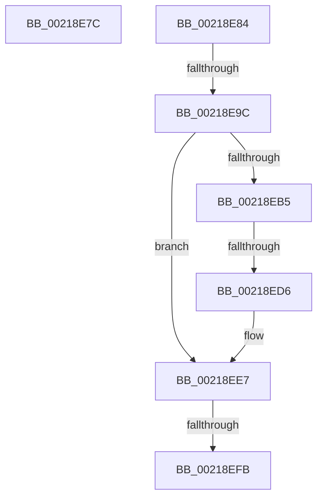

# sub_00218E7C

- RVA: `0x00218E7C`–`0x00218F11` (길이 `149` bytes)
- VA: `0x0000000140218E7C`
- 실행 섹션: `.text`
- PDB 이름 있음: `아니요`; PDB Function 태그: `아니요`
- unwind 정보 RVA: `0x0005EB88`
- 디코드: `32`개 명령, `149/149` bytes 표시
- 미해석 바이트: `0` (있으면 어셈블리에 `.byte`로 보존)

> 이 문서는 커널 이미지의 기계어와 PDB 기호를 분석해 생성했습니다. 4번과 5번은 함수 원형과 자료형을 바이너리 사용 방식에서 추정한 C 해석이며 원본 소스 복구 결과는 아닙니다.

## 1. Dependencies

- 직접 호출 지점: **4**; 고유 호출 대상: **4**
- 직접 호출자로 확인된 함수: **0**
- RIP 상대 이미지 참조: **5**

### Outgoing calls
- `0x00218E8B` → [KiReadGuestSchedulerAssistPriority](../30/KiReadGuestSchedulerAssistPriority_function_00304BE4.md) (function, `0x00304BE4`)
- `0x00218EA3` → [KeAcquireSpinLockAtDpcLevel](../20/KeAcquireSpinLockAtDpcLevel_function_00208430.md) (function, `0x00208430`)
- `0x00218EEE` → [KxReleaseSpinLock](../20/KxReleaseSpinLock_function_00206670.md) (function, `0x00206670`)
- `0x00218F07` → [KeInsertQueueDpc](../20/KeInsertQueueDpc_function_00207C50.md) (function, `0x00207C50`)

### Direct callers
- 이 함수 시작 RVA로 연결되는 직접 call은 확인되지 않았습니다. 간접 호출은 완전히 역산할 수 없습니다.

### Static image references
- `0x00218E9C` → RVA `0x00F22E58` (`.data`; read)
- `0x00218EB5` → RVA `0x00F22C08` (`.data`; read)
- `0x00218EBC` → RVA `0x00F22C00` (`.data`; read)
- `0x00218EE0` → RVA `0x00F22C08` (`.data`; write)
- `0x00218EFE` → RVA `0x00F22BC0` (`.data`; read)

## 2. Other-region calls and transfers

- 다른 실행 섹션으로 향하는 call: **0**
- call이 아닌 외부 분기/꼬리 이동: **5**
  - `0x00218E7F` → [sub_00218B2B + 0x50](Unknown_function_00218B2B.md) (`tail-transfer`)
  - `0x00218E96` → [sub_00218B2B + 0x15](Unknown_function_00218B2B.md) (`tail-transfer`)
  - `0x00218ED0` → [sub_00218B2B + 0xC5](Unknown_function_00218B2B.md) (`tail-transfer`)
  - `0x00218EF5` → [sub_00218B2B + 0x15](Unknown_function_00218B2B.md) (`tail-transfer`)
  - `0x00218F0C` → [sub_00218B2B + 0x15](Unknown_function_00218B2B.md) (`tail-transfer`)

## 3. Assembly (complete function range)

```asm
00218E7C  48 8B D6                        mov rdx, rsi
00218E7F  E9 F7 FC FF FF                  jmp 0x140218b7b
00218E84  33 D2                           xor edx, edx
00218E86  48 8B CF                        mov rcx, rdi
00218E89  32 DB                           xor bl, bl
00218E8B  E8 54 BD 0E 00                  call 0x140304be4
00218E90  3B 87 00 04 00 00               cmp eax, dword ptr [rdi + 0x400]
00218E96  0F 84 A4 FC FF FF               je 0x140218b40
00218E9C  48 8D 0D B5 9F D0 00            lea rcx, [rip + 0xd09fb5]
00218EA3  E8 88 F5 FE FF                  call 0x140208430
00218EA8  48 8D 87 F0 03 00 00            lea rax, [rdi + 0x3f0]
00218EAF  48 83 38 01                     cmp qword ptr [rax], 1
00218EB3  75 32                           jne 0x140218ee7
00218EB5  48 8B 15 4C 9D D0 00            mov rdx, qword ptr [rip + 0xd09d4c]
00218EBC  48 8D 0D 3D 9D D0 00            lea rcx, [rip + 0xd09d3d]
00218EC3  48 39 0D 36 9D D0 00            cmp qword ptr [rip + 0xd09d36], rcx
00218ECA  0F 94 C3                        sete bl
00218ECD  48 39 0A                        cmp qword ptr [rdx], rcx
00218ED0  0F 85 1A FD FF FF               jne 0x140218bf0
00218ED6  48 89 08                        mov qword ptr [rax], rcx
00218ED9  48 89 50 08                     mov qword ptr [rax + 8], rdx
00218EDD  48 89 02                        mov qword ptr [rdx], rax
00218EE0  48 89 05 21 9D D0 00            mov qword ptr [rip + 0xd09d21], rax
00218EE7  48 8D 0D 6A 9F D0 00            lea rcx, [rip + 0xd09f6a]
00218EEE  E8 7D D7 FE FF                  call 0x140206670
00218EF3  84 DB                           test bl, bl
00218EF5  0F 84 45 FC FF FF               je 0x140218b40
00218EFB  45 33 C0                        xor r8d, r8d
00218EFE  48 8D 0D BB 9C D0 00            lea rcx, [rip + 0xd09cbb]
00218F05  33 D2                           xor edx, edx
00218F07  E8 44 ED FE FF                  call 0x140207c50
00218F0C  E9 2F FC FF FF                  jmp 0x140218b40
```

## 4. C-style interpretation (structured pseudocode)

```c
__int64 __fastcall sub_00218E7C(__int64 a1, __int64 a2, int a3)
{
}
```

## 5. (Beta) C Style

```c
int64_t sub_00218E7C(int64_t Arg1, int64_t Arg2, int32_t Arg3)
{
}
```

## 6. Execution-region graph

[열기: 2D/3D 그래프와 함수 탐색 컨트롤 패널](../../../control-panel.html?section=text&rva=0x00218E7C&view=graph)

- 2D 그래프는 위에서 아래로 흐르고, 3D 그래프는 빈 공간을 드래그해 회전합니다. Shift+드래그는 이동, 휠은 확대·축소, 함수 노드 선택은 대상 보고서 이동입니다.

### Static fallback


