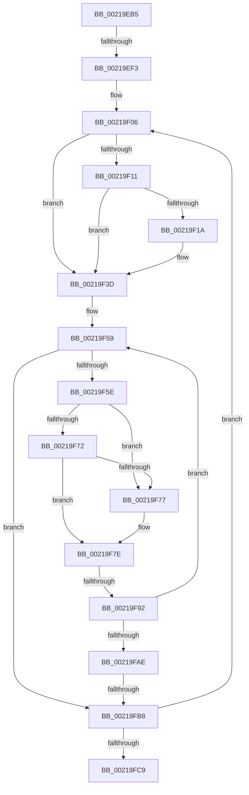

# sub_00219EB5

- RVA: `0x00219EB5`–`0x0021A01D` (길이 `360` bytes)
- VA: `0x0000000140219EB5`
- 실행 섹션: `.text`
- PDB 이름 있음: `아니요`; PDB Function 태그: `아니요`
- unwind 정보 RVA: `0x0005EC44`
- 디코드: `87`개 명령, `360/360` bytes 표시
- 미해석 바이트: `0` (있으면 어셈블리에 `.byte`로 보존)

> 이 문서는 커널 이미지의 기계어와 PDB 기호를 분석해 생성했습니다. 4번과 5번은 함수 원형과 자료형을 바이너리 사용 방식에서 추정한 C 해석이며 원본 소스 복구 결과는 아닙니다.

## 1. Dependencies

- 직접 호출 지점: **5**; 고유 호출 대상: **5**
- 직접 호출자로 확인된 함수: **0**
- RIP 상대 이미지 참조: **1**

### Outgoing calls
- `0x00219F38` → [KiAbConvertWaiterToOwnerEntry](KiAbConvertWaiterToOwnerEntry_function_00219430.md) (function, `0x00219430`)
- `0x00219F41` → [KiAcquireKobjectLockSafe](../25/KiAcquireKobjectLockSafe_function_00251C90.md) (function, `0x00251C90`)
- `0x00219FA0` → [KiTryUnwaitThread](../35/KiTryUnwaitThread_function_003506D0.md) (function, `0x003506D0`)
- `0x00219FD0` → [KiRemoveBoostThread](KiRemoveBoostThread_function_00219128.md) (function, `0x00219128`)
- `0x00219FEF` → [KiExitDispatcher](../25/KiExitDispatcher_function_00251CF0.md) (function, `0x00251CF0`)

### Direct callers
- 이 함수 시작 RVA로 연결되는 직접 call은 확인되지 않았습니다. 간접 호출은 완전히 역산할 수 없습니다.

### Static image references
- `0x00219EE6` → RVA `0x00FC6D20` (`ALMOSTRO`; read)

## 2. Other-region calls and transfers

- 다른 실행 섹션으로 향하는 call: **0**
- call이 아닌 외부 분기/꼬리 이동: **4**
  - `0x00219EED` → [sub_0021A01D](Unknown_function_0021A01D.md) (`tail-transfer`)
  - `0x00219F8C` → [sub_0021A01D + 0x10](Unknown_function_0021A01D.md) (`tail-transfer`)
  - `0x00219FB2` → [sub_0021A01D + 0x81](Unknown_function_0021A01D.md) (`tail-transfer`)
  - `0x0021A018` → [ExpCommitWakeFastResource + 0x2C](ExpCommitWakeFastResource_function_00219E80.md) (`tail-transfer`)

## 3. Assembly (complete function range)

```asm
00219EB5  48 89 6C 24 78                  mov qword ptr [rsp + 0x78], rbp
00219EBA  4C 89 A4 24 80 00 00 00         mov qword ptr [rsp + 0x80], r12
00219EC2  4C 89 AC 24 88 00 00 00         mov qword ptr [rsp + 0x88], r13
00219ECA  4C 89 74 24 48                  mov qword ptr [rsp + 0x48], r14
00219ECF  4C 89 7C 24 40                  mov qword ptr [rsp + 0x40], r15
00219ED4  44 0F 20 C0                     mov rax, cr8
00219ED8  48 89 44 24 30                  mov qword ptr [rsp + 0x30], rax
00219EDD  B9 02 00 00 00                  mov ecx, 2
00219EE2  44 0F 22 C1                     mov cr8, rcx
00219EE6  83 3D 33 CE DA 00 00            cmp dword ptr [rip + 0xdace33], 0
00219EED  0F 85 2A 01 00 00               jne 0x14021a01d
00219EF3  65 4C 8B 2C 25 20 00 00 00      mov r13, qword ptr gs:[0x20]
00219EFC  44 8B FB                        mov r15d, ebx
00219EFF  41 83 E7 04                     and r15d, 4
00219F03  4C 8B F7                        mov r14, rdi
00219F06  49 8D 2E                        lea rbp, [r14]
00219F09  4D 8B 36                        mov r14, qword ptr [r14]
00219F0C  45 85 FF                        test r15d, r15d
00219F0F  74 2C                           je 0x140219f3d
00219F11  48 8B 55 30                     mov rdx, qword ptr [rbp + 0x30]
00219F15  48 85 D2                        test rdx, rdx
00219F18  74 23                           je 0x140219f3d
00219F1A  48 8B 02                        mov rax, qword ptr [rdx]
00219F1D  48 8B CA                        mov rcx, rdx
00219F20  0F B6 42 08                     movzx eax, byte ptr [rdx + 8]
00219F24  83 E0 3F                        and eax, 0x3f
00219F27  4C 6B C0 58                     imul r8, rax, 0x58
00219F2B  49 2B C8                        sub rcx, r8
00219F2E  41 B8 01 00 00 00               mov r8d, 1
00219F34  48 8B 49 F0                     mov rcx, qword ptr [rcx - 0x10]
00219F38  E8 F3 F4 FF FF                  call 0x140219430
00219F3D  48 8D 4D 18                     lea rcx, [rbp + 0x18]
00219F41  E8 4A 7D 03 00                  call 0x140251c90
00219F46  48 8D 45 20                     lea rax, [rbp + 0x20]
00219F4A  C7 45 1C 01 00 00 00            mov dword ptr [rbp + 0x1c], 1
00219F51  4C 8B 20                        mov r12, qword ptr [rax]
00219F54  48 89 44 24 70                  mov qword ptr [rsp + 0x70], rax
00219F59  4C 3B E0                        cmp r12, rax
00219F5C  74 5A                           je 0x140219fb8
00219F5E  49 8B 14 24                     mov rdx, qword ptr [r12]
00219F62  49 8B C4                        mov rax, r12
00219F65  4C 8B E2                        mov r12, rdx
00219F68  48 8B 48 08                     mov rcx, qword ptr [rax + 8]
00219F6C  48 39 42 08                     cmp qword ptr [rdx + 8], rax
00219F70  75 05                           jne 0x140219f77
00219F72  48 39 01                        cmp qword ptr [rcx], rax
00219F75  74 07                           je 0x140219f7e
00219F77  B9 03 00 00 00                  mov ecx, 3
00219F7C  CD 29                           int 0x29
00219F7E  48 89 11                        mov qword ptr [rcx], rdx
00219F81  48 89 4A 08                     mov qword ptr [rdx + 8], rcx
00219F85  0F B6 48 10                     movzx ecx, byte ptr [rax + 0x10]
00219F89  80 F9 01                        cmp cl, 1
00219F8C  0F 85 9B 00 00 00               jne 0x14021a02d
00219F92  44 0F B7 40 12                  movzx r8d, word ptr [rax + 0x12]
00219F97  45 33 C9                        xor r9d, r9d
00219F9A  48 8B D0                        mov rdx, rax
00219F9D  49 8B CD                        mov rcx, r13
00219FA0  E8 2B 67 13 00                  call 0x1403506d0
00219FA5  84 C0                           test al, al
00219FA7  48 8B 44 24 70                  mov rax, qword ptr [rsp + 0x70]
00219FAC  74 AB                           je 0x140219f59
00219FAE  83 6D 1C 01                     sub dword ptr [rbp + 0x1c], 1
00219FB2  0F 85 E6 00 00 00               jne 0x14021a09e
00219FB8  F0 81 65 18 7F FF FF FF         lock and dword ptr [rbp + 0x18], 0xffffff7f
00219FC0  4C 3B F7                        cmp r14, rdi
00219FC3  0F 85 3D FF FF FF               jne 0x140219f06
00219FC9  49 8B 55 08                     mov rdx, qword ptr [r13 + 8]
00219FCD  49 8B CD                        mov rcx, r13
00219FD0  E8 53 F1 FF FF                  call 0x140219128
00219FD5  48 8B 44 24 30                  mov rax, qword ptr [rsp + 0x30]
00219FDA  33 D2                           xor edx, edx
00219FDC  D1 EB                           shr ebx, 1
00219FDE  49 8B CD                        mov rcx, r13
00219FE1  83 E3 01                        and ebx, 1
00219FE4  88 44 24 20                     mov byte ptr [rsp + 0x20], al
00219FE8  44 8B CB                        mov r9d, ebx
00219FEB  44 8D 42 01                     lea r8d, [rdx + 1]
00219FEF  E8 FC 7C 03 00                  call 0x140251cf0
00219FF4  4C 8B 74 24 48                  mov r14, qword ptr [rsp + 0x48]
00219FF9  33 C0                           xor eax, eax
00219FFB  4C 8B AC 24 88 00 00 00         mov r13, qword ptr [rsp + 0x88]
0021A003  4C 8B A4 24 80 00 00 00         mov r12, qword ptr [rsp + 0x80]
0021A00B  48 8B 6C 24 78                  mov rbp, qword ptr [rsp + 0x78]
0021A010  4C 8B 7C 24 40                  mov r15, qword ptr [rsp + 0x40]
0021A015  48 89 06                        mov qword ptr [rsi], rax
0021A018  E9 8F FE FF FF                  jmp 0x140219eac
```

## 4. C-style interpretation (structured pseudocode)

```c
__int64 __fastcall sub_00219EB5(__int64 a1, __int64 a2, __int64 a3, int a4, __int64 a5, __int64 a6, __int64 a7, __int64 a8, __int64 a9, __int64 a10, __int64 a11, __int64 a12, __int64 a13, __int64 a14, __int64 a15, __int64 a16, __int64 a17)
{
    __int64 result;
    __int64 v_r15;
    __int64 v_rbx;
    unsigned __int8 v_stack_p20;
    unsigned __int64 v_stack_p30;
    unsigned __int64 v_stack_p40;
    unsigned __int64 v_stack_p48;
    unsigned __int64 v_stack_p70;
    unsigned __int64 v_stack_p78;
    unsigned __int64 v_stack_p80;
    unsigned __int64 v_stack_p88;

    v_stack_p78 = v_rbp;
    v_stack_p80 = v_r12;
    v_stack_p88 = v_r13;
    v_stack_p48 = v_r14;
    v_stack_p40 = v_r15;
    v_stack_p30 = v_cr8;
    v_r15 = (unsigned int)(((unsigned int)((unsigned int)(v_rbx))) & (4));
loc_00219F06:
    if ((unsigned int)(v_r15) == 0) goto loc_00219F3D;
    result = v_cr8;
    if (*(unsigned __int64 *)(v_rdi + 48) != 0) {
        result = *(unsigned __int64 *)(*(unsigned __int64 *)(v_rdi + 48));
        a1 = *(unsigned __int64 *)(v_rdi + 48);
        result = *(unsigned __int8 *)(*(unsigned __int64 *)(v_rdi + 48) + 8);
        result = (unsigned int)((result) & (63));
        a3 = (a3) * (result);
        a1 = (a1) - (a3);
        a3 = 1;
        a1 = *(unsigned __int64 *)(a1 - 16);
        result = KiAbConvertWaiterToOwnerEntry(a1, *(unsigned __int64 *)(v_rdi + 48), a3, a4);
    }
    result = KiAcquireKobjectLockSafe(v_rdi + 24, *(unsigned __int64 *)(v_rdi + 48), a3, a4);
    *(unsigned int *)(v_rdi + 28) = 1;
    v_stack_p70 = v_rdi + 32;
loc_00219F59:
    if ((*(unsigned __int64 *)(v_rdi + 32)) == (v_rdi + 32)) goto loc_00219FB8;
    if ((*(unsigned __int64 *)(*(unsigned __int64 *)(*(unsigned __int64 *)(v_rdi + 32)) + 8)) != (*(unsigned __int64 *)(v_rdi + 32))) goto loc_00219F77;
    if ((*(unsigned __int64 *)(*(unsigned __int64 *)(*(unsigned __int64 *)(v_rdi + 32) + 8))) != (*(unsigned __int64 *)(v_rdi + 32))) {
        a1 = 3;
    }
    *(unsigned __int64 *)(a1) = *(unsigned __int64 *)(*(unsigned __int64 *)(v_rdi + 32));
    *(unsigned __int64 *)(*(unsigned __int64 *)(*(unsigned __int64 *)(v_rdi + 32)) + 8) = a1;
    a4 = 0;
    result = KiTryUnwaitThread(*(unsigned __int64 *)(gs_base + (0 + 32)), *(unsigned __int64 *)(v_rdi + 32), *(unsigned __int16 *)(*(unsigned __int64 *)(v_rdi + 32) + 18), a4);
    if ((unsigned __int8)(result) == 0) goto loc_00219F59;
loc_00219FB8:
    if ((*(unsigned __int64 *)(v_rdi)) != v_rdi) goto loc_00219F06;
    result = KiRemoveBoostThread(*(unsigned __int64 *)(gs_base + (0 + 32)), *(unsigned __int64 *)(*(unsigned __int64 *)(gs_base + (0 + 32)) + 8), *(unsigned __int16 *)(*(unsigned __int64 *)(v_rdi + 32) + 18), a4);
    a2 = 0;
    v_rbx = (unsigned int)((v_rbx) >> (1));
    v_rbx = (unsigned int)((v_rbx) & (1));
    v_stack_p20 = (unsigned __int8)(a6);
    result = KiExitDispatcher(*(unsigned __int64 *)(gs_base + (0 + 32)), a2, a2 + 1, (unsigned int)((unsigned int)(v_rbx)));
    result = 0;
    *(unsigned __int64 *)(v_rsi) = 0;
}
```

## 5. (Beta) C Style

```c
int64_t sub_00219EB5(int64_t Arg1, int64_t Arg2, int64_t Arg3, int32_t Arg4, uint64_t Arg5, int64_t Arg6, uint64_t Arg7, int64_t Arg8, int64_t Arg9, uint64_t Arg10, uint64_t Arg11, uint64_t Arg12, uint64_t Arg13, int64_t Arg14, int64_t Arg15, int64_t Arg16, int64_t Arg17)
{
    int64_t result;
    int64_t local_r15;
    int64_t local_rbx;
    uint8_t v_stack_p20;
    uint64_t v_stack_p30;
    uint64_t v_stack_p40;
    uint64_t v_stack_p48;
    uint64_t v_stack_p70;
    uint64_t v_stack_p78;
    uint64_t v_stack_p80;
    uint64_t v_stack_p88;

    v_stack_p78 = local_rbp;
    v_stack_p80 = local_r12;
    v_stack_p88 = local_r13;
    v_stack_p48 = local_r14;
    v_stack_p40 = local_r15;
    v_stack_p30 = v_cr8;
    local_r15 = (uint32_t)(((uint32_t)((uint32_t)(local_rbx))) & (4));
loc_00219F06:
    if ((uint32_t)(local_r15) == 0) goto loc_00219F3D;
    result = v_cr8;
    if (*(uint64_t *)(local_rdi + 0x30) != 0) {
        result = *(uint64_t *)(*(uint64_t *)(local_rdi + 0x30));
        Arg1 = *(uint64_t *)(local_rdi + 0x30);
        result = *(uint8_t *)(*(uint64_t *)(local_rdi + 0x30) + 0x8);
        result = (uint32_t)((result) & (63));
        Arg3 = (Arg3) * (result);
        Arg1 = (Arg1) - (Arg3);
        Arg3 = 1;
        Arg1 = *(uint64_t *)(Arg1 - 0x10);
        result = KiAbConvertWaiterToOwnerEntry(Arg1, *(uint64_t *)(local_rdi + 0x30), Arg3, Arg4);
    }
    result = KiAcquireKobjectLockSafe(local_rdi + 24, *(uint64_t *)(local_rdi + 0x30), Arg3, Arg4);
    *(uint32_t *)(local_rdi + 0x1C) = 1;
    v_stack_p70 = local_rdi + 32;
loc_00219F59:
    if ((*(uint64_t *)(local_rdi + 0x20)) == (local_rdi + 32)) goto loc_00219FB8;
    if ((*(uint64_t *)(*(uint64_t *)(*(uint64_t *)(local_rdi + 0x20)) + 0x8)) != (*(uint64_t *)(local_rdi + 0x20))) goto loc_00219F77;
    if ((*(uint64_t *)(*(uint64_t *)(*(uint64_t *)(local_rdi + 0x20) + 0x8))) != (*(uint64_t *)(local_rdi + 0x20))) {
        Arg1 = 3;
    }
    *(uint64_t *)(Arg1) = *(uint64_t *)(*(uint64_t *)(local_rdi + 0x20));
    *(uint64_t *)(*(uint64_t *)(*(uint64_t *)(local_rdi + 0x20)) + 0x8) = Arg1;
    Arg4 = 0;
    result = KiTryUnwaitThread(*(uint64_t *)(gs_base + (0 + 0x20)), *(uint64_t *)(local_rdi + 0x20), *(uint16_t *)(*(uint64_t *)(local_rdi + 0x20) + 0x12), Arg4);
    if ((uint8_t)(result) == 0) goto loc_00219F59;
loc_00219FB8:
    if ((*(uint64_t *)(local_rdi)) != local_rdi) goto loc_00219F06;
    result = KiRemoveBoostThread(*(uint64_t *)(gs_base + (0 + 0x20)), *(uint64_t *)(*(uint64_t *)(gs_base + (0 + 0x20)) + 0x8), *(uint16_t *)(*(uint64_t *)(local_rdi + 0x20) + 0x12), Arg4);
    Arg2 = 0;
    local_rbx = (uint32_t)((local_rbx) >> (1));
    local_rbx = (uint32_t)((local_rbx) & (1));
    v_stack_p20 = (uint8_t)(Arg6);
    result = KiExitDispatcher(*(uint64_t *)(gs_base + (0 + 0x20)), Arg2, Arg2 + 1, (uint32_t)((uint32_t)(local_rbx)));
    result = 0;
    *(uint64_t *)(local_rsi) = 0;
}
```

## 6. Execution-region graph

[열기: 2D/3D 그래프와 함수 탐색 컨트롤 패널](../../../control-panel.html?section=text&rva=0x00219EB5&view=graph)

- 2D 그래프는 위에서 아래로 흐르고, 3D 그래프는 빈 공간을 드래그해 회전합니다. Shift+드래그는 이동, 휠은 확대·축소, 함수 노드 선택은 대상 보고서 이동입니다.

### Static fallback


