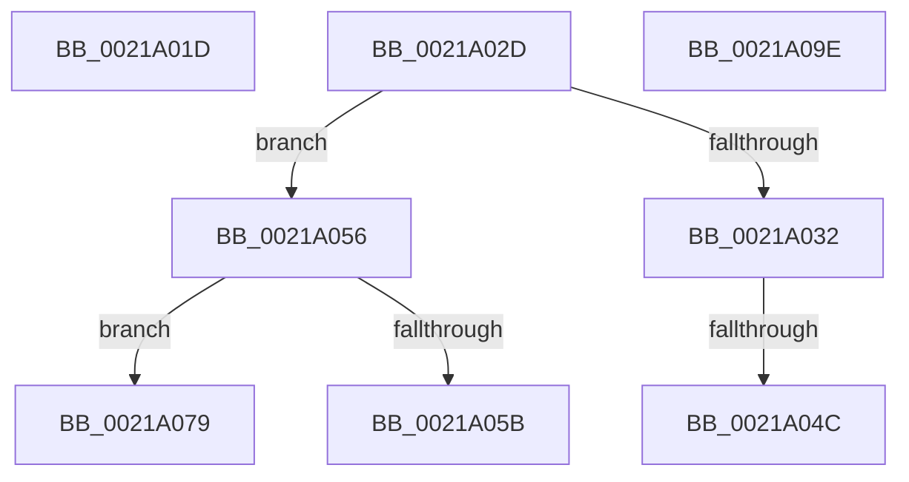

# sub_0021A01D

- RVA: `0x0021A01D`–`0x0021A0A3` (길이 `134` bytes)
- VA: `0x000000014021A01D`
- 실행 섹션: `.text`
- PDB 이름 있음: `아니요`; PDB Function 태그: `아니요`
- unwind 정보 RVA: `0x0005EC68`
- 디코드: `32`개 명령, `134/134` bytes 표시
- 미해석 바이트: `0` (있으면 어셈블리에 `.byte`로 보존)

> 이 문서는 커널 이미지의 기계어와 PDB 기호를 분석해 생성했습니다. 4번과 5번은 함수 원형과 자료형을 바이너리 사용 방식에서 추정한 C 해석이며 원본 소스 복구 결과는 아닙니다.

## 1. Dependencies

- 직접 호출 지점: **4**; 고유 호출 대상: **4**
- 직접 호출자로 확인된 함수: **0**
- RIP 상대 이미지 참조: **0**

### Outgoing calls
- `0x0021A023` → [KiRaiseIrqlProcessIrqlFlags](../4F/KiRaiseIrqlProcessIrqlFlags_function_004F56FC.md) (function, `0x004F56FC`)
- `0x0021A03D` → [KiInsertQueueInternal](KiInsertQueueInternal_function_00219B30.md) (function, `0x00219B30`)
- `0x0021A06A` → [KiTryUnwaitThread](../35/KiTryUnwaitThread_function_003506D0.md) (function, `0x003506D0`)
- `0x0021A08F` → [KeInsertQueueDpc](../20/KeInsertQueueDpc_function_00207C50.md) (function, `0x00207C50`)

### Direct callers
- 이 함수 시작 RVA로 연결되는 직접 call은 확인되지 않았습니다. 간접 호출은 완전히 역산할 수 없습니다.

### Static image references
- 디코드된 RIP-relative 메모리 참조가 없습니다.

## 2. Other-region calls and transfers

- 다른 실행 섹션으로 향하는 call: **0**
- call이 아닌 외부 분기/꼬리 이동: **6**
  - `0x0021A028` → [sub_00219EB5 + 0x3E](Unknown_function_00219EB5.md) (`tail-transfer`)
  - `0x0021A046` → [sub_00219EB5 + 0x103](Unknown_function_00219EB5.md) (`tail-transfer`)
  - `0x0021A051` → [sub_00219EB5 + 0xA4](Unknown_function_00219EB5.md) (`tail-transfer`)
  - `0x0021A074` → [sub_00219EB5 + 0xA4](Unknown_function_00219EB5.md) (`tail-transfer`)
  - `0x0021A099` → [sub_00219EB5 + 0xA4](Unknown_function_00219EB5.md) (`tail-transfer`)
  - `0x0021A09E` → [sub_00219EB5 + 0xA4](Unknown_function_00219EB5.md) (`tail-transfer`)

## 3. Assembly (complete function range)

```asm
0021A01D  0F B6 D1                        movzx edx, cl
0021A020  0F B6 C8                        movzx ecx, al
0021A023  E8 D4 B6 2D 00                  call 0x1404f56fc
0021A028  E9 C6 FE FF FF                  jmp 0x140219ef3
0021A02D  80 F9 02                        cmp cl, 2
0021A030  75 24                           jne 0x14021a056
0021A032  C6 40 11 05                     mov byte ptr [rax + 0x11], 5
0021A036  48 8B D0                        mov rdx, rax
0021A039  48 8B 48 18                     mov rcx, qword ptr [rax + 0x18]
0021A03D  E8 EE FA FF FF                  call 0x140219b30
0021A042  83 6D 1C 01                     sub dword ptr [rbp + 0x1c], 1
0021A046  0F 84 6C FF FF FF               je 0x140219fb8
0021A04C  48 8B 44 24 70                  mov rax, qword ptr [rsp + 0x70]
0021A051  E9 03 FF FF FF                  jmp 0x140219f59
0021A056  80 F9 04                        cmp cl, 4
0021A059  74 1E                           je 0x14021a079
0021A05B  45 33 C9                        xor r9d, r9d
0021A05E  41 B8 00 01 00 00               mov r8d, 0x100
0021A064  48 8B D0                        mov rdx, rax
0021A067  49 8B CD                        mov rcx, r13
0021A06A  E8 61 66 13 00                  call 0x1403506d0
0021A06F  48 8B 44 24 70                  mov rax, qword ptr [rsp + 0x70]
0021A074  E9 E0 FE FF FF                  jmp 0x140219f59
0021A079  C6 40 11 05                     mov byte ptr [rax + 0x11], 5
0021A07D  48 8D 55 18                     lea rdx, [rbp + 0x18]
0021A081  C7 45 1C 00 00 00 00            mov dword ptr [rbp + 0x1c], 0
0021A088  4C 8B C0                        mov r8, rax
0021A08B  48 8B 48 18                     mov rcx, qword ptr [rax + 0x18]
0021A08F  E8 BC DB FE FF                  call 0x140207c50
0021A094  48 8B 44 24 70                  mov rax, qword ptr [rsp + 0x70]
0021A099  E9 BB FE FF FF                  jmp 0x140219f59
0021A09E  E9 B6 FE FF FF                  jmp 0x140219f59
```

## 4. C-style interpretation (structured pseudocode)

```c
__int64 __fastcall sub_0021A01D(unsigned __int8 a1, __int64 a2, __int64 a3, int a4)
{
    __int64 result;
    unsigned __int64 v_stack_p70;

    result = KiRaiseIrqlProcessIrqlFlags((unsigned __int8)(result), a1, a3, a4);
}
```

## 5. (Beta) C Style

```c
int64_t sub_0021A01D(uint8_t Arg1, int64_t Arg2, int64_t Arg3, int32_t Arg4)
{
    int64_t result;
    uint64_t v_stack_p70;

    result = KiRaiseIrqlProcessIrqlFlags((uint8_t)(result), Arg1, Arg3, Arg4);
}
```

## 6. Execution-region graph

[열기: 2D/3D 그래프와 함수 탐색 컨트롤 패널](../../../control-panel.html?section=text&rva=0x0021A01D&view=graph)

- 2D 그래프는 위에서 아래로 흐르고, 3D 그래프는 빈 공간을 드래그해 회전합니다. Shift+드래그는 이동, 휠은 확대·축소, 함수 노드 선택은 대상 보고서 이동입니다.

### Static fallback


