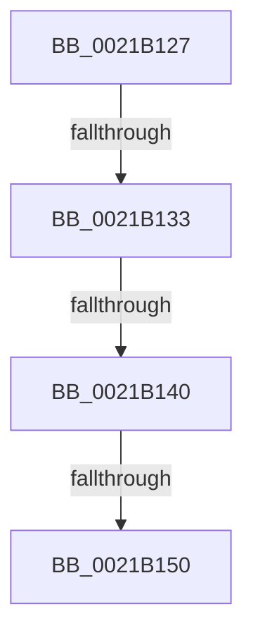

# sub_0021B127

- RVA: `0x0021B127`–`0x0021B15A` (길이 `51` bytes)
- VA: `0x000000014021B127`
- 실행 섹션: `.text`
- PDB 이름 있음: `아니요`; PDB Function 태그: `아니요`
- unwind 정보 RVA: `0x0005ECC0`
- 디코드: `10`개 명령, `51/51` bytes 표시
- 미해석 바이트: `0` (있으면 어셈블리에 `.byte`로 보존)

> 이 문서는 커널 이미지의 기계어와 PDB 기호를 분석해 생성했습니다. 4번과 5번은 함수 원형과 자료형을 바이너리 사용 방식에서 추정한 C 해석이며 원본 소스 복구 결과는 아닙니다.

## 1. Dependencies

- 직접 호출 지점: **0**; 고유 호출 대상: **0**
- 직접 호출자로 확인된 함수: **0**
- RIP 상대 이미지 참조: **0**

### Outgoing calls
- 직접 디코드된 call 명령이 없습니다.

### Direct callers
- 이 함수 시작 RVA로 연결되는 직접 call은 확인되지 않았습니다. 간접 호출은 완전히 역산할 수 없습니다.

### Static image references
- 디코드된 RIP-relative 메모리 참조가 없습니다.

## 2. Other-region calls and transfers

- 다른 실행 섹션으로 향하는 call: **0**
- call이 아닌 외부 분기/꼬리 이동: **3**
  - `0x0021B131` → [sub_0021B161 + 0x35](Unknown_function_0021B161.md) (`tail-transfer`)
  - `0x0021B13A` → [sub_0021B161 + 0x118](Unknown_function_0021B161.md) (`tail-transfer`)
  - `0x0021B14E` → [sub_0021B161](Unknown_function_0021B161.md) (`tail-transfer`)

## 3. Assembly (complete function range)

```asm
0021B127  48 89 74 24 30                  mov qword ptr [rsp + 0x30], rsi
0021B12C  48 89 7C 24 38                  mov qword ptr [rsp + 0x38], rdi
0021B131  75 63                           jne 0x14021b196
0021B133  80 BB E5 38 00 00 00            cmp byte ptr [rbx + 0x38e5], 0
0021B13A  0F 85 39 01 00 00               jne 0x14021b279
0021B140  48 8B 93 E8 38 00 00            mov rdx, qword ptr [rbx + 0x38e8]
0021B147  48 3B 93 F0 38 00 00            cmp rdx, qword ptr [rbx + 0x38f0]
0021B14E  75 11                           jne 0x14021b161
0021B150  48 8B 74 24 30                  mov rsi, qword ptr [rsp + 0x30]
0021B155  48 8B 7C 24 38                  mov rdi, qword ptr [rsp + 0x38]
```

## 4. C-style interpretation (structured pseudocode)

```c
void __fastcall sub_0021B127(__int64 a1, __int64 a2, __int64 a3, __int64 a4, __int64 a5, __int64 a6, __int64 a7)
{
    unsigned __int64 v_stack_p30;
    unsigned __int64 v_stack_p38;

    v_stack_p30 = v_rsi;
    v_stack_p38 = v_rdi;
    return;
}
```

## 5. (Beta) C Style

```c
void sub_0021B127(int64_t Arg1, int64_t Arg2, int64_t Arg3, int64_t Arg4, uint64_t Arg5, int64_t Arg6, int64_t Arg7)
{
    uint64_t v_stack_p30;
    uint64_t v_stack_p38;

    v_stack_p30 = local_rsi;
    v_stack_p38 = local_rdi;
    return;
}
```

## 6. Execution-region graph

[열기: 2D/3D 그래프와 함수 탐색 컨트롤 패널](../../../control-panel.html?section=text&rva=0x0021B127&view=graph)

- 2D 그래프는 위에서 아래로 흐르고, 3D 그래프는 빈 공간을 드래그해 회전합니다. Shift+드래그는 이동, 휠은 확대·축소, 함수 노드 선택은 대상 보고서 이동입니다.

### Static fallback


