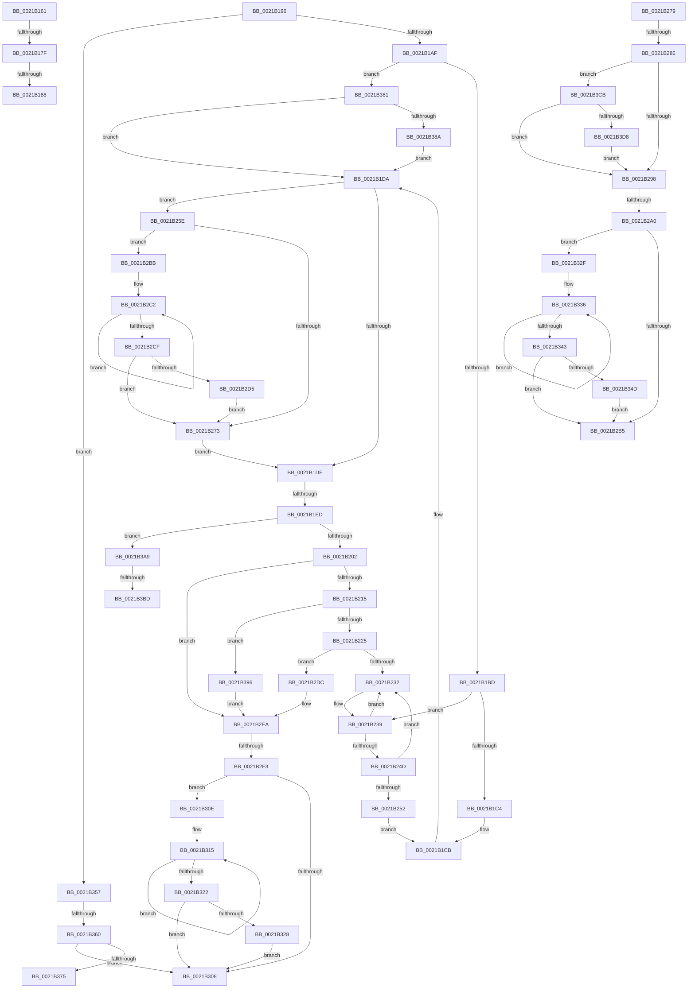

# sub_0021B161

- RVA: `0x0021B161`–`0x0021B3F7` (길이 `662` bytes)
- VA: `0x000000014021B161`
- 실행 섹션: `.text`
- PDB 이름 있음: `아니요`; PDB Function 태그: `아니요`
- unwind 정보 RVA: `0x0005ECEC`
- 디코드: `155`개 명령, `662/662` bytes 표시
- 미해석 바이트: `0` (있으면 어셈블리에 `.byte`로 보존)

> 이 문서는 커널 이미지의 기계어와 PDB 기호를 분석해 생성했습니다. 4번과 5번은 함수 원형과 자료형을 바이너리 사용 방식에서 추정한 C 해석이며 원본 소스 복구 결과는 아닙니다.

## 1. Dependencies

- 직접 호출 지점: **10**; 고유 호출 대상: **6**
- 직접 호출자로 확인된 함수: **0**
- RIP 상대 이미지 참조: **2**

### Outgoing calls
- `0x0021B17F` → [KiRcuReportQuiescentState](../20/KiRcuReportQuiescentState_function_0020AB8C.md) (function, `0x0020AB8C`)
- `0x0021B18F` → [KiRcuFlushCompleted](../20/KiRcuFlushCompleted_function_0020AD38.md) (function, `0x0020AD38`)
- `0x0021B196` → [KeDisableInterrupts](KeDisableInterrupts_function_00217BE0.md) (function, `0x00217BE0`)
- `0x0021B202` → [KeDisableInterrupts](KeDisableInterrupts_function_00217BE0.md) (function, `0x00217BE0`)
- `0x0021B286` → [KeDisableInterrupts](KeDisableInterrupts_function_00217BE0.md) (function, `0x00217BE0`)
- `0x0021B2D5` → [KiRemoveSystemWorkPriorityKick](../26/KiRemoveSystemWorkPriorityKick_function_002631D0.md) (function, `0x002631D0`)
- `0x0021B328` → [KiRemoveSystemWorkPriorityKick](../26/KiRemoveSystemWorkPriorityKick_function_002631D0.md) (function, `0x002631D0`)
- `0x0021B34D` → [KiRemoveSystemWorkPriorityKick](../26/KiRemoveSystemWorkPriorityKick_function_002631D0.md) (function, `0x002631D0`)
- `0x0021B3B0` → [KiSrcuReportQuiescent](../5C/KiSrcuReportQuiescent_function_005C2C08.md) (function, `0x005C2C08`)
- `0x0021B3C1` → [KiSrcuFlushCompleted](../5C/KiSrcuFlushCompleted_function_005C22B4.md) (function, `0x005C22B4`)

### Direct callers
- 이 함수 시작 RVA로 연결되는 직접 call은 확인되지 않았습니다. 간접 호출은 완전히 역산할 수 없습니다.

### Static image references
- `0x0021B164` → RVA `0x00F110C0` (`.data`; read)
- `0x0021B3E4` → RVA `0x00F210E8` (`.data`; read)

## 2. Other-region calls and transfers

- 다른 실행 섹션으로 향하는 call: **0**
- call이 아닌 외부 분기/꼬리 이동: **13**
  - `0x0021B17D` → [sub_0021B127 + 0x29](Unknown_function_0021B127.md) (`tail-transfer`)
  - `0x0021B186` → [sub_0021B127 + 0x29](Unknown_function_0021B127.md) (`tail-transfer`)
  - `0x0021B194` → [sub_0021B127 + 0x29](Unknown_function_0021B127.md) (`tail-transfer`)
  - `0x0021B1E7` → [sub_0021B127 + 0xC](Unknown_function_0021B127.md) (`tail-transfer`)
  - `0x0021B280` → [sub_0021B127 + 0x19](Unknown_function_0021B127.md) (`tail-transfer`)
  - `0x0021B29A` → [sub_0021B127 + 0x19](Unknown_function_0021B127.md) (`tail-transfer`)
  - `0x0021B2B6` → [sub_0021B127 + 0x19](Unknown_function_0021B127.md) (`tail-transfer`)
  - `0x0021B2ED` → [sub_0021B127 + 0xC](Unknown_function_0021B127.md) (`tail-transfer`)
  - `0x0021B309` → [sub_0021B127 + 0xC](Unknown_function_0021B127.md) (`tail-transfer`)
  - `0x0021B35A` → [sub_0021B127 + 0xC](Unknown_function_0021B127.md) (`tail-transfer`)
  - `0x0021B37C` → [sub_006D68DA](../6D/Unknown_function_006D68DA.md) (`tail-transfer`)
  - `0x0021B3B7` → [sub_0021B127 + 0xC](Unknown_function_0021B127.md) (`tail-transfer`)
  - `0x0021B3C6` → [sub_0021B127 + 0xC](Unknown_function_0021B127.md) (`tail-transfer`)

## 3. Assembly (complete function range)

```asm
0021B161  8B 4B 24                        mov ecx, dword ptr [rbx + 0x24]
0021B164  48 8D 05 55 5F CF 00            lea rax, [rip + 0xcf5f55]
0021B16B  48 C1 E1 05                     shl rcx, 5
0021B16F  48 03 C8                        add rcx, rax
0021B172  48 8B 41 08                     mov rax, qword ptr [rcx + 8]
0021B176  4C 8B 40 38                     mov r8, qword ptr [rax + 0x38]
0021B17A  4C 85 01                        test qword ptr [rcx], r8
0021B17D  75 D1                           jne 0x14021b150
0021B17F  E8 08 FA FE FF                  call 0x14020ab8c
0021B184  85 C0                           test eax, eax
0021B186  74 C8                           je 0x14021b150
0021B188  0F B6 8B E6 38 00 00            movzx ecx, byte ptr [rbx + 0x38e6]
0021B18F  E8 A4 FB FE FF                  call 0x14020ad38
0021B194  EB BA                           jmp 0x14021b150
0021B196  E8 45 CA FF FF                  call 0x140217be0
0021B19B  48 8B BB F8 38 00 00            mov rdi, qword ptr [rbx + 0x38f8]
0021B1A2  44 0F B6 C0                     movzx r8d, al
0021B1A6  48 85 FF                        test rdi, rdi
0021B1A9  0F 84 A8 01 00 00               je 0x14021b357
0021B1AF  48 83 7F F8 00                  cmp qword ptr [rdi - 8], 0
0021B1B4  48 8B 07                        mov rax, qword ptr [rdi]
0021B1B7  0F 85 C4 01 00 00               jne 0x14021b381
0021B1BD  33 D2                           xor edx, edx
0021B1BF  48 3B C7                        cmp rax, rdi
0021B1C2  75 75                           jne 0x14021b239
0021B1C4  48 89 93 F8 38 00 00            mov qword ptr [rbx + 0x38f8], rdx
0021B1CB  48 8B 47 30                     mov rax, qword ptr [rdi + 0x30]
0021B1CF  48 89 17                        mov qword ptr [rdi], rdx
0021B1D2  48 8B 40 38                     mov rax, qword ptr [rax + 0x38]
0021B1D6  48 89 47 10                     mov qword ptr [rdi + 0x10], rax
0021B1DA  45 84 C0                        test r8b, r8b
0021B1DD  75 7F                           jne 0x14021b25e
0021B1DF  4C 8B 47 10                     mov r8, qword ptr [rdi + 0x10]
0021B1E3  4C 3B 47 18                     cmp r8, qword ptr [rdi + 0x18]
0021B1E7  0F 84 46 FF FF FF               je 0x14021b133
0021B1ED  48 8B 47 28                     mov rax, qword ptr [rdi + 0x28]
0021B1F1  48 8B 57 20                     mov rdx, qword ptr [rdi + 0x20]
0021B1F5  48 8B 08                        mov rcx, qword ptr [rax]
0021B1F8  48 85 4A 28                     test qword ptr [rdx + 0x28], rcx
0021B1FC  0F 84 A7 01 00 00               je 0x14021b3a9
0021B202  E8 D9 C9 FF FF                  call 0x140217be0
0021B207  48 83 3F 00                     cmp qword ptr [rdi], 0
0021B20B  44 0F B6 C0                     movzx r8d, al
0021B20F  0F 85 D5 00 00 00               jne 0x14021b2ea
0021B215  48 8B 8B F8 38 00 00            mov rcx, qword ptr [rbx + 0x38f8]
0021B21C  48 85 C9                        test rcx, rcx
0021B21F  0F 84 71 01 00 00               je 0x14021b396
0021B225  48 8B 41 08                     mov rax, qword ptr [rcx + 8]
0021B229  48 39 08                        cmp qword ptr [rax], rcx
0021B22C  0F 84 AA 00 00 00               je 0x14021b2dc
0021B232  B9 03 00 00 00                  mov ecx, 3
0021B237  CD 29                           int 0x29
0021B239  48 89 83 F8 38 00 00            mov qword ptr [rbx + 0x38f8], rax
0021B240  48 8B 0F                        mov rcx, qword ptr [rdi]
0021B243  48 8B 47 08                     mov rax, qword ptr [rdi + 8]
0021B247  48 39 79 08                     cmp qword ptr [rcx + 8], rdi
0021B24B  75 E5                           jne 0x14021b232
0021B24D  48 39 38                        cmp qword ptr [rax], rdi
0021B250  75 E0                           jne 0x14021b232
0021B252  48 89 08                        mov qword ptr [rax], rcx
0021B255  48 89 41 08                     mov qword ptr [rcx + 8], rax
0021B259  E9 6D FF FF FF                  jmp 0x14021b1cb
0021B25E  65 48 8B 0C 25 20 00 00 00      mov rcx, qword ptr gs:[0x20]
0021B267  4C 8B 81 B8 8E 00 00            mov r8, qword ptr [rcx + 0x8eb8]
0021B26E  4D 85 C0                        test r8, r8
0021B271  75 48                           jne 0x14021b2bb
0021B273  FB                              sti
0021B274  E9 66 FF FF FF                  jmp 0x14021b1df
0021B279  83 BB E0 38 00 00 00            cmp dword ptr [rbx + 0x38e0], 0
0021B280  0F 85 BA FE FF FF               jne 0x14021b140
0021B286  E8 55 C9 FF FF                  call 0x140217be0
0021B28B  80 BB E5 38 00 00 00            cmp byte ptr [rbx + 0x38e5], 0
0021B292  0F 85 33 01 00 00               jne 0x14021b3cb
0021B298  84 C0                           test al, al
0021B29A  0F 84 A0 FE FF FF               je 0x14021b140
0021B2A0  65 48 8B 0C 25 20 00 00 00      mov rcx, qword ptr gs:[0x20]
0021B2A9  4C 8B 81 B8 8E 00 00            mov r8, qword ptr [rcx + 0x8eb8]
0021B2B0  4D 85 C0                        test r8, r8
0021B2B3  75 7A                           jne 0x14021b32f
0021B2B5  FB                              sti
0021B2B6  E9 85 FE FF FF                  jmp 0x14021b140
0021B2BB  41 0F 0D 08                     prefetchw byte ptr [r8]
0021B2BF  41 8B 00                        mov eax, dword ptr [r8]
0021B2C2  8B D0                           mov edx, eax
0021B2C4  0F BA F2 15                     btr edx, 0x15
0021B2C8  F0 41 0F B1 10                  lock cmpxchg dword ptr [r8], edx
0021B2CD  75 F3                           jne 0x14021b2c2
0021B2CF  0F BA E0 15                     bt eax, 0x15
0021B2D3  73 9E                           jae 0x14021b273
0021B2D5  E8 F6 7E 04 00                  call 0x1402631d0
0021B2DA  EB 97                           jmp 0x14021b273
0021B2DC  48 89 0F                        mov qword ptr [rdi], rcx
0021B2DF  48 89 47 08                     mov qword ptr [rdi + 8], rax
0021B2E3  48 89 38                        mov qword ptr [rax], rdi
0021B2E6  48 89 79 08                     mov qword ptr [rcx + 8], rdi
0021B2EA  45 84 C0                        test r8b, r8b
0021B2ED  0F 84 40 FE FF FF               je 0x14021b133
0021B2F3  65 48 8B 0C 25 20 00 00 00      mov rcx, qword ptr gs:[0x20]
0021B2FC  4C 8B 81 B8 8E 00 00            mov r8, qword ptr [rcx + 0x8eb8]
0021B303  4D 85 C0                        test r8, r8
0021B306  75 06                           jne 0x14021b30e
0021B308  FB                              sti
0021B309  E9 25 FE FF FF                  jmp 0x14021b133
0021B30E  41 0F 0D 08                     prefetchw byte ptr [r8]
0021B312  41 8B 00                        mov eax, dword ptr [r8]
0021B315  8B D0                           mov edx, eax
0021B317  0F BA F2 15                     btr edx, 0x15
0021B31B  F0 41 0F B1 10                  lock cmpxchg dword ptr [r8], edx
0021B320  75 F3                           jne 0x14021b315
0021B322  0F BA E0 15                     bt eax, 0x15
0021B326  73 E0                           jae 0x14021b308
0021B328  E8 A3 7E 04 00                  call 0x1402631d0
0021B32D  EB D9                           jmp 0x14021b308
0021B32F  41 0F 0D 08                     prefetchw byte ptr [r8]
0021B333  41 8B 00                        mov eax, dword ptr [r8]
0021B336  8B D0                           mov edx, eax
0021B338  0F BA F2 15                     btr edx, 0x15
0021B33C  F0 41 0F B1 10                  lock cmpxchg dword ptr [r8], edx
0021B341  75 F3                           jne 0x14021b336
0021B343  0F BA E0 15                     bt eax, 0x15
0021B347  0F 83 68 FF FF FF               jae 0x14021b2b5
0021B34D  E8 7E 7E 04 00                  call 0x1402631d0
0021B352  E9 5E FF FF FF                  jmp 0x14021b2b5
0021B357  45 84 C0                        test r8b, r8b
0021B35A  0F 84 D3 FD FF FF               je 0x14021b133
0021B360  65 48 8B 0C 25 20 00 00 00      mov rcx, qword ptr gs:[0x20]
0021B369  4C 8B 81 B8 8E 00 00            mov r8, qword ptr [rcx + 0x8eb8]
0021B370  4D 85 C0                        test r8, r8
0021B373  74 93                           je 0x14021b308
0021B375  41 0F 0D 08                     prefetchw byte ptr [r8]
0021B379  41 8B 00                        mov eax, dword ptr [r8]
0021B37C  E9 59 B5 4B 00                  jmp 0x1406d68da
0021B381  48 3B F8                        cmp rdi, rax
0021B384  0F 84 50 FE FF FF               je 0x14021b1da
0021B38A  48 89 83 F8 38 00 00            mov qword ptr [rbx + 0x38f8], rax
0021B391  E9 44 FE FF FF                  jmp 0x14021b1da
0021B396  48 89 7F 08                     mov qword ptr [rdi + 8], rdi
0021B39A  48 89 3F                        mov qword ptr [rdi], rdi
0021B39D  48 89 BB F8 38 00 00            mov qword ptr [rbx + 0x38f8], rdi
0021B3A4  E9 41 FF FF FF                  jmp 0x14021b2ea
0021B3A9  49 8B D0                        mov rdx, r8
0021B3AC  48 8D 4F F8                     lea rcx, [rdi - 8]
0021B3B0  E8 53 78 3A 00                  call 0x1405c2c08
0021B3B5  85 C0                           test eax, eax
0021B3B7  0F 84 76 FD FF FF               je 0x14021b133
0021B3BD  48 8B 4F 30                     mov rcx, qword ptr [rdi + 0x30]
0021B3C1  E8 EE 6E 3A 00                  call 0x1405c22b4
0021B3C6  E9 68 FD FF FF                  jmp 0x14021b133
0021B3CB  83 BB E0 38 00 00 00            cmp dword ptr [rbx + 0x38e0], 0
0021B3D2  0F 85 C0 FE FF FF               jne 0x14021b298
0021B3D8  C6 83 E5 38 00 00 00            mov byte ptr [rbx + 0x38e5], 0
0021B3DF  F0 83 0C 24 00                  lock or dword ptr [rsp], 0
0021B3E4  48 8B 0D FD 5C D0 00            mov rcx, qword ptr [rip + 0xd05cfd]
0021B3EB  48 89 8B E8 38 00 00            mov qword ptr [rbx + 0x38e8], rcx
0021B3F2  E9 A1 FE FF FF                  jmp 0x14021b298
```

## 4. C-style interpretation (structured pseudocode)

```c
__int64 __fastcall sub_0021B161(__int64 a1, int a2)
{
    __int64 result;
    unsigned int v_stack_p0;

    a1 = ((unsigned int)(*(unsigned int *)(v_rbx + 36))) << (5);
    a1 = (a1) + (v_rip + 13590357);
    result = KiRcuReportQuiescentState(a1, a2, *(unsigned __int64 *)(*(unsigned __int64 *)(a1 + 8) + 56), a4);
    result = KiRcuFlushCompleted(*(unsigned __int8 *)(v_rbx + 14566), a2, *(unsigned __int64 *)(*(unsigned __int64 *)(a1 + 8) + 56), a4);
}
```

## 5. (Beta) C Style

```c
int64_t sub_0021B161(int64_t Arg1, int32_t Arg2)
{
    int64_t result;
    uint32_t v_stack_p0;

    Arg1 = ((uint32_t)(*(uint32_t *)(local_rbx + 0x24))) << (5);
    Arg1 = (Arg1) + (v_rip + 13590357);
    result = KiRcuReportQuiescentState(Arg1, Arg2, *(uint64_t *)(*(uint64_t *)(Arg1 + 0x8) + 0x38), a4);
    result = KiRcuFlushCompleted(*(uint8_t *)(local_rbx + 0x38E6), Arg2, *(uint64_t *)(*(uint64_t *)(Arg1 + 0x8) + 0x38), a4);
}
```

## 6. Execution-region graph

[열기: 2D/3D 그래프와 함수 탐색 컨트롤 패널](../../../control-panel.html?section=text&rva=0x0021B161&view=graph)

- 2D 그래프는 위에서 아래로 흐르고, 3D 그래프는 빈 공간을 드래그해 회전합니다. Shift+드래그는 이동, 휠은 확대·축소, 함수 노드 선택은 대상 보고서 이동입니다.

### Static fallback


