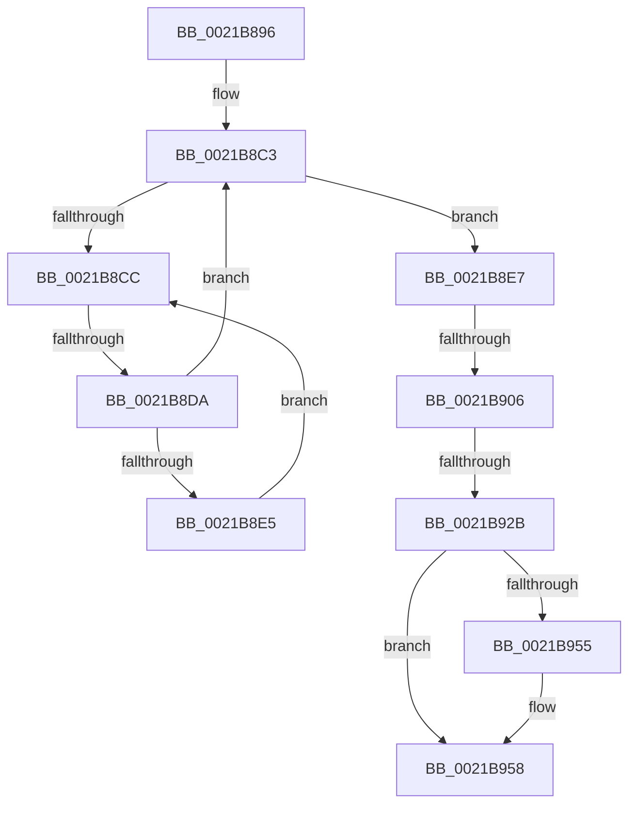

# sub_0021B896

- RVA: `0x0021B896`–`0x0021B96F` (길이 `217` bytes)
- VA: `0x000000014021B896`
- 실행 섹션: `.text`
- PDB 이름 있음: `아니요`; PDB Function 태그: `아니요`
- unwind 정보 RVA: `0x0005ED44`
- 디코드: `52`개 명령, `217/217` bytes 표시
- 미해석 바이트: `0` (있으면 어셈블리에 `.byte`로 보존)

> 이 문서는 커널 이미지의 기계어와 PDB 기호를 분석해 생성했습니다. 4번과 5번은 함수 원형과 자료형을 바이너리 사용 방식에서 추정한 C 해석이며 원본 소스 복구 결과는 아닙니다.

## 1. Dependencies

- 직접 호출 지점: **6**; 고유 호출 대상: **6**
- 직접 호출자로 확인된 함수: **0**
- RIP 상대 이미지 참조: **2**

### Outgoing calls
- `0x0021B89E` → [KiCaptureTotalCyclesCurrentThread](../37/KiCaptureTotalCyclesCurrentThread_function_0037CB90.md) (function, `0x0037CB90`)
- `0x0021B8A6` → [KiRcuCheckQuiescent](KiRcuCheckQuiescent_function_0021B110.md) (function, `0x0021B110`)
- `0x0021B8B0` → [KiAbProcessPreContextSwitch](KiAbProcessPreContextSwitch_function_0021D420.md) (function, `0x0021D420`)
- `0x0021B93D` → [KiQueueReadyThread](KiQueueReadyThread_function_0021C7B0.md) (function, `0x0021C7B0`)
- `0x0021B944` → [KeIsUserVaAccessAllowed](KeIsUserVaAccessAllowed_function_0021D740.md) (function, `0x0021D740`)
- `0x0021B961` → [KiSwapContext](../6B/KiSwapContext_function_006B9740.md) (function, `0x006B9740`)

### Direct callers
- 이 함수 시작 RVA로 연결되는 직접 call은 확인되지 않았습니다. 간접 호출은 완전히 역산할 수 없습니다.

### Static image references
- `0x0021B8CE` → RVA `0x00FC52AC` (`ALMOSTRO`; reference)
- `0x0021B949` → RVA `0x00FC6BF0` (`ALMOSTRO`; read)

## 2. Other-region calls and transfers

- 다른 실행 섹션으로 향하는 call: **0**
- call이 아닌 외부 분기/꼬리 이동: **4**
  - `0x0021B8D4` → [sub_0021B985](Unknown_function_0021B985.md) (`tail-transfer`)
  - `0x0021B900` → [sub_0021BA51 + 0x10](Unknown_function_0021BA51.md) (`tail-transfer`)
  - `0x0021B925` → [sub_0021BA51](Unknown_function_0021BA51.md) (`tail-transfer`)
  - `0x0021B96D` → [sub_0021B96F + 0xC](Unknown_function_0021B96F.md) (`tail-transfer`)

## 3. Assembly (complete function range)

```asm
0021B896  48 89 7C 24 30                  mov qword ptr [rsp + 0x30], rdi
0021B89B  48 8B CB                        mov rcx, rbx
0021B89E  E8 ED 12 16 00                  call 0x14037cb90
0021B8A3  48 8B CB                        mov rcx, rbx
0021B8A6  E8 65 F8 FF FF                  call 0x14021b110
0021B8AB  33 D2                           xor edx, edx
0021B8AD  48 8B CE                        mov rcx, rsi
0021B8B0  E8 6B 1B 00 00                  call 0x14021d420
0021B8B5  48 8B C3                        mov rax, rbx
0021B8B8  48 83 E0 FE                     and rax, 0xfffffffffffffffe
0021B8BC  48 89 44 24 38                  mov qword ptr [rsp + 0x38], rax
0021B8C1  33 FF                           xor edi, edi
0021B8C3  F0 48 0F BA 6B 30 00            lock bts qword ptr [rbx + 0x30], 0
0021B8CA  73 1B                           jae 0x14021b8e7
0021B8CC  FF C7                           inc edi
0021B8CE  85 3D D8 99 DA 00               test dword ptr [rip + 0xda99d8], edi
0021B8D4  0F 84 AB 00 00 00               je 0x14021b985
0021B8DA  F3 90                           pause
0021B8DC  48 8B 43 30                     mov rax, qword ptr [rbx + 0x30]
0021B8E0  48 85 C0                        test rax, rax
0021B8E3  74 DE                           je 0x14021b8c3
0021B8E5  EB E5                           jmp 0x14021b8cc
0021B8E7  48 8B 7B 10                     mov rdi, qword ptr [rbx + 0x10]
0021B8EB  48 C7 43 10 00 00 00 00         mov qword ptr [rbx + 0x10], 0
0021B8F3  48 89 7B 08                     mov qword ptr [rbx + 8], rdi
0021B8F7  0F B6 87 84 01 00 00            movzx eax, byte ptr [rdi + 0x184]
0021B8FE  3C 01                           cmp al, 1
0021B900  0F 84 5B 01 00 00               je 0x14021ba61
0021B906  C6 87 84 01 00 00 02            mov byte ptr [rdi + 0x184], 2
0021B90D  48 8B 93 C0 00 00 00            mov rdx, qword ptr [rbx + 0xc0]
0021B914  48 8B 8B C8 00 00 00            mov rcx, qword ptr [rbx + 0xc8]
0021B91B  48 8B 82 90 01 00 00            mov rax, qword ptr [rdx + 0x190]
0021B922  48 85 C1                        test rcx, rax
0021B925  0F 85 26 01 00 00               jne 0x14021ba51
0021B92B  4C 8B C6                        mov r8, rsi
0021B92E  C6 86 83 02 00 00 1F            mov byte ptr [rsi + 0x283], 0x1f
0021B935  48 8D 54 24 38                  lea rdx, [rsp + 0x38]
0021B93A  48 8B CB                        mov rcx, rbx
0021B93D  E8 6E 0E 00 00                  call 0x14021c7b0
0021B942  33 C9                           xor ecx, ecx
0021B944  E8 F7 1D 00 00                  call 0x14021d740
0021B949  83 3D A0 B2 DA 00 00            cmp dword ptr [rip + 0xdab2a0], 0
0021B950  0F B6 D8                        movzx ebx, al
0021B953  74 03                           je 0x14021b958
0021B955  0F 01 CB                        stac
0021B958  41 B0 01                        mov r8b, 1
0021B95B  48 8B D7                        mov rdx, rdi
0021B95E  48 8B CE                        mov rcx, rsi
0021B961  E8 DA DD 49 00                  call 0x1406b9740
0021B966  48 8B 7C 24 30                  mov rdi, qword ptr [rsp + 0x30]
0021B96B  84 DB                           test bl, bl
0021B96D  75 0C                           jne 0x14021b97b
```

## 4. C-style interpretation (structured pseudocode)

```c
__int64 __fastcall sub_0021B896(__int64 a1, int a2, __int64 a3, __int64 a4, __int64 a5, __int64 a6, __int64 a7)
{
    __int64 result;
    __int64 v_rdi;
    unsigned __int64 v_stack_p30;
    unsigned __int64 v_stack_p38;

    v_stack_p30 = v_rdi;
    result = KiCaptureTotalCyclesCurrentThread(v_rbx, a2, a3, a4);
    result = KiRcuCheckQuiescent(v_rbx, a2, a3, a4);
    a2 = 0;
    result = KiAbProcessPreContextSwitch(v_rsi, a2, a3, a4);
    result = (v_rbx) & (-2);
    v_stack_p38 = result;
    v_rdi = 0;
loc_0021B8C3:
    if (condition_is_above_or_equal) goto loc_0021B8E7;
loc_0021B8CC:
    v_rdi = (unsigned int)((v_rdi) + 1);
    if (*(unsigned __int64 *)(v_rbx + 48) == 0) goto loc_0021B8C3;
    goto loc_0021B8CC;
loc_0021B8E7:
    *(unsigned __int64 *)(v_rbx + 16) = 0;
    *(unsigned __int64 *)(v_rbx + 8) = *(unsigned __int64 *)(v_rbx + 16);
    *(unsigned __int8 *)(*(unsigned __int64 *)(v_rbx + 16) + 388) = 2;
    *(unsigned __int8 *)(v_rsi + 643) = 31;
    result = KiQueueReadyThread(v_rbx, a7, v_rsi, a4);
    a1 = 0;
    result = KeIsUserVaAccessAllowed(a1, a7, v_rsi, a4);
    if ((*(unsigned int *)(v_rip + 14332576)) != 0) {
    }
    result = KiSwapContext(v_rsi, *(unsigned __int64 *)(v_rbx + 16), 1, a4);
}
```

## 5. (Beta) C Style

```c
int64_t sub_0021B896(int64_t Arg1, int32_t Arg2, int64_t Arg3, int64_t Arg4, uint64_t Arg5, int64_t Arg6, int64_t Arg7)
{
    int64_t result;
    int64_t local_rdi;
    uint64_t v_stack_p30;
    uint64_t v_stack_p38;

    v_stack_p30 = local_rdi;
    result = KiCaptureTotalCyclesCurrentThread(local_rbx, Arg2, Arg3, Arg4);
    result = KiRcuCheckQuiescent(local_rbx, Arg2, Arg3, Arg4);
    Arg2 = 0;
    result = KiAbProcessPreContextSwitch(local_rsi, Arg2, Arg3, Arg4);
    result = (local_rbx) & (-2);
    v_stack_p38 = result;
    local_rdi = 0;
loc_0021B8C3:
    if (condition_is_above_or_equal) goto loc_0021B8E7;
loc_0021B8CC:
    local_rdi = (uint32_t)((local_rdi) + 1);
    if (*(uint64_t *)(local_rbx + 0x30) == 0) goto loc_0021B8C3;
    goto loc_0021B8CC;
loc_0021B8E7:
    *(uint64_t *)(local_rbx + 0x10) = 0;
    *(uint64_t *)(local_rbx + 0x8) = *(uint64_t *)(local_rbx + 0x10);
    *(uint8_t *)(*(uint64_t *)(local_rbx + 0x10) + 0x184) = 2;
    *(uint8_t *)(local_rsi + 0x283) = 31;
    result = KiQueueReadyThread(local_rbx, Arg7, local_rsi, Arg4);
    Arg1 = 0;
    result = KeIsUserVaAccessAllowed(Arg1, Arg7, local_rsi, Arg4);
    if ((*(uint32_t *)(v_rip + 0xDAB2A0)) != 0) {
    }
    result = KiSwapContext(local_rsi, *(uint64_t *)(local_rbx + 0x10), 1, Arg4);
}
```

## 6. Execution-region graph

[열기: 2D/3D 그래프와 함수 탐색 컨트롤 패널](../../../control-panel.html?section=text&rva=0x0021B896&view=graph)

- 2D 그래프는 위에서 아래로 흐르고, 3D 그래프는 빈 공간을 드래그해 회전합니다. Shift+드래그는 이동, 휠은 확대·축소, 함수 노드 선택은 대상 보고서 이동입니다.

### Static fallback


