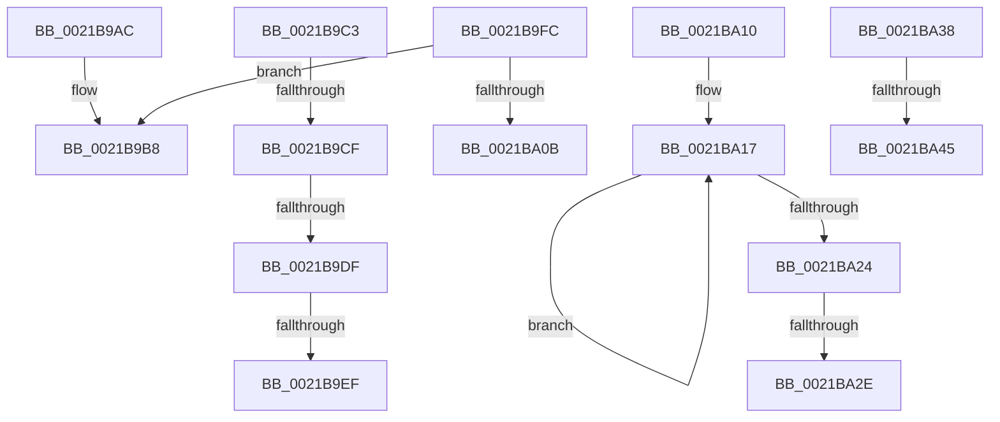

# sub_0021B9AC

- RVA: `0x0021B9AC`–`0x0021BA51` (길이 `165` bytes)
- VA: `0x000000014021B9AC`
- 실행 섹션: `.text`
- PDB 이름 있음: `아니요`; PDB Function 태그: `아니요`
- unwind 정보 RVA: `0x0005ED7C`
- 디코드: `37`개 명령, `165/165` bytes 표시
- 미해석 바이트: `0` (있으면 어셈블리에 `.byte`로 보존)

> 이 문서는 커널 이미지의 기계어와 PDB 기호를 분석해 생성했습니다. 4번과 5번은 함수 원형과 자료형을 바이너리 사용 방식에서 추정한 C 해석이며 원본 소스 복구 결과는 아닙니다.

## 1. Dependencies

- 직접 호출 지점: **3**; 고유 호출 대상: **3**
- 직접 호출자로 확인된 함수: **0**
- RIP 상대 이미지 참조: **3**

### Outgoing calls
- `0x0021B9B3` → [KiQuantumEnd](KiQuantumEnd_function_0021BA90.md) (function, `0x0021BA90`)
- `0x0021BA02` → [KiDeferGroupSchedulingPreemption](../20/KiDeferGroupSchedulingPreemption_function_0020076C.md) (function, `0x0020076C`)
- `0x0021BA2E` → [KiRemoveSystemWorkPriorityKick](../26/KiRemoveSystemWorkPriorityKick_function_002631D0.md) (function, `0x002631D0`)

### Direct callers
- 이 함수 시작 RVA로 연결되는 직접 call은 확인되지 않았습니다. 간접 호출은 완전히 역산할 수 없습니다.

### Static image references
- `0x0021B9CF` → RVA `0x006BA577` (`ExpInterlockedPopEntrySListResume`; read)
- `0x0021B9DF` → RVA `0x006BA590` (`ExpInterlockedPopEntrySListEnd`; read)
- `0x0021BA38` → RVA `0x00FC74B8` (`ALMOSTRO`; read)

## 2. Other-region calls and transfers

- 다른 실행 섹션으로 향하는 call: **0**
- call이 아닌 외부 분기/꼬리 이동: **9**
  - `0x0021B9C9` → [KiDispatchInterrupt + 0x39](KiDispatchInterrupt_function_0021B7F0.md) (`tail-transfer`)
  - `0x0021B9D9` → [KiDispatchInterrupt + 0x39](KiDispatchInterrupt_function_0021B7F0.md) (`tail-transfer`)
  - `0x0021B9E9` → [KiDispatchInterrupt + 0x39](KiDispatchInterrupt_function_0021B7F0.md) (`tail-transfer`)
  - `0x0021B9F7` → [KiDispatchInterrupt + 0x39](KiDispatchInterrupt_function_0021B7F0.md) (`tail-transfer`)
  - `0x0021BA0B` → [KiDispatchInterrupt + 0xA3](KiDispatchInterrupt_function_0021B7F0.md) (`tail-transfer`)
  - `0x0021BA28` → [KiDispatchInterrupt + 0x7E](KiDispatchInterrupt_function_0021B7F0.md) (`tail-transfer`)
  - `0x0021BA33` → [KiDispatchInterrupt + 0x7E](KiDispatchInterrupt_function_0021B7F0.md) (`tail-transfer`)
  - `0x0021BA3F` → [KiDispatchInterrupt + 0x39](KiDispatchInterrupt_function_0021B7F0.md) (`tail-transfer`)
  - `0x0021BA4C` → [KiDispatchInterrupt + 0x39](KiDispatchInterrupt_function_0021B7F0.md) (`tail-transfer`)

## 3. Assembly (complete function range)

```asm
0021B9AC  C6 83 B9 38 00 00 00            mov byte ptr [rbx + 0x38b9], 0
0021B9B3  E8 D8 00 00 00                  call 0x14021ba90
0021B9B8  48 8B 5C 24 40                  mov rbx, qword ptr [rsp + 0x40]
0021B9BD  48 83 C4 20                     add rsp, 0x20
0021B9C1  5E                              pop rsi
0021B9C2  C3                              ret
0021B9C3  CC                              int3
0021B9C4  66 41 83 F8 10                  cmp r8w, 0x10
0021B9C9  0F 85 5A FE FF FF               jne 0x14021b829
0021B9CF  4C 8D 05 A1 EB 49 00            lea r8, [rip + 0x49eba1]
0021B9D6  49 3B C0                        cmp rax, r8
0021B9D9  0F 86 4A FE FF FF               jbe 0x14021b829
0021B9DF  4C 8D 05 AA EB 49 00            lea r8, [rip + 0x49ebaa]
0021B9E6  49 3B C0                        cmp rax, r8
0021B9E9  0F 87 3A FE FF FF               ja 0x14021b829
0021B9EF  48 81 4A 30 00 00 01 00         or qword ptr [rdx + 0x30], 0x10000
0021B9F7  E9 2D FE FF FF                  jmp 0x14021b829
0021B9FC  48 8B D3                        mov rdx, rbx
0021B9FF  48 8B CE                        mov rcx, rsi
0021BA02  E8 65 4D FE FF                  call 0x14020076c
0021BA07  84 C0                           test al, al
0021BA09  75 AD                           jne 0x14021b9b8
0021BA0B  E9 83 FE FF FF                  jmp 0x14021b893
0021BA10  41 0F 0D 08                     prefetchw byte ptr [r8]
0021BA14  41 8B 00                        mov eax, dword ptr [r8]
0021BA17  8B D0                           mov edx, eax
0021BA19  0F BA F2 15                     btr edx, 0x15
0021BA1D  F0 41 0F B1 10                  lock cmpxchg dword ptr [r8], edx
0021BA22  75 F3                           jne 0x14021ba17
0021BA24  0F BA E0 15                     bt eax, 0x15
0021BA28  0F 83 40 FE FF FF               jae 0x14021b86e
0021BA2E  E8 9D 77 04 00                  call 0x1402631d0
0021BA33  E9 36 FE FF FF                  jmp 0x14021b86e
0021BA38  48 3B 05 79 BA DA 00            cmp rax, qword ptr [rip + 0xdaba79]
0021BA3F  0F 87 E4 FD FF FF               ja 0x14021b829
0021BA45  4C 89 82 68 01 00 00            mov qword ptr [rdx + 0x168], r8
0021BA4C  E9 D8 FD FF FF                  jmp 0x14021b829
```

## 4. C-style interpretation (structured pseudocode)

```c
__int64 __fastcall sub_0021B9AC(__int64 a1, __int64 a2, unsigned __int16 a3, __int64 a4, __int64 a5, __int64 a6, __int64 a7, __int64 a8)
{
    __int64 result;
    __int64 v_rsp;

    *(unsigned __int8 *)(v_rbx + 14521) = 0;
    result = KiQuantumEnd(a1, a2, a3, a4);
loc_0021B9B8:
    v_rsp = (v_rsp) + (32);
    return result;
}
```

## 5. (Beta) C Style

```c
int64_t sub_0021B9AC(int64_t Arg1, int64_t Arg2, uint16_t Arg3, int64_t Arg4, uint64_t Arg5, uint64_t Arg6, uint64_t Arg7, int64_t Arg8)
{
    int64_t result;
    int64_t local_rsp;

    *(uint8_t *)(local_rbx + 0x38B9) = 0;
    result = KiQuantumEnd(Arg1, Arg2, Arg3, Arg4);
loc_0021B9B8:
    local_rsp = (local_rsp) + (32);
    return result;
}
```

## 6. Execution-region graph

[열기: 2D/3D 그래프와 함수 탐색 컨트롤 패널](../../../control-panel.html?section=text&rva=0x0021B9AC&view=graph)

- 2D 그래프는 위에서 아래로 흐르고, 3D 그래프는 빈 공간을 드래그해 회전합니다. Shift+드래그는 이동, 휠은 확대·축소, 함수 노드 선택은 대상 보고서 이동입니다.

### Static fallback


