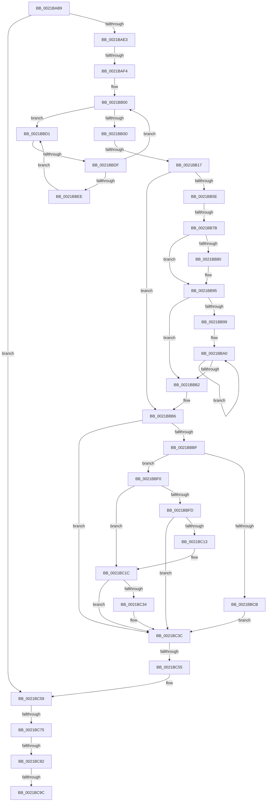

# sub_0021BAB9

- RVA: `0x0021BAB9`–`0x0021BCB0` (길이 `503` bytes)
- VA: `0x000000014021BAB9`
- 실행 섹션: `.text`
- PDB 이름 있음: `아니요`; PDB Function 태그: `아니요`
- unwind 정보 RVA: `0x0005EDCC`
- 디코드: `122`개 명령, `503/503` bytes 표시
- 미해석 바이트: `0` (있으면 어셈블리에 `.byte`로 보존)

> 이 문서는 커널 이미지의 기계어와 PDB 기호를 분석해 생성했습니다. 4번과 5번은 함수 원형과 자료형을 바이너리 사용 방식에서 추정한 C 해석이며 원본 소스 복구 결과는 아닙니다.

## 1. Dependencies

- 직접 호출 지점: **7**; 고유 호출 대상: **7**
- 직접 호출자로 확인된 함수: **0**
- RIP 상대 이미지 참조: **3**

### Outgoing calls
- `0x0021BAE7` → [Feature_HeteroRescheduleFixes__private_IsEnabledNoReportingNoInline](../35/Feature_HeteroRescheduleFixes__private_IsEnabledNoReportingNoInline_function_00355C60.md) (function, `0x00355C60`)
- `0x0021BB42` → [KiAcquireThreadStateLockForWrite](../30/KiAcquireThreadStateLockForWrite_function_0030E8C0.md) (function, `0x0030E8C0`)
- `0x0021BB54` → [KzRefreshWorkloadProperties](../25/KzRefreshWorkloadProperties_function_002576D4.md) (function, `0x002576D4`)
- `0x0021BC17` → [KxWaitForLockChainValid](KxWaitForLockChainValid_function_00217AA0.md) (function, `0x00217AA0`)
- `0x0021BC37` → [KeWakeAddressAll](KeWakeAddressAll_function_00217C20.md) (function, `0x00217C20`)
- `0x0021BC48` → [KiCheckPreferredHeteroProcessor](../39/KiCheckPreferredHeteroProcessor_function_0039D72C.md) (function, `0x0039D72C`)
- `0x0021BC8F` → [KiAcquirePrcbLocksForIsolationUnit](../30/KiAcquirePrcbLocksForIsolationUnit_function_0030ED60.md) (function, `0x0030ED60`)

### Direct callers
- 이 함수 시작 RVA로 연결되는 직접 call은 확인되지 않았습니다. 간접 호출은 완전히 역산할 수 없습니다.

### Static image references
- `0x0021BBBF` → RVA `0x00FC6B38` (`ALMOSTRO`; read)
- `0x0021BBD3` → RVA `0x00FC52AC` (`ALMOSTRO`; reference)
- `0x0021BC75` → RVA `0x00FC6ABC` (`ALMOSTRO`; read)

## 2. Other-region calls and transfers

- 다른 실행 섹션으로 향하는 call: **0**
- call이 아닌 외부 분기/꼬리 이동: **9**
  - `0x0021BAEE` → [sub_0021C69D + 0x72](Unknown_function_0021C69D.md) (`tail-transfer`)
  - `0x0021BB11` → [sub_0021BDD6 + 0xE](Unknown_function_0021BDD6.md) (`tail-transfer`)
  - `0x0021BB75` → [sub_0021BDD6](Unknown_function_0021BDD6.md) (`tail-transfer`)
  - `0x0021BBD9` → [sub_0021C284](Unknown_function_0021C284.md) (`tail-transfer`)
  - `0x0021BC4F` → [sub_0021C0DA](Unknown_function_0021C0DA.md) (`tail-transfer`)
  - `0x0021BC6F` → [sub_0021C284 + 0x1F4](Unknown_function_0021C284.md) (`tail-transfer`)
  - `0x0021BC7C` → [sub_0021C0DA + 0xD5](Unknown_function_0021C0DA.md) (`tail-transfer`)
  - `0x0021BC96` → [sub_0021C284 + 0x33](Unknown_function_0021C284.md) (`tail-transfer`)
  - `0x0021BCAA` → [sub_0021C00A](Unknown_function_0021C00A.md) (`tail-transfer`)

## 3. Assembly (complete function range)

```asm
0021BAB9  4C 89 68 C0                     mov qword ptr [rax - 0x40], r13
0021BABD  48 89 7D 87                     mov qword ptr [rbp - 0x79], rdi
0021BAC1  4D 8B 74 24 08                  mov r14, qword ptr [r12 + 8]
0021BAC6  44 88 7D 67                     mov byte ptr [rbp + 0x67], r15b
0021BACA  4C 89 64 24 38                  mov qword ptr [rsp + 0x38], r12
0021BACF  48 89 7C 24 30                  mov qword ptr [rsp + 0x30], rdi
0021BAD4  4C 89 75 8F                     mov qword ptr [rbp - 0x71], r14
0021BAD8  4D 3B 74 24 18                  cmp r14, qword ptr [r12 + 0x18]
0021BADD  0F 84 76 01 00 00               je 0x14021bc59
0021BAE3  4D 8B 6E 48                     mov r13, qword ptr [r14 + 0x48]
0021BAE7  E8 74 A1 13 00                  call 0x140355c60
0021BAEC  85 C0                           test eax, eax
0021BAEE  0F 84 1B 0C 00 00               je 0x14021c70f
0021BAF4  8B DF                           mov ebx, edi
0021BAF6  66 66 0F 1F 84 00 00 00 00 00   nop word ptr [rax + rax]
0021BB00  F0 49 0F BA 6E 40 00            lock bts qword ptr [r14 + 0x40], 0
0021BB07  0F 82 C4 00 00 00               jb 0x14021bbd1
0021BB0D  4D 3B 6E 20                     cmp r13, qword ptr [r14 + 0x20]
0021BB11  0F 83 CD 02 00 00               jae 0x14021bde4
0021BB17  0F 57 C0                        xorps xmm0, xmm0
0021BB1A  48 89 7D CF                     mov qword ptr [rbp - 0x31], rdi
0021BB1E  48 8D 45 97                     lea rax, [rbp - 0x69]
0021BB22  48 89 7D D7                     mov qword ptr [rbp - 0x29], rdi
0021BB26  4C 8D 4D D7                     lea r9, [rbp - 0x29]
0021BB2A  48 89 44 24 20                  mov qword ptr [rsp + 0x20], rax
0021BB2F  4C 8D 45 BF                     lea r8, [rbp - 0x41]
0021BB33  48 89 7D BF                     mov qword ptr [rbp - 0x41], rdi
0021BB37  48 8D 55 CF                     lea rdx, [rbp - 0x31]
0021BB3B  49 8B CE                        mov rcx, r14
0021BB3E  0F 11 45 97                     movups xmmword ptr [rbp - 0x69], xmm0
0021BB42  E8 79 2D 0F 00                  call 0x14030e8c0
0021BB47  48 8B 5D CF                     mov rbx, qword ptr [rbp - 0x31]
0021BB4B  0F B6 D0                        movzx edx, al
0021BB4E  4C 8B C3                        mov r8, rbx
0021BB51  49 8B CE                        mov rcx, r14
0021BB54  E8 7B BB 03 00                  call 0x1402576d4
0021BB59  48 85 DB                        test rbx, rbx
0021BB5C  74 58                           je 0x14021bbb6
0021BB5E  48 8B 45 BF                     mov rax, qword ptr [rbp - 0x41]
0021BB62  4C 8B C7                        mov r8, rdi
0021BB65  4C 8B C8                        mov r9, rax
0021BB68  8B D7                           mov edx, edi
0021BB6A  49 83 E1 FE                     and r9, 0xfffffffffffffffe
0021BB6E  4C 89 4D EF                     mov qword ptr [rbp - 0x11], r9
0021BB72  83 E0 01                        and eax, 1
0021BB75  0F 84 5B 02 00 00               je 0x14021bdd6
0021BB7B  83 F8 01                        cmp eax, 1
0021BB7E  75 15                           jne 0x14021bb95
0021BB80  49 8B 81 58 8E 00 00            mov rax, qword ptr [r9 + 0x8e58]
0021BB87  4D 8B 81 58 8E 00 00            mov r8, qword ptr [r9 + 0x8e58]
0021BB8E  49 83 C0 08                     add r8, 8
0021BB92  0F B6 10                        movzx edx, byte ptr [rax]
0021BB95  85 D2                           test edx, edx
0021BB97  74 19                           je 0x14021bbb2
0021BB99  0F 1F 80 00 00 00 00            nop dword ptr [rax]
0021BBA0  8D 42 FF                        lea eax, [rdx - 1]
0021BBA3  49 8B 0C C0                     mov rcx, qword ptr [r8 + rax*8]
0021BBA7  8B D0                           mov edx, eax
0021BBA9  F0 48 21 79 30                  lock and qword ptr [rcx + 0x30], rdi
0021BBAE  85 C0                           test eax, eax
0021BBB0  75 EE                           jne 0x14021bba0
0021BBB2  48 89 7D BF                     mov qword ptr [rbp - 0x41], rdi
0021BBB6  48 8B 4D D7                     mov rcx, qword ptr [rbp - 0x29]
0021BBBA  48 85 C9                        test rcx, rcx
0021BBBD  74 7D                           je 0x14021bc3c
0021BBBF  F7 05 6F AF DA 00 00 00 20 00   test dword ptr [rip + 0xdaaf6f], 0x200000
0021BBC9  75 25                           jne 0x14021bbf0
0021BBCB  F0 48 21 39                     lock and qword ptr [rcx], rdi
0021BBCF  EB 6B                           jmp 0x14021bc3c
0021BBD1  FF C3                           inc ebx
0021BBD3  85 1D D3 96 DA 00               test dword ptr [rip + 0xda96d3], ebx
0021BBD9  0F 84 A5 06 00 00               je 0x14021c284
0021BBDF  F3 90                           pause
0021BBE1  49 8B 46 40                     mov rax, qword ptr [r14 + 0x40]
0021BBE5  48 85 C0                        test rax, rax
0021BBE8  0F 84 12 FF FF FF               je 0x14021bb00
0021BBEE  EB E1                           jmp 0x14021bbd1
0021BBF0  0F 0D 4D 97                     prefetchw byte ptr [rbp - 0x69]
0021BBF4  48 8B 45 97                     mov rax, qword ptr [rbp - 0x69]
0021BBF8  48 85 C0                        test rax, rax
0021BBFB  75 1F                           jne 0x14021bc1c
0021BBFD  48 8B 4D 9F                     mov rcx, qword ptr [rbp - 0x61]
0021BC01  48 8D 45 97                     lea rax, [rbp - 0x69]
0021BC05  F0 48 0F B1 39                  lock cmpxchg qword ptr [rcx], rdi
0021BC0A  48 8D 4D 97                     lea rcx, [rbp - 0x69]
0021BC0E  48 3B C1                        cmp rax, rcx
0021BC11  74 29                           je 0x14021bc3c
0021BC13  48 8D 4D 97                     lea rcx, [rbp - 0x69]
0021BC17  E8 84 BE FF FF                  call 0x140217aa0
0021BC1C  48 8D 50 08                     lea rdx, [rax + 8]
0021BC20  48 89 7D 97                     mov qword ptr [rbp - 0x69], rdi
0021BC24  48 8B 4D 9F                     mov rcx, qword ptr [rbp - 0x61]
0021BC28  48 8B C1                        mov rax, rcx
0021BC2B  48 87 02                        xchg qword ptr [rdx], rax
0021BC2E  32 C1                           xor al, cl
0021BC30  A8 04                           test al, 4
0021BC32  74 08                           je 0x14021bc3c
0021BC34  48 8B CA                        mov rcx, rdx
0021BC37  E8 E4 BF FF FF                  call 0x140217c20
0021BC3C  41 B8 01 00 00 00               mov r8d, 1
0021BC42  49 8B D4                        mov rdx, r12
0021BC45  49 8B CE                        mov rcx, r14
0021BC48  E8 DF 1A 18 00                  call 0x14039d72c
0021BC4D  85 C0                           test eax, eax
0021BC4F  0F 85 85 04 00 00               jne 0x14021c0da
0021BC55  49 89 7E 40                     mov qword ptr [r14 + 0x40], rdi
0021BC59  48 B8 20 03 00 00 80 F7 FF FF   movabs rax, 0xfffff78000000320
0021BC63  32 DB                           xor bl, bl
0021BC65  8B 30                           mov esi, dword ptr [rax]
0021BC67  41 39 B4 24 C8 38 00 00         cmp dword ptr [r12 + 0x38c8], esi
0021BC6F  0F 88 03 08 00 00               js 0x14021c478
0021BC75  40 38 3D 40 AE DA 00            cmp byte ptr [rip + 0xdaae40], dil
0021BC7C  0F 85 2D 05 00 00               jne 0x14021c1af
0021BC82  4C 8D 44 24 30                  lea r8, [rsp + 0x30]
0021BC87  BA 01 00 00 00                  mov edx, 1
0021BC8C  49 8B CC                        mov rcx, r12
0021BC8F  E8 CC 30 0F 00                  call 0x14030ed60
0021BC94  84 DB                           test bl, bl
0021BC96  0F 85 1B 06 00 00               jne 0x14021c2b7
0021BC9C  49 83 7C 24 10 00               cmp qword ptr [r12 + 0x10], 0
0021BCA2  4C 8B AC 24 D8 00 00 00         mov r13, qword ptr [rsp + 0xd8]
0021BCAA  0F 84 5A 03 00 00               je 0x14021c00a
```

## 4. C-style interpretation (structured pseudocode)

```c
__int64 __fastcall sub_0021BAB9(__int64 a1, __int64 a2, __int64 a3, __int64 a4, __int64 a5, __int64 a6, __int64 a7, __int64 a8, __int64 a9, __int64 a10, __int64 a11, __int64 a12, __int64 a13, __int64 a14, __int64 a15, __int64 a16, __int64 a17, __int64 a18, __int64 a19, __int64 a20, __int64 a21, __int64 a22, __int64 a23, __int64 a24, __int64 a25, __int64 a26, __int64 a27)
{
    __int64 result;
    __int64 v_rbx;
    unsigned __int64 v_stack_p20;
    unsigned __int64 v_stack_p30;
    unsigned __int64 v_stack_p38;

    *(unsigned __int64 *)(result - 64) = v_r13;
    *(unsigned __int64 *)(v_rbp - 121) = v_rdi;
    *(unsigned __int8 *)(v_rbp + 103) = (unsigned __int8)(v_r15);
    v_stack_p38 = v_r12;
    v_stack_p30 = v_rdi;
    *(unsigned __int64 *)(v_rbp - 113) = *(unsigned __int64 *)(v_r12 + 8);
    if ((*(unsigned __int64 *)(v_r12 + 8)) == (*(unsigned __int64 *)(v_r12 + 24))) goto loc_0021BC59;
    result = Feature_HeteroRescheduleFixes__private_IsEnabledNoReportingNoInline(a1, a2, a3, a4);
loc_0021BB00:
    if (condition_is_below) goto loc_0021BBD1;
    *(unsigned __int64 *)(v_rbp - 49) = v_rdi;
    *(unsigned __int64 *)(v_rbp - 41) = v_rdi;
    v_stack_p20 = v_rbp - 105;
    *(unsigned __int64 *)(v_rbp - 65) = v_rdi;
    *(unsigned __int64 *)(v_rbp - 105) = v_xmm0;
    result = KiAcquireThreadStateLockForWrite(*(unsigned __int64 *)(v_r12 + 8), v_rbp - 49, v_rbp - 65, v_rbp - 41);
    result = KzRefreshWorkloadProperties(*(unsigned __int64 *)(v_r12 + 8), (unsigned __int8)(result), *(unsigned __int64 *)(v_rbp - 49), v_rbp - 41);
    if (*(unsigned __int64 *)(v_rbp - 49) == 0) goto loc_0021BBB6;
    a4 = (*(unsigned __int64 *)(v_rbp - 65)) & (-2);
    *(unsigned __int64 *)(v_rbp - 17) = a4;
    result = (unsigned int)((*(unsigned __int64 *)(v_rbp - 65)) & (1));
    if (((unsigned int)(result)) == 1) {
        result = *(unsigned __int64 *)(a4 + 36440);
        a3 = *(unsigned __int64 *)(a4 + 36440);
        a3 = (a3) + (8);
        a2 = *(unsigned __int8 *)(result);
    }
    if ((unsigned int)(a2) == 0) goto loc_0021BBB2;
loc_0021BBA0:
    if ((unsigned int)(a2 - 1) != 0) goto loc_0021BBA0;
loc_0021BBB2:
    *(unsigned __int64 *)(v_rbp - 65) = v_rdi;
loc_0021BBB6:
    if (*(unsigned __int64 *)(v_rbp - 41) == 0) goto loc_0021BC3C;
    if (((*(unsigned int *)(v_rip + 14331759)) & (0x200000ULL)) != 0) goto loc_0021BBF0;
    goto loc_0021BC3C;
loc_0021BBD1:
    v_rbx = (unsigned int)((*(unsigned __int64 *)(v_rbp - 49)) + 1);
    if (*(unsigned __int64 *)(*(unsigned __int64 *)(v_r12 + 8) + 64) == 0) goto loc_0021BB00;
    goto loc_0021BBD1;
loc_0021BBF0:
    if (*(unsigned __int64 *)(v_rbp - 105) != 0) goto loc_0021BC1C;
    if ((v_rbp - 105) == (v_rbp - 105)) goto loc_0021BC3C;
    result = KxWaitForLockChainValid(v_rbp - 105, (unsigned int)((unsigned int)(a2 - 1)), a3, a4);
loc_0021BC1C:
    *(unsigned __int64 *)(v_rbp - 105) = v_rdi;
    result = (unsigned __int8)((*(unsigned __int64 *)(v_rbp - 97)) ^ ((unsigned __int8)(*(unsigned __int64 *)(v_rbp - 97))));
    if ((((unsigned __int8)(result)) & (4)) != 0) {
        a1 = result + 8;
        result = KeWakeAddressAll(a1, result + 8, a3, a4);
    }
    result = KiCheckPreferredHeteroProcessor(*(unsigned __int64 *)(v_r12 + 8), v_r12, 1, a4);
    *(unsigned __int64 *)(*(unsigned __int64 *)(v_r12 + 8) + 64) = v_rdi;
loc_0021BC59:
    v_rbx = 0;
    result = KiAcquirePrcbLocksForIsolationUnit(v_r12, 1, a6, a4);
}
```

## 5. (Beta) C Style

```c
int64_t sub_0021BAB9(int64_t Arg1, int64_t Arg2, int64_t Arg3, int64_t Arg4, uint64_t Arg5, int64_t Arg6, uint64_t Arg7, uint64_t Arg8, uint64_t Arg9, uint64_t Arg10, uint64_t Arg11, uint64_t Arg12, uint64_t Arg13, uint64_t Arg14, uint64_t Arg15, uint64_t Arg16, uint64_t Arg17, uint64_t Arg18, uint64_t Arg19, uint64_t Arg20, uint64_t Arg21, uint64_t Arg22, uint64_t Arg23, uint64_t Arg24, uint64_t Arg25, uint64_t Arg26, int64_t Arg27)
{
    int64_t result;
    int64_t local_rbx;
    uint64_t v_stack_p20;
    uint64_t v_stack_p30;
    uint64_t v_stack_p38;

    *(uint64_t *)(result - 0x40) = local_r13;
    *(uint64_t *)(local_rbp - 0x79) = local_rdi;
    *(uint8_t *)(local_rbp + 0x67) = (uint8_t)(local_r15);
    v_stack_p38 = local_r12;
    v_stack_p30 = local_rdi;
    *(uint64_t *)(local_rbp - 0x71) = *(uint64_t *)(local_r12 + 0x8);
    if ((*(uint64_t *)(local_r12 + 0x8)) == (*(uint64_t *)(local_r12 + 0x18))) goto loc_0021BC59;
    result = Feature_HeteroRescheduleFixes__private_IsEnabledNoReportingNoInline(Arg1, Arg2, Arg3, Arg4);
loc_0021BB00:
    if (condition_is_below) goto loc_0021BBD1;
    *(uint64_t *)(local_rbp - 0x31) = local_rdi;
    *(uint64_t *)(local_rbp - 0x29) = local_rdi;
    v_stack_p20 = local_rbp - 105;
    *(uint64_t *)(local_rbp - 0x41) = local_rdi;
    *(uint64_t *)(local_rbp - 0x69) = v_xmm0;
    result = KiAcquireThreadStateLockForWrite(*(uint64_t *)(local_r12 + 0x8), local_rbp - 49, local_rbp - 65, local_rbp - 41);
    result = KzRefreshWorkloadProperties(*(uint64_t *)(local_r12 + 0x8), (uint8_t)(result), *(uint64_t *)(local_rbp - 0x31), local_rbp - 41);
    if (*(uint64_t *)(local_rbp - 0x31) == 0) goto loc_0021BBB6;
    Arg4 = (*(uint64_t *)(local_rbp - 0x41)) & (-2);
    *(uint64_t *)(local_rbp - 0x11) = Arg4;
    result = (uint32_t)((*(uint64_t *)(local_rbp - 0x41)) & (1));
    if (((uint32_t)(result)) == 1) {
        result = *(uint64_t *)(Arg4 + 0x8E58);
        Arg3 = *(uint64_t *)(Arg4 + 0x8E58);
        Arg3 = (Arg3) + (8);
        Arg2 = *(uint8_t *)(result);
    }
    if ((uint32_t)(Arg2) == 0) goto loc_0021BBB2;
loc_0021BBA0:
    if ((uint32_t)(Arg2 - 1) != 0) goto loc_0021BBA0;
loc_0021BBB2:
    *(uint64_t *)(local_rbp - 0x41) = local_rdi;
loc_0021BBB6:
    if (*(uint64_t *)(local_rbp - 0x29) == 0) goto loc_0021BC3C;
    if (((*(uint32_t *)(v_rip + 0xDAAF6F)) & (0x200000ULL)) != 0) goto loc_0021BBF0;
    goto loc_0021BC3C;
loc_0021BBD1:
    local_rbx = (uint32_t)((*(uint64_t *)(local_rbp - 0x31)) + 1);
    if (*(uint64_t *)(*(uint64_t *)(local_r12 + 0x8) + 0x40) == 0) goto loc_0021BB00;
    goto loc_0021BBD1;
loc_0021BBF0:
    if (*(uint64_t *)(local_rbp - 0x69) != 0) goto loc_0021BC1C;
    if ((local_rbp - 105) == (local_rbp - 105)) goto loc_0021BC3C;
    result = KxWaitForLockChainValid(local_rbp - 105, (uint32_t)((uint32_t)(Arg2 - 1)), Arg3, Arg4);
loc_0021BC1C:
    *(uint64_t *)(local_rbp - 0x69) = local_rdi;
    result = (uint8_t)((*(uint64_t *)(local_rbp - 0x61)) ^ ((uint8_t)(*(uint64_t *)(local_rbp - 0x61))));
    if ((((uint8_t)(result)) & (4)) != 0) {
        Arg1 = result + 8;
        result = KeWakeAddressAll(Arg1, result + 8, Arg3, Arg4);
    }
    result = KiCheckPreferredHeteroProcessor(*(uint64_t *)(local_r12 + 0x8), local_r12, 1, Arg4);
    *(uint64_t *)(*(uint64_t *)(local_r12 + 0x8) + 0x40) = local_rdi;
loc_0021BC59:
    local_rbx = 0;
    result = KiAcquirePrcbLocksForIsolationUnit(local_r12, 1, Arg6, Arg4);
}
```

## 6. Execution-region graph

[열기: 2D/3D 그래프와 함수 탐색 컨트롤 패널](../../../control-panel.html?section=text&rva=0x0021BAB9&view=graph)

- 2D 그래프는 위에서 아래로 흐르고, 3D 그래프는 빈 공간을 드래그해 회전합니다. Shift+드래그는 이동, 휠은 확대·축소, 함수 노드 선택은 대상 보고서 이동입니다.

### Static fallback


