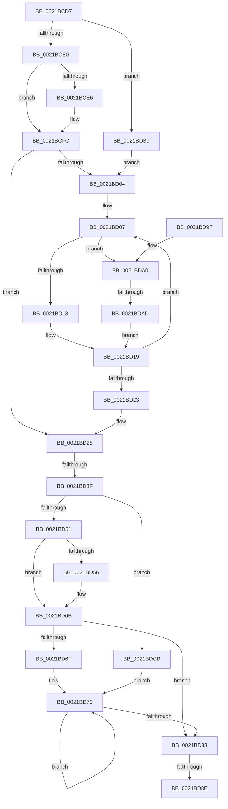

# sub_0021BCD7

- RVA: `0x0021BCD7`–`0x0021BDD6` (길이 `255` bytes)
- VA: `0x000000014021BCD7`
- 실행 섹션: `.text`
- PDB 이름 있음: `아니요`; PDB Function 태그: `아니요`
- unwind 정보 RVA: `0x0005EDF0`
- 디코드: `69`개 명령, `255/255` bytes 표시
- 미해석 바이트: `0` (있으면 어셈블리에 `.byte`로 보존)

> 이 문서는 커널 이미지의 기계어와 PDB 기호를 분석해 생성했습니다. 4번과 5번은 함수 원형과 자료형을 바이너리 사용 방식에서 추정한 C 해석이며 원본 소스 복구 결과는 아닙니다.

## 1. Dependencies

- 직접 호출 지점: **0**; 고유 호출 대상: **0**
- 직접 호출자로 확인된 함수: **0**
- RIP 상대 이미지 참조: **0**

### Outgoing calls
- 직접 디코드된 call 명령이 없습니다.

### Direct callers
- 이 함수 시작 RVA로 연결되는 직접 call은 확인되지 않았습니다. 간접 호출은 완전히 역산할 수 없습니다.

### Static image references
- 디코드된 RIP-relative 메모리 참조가 없습니다.

## 2. Other-region calls and transfers

- 다른 실행 섹션으로 향하는 call: **0**
- call이 아닌 외부 분기/꼬리 이동: **3**
  - `0x0021BD39` → [sub_0021C5F2](Unknown_function_0021C5F2.md) (`tail-transfer`)
  - `0x0021BD88` → [sub_0021BFFA](Unknown_function_0021BFFA.md) (`tail-transfer`)
  - `0x0021BDA7` → [sub_0021C4D9](Unknown_function_0021C4D9.md) (`tail-transfer`)

## 3. Assembly (complete function range)

```asm
0021BCD7  45 85 C9                        test r9d, r9d
0021BCDA  0F 84 D9 00 00 00               je 0x14021bdb9
0021BCE0  41 83 F9 01                     cmp r9d, 1
0021BCE4  75 16                           jne 0x14021bcfc
0021BCE6  49 8B 88 58 8E 00 00            mov rcx, qword ptr [r8 + 0x8e58]
0021BCED  49 8B 90 58 8E 00 00            mov rdx, qword ptr [r8 + 0x8e58]
0021BCF4  48 83 C2 08                     add rdx, 8
0021BCF8  44 0F B6 11                     movzx r10d, byte ptr [rcx]
0021BCFC  44 8B CF                        mov r9d, edi
0021BCFF  45 85 D2                        test r10d, r10d
0021BD02  74 24                           je 0x14021bd28
0021BD04  41 8B CA                        mov ecx, r10d
0021BD07  48 8B 02                        mov rax, qword ptr [rdx]
0021BD0A  4C 3B C0                        cmp r8, rax
0021BD0D  0F 84 8D 00 00 00               je 0x14021bda0
0021BD13  F0 48 83 60 30 00               lock and qword ptr [rax + 0x30], 0
0021BD19  48 83 C2 08                     add rdx, 8
0021BD1D  48 83 E9 01                     sub rcx, 1
0021BD21  75 E4                           jne 0x14021bd07
0021BD23  48 8B 44 24 30                  mov rax, qword ptr [rsp + 0x30]
0021BD28  48 83 E0 FE                     and rax, 0xfffffffffffffffe
0021BD2C  48 89 44 24 30                  mov qword ptr [rsp + 0x30], rax
0021BD31  49 8B 5C 24 10                  mov rbx, qword ptr [r12 + 0x10]
0021BD36  48 85 DB                        test rbx, rbx
0021BD39  0F 85 B3 08 00 00               jne 0x14021c5f2
0021BD3F  4C 8B C0                        mov r8, rax
0021BD42  8B CF                           mov ecx, edi
0021BD44  49 83 E0 FE                     and r8, 0xfffffffffffffffe
0021BD48  4C 89 45 FF                     mov qword ptr [rbp - 1], r8
0021BD4C  83 E0 01                        and eax, 1
0021BD4F  74 7A                           je 0x14021bdcb
0021BD51  83 F8 01                        cmp eax, 1
0021BD54  75 15                           jne 0x14021bd6b
0021BD56  49 8B 80 58 8E 00 00            mov rax, qword ptr [r8 + 0x8e58]
0021BD5D  49 8B B8 58 8E 00 00            mov rdi, qword ptr [r8 + 0x8e58]
0021BD64  48 83 C7 08                     add rdi, 8
0021BD68  0F B6 08                        movzx ecx, byte ptr [rax]
0021BD6B  85 C9                           test ecx, ecx
0021BD6D  74 14                           je 0x14021bd83
0021BD6F  90                              nop
0021BD70  8D 41 FF                        lea eax, [rcx - 1]
0021BD73  48 8B 14 C7                     mov rdx, qword ptr [rdi + rax*8]
0021BD77  8B C8                           mov ecx, eax
0021BD79  F0 48 83 62 30 00               lock and qword ptr [rdx + 0x30], 0
0021BD7F  85 C0                           test eax, eax
0021BD81  75 ED                           jne 0x14021bd70
0021BD83  4D 3B 74 24 18                  cmp r14, qword ptr [r12 + 0x18]
0021BD88  0F 85 6C 02 00 00               jne 0x14021bffa
0021BD8E  48 81 C4 E8 00 00 00            add rsp, 0xe8
0021BD95  41 5F                           pop r15
0021BD97  41 5E                           pop r14
0021BD99  41 5C                           pop r12
0021BD9B  5F                              pop rdi
0021BD9C  5B                              pop rbx
0021BD9D  5D                              pop rbp
0021BD9E  C3                              ret
0021BD9F  CC                              int3
0021BDA0  41 FF C1                        inc r9d
0021BDA3  41 83 F9 01                     cmp r9d, 1
0021BDA7  0F 85 2C 07 00 00               jne 0x14021c4d9
0021BDAD  49 C7 C0 FF FF FF FF            mov r8, 0xffffffffffffffff
0021BDB4  E9 60 FF FF FF                  jmp 0x14021bd19
0021BDB9  48 8D 55 DF                     lea rdx, [rbp - 0x21]
0021BDBD  41 BA 01 00 00 00               mov r10d, 1
0021BDC3  44 8B CF                        mov r9d, edi
0021BDC6  E9 39 FF FF FF                  jmp 0x14021bd04
0021BDCB  48 8D 7D FF                     lea rdi, [rbp - 1]
0021BDCF  B9 01 00 00 00                  mov ecx, 1
0021BDD4  EB 9A                           jmp 0x14021bd70
```

## 4. C-style interpretation (structured pseudocode)

```c
__int64 __fastcall sub_0021BCD7(__int64 a1, __int64 a2, __int64 a3, int a4, __int64 a5, __int64 a6)
{
    __int64 result;
    __int64 v_r10;
    __int64 v_rdi;
    __int64 v_rsp;
    unsigned __int64 v_stack_p30;

    if (a4 == 0) goto loc_0021BDB9;
    if (a4 == 1) {
        a1 = *(unsigned __int64 *)(a3 + 36440);
        a2 = *(unsigned __int64 *)(a3 + 36440);
        a2 = (a2) + (8);
        v_r10 = *(unsigned __int8 *)(a1);
    }
    if ((unsigned int)(v_r10) == 0) goto loc_0021BD28;
loc_0021BD04:
loc_0021BD07:
    if (a3 == (*(unsigned __int64 *)(a2))) goto loc_0021BDA0;
loc_0021BD19:
    a2 = (a2) + (8);
    a1 = ((unsigned int)((unsigned int)(v_r10))) - (1);
    if (condition_is_not_equal) goto loc_0021BD07;
loc_0021BD28:
    result = (a6) & (-2);
    v_stack_p30 = result;
    a3 = (result) & (-2);
    *(unsigned __int64 *)(v_rbp - 1) = a3;
    result = (unsigned int)((result) & (1));
    if (condition_is_equal) goto loc_0021BDCB;
    if (((unsigned int)(result)) == 1) {
        result = *(unsigned __int64 *)(a3 + 36440);
        v_rdi = *(unsigned __int64 *)(a3 + 36440);
        v_rdi = (v_rdi) + (8);
        a1 = *(unsigned __int8 *)(result);
    }
    if ((unsigned int)(a1) == 0) goto loc_0021BD83;
loc_0021BD70:
    if ((unsigned int)(a1 - 1) != 0) goto loc_0021BD70;
loc_0021BD83:
    v_rsp = (v_rsp) + (232);
    return a1 - 1;
loc_0021BDA0:
    a4 = (unsigned int)(((unsigned int)((unsigned int)(v_rdi))) + 1);
    goto loc_0021BD19;
loc_0021BDB9:
    goto loc_0021BD04;
loc_0021BDCB:
    goto loc_0021BD70;
}
```

## 5. (Beta) C Style

```c
int64_t sub_0021BCD7(int64_t Arg1, int64_t Arg2, void *Arg3, int32_t Arg4, uint64_t Arg5, int64_t Arg6)
{
    uint8_t *arg3 = (uint8_t *)Arg3;

    int64_t result;
    int64_t local_r10;
    int64_t local_rdi;
    int64_t local_rsp;
    uint64_t v_stack_p30;

    if (Arg4 == 0) goto loc_0021BDB9;
    if (Arg4 == 1) {
        Arg1 = *(uint64_t *)(arg3 + 0x8E58);
        Arg2 = *(uint64_t *)(arg3 + 0x8E58);
        Arg2 = (Arg2) + (8);
        local_r10 = *(uint8_t *)(Arg1);
    }
    if ((uint32_t)(local_r10) == 0) goto loc_0021BD28;
loc_0021BD04:
loc_0021BD07:
    if (Arg3 == (*(uint64_t *)(Arg2))) goto loc_0021BDA0;
loc_0021BD19:
    Arg2 = (Arg2) + (8);
    Arg1 = ((uint32_t)((uint32_t)(local_r10))) - (1);
    if (condition_is_not_equal) goto loc_0021BD07;
loc_0021BD28:
    result = (Arg6) & (-2);
    v_stack_p30 = result;
    Arg3 = (result) & (-2);
    *(void **)(local_rbp - 0x1) = Arg3;
    result = (uint32_t)((result) & (1));
    if (condition_is_equal) goto loc_0021BDCB;
    if (((uint32_t)(result)) == 1) {
        result = *(uint64_t *)(arg3 + 0x8E58);
        local_rdi = *(uint64_t *)(arg3 + 0x8E58);
        local_rdi = (local_rdi) + (8);
        Arg1 = *(uint8_t *)(result);
    }
    if ((uint32_t)(Arg1) == 0) goto loc_0021BD83;
loc_0021BD70:
    if ((uint32_t)(Arg1 - 1) != 0) goto loc_0021BD70;
loc_0021BD83:
    local_rsp = (local_rsp) + (232);
    return Arg1 - 1;
loc_0021BDA0:
    Arg4 = (uint32_t)(((uint32_t)((uint32_t)(local_rdi))) + 1);
    goto loc_0021BD19;
loc_0021BDB9:
    goto loc_0021BD04;
loc_0021BDCB:
    goto loc_0021BD70;
}
```

### 관측된 메모리 오프셋

구조체 형식이 확인되지 않은 접근은 인자 기준의 오프셋으로만 기록했습니다.

| 기준 인자 | 오프셋 표현 | 폭 (bit) | 접근 |
|---|---:|---:|---|
| `Arg3` | `+ 0x8E58` | `64` | `R` |

## 6. Execution-region graph

[열기: 2D/3D 그래프와 함수 탐색 컨트롤 패널](../../../control-panel.html?section=text&rva=0x0021BCD7&view=graph)

- 2D 그래프는 위에서 아래로 흐르고, 3D 그래프는 빈 공간을 드래그해 회전합니다. Shift+드래그는 이동, 휠은 확대·축소, 함수 노드 선택은 대상 보고서 이동입니다.

### Static fallback


