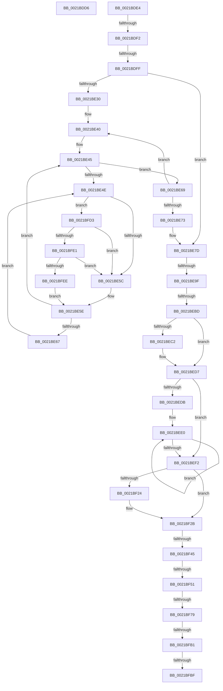

# sub_0021BDD6

- RVA: `0x0021BDD6`–`0x0021BFFA` (길이 `548` bytes)
- VA: `0x000000014021BDD6`
- 실행 섹션: `.text`
- PDB 이름 있음: `아니요`; PDB Function 태그: `아니요`
- unwind 정보 RVA: `0x0005EE04`
- 디코드: `126`개 명령, `548/548` bytes 표시
- 미해석 바이트: `0` (있으면 어셈블리에 `.byte`로 보존)

> 이 문서는 커널 이미지의 기계어와 PDB 기호를 분석해 생성했습니다. 4번과 5번은 함수 원형과 자료형을 바이너리 사용 방식에서 추정한 C 해석이며 원본 소스 복구 결과는 아닙니다.

## 1. Dependencies

- 직접 호출 지점: **7**; 고유 호출 대상: **7**
- 직접 호출자로 확인된 함수: **0**
- RIP 상대 이미지 참조: **4**

### Outgoing calls
- `0x0021BDF2` → [Feature_StackingDecayBoosts__private_IsEnabledNoReportingNoInline](../4E/Feature_StackingDecayBoosts__private_IsEnabledNoReportingNoInline_function_004EF7C0.md) (function, `0x004EF7C0`)
- `0x0021BE05` → [KiComputeNewPriorityNonStacking](../5C/KiComputeNewPriorityNonStacking_function_005CA75C.md) (function, `0x005CA75C`)
- `0x0021BE92` → [KiUpdateVPBackingThreadPriority](../30/KiUpdateVPBackingThreadPriority_function_00306040.md) (function, `0x00306040`)
- `0x0021BEFA` → [KiQueryQuantumReset](KiQueryQuantumReset_function_0021F6B4.md) (function, `0x0021F6B4`)
- `0x0021BF0B` → [KiTryScheduleNextForegroundBoost](../47/KiTryScheduleNextForegroundBoost_function_0047B51C.md) (function, `0x0047B51C`)
- `0x0021BFE1` → [KiCheckVpBackingLongSpinWaitHypercall](../30/KiCheckVpBackingLongSpinWaitHypercall_function_0030F490.md) (function, `0x0030F490`)
- `0x0021BFF0` → [HvlNotifyLongSpinWait](../30/HvlNotifyLongSpinWait_function_0030F460.md) (function, `0x0030F460`)

### Direct callers
- 이 함수 시작 RVA로 연결되는 직접 call은 확인되지 않았습니다. 간접 호출은 완전히 역산할 수 없습니다.

### Static image references
- `0x0021BE50` → RVA `0x00FC52AC` (`ALMOSTRO`; reference)
- `0x0021BF10` → RVA `0x00FC5098` (`ALMOSTRO`; read)
- `0x0021BF80` → RVA `0x00FC8C40` (`ALMOSTRO`; read)
- `0x0021BFD3` → RVA `0x00FC6AB8` (`ALMOSTRO`; read)

## 2. Other-region calls and transfers

- 다른 실행 섹션으로 향하는 call: **0**
- call이 아닌 외부 분기/꼬리 이동: **11**
  - `0x0021BDDF` → [sub_0021BAB9 + 0xE7](Unknown_function_0021BAB9.md) (`tail-transfer`)
  - `0x0021BDEC` → [sub_0021C69D + 0x81](Unknown_function_0021C69D.md) (`tail-transfer`)
  - `0x0021BDF9` → [sub_0021C0DA + 0xC](Unknown_function_0021C0DA.md) (`tail-transfer`)
  - `0x0021BE99` → [sub_0021C0DA + 0x10B](Unknown_function_0021C0DA.md) (`tail-transfer`)
  - `0x0021BEB7` → [sub_0021C0DA + 0xEE](Unknown_function_0021C0DA.md) (`tail-transfer`)
  - `0x0021BF3F` → [sub_0021BAB9 + 0x5E](Unknown_function_0021BAB9.md) (`tail-transfer`)
  - `0x0021BF4B` → [sub_0021BAB9 + 0x5E](Unknown_function_0021BAB9.md) (`tail-transfer`)
  - `0x0021BF73` → [sub_0021BAB9 + 0x5E](Unknown_function_0021BAB9.md) (`tail-transfer`)
  - `0x0021BFAB` → [sub_0021C52A + 0x16](Unknown_function_0021C52A.md) (`tail-transfer`)
  - `0x0021BFB9` → [sub_0021BAB9 + 0x5E](Unknown_function_0021BAB9.md) (`tail-transfer`)
  - `0x0021BFCE` → [sub_0021BAB9 + 0x5E](Unknown_function_0021BAB9.md) (`tail-transfer`)

## 3. Assembly (complete function range)

```asm
0021BDD6  4C 8D 45 EF                     lea r8, [rbp - 0x11]
0021BDDA  BA 01 00 00 00                  mov edx, 1
0021BDDF  E9 BC FD FF FF                  jmp 0x14021bba0
0021BDE4  41 F7 46 78 00 01 00 00         test dword ptr [r14 + 0x78], 0x100
0021BDEC  0F 85 2C 09 00 00               jne 0x14021c71e
0021BDF2  E8 C9 39 2D 00                  call 0x1404ef7c0
0021BDF7  85 C0                           test eax, eax
0021BDF9  0F 85 E7 02 00 00               jne 0x14021c0e6
0021BDFF  41 B0 01                        mov r8b, 1
0021BE02  49 8B CE                        mov rcx, r14
0021BE05  E8 52 E9 3A 00                  call 0x1405ca75c
0021BE0A  44 8B E0                        mov r12d, eax
0021BE0D  4C 8B 44 24 38                  mov r8, qword ptr [rsp + 0x38]
0021BE12  49 8B D8                        mov rbx, r8
0021BE15  48 83 CB 01                     or rbx, 1
0021BE19  48 89 5C 24 30                  mov qword ptr [rsp + 0x30], rbx
0021BE1E  49 8B 80 58 8E 00 00            mov rax, qword ptr [r8 + 0x8e58]
0021BE25  0F B6 08                        movzx ecx, byte ptr [rax]
0021BE28  4C 8D 70 08                     lea r14, [rax + 8]
0021BE2C  84 C9                           test cl, cl
0021BE2E  74 4D                           je 0x14021be7d
0021BE30  44 8B F9                        mov r15d, ecx
0021BE33  0F 1F 40 00                     nop dword ptr [rax]
0021BE37  66 0F 1F 84 00 00 00 00 00      nop word ptr [rax + rax]
0021BE40  49 8B 1E                        mov rbx, qword ptr [r14]
0021BE43  8B F7                           mov esi, edi
0021BE45  F0 48 0F BA 6B 30 00            lock bts qword ptr [rbx + 0x30], 0
0021BE4C  73 1B                           jae 0x14021be69
0021BE4E  FF C6                           inc esi
0021BE50  85 35 56 94 DA 00               test dword ptr [rip + 0xda9456], esi
0021BE56  0F 84 77 01 00 00               je 0x14021bfd3
0021BE5C  F3 90                           pause
0021BE5E  48 8B 43 30                     mov rax, qword ptr [rbx + 0x30]
0021BE62  48 85 C0                        test rax, rax
0021BE65  74 DE                           je 0x14021be45
0021BE67  EB E5                           jmp 0x14021be4e
0021BE69  49 83 C6 08                     add r14, 8
0021BE6D  49 83 EF 01                     sub r15, 1
0021BE71  75 CD                           jne 0x14021be40
0021BE73  48 8B 5C 24 30                  mov rbx, qword ptr [rsp + 0x30]
0021BE78  4C 8B 44 24 38                  mov r8, qword ptr [rsp + 0x38]
0021BE7D  49 39 78 10                     cmp qword ptr [r8 + 0x10], rdi
0021BE81  48 8B D7                        mov rdx, rdi
0021BE84  4C 8B 75 8F                     mov r14, qword ptr [rbp - 0x71]
0021BE88  49 0F 44 D0                     cmove rdx, r8
0021BE8C  49 8B CE                        mov rcx, r14
0021BE8F  45 33 C9                        xor r9d, r9d
0021BE92  E8 A9 A1 0E 00                  call 0x140306040
0021BE97  84 C0                           test al, al
0021BE99  0F 84 46 03 00 00               je 0x14021c1e5
0021BE9F  4C 8B 64 24 38                  mov r12, qword ptr [rsp + 0x38]
0021BEA4  48 8B CB                        mov rcx, rbx
0021BEA7  4C 8B C7                        mov r8, rdi
0021BEAA  48 83 E1 FE                     and rcx, 0xfffffffffffffffe
0021BEAE  8B D7                           mov edx, edi
0021BEB0  48 89 4D E7                     mov qword ptr [rbp - 0x19], rcx
0021BEB4  83 E3 01                        and ebx, 1
0021BEB7  0F 84 0B 03 00 00               je 0x14021c1c8
0021BEBD  83 FB 01                        cmp ebx, 1
0021BEC0  75 15                           jne 0x14021bed7
0021BEC2  48 8B 81 58 8E 00 00            mov rax, qword ptr [rcx + 0x8e58]
0021BEC9  4C 8B 81 58 8E 00 00            mov r8, qword ptr [rcx + 0x8e58]
0021BED0  49 83 C0 08                     add r8, 8
0021BED4  0F B6 10                        movzx edx, byte ptr [rax]
0021BED7  85 D2                           test edx, edx
0021BED9  74 17                           je 0x14021bef2
0021BEDB  0F 1F 44 00 00                  nop dword ptr [rax + rax]
0021BEE0  8D 42 FF                        lea eax, [rdx - 1]
0021BEE3  49 8B 0C C0                     mov rcx, qword ptr [r8 + rax*8]
0021BEE7  8B D0                           mov edx, eax
0021BEE9  F0 48 21 79 30                  lock and qword ptr [rcx + 0x30], rdi
0021BEEE  85 C0                           test eax, eax
0021BEF0  75 EE                           jne 0x14021bee0
0021BEF2  49 8B CE                        mov rcx, r14
0021BEF5  48 89 7C 24 30                  mov qword ptr [rsp + 0x30], rdi
0021BEFA  E8 B5 37 00 00                  call 0x14021f6b4
0021BEFF  41 B7 01                        mov r15b, 1
0021BF02  49 8B CE                        mov rcx, r14
0021BF05  44 88 7D 67                     mov byte ptr [rbp + 0x67], r15b
0021BF09  8B D8                           mov ebx, eax
0021BF0B  E8 0C F6 25 00                  call 0x14047b51c
0021BF10  0F AF 1D 81 91 DA 00            imul ebx, dword ptr [rip + 0xda9181]
0021BF17  41 8B 46 78                     mov eax, dword ptr [r14 + 0x78]
0021BF1B  8B CB                           mov ecx, ebx
0021BF1D  49 03 CD                        add rcx, r13
0021BF20  A8 20                           test al, 0x20
0021BF22  74 07                           je 0x14021bf2b
0021BF24  F0 41 0F BA 76 78 05            lock btr dword ptr [r14 + 0x78], 5
0021BF2B  49 89 4E 20                     mov qword ptr [r14 + 0x20], rcx
0021BF2F  49 8B 84 24 60 8E 00 00         mov rax, qword ptr [r12 + 0x8e60]
0021BF37  49 39 84 24 C8 00 00 00         cmp qword ptr [r12 + 0xc8], rax
0021BF3F  0F 84 D2 FB FF FF               je 0x14021bb17
0021BF45  41 0F BA 76 74 07               btr dword ptr [r14 + 0x74], 7
0021BF4B  0F 82 C6 FB FF FF               jb 0x14021bb17
0021BF51  4D 8B 84 24 60 8E 00 00         mov r8, qword ptr [r12 + 0x8e60]
0021BF59  49 8B 84 24 C0 00 00 00         mov rax, qword ptr [r12 + 0xc0]
0021BF61  48 8B 50 10                     mov rdx, qword ptr [rax + 0x10]
0021BF65  49 0B 94 24 C8 00 00 00         or rdx, qword ptr [r12 + 0xc8]
0021BF6D  49 23 D0                        and rdx, r8
0021BF70  49 3B D0                        cmp rdx, r8
0021BF73  0F 84 9E FB FF FF               je 0x14021bb17
0021BF79  41 8B 86 4C 02 00 00            mov eax, dword ptr [r14 + 0x24c]
0021BF80  48 8D 0D B9 CC DA 00            lea rcx, [rip + 0xdaccb9]
0021BF87  48 8B 04 C1                     mov rax, qword ptr [rcx + rax*8]
0021BF8B  48 8B 88 C0 00 00 00            mov rcx, qword ptr [rax + 0xc0]
0021BF92  48 8B 51 50                     mov rdx, qword ptr [rcx + 0x50]
0021BF96  48 23 51 18                     and rdx, qword ptr [rcx + 0x18]
0021BF9A  0F B7 81 88 00 00 00            movzx eax, word ptr [rcx + 0x88]
0021BFA1  49 8B 8E 40 02 00 00            mov rcx, qword ptr [r14 + 0x240]
0021BFA8  66 3B 01                        cmp ax, word ptr [rcx]
0021BFAB  0F 83 8F 05 00 00               jae 0x14021c540
0021BFB1  4C 8B 44 C1 08                  mov r8, qword ptr [rcx + rax*8 + 8]
0021BFB6  4C 85 C2                        test rdx, r8
0021BFB9  0F 84 58 FB FF FF               je 0x14021bb17
0021BFBF  41 81 4E 74 80 00 00 00         or dword ptr [r14 + 0x74], 0x80
0021BFC7  F0 41 0F BA 6E 78 0C            lock bts dword ptr [r14 + 0x78], 0xc
0021BFCE  E9 44 FB FF FF                  jmp 0x14021bb17
0021BFD3  8B 05 DF AA DA 00               mov eax, dword ptr [rip + 0xdaaadf]
0021BFD9  A8 40                           test al, 0x40
0021BFDB  0F 84 7B FE FF FF               je 0x14021be5c
0021BFE1  E8 AA 34 0F 00                  call 0x14030f490
0021BFE6  84 C0                           test al, al
0021BFE8  0F 84 6E FE FF FF               je 0x14021be5c
0021BFEE  8B CE                           mov ecx, esi
0021BFF0  E8 6B 34 0F 00                  call 0x14030f460
0021BFF5  E9 64 FE FF FF                  jmp 0x14021be5e
```

## 4. C-style interpretation (structured pseudocode)

```c
__int64 __fastcall sub_0021BDD6(__int64 a1, __int64 a2, __int64 a3, int a4)
{
    unsigned __int64 v_stack_p30;
    unsigned __int64 v_stack_p38;
}
```

## 5. (Beta) C Style

```c
int64_t sub_0021BDD6(int64_t Arg1, int64_t Arg2, int64_t Arg3, int32_t Arg4)
{
    uint64_t v_stack_p30;
    uint64_t v_stack_p38;
}
```

## 6. Execution-region graph

[열기: 2D/3D 그래프와 함수 탐색 컨트롤 패널](../../../control-panel.html?section=text&rva=0x0021BDD6&view=graph)

- 2D 그래프는 위에서 아래로 흐르고, 3D 그래프는 빈 공간을 드래그해 회전합니다. Shift+드래그는 이동, 휠은 확대·축소, 함수 노드 선택은 대상 보고서 이동입니다.

### Static fallback


