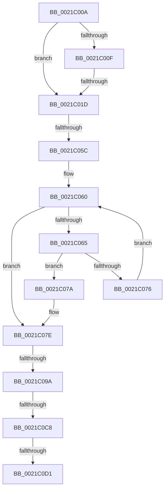

# sub_0021C00A

- RVA: `0x0021C00A`–`0x0021C0DA` (길이 `208` bytes)
- VA: `0x000000014021C00A`
- 실행 섹션: `.text`
- PDB 이름 있음: `아니요`; PDB Function 태그: `아니요`
- unwind 정보 RVA: `0x0005EE2C`
- 디코드: `52`개 명령, `208/208` bytes 표시
- 미해석 바이트: `0` (있으면 어셈블리에 `.byte`로 보존)

> 이 문서는 커널 이미지의 기계어와 PDB 기호를 분석해 생성했습니다. 4번과 5번은 함수 원형과 자료형을 바이너리 사용 방식에서 추정한 C 해석이며 원본 소스 복구 결과는 아닙니다.

## 1. Dependencies

- 직접 호출 지점: **4**; 고유 호출 대상: **4**
- 직접 호출자로 확인된 함수: **0**
- RIP 상대 이미지 참조: **0**

### Outgoing calls
- `0x0021C030` → [memset](../6C/memset_function_006C6C40.md) (function, `0x006C6C40`)
- `0x0021C040` → [KiStartRescheduleContext](../30/KiStartRescheduleContext_function_0030C6B0.md) (function, `0x0030C6B0`)
- `0x0021C0A1` → [KiSearchForNewThreadsForRescheduleContext](../25/KiSearchForNewThreadsForRescheduleContext_function_00258620.md) (function, `0x00258620`)
- `0x0021C0B3` → [KiCommitRescheduleContext](../30/KiCommitRescheduleContext_function_0030CF20.md) (function, `0x0030CF20`)

### Direct callers
- 이 함수 시작 RVA로 연결되는 직접 call은 확인되지 않았습니다. 간접 호출은 완전히 역산할 수 없습니다.

### Static image references
- 디코드된 RIP-relative 메모리 참조가 없습니다.

## 2. Other-region calls and transfers

- 다른 실행 섹션으로 향하는 call: **0**
- call이 아닌 외부 분기/꼬리 이동: **6**
  - `0x0021C017` → [sub_0021BCB0](Unknown_function_0021BCB0.md) (`tail-transfer`)
  - `0x0021C056` → [sub_0021C210](Unknown_function_0021C210.md) (`tail-transfer`)
  - `0x0021C094` → [sub_0021C548](Unknown_function_0021C548.md) (`tail-transfer`)
  - `0x0021C0C2` → [sub_0021C4AD](Unknown_function_0021C4AD.md) (`tail-transfer`)
  - `0x0021C0CB` → [sub_0021C4AD](Unknown_function_0021C4AD.md) (`tail-transfer`)
  - `0x0021C0D5` → [sub_0021BCB0](Unknown_function_0021BCB0.md) (`tail-transfer`)

## 3. Assembly (complete function range)

```asm
0021C00A  45 84 FF                        test r15b, r15b
0021C00D  75 0E                           jne 0x14021c01d
0021C00F  41 F7 46 78 00 10 00 00         test dword ptr [r14 + 0x78], 0x1000
0021C017  0F 84 93 FC FF FF               je 0x14021bcb0
0021C01D  49 8B B4 24 E8 37 00 00         mov rsi, qword ptr [r12 + 0x37e8]
0021C025  33 D2                           xor edx, edx
0021C027  48 8B CE                        mov rcx, rsi
0021C02A  41 B8 F0 00 00 00               mov r8d, 0xf0
0021C030  E8 0B AC 4A 00                  call 0x1406c6c40
0021C035  45 33 C0                        xor r8d, r8d
0021C038  48 8D 54 24 30                  lea rdx, [rsp + 0x30]
0021C03D  48 8B CE                        mov rcx, rsi
0021C040  E8 6B 06 0F 00                  call 0x14030c6b0
0021C045  41 F7 46 78 00 10 00 00         test dword ptr [r14 + 0x78], 0x1000
0021C04D  4C 8B CF                        mov r9, rdi
0021C050  44 0F B6 06                     movzx r8d, byte ptr [rsi]
0021C054  8B D7                           mov edx, edi
0021C056  0F 85 B4 01 00 00               jne 0x14021c210
0021C05C  0F 1F 40 00                     nop dword ptr [rax]
0021C060  41 3B D0                        cmp edx, r8d
0021C063  73 19                           jae 0x14021c07e
0021C065  8B C2                           mov eax, edx
0021C067  48 8D 0C 80                     lea rcx, [rax + rax*4]
0021C06B  4C 39 64 CE 10                  cmp qword ptr [rsi + rcx*8 + 0x10], r12
0021C070  48 8D 04 CE                     lea rax, [rsi + rcx*8]
0021C074  74 04                           je 0x14021c07a
0021C076  FF C2                           inc edx
0021C078  EB E6                           jmp 0x14021c060
0021C07A  4C 8D 48 10                     lea r9, [rax + 0x10]
0021C07E  41 0F B6 49 20                  movzx ecx, byte ptr [r9 + 0x20]
0021C083  41 80 49 22 02                  or byte ptr [r9 + 0x22], 2
0021C088  0F B6 C1                        movzx eax, cl
0021C08B  0C 08                           or al, 8
0021C08D  41 88 41 20                     mov byte ptr [r9 + 0x20], al
0021C091  F6 C1 02                        test cl, 2
0021C094  0F 85 AE 04 00 00               jne 0x14021c548
0021C09A  48 8D 55 87                     lea rdx, [rbp - 0x79]
0021C09E  48 8B CE                        mov rcx, rsi
0021C0A1  E8 7A C5 03 00                  call 0x140258620
0021C0A6  4C 8D 4D 87                     lea r9, [rbp - 0x79]
0021C0AA  45 33 C0                        xor r8d, r8d
0021C0AD  49 8B D4                        mov rdx, r12
0021C0B0  48 8B CE                        mov rcx, rsi
0021C0B3  E8 68 0E 0F 00                  call 0x14030cf20
0021C0B8  48 8B 5D 87                     mov rbx, qword ptr [rbp - 0x79]
0021C0BC  44 0F B6 F0                     movzx r14d, al
0021C0C0  84 C0                           test al, al
0021C0C2  0F 85 E5 03 00 00               jne 0x14021c4ad
0021C0C8  48 85 DB                        test rbx, rbx
0021C0CB  0F 85 DC 03 00 00               jne 0x14021c4ad
0021C0D1  4C 8B 75 8F                     mov r14, qword ptr [rbp - 0x71]
0021C0D5  E9 D6 FB FF FF                  jmp 0x14021bcb0
```

## 4. C-style interpretation (structured pseudocode)

```c
__int64 __fastcall sub_0021C00A(__int64 a1, int a2, __int64 a3, __int64 a4, __int64 a5, __int64 a6)
{
    __int64 result;

    if ((unsigned __int8)(v_r15) != 0) goto loc_0021C01D;
loc_0021C01D:
    a2 = 0;
    result = memset(*(unsigned __int64 *)(v_r12 + 14312), a2, 240, a4);
    a3 = 0;
    result = KiStartRescheduleContext(*(unsigned __int64 *)(v_r12 + 14312), a6, a3, a4);
loc_0021C060:
    if (((unsigned int)((unsigned int)((unsigned int)(v_rdi)))) >= ((unsigned int)(*(unsigned __int8 *)(*(unsigned __int64 *)(v_r12 + 14312))))) goto loc_0021C07E;
    if ((*(unsigned __int64 *)(*(unsigned __int64 *)(v_r12 + 14312) + (unsigned int)((unsigned int)((unsigned int)((unsigned int)(v_rdi)))) + (unsigned int)((unsigned int)((unsigned int)((unsigned int)(v_rdi)))) * 4 * 8 + 16)) == v_r12) goto loc_0021C07A;
    a2 = (unsigned int)(((unsigned int)((unsigned int)(v_rdi))) + 1);
    goto loc_0021C060;
loc_0021C07A:
loc_0021C07E:
    result = (unsigned __int8)(((unsigned __int8)(*(unsigned __int8 *)(*(unsigned __int64 *)(v_r12 + 14312) + (unsigned int)((unsigned int)((unsigned int)((unsigned int)(v_rdi)))) + (unsigned int)((unsigned int)((unsigned int)((unsigned int)(v_rdi)))) * 4 * 8 + 16 + 32))) | (8));
    *(unsigned __int8 *)(*(unsigned __int64 *)(v_r12 + 14312) + (unsigned int)((unsigned int)((unsigned int)((unsigned int)(v_rdi)))) + (unsigned int)((unsigned int)((unsigned int)((unsigned int)(v_rdi)))) * 4 * 8 + 16 + 32) = (unsigned __int8)(result);
    result = KiSearchForNewThreadsForRescheduleContext(*(unsigned __int64 *)(v_r12 + 14312), v_rbp - 121, *(unsigned __int8 *)(*(unsigned __int64 *)(v_r12 + 14312)), *(unsigned __int64 *)(v_r12 + 14312) + (unsigned int)((unsigned int)((unsigned int)((unsigned int)(v_rdi)))) + (unsigned int)((unsigned int)((unsigned int)((unsigned int)(v_rdi)))) * 4 * 8 + 16);
    a3 = 0;
    result = KiCommitRescheduleContext(*(unsigned __int64 *)(v_r12 + 14312), v_r12, a3, v_rbp - 121);
}
```

## 5. (Beta) C Style

```c
int64_t sub_0021C00A(int64_t Arg1, int32_t Arg2, int64_t Arg3, int64_t Arg4, uint64_t Arg5, int64_t Arg6)
{
    int64_t result;

    if ((uint8_t)(local_r15) != 0) goto loc_0021C01D;
loc_0021C01D:
    Arg2 = 0;
    result = memset(*(uint64_t *)(local_r12 + 0x37E8), Arg2, 240, Arg4);
    Arg3 = 0;
    result = KiStartRescheduleContext(*(uint64_t *)(local_r12 + 0x37E8), Arg6, Arg3, Arg4);
loc_0021C060:
    if (((uint32_t)((uint32_t)((uint32_t)(local_rdi)))) >= ((uint32_t)(*(uint8_t *)(*(uint64_t *)(local_r12 + 0x37E8))))) goto loc_0021C07E;
    if ((*(uint64_t *)(*(uint64_t *)(local_r12 + 0x37E8) + (uint32_t)((uint32_t)((uint32_t)((uint32_t)(local_rdi)))) + (uint32_t)((uint32_t)((uint32_t)((uint32_t)(local_rdi)))) * 4 * 8 + 0x10)) == local_r12) goto loc_0021C07A;
    Arg2 = (uint32_t)(((uint32_t)((uint32_t)(local_rdi))) + 1);
    goto loc_0021C060;
loc_0021C07A:
loc_0021C07E:
    result = (uint8_t)(((uint8_t)(*(uint8_t *)(*(uint64_t *)(local_r12 + 0x37E8) + (uint32_t)((uint32_t)((uint32_t)((uint32_t)(local_rdi)))) + (uint32_t)((uint32_t)((uint32_t)((uint32_t)(local_rdi)))) * 4 * 8 + 0x10 + 0x20))) | (8));
    *(uint8_t *)(*(uint64_t *)(local_r12 + 0x37E8) + (uint32_t)((uint32_t)((uint32_t)((uint32_t)(local_rdi)))) + (uint32_t)((uint32_t)((uint32_t)((uint32_t)(local_rdi)))) * 4 * 8 + 0x10 + 0x20) = (uint8_t)(result);
    result = KiSearchForNewThreadsForRescheduleContext(*(uint64_t *)(local_r12 + 0x37E8), local_rbp - 121, *(uint8_t *)(*(uint64_t *)(local_r12 + 0x37E8)), *(uint64_t *)(local_r12 + 0x37E8) + (uint32_t)((uint32_t)((uint32_t)((uint32_t)(local_rdi)))) + (uint32_t)((uint32_t)((uint32_t)((uint32_t)(local_rdi)))) * 4 * 8 + 16);
    Arg3 = 0;
    result = KiCommitRescheduleContext(*(uint64_t *)(local_r12 + 0x37E8), local_r12, Arg3, local_rbp - 121);
}
```

## 6. Execution-region graph

[열기: 2D/3D 그래프와 함수 탐색 컨트롤 패널](../../../control-panel.html?section=text&rva=0x0021C00A&view=graph)

- 2D 그래프는 위에서 아래로 흐르고, 3D 그래프는 빈 공간을 드래그해 회전합니다. Shift+드래그는 이동, 휠은 확대·축소, 함수 노드 선택은 대상 보고서 이동입니다.

### Static fallback


