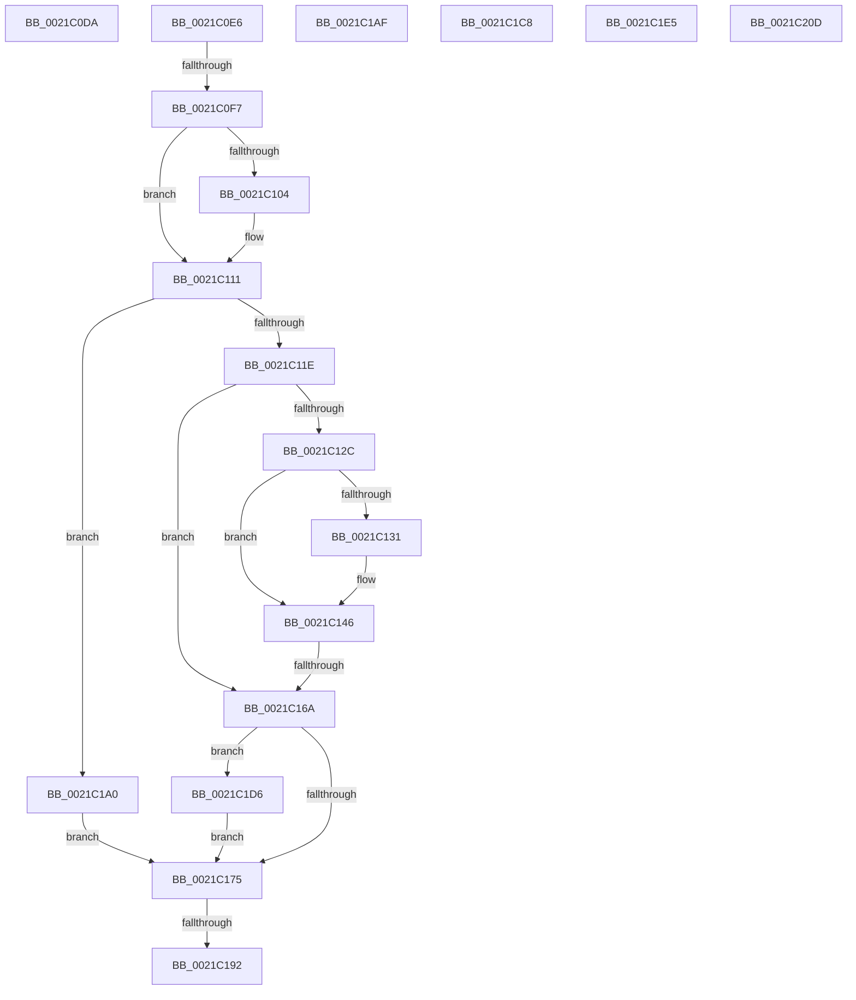

# sub_0021C0DA

- RVA: `0x0021C0DA`–`0x0021C210` (길이 `310` bytes)
- VA: `0x000000014021C0DA`
- 실행 섹션: `.text`
- PDB 이름 있음: `아니요`; PDB Function 태그: `아니요`
- unwind 정보 RVA: `0x0005EE40`
- 디코드: `74`개 명령, `310/310` bytes 표시
- 미해석 바이트: `0` (있으면 어셈블리에 `.byte`로 보존)

> 이 문서는 커널 이미지의 기계어와 PDB 기호를 분석해 생성했습니다. 4번과 5번은 함수 원형과 자료형을 바이너리 사용 방식에서 추정한 C 해석이며 원본 소스 복구 결과는 아닙니다.

## 1. Dependencies

- 직접 호출 지점: **5**; 고유 호출 대상: **5**
- 직접 호출자로 확인된 함수: **0**
- RIP 상대 이미지 참조: **1**

### Outgoing calls
- `0x0021C10C` → [KiClearForegroundBoost](../3C/KiClearForegroundBoost_function_003C20D8.md) (function, `0x003C20D8`)
- `0x0021C111` → [Feature_StackingDecayBoosts__private_IsEnabledNoReportingNoInline](../4E/Feature_StackingDecayBoosts__private_IsEnabledNoReportingNoInline_function_004EF7C0.md) (function, `0x004EF7C0`)
- `0x0021C1A5` → [KiComputeThreadPriorityNonStacking](../5C/KiComputeThreadPriorityNonStacking_function_005CA81C.md) (function, `0x005CA81C`)
- `0x0021C1BE` → [KiGroupSchedulingQuantumEnd](../30/KiGroupSchedulingQuantumEnd_function_0030B220.md) (function, `0x0030B220`)
- `0x0021C203` → [KiUpdateThreadPriority](../25/KiUpdateThreadPriority_function_00257810.md) (function, `0x00257810`)

### Direct callers
- 이 함수 시작 RVA로 연결되는 직접 call은 확인되지 않았습니다. 간접 호출은 완전히 역산할 수 없습니다.

### Static image references
- `0x0021C0F7` → RVA `0x00FC50A0` (`ALMOSTRO`; read)

## 2. Other-region calls and transfers

- 다른 실행 섹션으로 향하는 call: **0**
- call이 아닌 외부 분기/꼬리 이동: **8**
  - `0x0021C0E1` → [sub_0021BAB9 + 0x19C](Unknown_function_0021BAB9.md) (`tail-transfer`)
  - `0x0021C0F1` → [sub_0021C52A](Unknown_function_0021C52A.md) (`tail-transfer`)
  - `0x0021C164` → [sub_0021C69D + 0x99](Unknown_function_0021C69D.md) (`tail-transfer`)
  - `0x0021C18C` → [sub_0021C284 + 0x27](Unknown_function_0021C284.md) (`tail-transfer`)
  - `0x0021C19B` → [sub_0021BDD6 + 0x37](Unknown_function_0021BDD6.md) (`tail-transfer`)
  - `0x0021C1C3` → [sub_0021BAB9 + 0x1DB](Unknown_function_0021BAB9.md) (`tail-transfer`)
  - `0x0021C1D1` → [sub_0021BDD6 + 0x10A](Unknown_function_0021BDD6.md) (`tail-transfer`)
  - `0x0021C208` → [sub_0021BDD6 + 0xCE](Unknown_function_0021BDD6.md) (`tail-transfer`)

## 3. Assembly (complete function range)

```asm
0021C0DA  F0 41 0F BA 6E 78 0C            lock bts dword ptr [r14 + 0x78], 0xc
0021C0E1  E9 6F FB FF FF                  jmp 0x14021bc55
0021C0E6  41 0F BE 8E C3 00 00 00         movsx ecx, byte ptr [r14 + 0xc3]
0021C0EE  80 F9 10                        cmp cl, 0x10
0021C0F1  0F 8D 33 04 00 00               jge 0x14021c52a
0021C0F7  39 3D A3 8F DA 00               cmp dword ptr [rip + 0xda8fa3], edi
0021C0FD  BB 02 00 00 00                  mov ebx, 2
0021C102  74 0D                           je 0x14021c111
0021C104  49 8B CE                        mov rcx, r14
0021C107  BB 03 00 00 00                  mov ebx, 3
0021C10C  E8 C7 5F 1A 00                  call 0x1403c20d8
0021C111  E8 AA 36 2D 00                  call 0x1404ef7c0
0021C116  85 C0                           test eax, eax
0021C118  0F 84 82 00 00 00               je 0x14021c1a0
0021C11E  45 0F BE A6 33 02 00 00         movsx r12d, byte ptr [r14 + 0x233]
0021C126  41 83 FC 10                     cmp r12d, 0x10
0021C12A  7D 3E                           jge 0x14021c16a
0021C12C  F6 C3 01                        test bl, 1
0021C12F  75 15                           jne 0x14021c146
0021C131  41 0F B7 8E 06 02 00 00         movzx ecx, word ptr [r14 + 0x206]
0021C139  83 E1 0F                        and ecx, 0xf
0021C13C  41 03 CC                        add ecx, r12d
0021C13F  41 3B CC                        cmp ecx, r12d
0021C142  44 0F 4F E1                     cmovg r12d, ecx
0021C146  41 0F B6 96 66 03 00 00         movzx edx, byte ptr [r14 + 0x366]
0021C14E  80 FA 01                        cmp dl, 1
0021C151  8D 42 FF                        lea eax, [rdx - 1]
0021C154  0F B6 C8                        movzx ecx, al
0021C157  0F 4E CF                        cmovle ecx, edi
0021C15A  0F BE C1                        movsx eax, cl
0021C15D  44 03 E0                        add r12d, eax
0021C160  41 83 FC 10                     cmp r12d, 0x10
0021C164  0F 8D CC 05 00 00               jge 0x14021c736
0021C16A  41 8B 86 58 03 00 00            mov eax, dword ptr [r14 + 0x358]
0021C171  85 C0                           test eax, eax
0021C173  75 61                           jne 0x14021c1d6
0021C175  B8 0F F0 00 00                  mov eax, 0xf00f
0021C17A  66 41 21 86 06 02 00 00         and word ptr [r14 + 0x206], ax
0021C182  41 0F B6 86 66 03 00 00         movzx eax, byte ptr [r14 + 0x366]
0021C18A  3C 01                           cmp al, 1
0021C18C  0F 8C 19 01 00 00               jl 0x14021c2ab
0021C192  FE C8                           dec al
0021C194  41 88 86 66 03 00 00            mov byte ptr [r14 + 0x366], al
0021C19B  E9 6D FC FF FF                  jmp 0x14021be0d
0021C1A0  8B D3                           mov edx, ebx
0021C1A2  49 8B CE                        mov rcx, r14
0021C1A5  E8 72 E6 3A 00                  call 0x1405ca81c
0021C1AA  44 8B E0                        mov r12d, eax
0021C1AD  EB C6                           jmp 0x14021c175
0021C1AF  45 0F B6 CF                     movzx r9d, r15b
0021C1B3  48 8D 54 24 30                  lea rdx, [rsp + 0x30]
0021C1B8  4D 8B C6                        mov r8, r14
0021C1BB  49 8B CC                        mov rcx, r12
0021C1BE  E8 5D F0 0E 00                  call 0x14030b220
0021C1C3  E9 CC FA FF FF                  jmp 0x14021bc94
0021C1C8  4C 8D 45 E7                     lea r8, [rbp - 0x19]
0021C1CC  BA 01 00 00 00                  mov edx, 1
0021C1D1  E9 0A FD FF FF                  jmp 0x14021bee0
0021C1D6  0F BD C0                        bsr eax, eax
0021C1D9  44 3B E0                        cmp r12d, eax
0021C1DC  89 45 A7                        mov dword ptr [rbp - 0x59], eax
0021C1DF  44 0F 4C E0                     cmovl r12d, eax
0021C1E3  EB 90                           jmp 0x14021c175
0021C1E5  48 8B 44 24 38                  mov rax, qword ptr [rsp + 0x38]
0021C1EA  45 8B CC                        mov r9d, r12d
0021C1ED  4C 8B 64 24 38                  mov r12, qword ptr [rsp + 0x38]
0021C1F2  4D 8B C6                        mov r8, r14
0021C1F5  49 8B CC                        mov rcx, r12
0021C1F8  48 39 78 10                     cmp qword ptr [rax + 0x10], rdi
0021C1FC  0F 94 C0                        sete al
0021C1FF  88 44 24 20                     mov byte ptr [rsp + 0x20], al
0021C203  E8 08 B6 03 00                  call 0x140257810
0021C208  E9 97 FC FF FF                  jmp 0x14021bea4
0021C20D  0F 1F 00                        nop dword ptr [rax]
```

## 4. C-style interpretation (structured pseudocode)

```c
__int64 __fastcall sub_0021C0DA(void)
{
    unsigned __int8 v_stack_p20;
    unsigned __int64 v_stack_p30;
    unsigned __int64 v_stack_p38;
}
```

## 5. (Beta) C Style

```c
void sub_0021C0DA(void)
{
    uint8_t v_stack_p20;
    uint64_t v_stack_p30;
    uint64_t v_stack_p38;
}
```

## 6. Execution-region graph

[열기: 2D/3D 그래프와 함수 탐색 컨트롤 패널](../../../control-panel.html?section=text&rva=0x0021C0DA&view=graph)

- 2D 그래프는 위에서 아래로 흐르고, 3D 그래프는 빈 공간을 드래그해 회전합니다. Shift+드래그는 이동, 휠은 확대·축소, 함수 노드 선택은 대상 보고서 이동입니다.

### Static fallback


