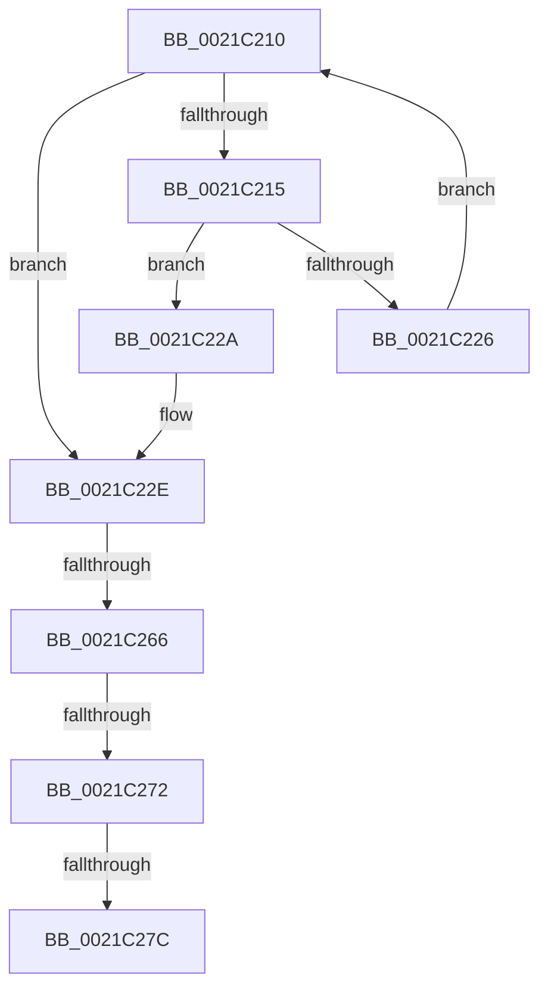

# sub_0021C210

- RVA: `0x0021C210`–`0x0021C284` (길이 `116` bytes)
- VA: `0x000000014021C210`
- 실행 섹션: `.text`
- PDB 이름 있음: `아니요`; PDB Function 태그: `아니요`
- unwind 정보 RVA: `0x0005EE58`
- 디코드: `31`개 명령, `116/116` bytes 표시
- 미해석 바이트: `0` (있으면 어셈블리에 `.byte`로 보존)

> 이 문서는 커널 이미지의 기계어와 PDB 기호를 분석해 생성했습니다. 4번과 5번은 함수 원형과 자료형을 바이너리 사용 방식에서 추정한 C 해석이며 원본 소스 복구 결과는 아닙니다.

## 1. Dependencies

- 직접 호출 지점: **0**; 고유 호출 대상: **0**
- 직접 호출자로 확인된 함수: **0**
- RIP 상대 이미지 참조: **0**

### Outgoing calls
- 직접 디코드된 call 명령이 없습니다.

### Direct callers
- 이 함수 시작 RVA로 연결되는 직접 call은 확인되지 않았습니다. 간접 호출은 완전히 역산할 수 없습니다.

### Static image references
- 디코드된 RIP-relative 메모리 참조가 없습니다.

## 2. Other-region calls and transfers

- 다른 실행 섹션으로 향하는 call: **0**
- call이 아닌 외부 분기/꼬리 이동: **4**
  - `0x0021C260` → [sub_0021C00A + 0x90](Unknown_function_0021C00A.md) (`tail-transfer`)
  - `0x0021C26C` → [sub_0021C5A5](Unknown_function_0021C5A5.md) (`tail-transfer`)
  - `0x0021C276` → [sub_0021C00A + 0x90](Unknown_function_0021C00A.md) (`tail-transfer`)
  - `0x0021C27F` → [sub_0021C00A + 0x90](Unknown_function_0021C00A.md) (`tail-transfer`)

## 3. Assembly (complete function range)

```asm
0021C210  41 3B D0                        cmp edx, r8d
0021C213  73 19                           jae 0x14021c22e
0021C215  8B C2                           mov eax, edx
0021C217  48 8D 0C 80                     lea rcx, [rax + rax*4]
0021C21B  4C 39 64 CE 10                  cmp qword ptr [rsi + rcx*8 + 0x10], r12
0021C220  48 8D 04 CE                     lea rax, [rsi + rcx*8]
0021C224  74 04                           je 0x14021c22a
0021C226  FF C2                           inc edx
0021C228  EB E6                           jmp 0x14021c210
0021C22A  4C 8D 48 10                     lea r9, [rax + 0x10]
0021C22E  41 80 49 22 02                  or byte ptr [r9 + 0x22], 2
0021C233  45 0F B6 51 20                  movzx r10d, byte ptr [r9 + 0x20]
0021C238  49 8B 09                        mov rcx, qword ptr [r9]
0021C23B  48 8B 41 18                     mov rax, qword ptr [rcx + 0x18]
0021C23F  49 89 41 10                     mov qword ptr [r9 + 0x10], rax
0021C243  41 0F B6 C2                     movzx eax, r10b
0021C247  24 C5                           and al, 0xc5
0021C249  0C 05                           or al, 5
0021C24B  41 88 41 20                     mov byte ptr [r9 + 0x20], al
0021C24F  48 8B 41 18                     mov rax, qword ptr [rcx + 0x18]
0021C253  41 80 61 21 FE                  and byte ptr [r9 + 0x21], 0xfe
0021C258  49 89 41 18                     mov qword ptr [r9 + 0x18], rax
0021C25C  41 F6 C2 02                     test r10b, 2
0021C260  0F 84 34 FE FF FF               je 0x14021c09a
0021C266  80 3E 00                        cmp byte ptr [rsi], 0
0021C269  44 8B C7                        mov r8d, edi
0021C26C  0F 87 33 03 00 00               ja 0x14021c5a5
0021C272  41 F6 C2 02                     test r10b, 2
0021C276  0F 84 1E FE FF FF               je 0x14021c09a
0021C27C  89 7E 04                        mov dword ptr [rsi + 4], edi
0021C27F  E9 16 FE FF FF                  jmp 0x14021c09a
```

## 4. C-style interpretation (structured pseudocode)

```c
__int64 __fastcall sub_0021C210(__int64 a1, int a2, int a3)
{
    __int64 result;

    if (a2 >= a3) goto loc_0021C22E;
    if ((*(unsigned __int64 *)(v_rsi + (unsigned int)(a2) + (unsigned int)(a2) * 4 * 8 + 16)) == v_r12) goto loc_0021C22A;
    a2 = (unsigned int)((a2) + 1);
    goto loc_0021C210;
loc_0021C22A:
loc_0021C22E:
    *(unsigned __int64 *)(v_rsi + (unsigned int)(a2) + (unsigned int)(a2) * 4 * 8 + 16 + 16) = *(unsigned __int64 *)(*(unsigned __int64 *)(v_rsi + (unsigned int)(a2) + (unsigned int)(a2) * 4 * 8 + 16) + 24);
    result = (unsigned __int8)(((unsigned __int8)(*(unsigned __int8 *)(v_rsi + (unsigned int)(a2) + (unsigned int)(a2) * 4 * 8 + 16 + 32))) & (197));
    result = (unsigned __int8)((result) | (5));
    *(unsigned __int8 *)(v_rsi + (unsigned int)(a2) + (unsigned int)(a2) * 4 * 8 + 16 + 32) = (unsigned __int8)(result);
    *(unsigned __int64 *)(v_rsi + (unsigned int)(a2) + (unsigned int)(a2) * 4 * 8 + 16 + 24) = *(unsigned __int64 *)(*(unsigned __int64 *)(v_rsi + (unsigned int)(a2) + (unsigned int)(a2) * 4 * 8 + 16) + 24);
    *(unsigned int *)(v_rsi + 4) = (unsigned int)(v_rdi);
}
```

## 5. (Beta) C Style

```c
int64_t sub_0021C210(int64_t Arg1, int32_t Arg2, int32_t Arg3)
{
    int64_t result;

    if (Arg2 >= Arg3) goto loc_0021C22E;
    if ((*(uint64_t *)(local_rsi + (uint32_t)(Arg2) + (uint32_t)(Arg2) * 4 * 8 + 0x10)) == local_r12) goto loc_0021C22A;
    Arg2 = (uint32_t)((Arg2) + 1);
    goto loc_0021C210;
loc_0021C22A:
loc_0021C22E:
    *(uint64_t *)(local_rsi + (uint32_t)(Arg2) + (uint32_t)(Arg2) * 4 * 8 + 0x10 + 0x10) = *(uint64_t *)(*(uint64_t *)(local_rsi + (uint32_t)(Arg2) + (uint32_t)(Arg2) * 4 * 8 + 0x10) + 0x18);
    result = (uint8_t)(((uint8_t)(*(uint8_t *)(local_rsi + (uint32_t)(Arg2) + (uint32_t)(Arg2) * 4 * 8 + 0x10 + 0x20))) & (197));
    result = (uint8_t)((result) | (5));
    *(uint8_t *)(local_rsi + (uint32_t)(Arg2) + (uint32_t)(Arg2) * 4 * 8 + 0x10 + 0x20) = (uint8_t)(result);
    *(uint64_t *)(local_rsi + (uint32_t)(Arg2) + (uint32_t)(Arg2) * 4 * 8 + 0x10 + 0x18) = *(uint64_t *)(*(uint64_t *)(local_rsi + (uint32_t)(Arg2) + (uint32_t)(Arg2) * 4 * 8 + 0x10) + 0x18);
    *(uint32_t *)(local_rsi + 0x4) = (uint32_t)(local_rdi);
}
```

## 6. Execution-region graph

[열기: 2D/3D 그래프와 함수 탐색 컨트롤 패널](../../../control-panel.html?section=text&rva=0x0021C210&view=graph)

- 2D 그래프는 위에서 아래로 흐르고, 3D 그래프는 빈 공간을 드래그해 회전합니다. Shift+드래그는 이동, 휠은 확대·축소, 함수 노드 선택은 대상 보고서 이동입니다.

### Static fallback


