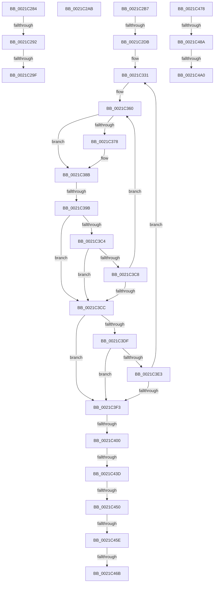

# sub_0021C284

- RVA: `0x0021C284`–`0x0021C4AD` (길이 `553` bytes)
- VA: `0x000000014021C284`
- 실행 섹션: `.text`
- PDB 이름 있음: `아니요`; PDB Function 태그: `아니요`
- unwind 정보 RVA: `0x0005EE6C`
- 디코드: `133`개 명령, `553/553` bytes 표시
- 미해석 바이트: `0` (있으면 어셈블리에 `.byte`로 보존)

> 이 문서는 커널 이미지의 기계어와 PDB 기호를 분석해 생성했습니다. 4번과 5번은 함수 원형과 자료형을 바이너리 사용 방식에서 추정한 C 해석이며 원본 소스 복구 결과는 아닙니다.

## 1. Dependencies

- 직접 호출 지점: **10**; 고유 호출 대상: **8**
- 직접 호출자로 확인된 함수: **0**
- RIP 상대 이미지 참조: **7**

### Outgoing calls
- `0x0021C292` → [KiCheckVpBackingLongSpinWaitHypercall](../30/KiCheckVpBackingLongSpinWaitHypercall_function_0030F490.md) (function, `0x0030F490`)
- `0x0021C2A1` → [HvlNotifyLongSpinWait](../30/HvlNotifyLongSpinWait_function_0030F460.md) (function, `0x0030F460`)
- `0x0021C37D` → [KiReadGuestSchedulerAssistPriority](../30/KiReadGuestSchedulerAssistPriority_function_00304BE4.md) (function, `0x00304BE4`)
- `0x0021C3A6` → [KiRemoveThreadFromReadyQueue](../20/KiRemoveThreadFromReadyQueue_function_002016C8.md) (function, `0x002016C8`)
- `0x0021C3B2` → [KiInsertDeferredReadyList](../20/KiInsertDeferredReadyList_function_00201310.md) (function, `0x00201310`)
- `0x0021C405` → [KiReleasePrcbLocksForIsolationUnit](../39/KiReleasePrcbLocksForIsolationUnit_function_00399C50.md) (function, `0x00399C50`)
- `0x0021C45E` → [KiCheckVpBackingLongSpinWaitHypercall](../30/KiCheckVpBackingLongSpinWaitHypercall_function_0030F490.md) (function, `0x0030F490`)
- `0x0021C46E` → [HvlNotifyLongSpinWait](../30/HvlNotifyLongSpinWait_function_0030F460.md) (function, `0x0030F460`)
- `0x0021C47D` → [KiShouldScanSharedReadyQueue](../46/KiShouldScanSharedReadyQueue_function_00468B50.md) (function, `0x00468B50`)
- `0x0021C4A3` → [KiScanSharedReadyThreads](../46/KiScanSharedReadyThreads_function_0046F120.md) (function, `0x0046F120`)

### Direct callers
- 이 함수 시작 RVA로 연결되는 직접 call은 확인되지 않았습니다. 간접 호출은 완전히 역산할 수 없습니다.

### Static image references
- `0x0021C284` → RVA `0x00FC6AB8` (`ALMOSTRO`; read)
- `0x0021C2B7` → RVA `0x00FC51C4` (`ALMOSTRO`; read)
- `0x0021C2DB` → RVA `0x00FC6C4C` (`ALMOSTRO`; read)
- `0x0021C2F4` → RVA `0x00FC52A4` (`ALMOSTRO`; read)
- `0x0021C2FA` → RVA `0x00FC511C` (`ALMOSTRO`; read)
- `0x0021C31B` → RVA `0x00FC51C0` (`ALMOSTRO`; read)
- `0x0021C443` → RVA `0x00FC52AC` (`ALMOSTRO`; reference)

## 2. Other-region calls and transfers

- 다른 실행 섹션으로 향하는 call: **0**
- call이 아닌 외부 분기/꼬리 이동: **15**
  - `0x0021C28C` → [sub_0021BAB9 + 0x126](Unknown_function_0021BAB9.md) (`tail-transfer`)
  - `0x0021C299` → [sub_0021BAB9 + 0x126](Unknown_function_0021BAB9.md) (`tail-transfer`)
  - `0x0021C2A6` → [sub_0021BAB9 + 0x128](Unknown_function_0021BAB9.md) (`tail-transfer`)
  - `0x0021C2B2` → [sub_0021BDD6 + 0x37](Unknown_function_0021BDD6.md) (`tail-transfer`)
  - `0x0021C2D5` → [sub_0021BAB9 + 0x1E3](Unknown_function_0021BAB9.md) (`tail-transfer`)
  - `0x0021C395` → [sub_0021C57C](Unknown_function_0021C57C.md) (`tail-transfer`)
  - `0x0021C3FA` → [sub_006D68EC](../6D/Unknown_function_006D68EC.md) (`tail-transfer`)
  - `0x0021C437` → [sub_0021C69D + 0x14](Unknown_function_0021C69D.md) (`tail-transfer`)
  - `0x0021C44A` → [sub_0021C69D](Unknown_function_0021C69D.md) (`tail-transfer`)
  - `0x0021C458` → [sub_0021C69D](Unknown_function_0021C69D.md) (`tail-transfer`)
  - `0x0021C465` → [sub_0021C69D](Unknown_function_0021C69D.md) (`tail-transfer`)
  - `0x0021C473` → [sub_0021C69D + 0x2](Unknown_function_0021C69D.md) (`tail-transfer`)
  - `0x0021C484` → [sub_0021BAB9 + 0x1BC](Unknown_function_0021BAB9.md) (`tail-transfer`)
  - `0x0021C49A` → [sub_0021BAB9 + 0x1BC](Unknown_function_0021BAB9.md) (`tail-transfer`)
  - `0x0021C4A8` → [sub_0021BAB9 + 0x1BC](Unknown_function_0021BAB9.md) (`tail-transfer`)

## 3. Assembly (complete function range)

```asm
0021C284  8B 05 2E A8 DA 00               mov eax, dword ptr [rip + 0xdaa82e]
0021C28A  A8 40                           test al, 0x40
0021C28C  0F 84 4D F9 FF FF               je 0x14021bbdf
0021C292  E8 F9 31 0F 00                  call 0x14030f490
0021C297  84 C0                           test al, al
0021C299  0F 84 40 F9 FF FF               je 0x14021bbdf
0021C29F  8B CB                           mov ecx, ebx
0021C2A1  E8 BA 31 0F 00                  call 0x14030f460
0021C2A6  E9 36 F9 FF FF                  jmp 0x14021bbe1
0021C2AB  41 88 BE 66 03 00 00            mov byte ptr [r14 + 0x366], dil
0021C2B2  E9 56 FB FF FF                  jmp 0x14021be0d
0021C2B7  8B 0D 07 8F DA 00               mov ecx, dword ptr [rip + 0xda8f07]
0021C2BD  41 8B 9C 24 D8 83 00 00         mov ebx, dword ptr [r12 + 0x83d8]
0021C2C5  03 CE                           add ecx, esi
0021C2C7  41 89 8C 24 C8 38 00 00         mov dword ptr [r12 + 0x38c8], ecx
0021C2CF  81 E3 FE 7F 00 00               and ebx, 0x7ffe
0021C2D5  0F 84 C1 F9 FF FF               je 0x14021bc9c
0021C2DB  8B 05 6B A9 DA 00               mov eax, dword ptr [rip + 0xdaa96b]
0021C2E1  4D 8D 84 24 40 84 00 00         lea r8, [r12 + 0x8440]
0021C2E9  41 8B 8C 24 E0 83 00 00         mov ecx, dword ptr [r12 + 0x83e0]
0021C2F1  0F 57 C0                        xorps xmm0, xmm0
0021C2F4  8B 15 AA 8F DA 00               mov edx, dword ptr [rip + 0xda8faa]
0021C2FA  44 8B 2D 1B 8E DA 00            mov r13d, dword ptr [rip + 0xda8e1b]
0021C301  89 45 B7                        mov dword ptr [rbp - 0x49], eax
0021C304  48 B8 20 03 00 00 80 F7 FF FF   movabs rax, 0xfffff78000000320
0021C30E  0F 11 45 07                     movups xmmword ptr [rbp + 7], xmm0
0021C312  89 55 77                        mov dword ptr [rbp + 0x77], edx
0021C315  44 89 6D 6F                     mov dword ptr [rbp + 0x6f], r13d
0021C319  8B 00                           mov eax, dword ptr [rax]
0021C31B  2B 05 9F 8E DA 00               sub eax, dword ptr [rip + 0xda8e9f]
0021C321  89 45 7F                        mov dword ptr [rbp + 0x7f], eax
0021C324  D3 CB                           ror ebx, cl
0021C326  89 4D B3                        mov dword ptr [rbp - 0x4d], ecx
0021C329  4C 89 45 F7                     mov qword ptr [rbp - 9], r8
0021C32D  48 89 7D C7                     mov qword ptr [rbp - 0x39], rdi
0021C331  8B 7D 7F                        mov edi, dword ptr [rbp + 0x7f]
0021C334  0F BC C3                        bsf eax, ebx
0021C337  0F BB C3                        btc ebx, eax
0021C33A  89 45 AB                        mov dword ptr [rbp - 0x55], eax
0021C33D  89 5D AF                        mov dword ptr [rbp - 0x51], ebx
0021C340  8B 5D 6F                        mov ebx, dword ptr [rbp + 0x6f]
0021C343  44 8D 3C 08                     lea r15d, [rax + rcx]
0021C347  41 83 E7 1F                     and r15d, 0x1f
0021C34B  45 8B E7                        mov r12d, r15d
0021C34E  49 C1 E4 04                     shl r12, 4
0021C352  4D 03 E0                        add r12, r8
0021C355  44 89 7D BB                     mov dword ptr [rbp - 0x45], r15d
0021C359  4D 8B 34 24                     mov r14, qword ptr [r12]
0021C35D  0F 1F 00                        nop dword ptr [rax]
0021C360  49 8D B6 28 FF FF FF            lea rsi, [r14 - 0xd8]
0021C367  32 C9                           xor cl, cl
0021C369  F7 46 78 00 00 40 00            test dword ptr [rsi + 0x78], 0x400000
0021C370  4D 8B EE                        mov r13, r14
0021C373  4D 8B 36                        mov r14, qword ptr [r14]
0021C376  74 13                           je 0x14021c38b
0021C378  33 D2                           xor edx, edx
0021C37A  48 8B CE                        mov rcx, rsi
0021C37D  E8 62 88 0E 00                  call 0x140304be4
0021C382  3B 86 00 04 00 00               cmp eax, dword ptr [rsi + 0x400]
0021C388  0F 95 C1                        setne cl
0021C38B  8B C7                           mov eax, edi
0021C38D  2B 86 B4 01 00 00               sub eax, dword ptr [rsi + 0x1b4]
0021C393  85 C0                           test eax, eax
0021C395  0F 8E E1 01 00 00               jle 0x14021c57c
0021C39B  48 8B 4C 24 38                  mov rcx, qword ptr [rsp + 0x38]
0021C3A0  45 8B C7                        mov r8d, r15d
0021C3A3  49 8B D5                        mov rdx, r13
0021C3A6  E8 1D 53 FE FF                  call 0x1402016c8
0021C3AB  48 8B D6                        mov rdx, rsi
0021C3AE  48 8D 4D C7                     lea rcx, [rbp - 0x39]
0021C3B2  E8 59 4F FE FF                  call 0x140201310
0021C3B7  FF 4D 77                        dec dword ptr [rbp + 0x77]
0021C3BA  8B 55 77                        mov edx, dword ptr [rbp + 0x77]
0021C3BD  FF CB                           dec ebx
0021C3BF  4D 3B F4                        cmp r14, r12
0021C3C2  74 08                           je 0x14021c3cc
0021C3C4  85 D2                           test edx, edx
0021C3C6  74 04                           je 0x14021c3cc
0021C3C8  85 DB                           test ebx, ebx
0021C3CA  75 94                           jne 0x14021c360
0021C3CC  89 5D 6F                        mov dword ptr [rbp + 0x6f], ebx
0021C3CF  BF 00 00 00 00                  mov edi, 0
0021C3D4  8B 5D AF                        mov ebx, dword ptr [rbp - 0x51]
0021C3D7  44 8B 6D 6F                     mov r13d, dword ptr [rbp + 0x6f]
0021C3DB  85 DB                           test ebx, ebx
0021C3DD  74 14                           je 0x14021c3f3
0021C3DF  85 D2                           test edx, edx
0021C3E1  74 10                           je 0x14021c3f3
0021C3E3  8B 4D B3                        mov ecx, dword ptr [rbp - 0x4d]
0021C3E6  4C 8B 45 F7                     mov r8, qword ptr [rbp - 9]
0021C3EA  45 85 ED                        test r13d, r13d
0021C3ED  0F 85 3E FF FF FF               jne 0x14021c331
0021C3F3  48 8B 75 C7                     mov rsi, qword ptr [rbp - 0x39]
0021C3F7  48 85 F6                        test rsi, rsi
0021C3FA  0F 84 EC A4 4B 00               je 0x1406d68ec
0021C400  48 8D 4C 24 30                  lea rcx, [rsp + 0x30]
0021C405  E8 46 D8 17 00                  call 0x140399c50
0021C40A  44 8B 6D 7F                     mov r13d, dword ptr [rbp + 0x7f]
0021C40E  44 8B 7D B7                     mov r15d, dword ptr [rbp - 0x49]
0021C412  48 8D 9E 28 FF FF FF            lea rbx, [rsi - 0xd8]
0021C419  45 32 E4                        xor r12b, r12b
0021C41C  48 8B 4B 48                     mov rcx, qword ptr [rbx + 0x48]
0021C420  44 8B F7                        mov r14d, edi
0021C423  48 8B 36                        mov rsi, qword ptr [rsi]
0021C426  48 89 4D 7F                     mov qword ptr [rbp + 0x7f], rcx
0021C42A  66 0F 1F 44 00 00               nop word ptr [rax + rax]
0021C430  F0 48 0F BA 6B 40 00            lock bts qword ptr [rbx + 0x40], 0
0021C437  0F 83 74 02 00 00               jae 0x14021c6b1
0021C43D  0F 1F 00                        nop dword ptr [rax]
0021C440  41 FF C6                        inc r14d
0021C443  44 85 35 62 8E DA 00            test dword ptr [rip + 0xda8e62], r14d
0021C44A  0F 85 4D 02 00 00               jne 0x14021c69d
0021C450  8B 05 62 A6 DA 00               mov eax, dword ptr [rip + 0xdaa662]
0021C456  A8 40                           test al, 0x40
0021C458  0F 84 3F 02 00 00               je 0x14021c69d
0021C45E  E8 2D 30 0F 00                  call 0x14030f490
0021C463  84 C0                           test al, al
0021C465  0F 84 32 02 00 00               je 0x14021c69d
0021C46B  41 8B CE                        mov ecx, r14d
0021C46E  E8 ED 2F 0F 00                  call 0x14030f460
0021C473  E9 27 02 00 00                  jmp 0x14021c69f
0021C478  49 8B CC                        mov rcx, r12
0021C47B  B3 01                           mov bl, 1
0021C47D  E8 CE C6 24 00                  call 0x140468b50
0021C482  85 C0                           test eax, eax
0021C484  0F 84 EB F7 FF FF               je 0x14021bc75
0021C48A  49 8B 94 24 48 8E 00 00         mov rdx, qword ptr [r12 + 0x8e48]
0021C492  8B 42 08                        mov eax, dword ptr [rdx + 8]
0021C495  A9 FE 7F 00 00                  test eax, 0x7ffe
0021C49A  0F 84 D5 F7 FF FF               je 0x14021bc75
0021C4A0  45 33 C0                        xor r8d, r8d
0021C4A3  E8 78 2C 25 00                  call 0x14046f120
0021C4A8  E9 C8 F7 FF FF                  jmp 0x14021bc75
```

## 4. C-style interpretation (structured pseudocode)

```c
__int64 __fastcall sub_0021C284(void)
{
    __int64 result;
    unsigned __int64 v_stack_p30;
    unsigned __int64 v_stack_p38;

    result = KiCheckVpBackingLongSpinWaitHypercall(a1, a2, a3, a4);
    result = HvlNotifyLongSpinWait((unsigned int)((unsigned int)(v_rbx)), a2, a3, a4);
}
```

## 5. (Beta) C Style

```c
void sub_0021C284(void)
{
    int64_t result;
    uint64_t v_stack_p30;
    uint64_t v_stack_p38;

    result = KiCheckVpBackingLongSpinWaitHypercall(a1, a2, a3, a4);
    result = HvlNotifyLongSpinWait((uint32_t)((uint32_t)(local_rbx)), a2, a3, a4);
}
```

## 6. Execution-region graph

[열기: 2D/3D 그래프와 함수 탐색 컨트롤 패널](../../../control-panel.html?section=text&rva=0x0021C284&view=graph)

- 2D 그래프는 위에서 아래로 흐르고, 3D 그래프는 빈 공간을 드래그해 회전합니다. Shift+드래그는 이동, 휠은 확대·축소, 함수 노드 선택은 대상 보고서 이동입니다.

### Static fallback


