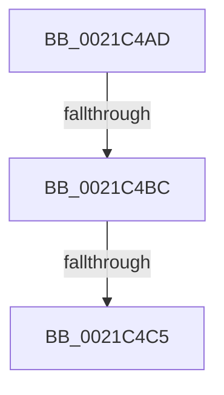

# sub_0021C4AD

- RVA: `0x0021C4AD`–`0x0021C4D9` (길이 `44` bytes)
- VA: `0x000000014021C4AD`
- 실행 섹션: `.text`
- PDB 이름 있음: `아니요`; PDB Function 태그: `아니요`
- unwind 정보 RVA: `0x0005EE84`
- 디코드: `11`개 명령, `44/44` bytes 표시
- 미해석 바이트: `0` (있으면 어셈블리에 `.byte`로 보존)

> 이 문서는 커널 이미지의 기계어와 PDB 기호를 분석해 생성했습니다. 4번과 5번은 함수 원형과 자료형을 바이너리 사용 방식에서 추정한 C 해석이며 원본 소스 복구 결과는 아닙니다.

## 1. Dependencies

- 직접 호출 지점: **2**; 고유 호출 대상: **2**
- 직접 호출자로 확인된 함수: **0**
- RIP 상대 이미지 참조: **0**

### Outgoing calls
- `0x0021C4B2` → [KiReleasePrcbLocksForIsolationUnit](../39/KiReleasePrcbLocksForIsolationUnit_function_00399C50.md) (function, `0x00399C50`)
- `0x0021C4CF` → [KiAcquirePrcbLocksForIsolationUnit](../30/KiAcquirePrcbLocksForIsolationUnit_function_0030ED60.md) (function, `0x0030ED60`)

### Direct callers
- 이 함수 시작 RVA로 연결되는 직접 call은 확인되지 않았습니다. 간접 호출은 완전히 역산할 수 없습니다.

### Static image references
- 디코드된 RIP-relative 메모리 참조가 없습니다.

## 2. Other-region calls and transfers

- 다른 실행 섹션으로 향하는 call: **0**
- call이 아닌 외부 분기/꼬리 이동: **3**
  - `0x0021C4BA` → [sub_0021C4E3](Unknown_function_0021C4E3.md) (`tail-transfer`)
  - `0x0021C4BF` → [sub_0021C78A](Unknown_function_0021C78A.md) (`tail-transfer`)
  - `0x0021C4D4` → [sub_0021C00A + 0xC7](Unknown_function_0021C00A.md) (`tail-transfer`)

## 3. Assembly (complete function range)

```asm
0021C4AD  48 8D 4C 24 30                  lea rcx, [rsp + 0x30]
0021C4B2  E8 99 D7 17 00                  call 0x140399c50
0021C4B7  45 84 F6                        test r14b, r14b
0021C4BA  75 27                           jne 0x14021c4e3
0021C4BC  48 85 DB                        test rbx, rbx
0021C4BF  0F 85 C5 02 00 00               jne 0x14021c78a
0021C4C5  4C 8D 44 24 30                  lea r8, [rsp + 0x30]
0021C4CA  33 D2                           xor edx, edx
0021C4CC  49 8B CC                        mov rcx, r12
0021C4CF  E8 8C 28 0F 00                  call 0x14030ed60
0021C4D4  E9 F8 FB FF FF                  jmp 0x14021c0d1
```

## 4. C-style interpretation (structured pseudocode)

```c
__int64 __fastcall sub_0021C4AD(__int64 a1, int a2, __int64 a3, __int64 a4, __int64 a5, __int64 a6)
{
    __int64 result;

    result = KiReleasePrcbLocksForIsolationUnit(a6, a2, a3, a4);
    a2 = 0;
    result = KiAcquirePrcbLocksForIsolationUnit(v_r12, a2, a6, a4);
}
```

## 5. (Beta) C Style

```c
int64_t sub_0021C4AD(int64_t Arg1, int32_t Arg2, int64_t Arg3, int64_t Arg4, uint64_t Arg5, int64_t Arg6)
{
    int64_t result;

    result = KiReleasePrcbLocksForIsolationUnit(Arg6, Arg2, Arg3, Arg4);
    Arg2 = 0;
    result = KiAcquirePrcbLocksForIsolationUnit(local_r12, Arg2, Arg6, Arg4);
}
```

## 6. Execution-region graph

[열기: 2D/3D 그래프와 함수 탐색 컨트롤 패널](../../../control-panel.html?section=text&rva=0x0021C4AD&view=graph)

- 2D 그래프는 위에서 아래로 흐르고, 3D 그래프는 빈 공간을 드래그해 회전합니다. Shift+드래그는 이동, 휠은 확대·축소, 함수 노드 선택은 대상 보고서 이동입니다.

### Static fallback


