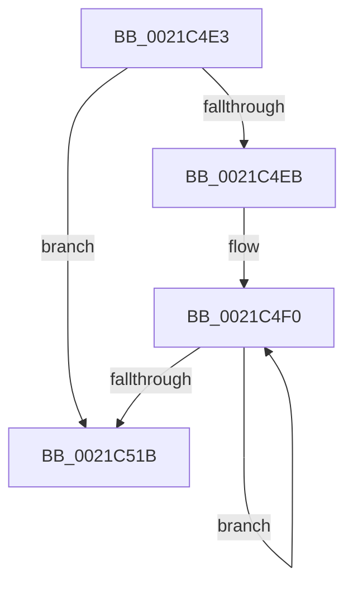

# sub_0021C4E3

- RVA: `0x0021C4E3`–`0x0021C52A` (길이 `71` bytes)
- VA: `0x000000014021C4E3`
- 실행 섹션: `.text`
- PDB 이름 있음: `아니요`; PDB Function 태그: `아니요`
- unwind 정보 RVA: `0x0005EEA8`
- 디코드: `19`개 명령, `71/71` bytes 표시
- 미해석 바이트: `0` (있으면 어셈블리에 `.byte`로 보존)

> 이 문서는 커널 이미지의 기계어와 PDB 기호를 분석해 생성했습니다. 4번과 5번은 함수 원형과 자료형을 바이너리 사용 방식에서 추정한 C 해석이며 원본 소스 복구 결과는 아닙니다.

## 1. Dependencies

- 직접 호출 지점: **2**; 고유 호출 대상: **2**
- 직접 호출자로 확인된 함수: **0**
- RIP 상대 이미지 참조: **0**

### Outgoing calls
- `0x0021C50B` → [KiCompleteRescheduleContextEntry](../35/KiCompleteRescheduleContextEntry_function_00356330.md) (function, `0x00356330`)
- `0x0021C523` → [KiFlushSoftwareInterruptBatch](../25/KiFlushSoftwareInterruptBatch_function_00252200.md) (function, `0x00252200`)

### Direct callers
- 이 함수 시작 RVA로 연결되는 직접 call은 확인되지 않았습니다. 간접 호출은 완전히 역산할 수 없습니다.

### Static image references
- 디코드된 RIP-relative 메모리 참조가 없습니다.

## 2. Other-region calls and transfers

- 다른 실행 섹션으로 향하는 call: **0**
- call이 아닌 외부 분기/꼬리 이동: **1**
  - `0x0021C528` → [sub_0021C4AD + 0xF](Unknown_function_0021C4AD.md) (`tail-transfer`)

## 3. Assembly (complete function range)

```asm
0021C4E3  80 3E 00                        cmp byte ptr [rsi], 0
0021C4E6  44 8B F7                        mov r14d, edi
0021C4E9  76 30                           jbe 0x14021c51b
0021C4EB  0F 1F 44 00 00                  nop dword ptr [rax + rax]
0021C4F0  41 8B C6                        mov eax, r14d
0021C4F3  45 33 C9                        xor r9d, r9d
0021C4F6  45 33 C0                        xor r8d, r8d
0021C4F9  49 8B D4                        mov rdx, r12
0021C4FC  48 8D 0C 85 02 00 00 00         lea rcx, [rax*4 + 2]
0021C504  48 03 C8                        add rcx, rax
0021C507  48 8D 0C CE                     lea rcx, [rsi + rcx*8]
0021C50B  E8 20 9E 13 00                  call 0x140356330
0021C510  0F B6 06                        movzx eax, byte ptr [rsi]
0021C513  41 FF C6                        inc r14d
0021C516  44 3B F0                        cmp r14d, eax
0021C519  72 D5                           jb 0x14021c4f0
0021C51B  49 8D 8C 24 D8 35 00 00         lea rcx, [r12 + 0x35d8]
0021C523  E8 D8 5C 03 00                  call 0x140252200
0021C528  EB 92                           jmp 0x14021c4bc
```

## 4. C-style interpretation (structured pseudocode)

```c
__int64 __fastcall sub_0021C4E3(__int64 a1, __int64 a2, int a3, int a4)
{
    __int64 result;
    __int64 v_r14;

    if ((*(unsigned __int8 *)(v_rsi)) <= 0) goto loc_0021C51B;
loc_0021C4F0:
    a4 = 0;
    a3 = 0;
    a1 = ((unsigned int)((unsigned int)((unsigned int)((unsigned int)(v_rdi)))) * 4 + 2) + ((unsigned int)((unsigned int)((unsigned int)((unsigned int)(v_rdi)))));
    result = KiCompleteRescheduleContextEntry(v_rsi + a1 * 8, v_r12, a3, a4);
    v_r14 = (unsigned int)(((unsigned int)((unsigned int)(v_rdi))) + 1);
    if (((unsigned int)(v_r14)) < ((unsigned int)(*(unsigned __int8 *)(v_rsi)))) goto loc_0021C4F0;
loc_0021C51B:
    result = KiFlushSoftwareInterruptBatch(v_r12 + 13784, v_r12, a3, a4);
}
```

## 5. (Beta) C Style

```c
int64_t sub_0021C4E3(int64_t Arg1, int64_t Arg2, int32_t Arg3, int32_t Arg4)
{
    int64_t result;
    int64_t local_r14;

    if ((*(uint8_t *)(local_rsi)) <= 0) goto loc_0021C51B;
loc_0021C4F0:
    Arg4 = 0;
    Arg3 = 0;
    Arg1 = ((uint32_t)((uint32_t)((uint32_t)((uint32_t)(local_rdi)))) * 4 + 2) + ((uint32_t)((uint32_t)((uint32_t)((uint32_t)(local_rdi)))));
    result = KiCompleteRescheduleContextEntry(local_rsi + Arg1 * 8, local_r12, Arg3, Arg4);
    local_r14 = (uint32_t)(((uint32_t)((uint32_t)(local_rdi))) + 1);
    if (((uint32_t)(local_r14)) < ((uint32_t)(*(uint8_t *)(local_rsi)))) goto loc_0021C4F0;
loc_0021C51B:
    result = KiFlushSoftwareInterruptBatch(local_r12 + 13784, local_r12, Arg3, Arg4);
}
```

## 6. Execution-region graph

[열기: 2D/3D 그래프와 함수 탐색 컨트롤 패널](../../../control-panel.html?section=text&rva=0x0021C4E3&view=graph)

- 2D 그래프는 위에서 아래로 흐르고, 3D 그래프는 빈 공간을 드래그해 회전합니다. Shift+드래그는 이동, 휠은 확대·축소, 함수 노드 선택은 대상 보고서 이동입니다.

### Static fallback


