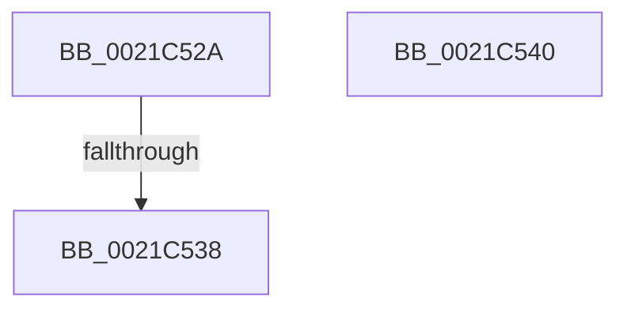

# sub_0021C52A

- RVA: `0x0021C52A`–`0x0021C548` (길이 `30` bytes)
- VA: `0x000000014021C52A`
- 실행 섹션: `.text`
- PDB 이름 있음: `아니요`; PDB Function 태그: `아니요`
- unwind 정보 RVA: `0x0005EEBC`
- 디코드: `6`개 명령, `30/30` bytes 표시
- 미해석 바이트: `0` (있으면 어셈블리에 `.byte`로 보존)

> 이 문서는 커널 이미지의 기계어와 PDB 기호를 분석해 생성했습니다. 4번과 5번은 함수 원형과 자료형을 바이너리 사용 방식에서 추정한 C 해석이며 원본 소스 복구 결과는 아닙니다.

## 1. Dependencies

- 직접 호출 지점: **0**; 고유 호출 대상: **0**
- 직접 호출자로 확인된 함수: **0**
- RIP 상대 이미지 참조: **0**

### Outgoing calls
- 직접 디코드된 call 명령이 없습니다.

### Direct callers
- 이 함수 시작 RVA로 연결되는 직접 call은 확인되지 않았습니다. 간접 호출은 완전히 역산할 수 없습니다.

### Static image references
- 디코드된 RIP-relative 메모리 참조가 없습니다.

## 2. Other-region calls and transfers

- 다른 실행 섹션으로 향하는 call: **0**
- call이 아닌 외부 분기/꼬리 이동: **3**
  - `0x0021C532` → [sub_0021C0DA + 0x1D](Unknown_function_0021C0DA.md) (`tail-transfer`)
  - `0x0021C53B` → [sub_0021BDD6 + 0x37](Unknown_function_0021BDD6.md) (`tail-transfer`)
  - `0x0021C543` → [sub_0021BDD6 + 0x1E0](Unknown_function_0021BDD6.md) (`tail-transfer`)

## 3. Assembly (complete function range)

```asm
0021C52A  41 F7 46 78 00 00 40 00         test dword ptr [r14 + 0x78], 0x400000
0021C532  0F 85 BF FB FF FF               jne 0x14021c0f7
0021C538  44 8B E1                        mov r12d, ecx
0021C53B  E9 CD F8 FF FF                  jmp 0x14021be0d
0021C540  4C 8B C7                        mov r8, rdi
0021C543  E9 6E FA FF FF                  jmp 0x14021bfb6
```

## 4. C-style interpretation (structured pseudocode)

```c
void __fastcall sub_0021C52A(int a1)
{
}
```

## 5. (Beta) C Style

```c
void sub_0021C52A(int32_t Arg1)
{
}
```

## 6. Execution-region graph

[열기: 2D/3D 그래프와 함수 탐색 컨트롤 패널](../../../control-panel.html?section=text&rva=0x0021C52A&view=graph)

- 2D 그래프는 위에서 아래로 흐르고, 3D 그래프는 빈 공간을 드래그해 회전합니다. Shift+드래그는 이동, 휠은 확대·축소, 함수 노드 선택은 대상 보고서 이동입니다.

### Static fallback


