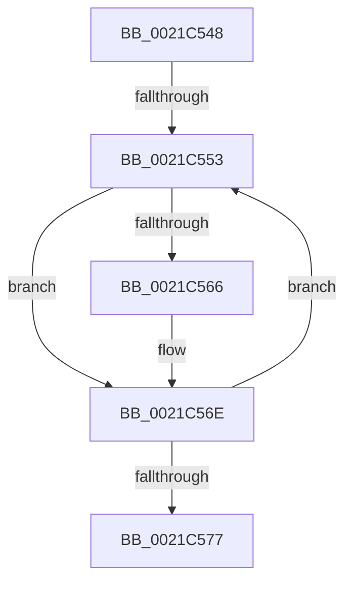

# sub_0021C548

- RVA: `0x0021C548`–`0x0021C57C` (길이 `52` bytes)
- VA: `0x000000014021C548`
- 실행 섹션: `.text`
- PDB 이름 있음: `아니요`; PDB Function 태그: `아니요`
- unwind 정보 RVA: `0x0005EED4`
- 디코드: `16`개 명령, `52/52` bytes 표시
- 미해석 바이트: `0` (있으면 어셈블리에 `.byte`로 보존)

> 이 문서는 커널 이미지의 기계어와 PDB 기호를 분석해 생성했습니다. 4번과 5번은 함수 원형과 자료형을 바이너리 사용 방식에서 추정한 C 해석이며 원본 소스 복구 결과는 아닙니다.

## 1. Dependencies

- 직접 호출 지점: **0**; 고유 호출 대상: **0**
- 직접 호출자로 확인된 함수: **0**
- RIP 상대 이미지 참조: **0**

### Outgoing calls
- 직접 디코드된 call 명령이 없습니다.

### Direct callers
- 이 함수 시작 RVA로 연결되는 직접 call은 확인되지 않았습니다. 간접 호출은 완전히 역산할 수 없습니다.

### Static image references
- 디코드된 RIP-relative 메모리 참조가 없습니다.

## 2. Other-region calls and transfers

- 다른 실행 섹션으로 향하는 call: **0**
- call이 아닌 외부 분기/꼬리 이동: **2**
  - `0x0021C54D` → [sub_0021C00A + 0x90](Unknown_function_0021C00A.md) (`tail-transfer`)
  - `0x0021C577` → [sub_0021C00A + 0x90](Unknown_function_0021C00A.md) (`tail-transfer`)

## 3. Assembly (complete function range)

```asm
0021C548  80 3E 00                        cmp byte ptr [rsi], 0
0021C54B  8B D7                           mov edx, edi
0021C54D  0F 86 47 FB FF FF               jbe 0x14021c09a
0021C553  8B C2                           mov eax, edx
0021C555  48 8D 04 80                     lea rax, [rax + rax*4]
0021C559  48 8D 40 02                     lea rax, [rax + 2]
0021C55D  48 8D 04 C6                     lea rax, [rsi + rax*8]
0021C561  49 3B C1                        cmp rax, r9
0021C564  74 08                           je 0x14021c56e
0021C566  80 48 20 08                     or byte ptr [rax + 0x20], 8
0021C56A  80 48 22 02                     or byte ptr [rax + 0x22], 2
0021C56E  0F B6 06                        movzx eax, byte ptr [rsi]
0021C571  FF C2                           inc edx
0021C573  3B D0                           cmp edx, eax
0021C575  72 DC                           jb 0x14021c553
0021C577  E9 1E FB FF FF                  jmp 0x14021c09a
```

## 4. C-style interpretation (structured pseudocode)

```c
__int64 __fastcall sub_0021C548(__int64 a1, __int64 a2, __int64 a3, __int64 a4)
{
loc_0021C553:
    if ((v_rsi + (unsigned int)((unsigned int)((unsigned int)((unsigned int)(v_rdi)))) + (unsigned int)((unsigned int)((unsigned int)((unsigned int)(v_rdi)))) * 4 + 2 * 8) != a4) {
    }
    a2 = (unsigned int)(((unsigned int)((unsigned int)(v_rdi))) + 1);
    if (((unsigned int)(a2)) < ((unsigned int)(*(unsigned __int8 *)(v_rsi)))) goto loc_0021C553;
}
```

## 5. (Beta) C Style

```c
int64_t sub_0021C548(int64_t Arg1, int64_t Arg2, int64_t Arg3, int64_t Arg4)
{
loc_0021C553:
    if ((local_rsi + (uint32_t)((uint32_t)((uint32_t)((uint32_t)(local_rdi)))) + (uint32_t)((uint32_t)((uint32_t)((uint32_t)(local_rdi)))) * 4 + 2 * 8) != Arg4) {
    }
    Arg2 = (uint32_t)(((uint32_t)((uint32_t)(local_rdi))) + 1);
    if (((uint32_t)(Arg2)) < ((uint32_t)(*(uint8_t *)(local_rsi)))) goto loc_0021C553;
}
```

## 6. Execution-region graph

[열기: 2D/3D 그래프와 함수 탐색 컨트롤 패널](../../../control-panel.html?section=text&rva=0x0021C548&view=graph)

- 2D 그래프는 위에서 아래로 흐르고, 3D 그래프는 빈 공간을 드래그해 회전합니다. Shift+드래그는 이동, 휠은 확대·축소, 함수 노드 선택은 대상 보고서 이동입니다.

### Static fallback


