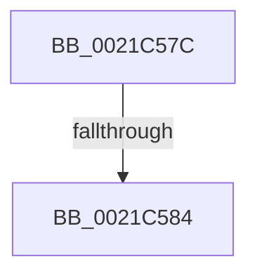

# sub_0021C57C

- RVA: `0x0021C57C`–`0x0021C5A5` (길이 `41` bytes)
- VA: `0x000000014021C57C`
- 실행 섹션: `.text`
- PDB 이름 있음: `아니요`; PDB Function 태그: `아니요`
- unwind 정보 RVA: `0x0005EEE8`
- 디코드: `10`개 명령, `41/41` bytes 표시
- 미해석 바이트: `0` (있으면 어셈블리에 `.byte`로 보존)

> 이 문서는 커널 이미지의 기계어와 PDB 기호를 분석해 생성했습니다. 4번과 5번은 함수 원형과 자료형을 바이너리 사용 방식에서 추정한 C 해석이며 원본 소스 복구 결과는 아닙니다.

## 1. Dependencies

- 직접 호출 지점: **2**; 고유 호출 대상: **2**
- 직접 호출자로 확인된 함수: **0**
- RIP 상대 이미지 참조: **0**

### Outgoing calls
- `0x0021C58F` → [KiRemoveThreadFromReadyQueue](../20/KiRemoveThreadFromReadyQueue_function_002016C8.md) (function, `0x002016C8`)
- `0x0021C59B` → [KiInsertDeferredReadyList](../20/KiInsertDeferredReadyList_function_00201310.md) (function, `0x00201310`)

### Direct callers
- 이 함수 시작 RVA로 연결되는 직접 call은 확인되지 않았습니다. 간접 호출은 완전히 역산할 수 없습니다.

### Static image references
- 디코드된 RIP-relative 메모리 참조가 없습니다.

## 2. Other-region calls and transfers

- 다른 실행 섹션으로 향하는 call: **0**
- call이 아닌 외부 분기/꼬리 이동: **2**
  - `0x0021C57E` → [sub_0021C284 + 0x136](Unknown_function_0021C284.md) (`tail-transfer`)
  - `0x0021C5A0` → [sub_0021C284 + 0x136](Unknown_function_0021C284.md) (`tail-transfer`)

## 3. Assembly (complete function range)

```asm
0021C57C  84 C9                           test cl, cl
0021C57E  0F 84 36 FE FF FF               je 0x14021c3ba
0021C584  48 8B 4C 24 38                  mov rcx, qword ptr [rsp + 0x38]
0021C589  45 8B C7                        mov r8d, r15d
0021C58C  49 8B D5                        mov rdx, r13
0021C58F  E8 34 51 FE FF                  call 0x1402016c8
0021C594  48 8B D6                        mov rdx, rsi
0021C597  48 8D 4D C7                     lea rcx, [rbp - 0x39]
0021C59B  E8 70 4D FE FF                  call 0x140201310
0021C5A0  E9 15 FE FF FF                  jmp 0x14021c3ba
```

## 4. C-style interpretation (structured pseudocode)

```c
__int64 __fastcall sub_0021C57C(unsigned __int8 a1, __int64 a2, __int64 a3, __int64 a4, __int64 a5, __int64 a6, __int64 a7)
{
    __int64 result;

    result = KiRemoveThreadFromReadyQueue(a7, v_r13, (unsigned int)((unsigned int)(v_r15)), a4);
    result = KiInsertDeferredReadyList(v_rbp - 57, v_rsi, (unsigned int)((unsigned int)(v_r15)), a4);
}
```

## 5. (Beta) C Style

```c
int64_t sub_0021C57C(uint8_t Arg1, int64_t Arg2, int64_t Arg3, int64_t Arg4, uint64_t Arg5, uint64_t Arg6, int64_t Arg7)
{
    int64_t result;

    result = KiRemoveThreadFromReadyQueue(Arg7, local_r13, (uint32_t)((uint32_t)(local_r15)), Arg4);
    result = KiInsertDeferredReadyList(local_rbp - 57, local_rsi, (uint32_t)((uint32_t)(local_r15)), Arg4);
}
```

## 6. Execution-region graph

[열기: 2D/3D 그래프와 함수 탐색 컨트롤 패널](../../../control-panel.html?section=text&rva=0x0021C57C&view=graph)

- 2D 그래프는 위에서 아래로 흐르고, 3D 그래프는 빈 공간을 드래그해 회전합니다. Shift+드래그는 이동, 휠은 확대·축소, 함수 노드 선택은 대상 보고서 이동입니다.

### Static fallback


