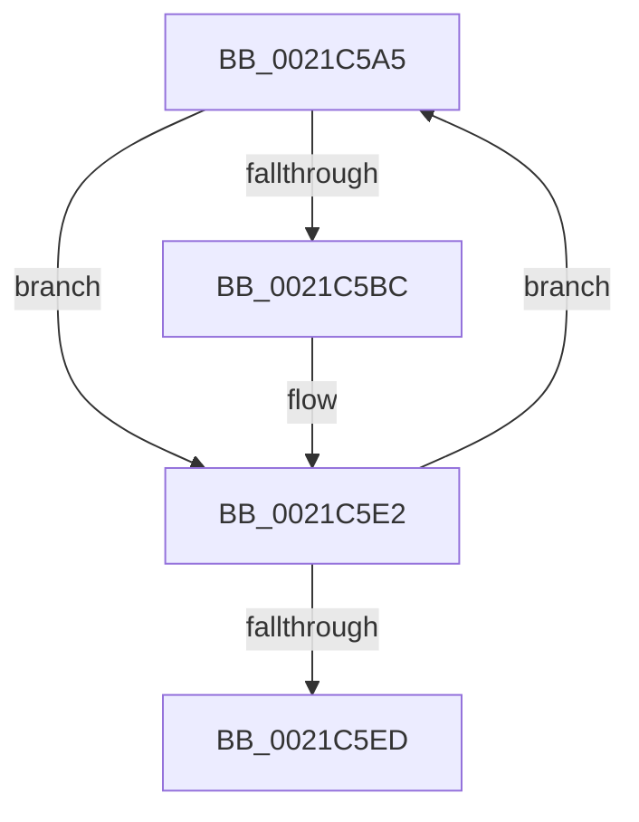

# sub_0021C5A5

- RVA: `0x0021C5A5`–`0x0021C5F2` (길이 `77` bytes)
- VA: `0x000000014021C5A5`
- 실행 섹션: `.text`
- PDB 이름 있음: `아니요`; PDB Function 태그: `아니요`
- unwind 정보 RVA: `0x0005EF00`
- 디코드: `22`개 명령, `77/77` bytes 표시
- 미해석 바이트: `0` (있으면 어셈블리에 `.byte`로 보존)

> 이 문서는 커널 이미지의 기계어와 PDB 기호를 분석해 생성했습니다. 4번과 5번은 함수 원형과 자료형을 바이너리 사용 방식에서 추정한 C 해석이며 원본 소스 복구 결과는 아닙니다.

## 1. Dependencies

- 직접 호출 지점: **0**; 고유 호출 대상: **0**
- 직접 호출자로 확인된 함수: **0**
- RIP 상대 이미지 참조: **0**

### Outgoing calls
- 직접 디코드된 call 명령이 없습니다.

### Direct callers
- 이 함수 시작 RVA로 연결되는 직접 call은 확인되지 않았습니다. 간접 호출은 완전히 역산할 수 없습니다.

### Static image references
- 디코드된 RIP-relative 메모리 참조가 없습니다.

## 2. Other-region calls and transfers

- 다른 실행 섹션으로 향하는 call: **0**
- call이 아닌 외부 분기/꼬리 이동: **1**
  - `0x0021C5ED` → [sub_0021C210 + 0x62](Unknown_function_0021C210.md) (`tail-transfer`)

## 3. Assembly (complete function range)

```asm
0021C5A5  41 8B C0                        mov eax, r8d
0021C5A8  48 8D 14 85 02 00 00 00         lea rdx, [rax*4 + 2]
0021C5B0  48 03 D0                        add rdx, rax
0021C5B3  48 8D 14 D6                     lea rdx, [rsi + rdx*8]
0021C5B7  49 3B D1                        cmp rdx, r9
0021C5BA  74 26                           je 0x14021c5e2
0021C5BC  80 4A 22 02                     or byte ptr [rdx + 0x22], 2
0021C5C0  48 8B 0A                        mov rcx, qword ptr [rdx]
0021C5C3  48 8B 41 18                     mov rax, qword ptr [rcx + 0x18]
0021C5C7  48 89 42 10                     mov qword ptr [rdx + 0x10], rax
0021C5CB  0F B6 42 20                     movzx eax, byte ptr [rdx + 0x20]
0021C5CF  24 C5                           and al, 0xc5
0021C5D1  0C 05                           or al, 5
0021C5D3  88 42 20                        mov byte ptr [rdx + 0x20], al
0021C5D6  48 8B 41 18                     mov rax, qword ptr [rcx + 0x18]
0021C5DA  80 62 21 FE                     and byte ptr [rdx + 0x21], 0xfe
0021C5DE  48 89 42 18                     mov qword ptr [rdx + 0x18], rax
0021C5E2  0F B6 06                        movzx eax, byte ptr [rsi]
0021C5E5  41 FF C0                        inc r8d
0021C5E8  44 3B C0                        cmp r8d, eax
0021C5EB  72 B8                           jb 0x14021c5a5
0021C5ED  E9 80 FC FF FF                  jmp 0x14021c272
```

## 4. C-style interpretation (structured pseudocode)

```c
__int64 __fastcall sub_0021C5A5(__int64 a1, __int64 a2, int a3, __int64 a4)
{
    __int64 result;

    a2 = ((unsigned int)(a3) * 4 + 2) + ((unsigned int)(a3));
    result = (unsigned int)(a3);
    if ((v_rsi + a2 * 8) != a4) {
        a1 = *(unsigned __int64 *)(v_rsi + a2 * 8);
        result = *(unsigned __int64 *)(a1 + 24);
        *(unsigned __int64 *)(v_rsi + a2 * 8 + 16) = result;
        result = *(unsigned __int8 *)(v_rsi + a2 * 8 + 32);
        result = (unsigned __int8)((result) & (197));
        result = (unsigned __int8)((result) | (5));
        *(unsigned __int8 *)(v_rsi + a2 * 8 + 32) = (unsigned __int8)(result);
        result = *(unsigned __int64 *)(a1 + 24);
        *(unsigned __int64 *)(v_rsi + a2 * 8 + 24) = result;
    }
    a3 = (unsigned int)((a3) + 1);
    if (a3 < ((unsigned int)(*(unsigned __int8 *)(v_rsi)))) goto loc_0021C5A5;
}
```

## 5. (Beta) C Style

```c
int64_t sub_0021C5A5(int64_t Arg1, int64_t Arg2, int32_t Arg3, int64_t Arg4)
{
    int64_t result;

    Arg2 = ((uint32_t)(Arg3) * 4 + 2) + ((uint32_t)(Arg3));
    result = (uint32_t)(Arg3);
    if ((local_rsi + Arg2 * 8) != Arg4) {
        Arg1 = *(uint64_t *)(local_rsi + Arg2 * 8);
        result = *(uint64_t *)(Arg1 + 0x18);
        *(uint64_t *)(local_rsi + Arg2 * 8 + 0x10) = result;
        result = *(uint8_t *)(local_rsi + Arg2 * 8 + 0x20);
        result = (uint8_t)((result) & (197));
        result = (uint8_t)((result) | (5));
        *(uint8_t *)(local_rsi + Arg2 * 8 + 0x20) = (uint8_t)(result);
        result = *(uint64_t *)(Arg1 + 0x18);
        *(uint64_t *)(local_rsi + Arg2 * 8 + 0x18) = result;
    }
    Arg3 = (uint32_t)((Arg3) + 1);
    if (Arg3 < ((uint32_t)(*(uint8_t *)(local_rsi)))) goto loc_0021C5A5;
}
```

## 6. Execution-region graph

[열기: 2D/3D 그래프와 함수 탐색 컨트롤 패널](../../../control-panel.html?section=text&rva=0x0021C5A5&view=graph)

- 2D 그래프는 위에서 아래로 흐르고, 3D 그래프는 빈 공간을 드래그해 회전합니다. Shift+드래그는 이동, 휠은 확대·축소, 함수 노드 선택은 대상 보고서 이동입니다.

### Static fallback


