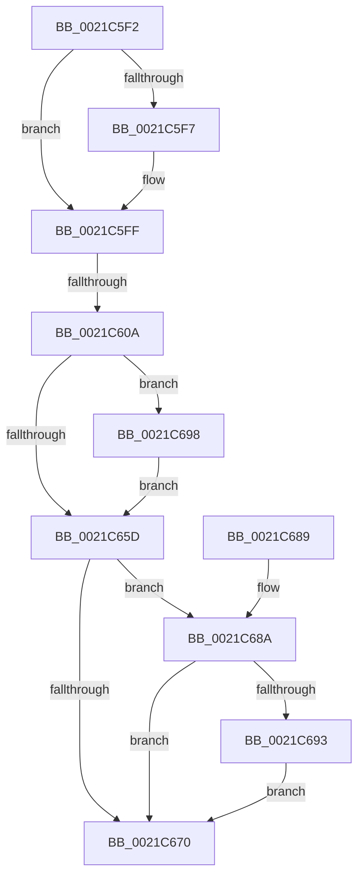

# sub_0021C5F2

- RVA: `0x0021C5F2`–`0x0021C69D` (길이 `171` bytes)
- VA: `0x000000014021C5F2`
- 실행 섹션: `.text`
- PDB 이름 있음: `아니요`; PDB Function 태그: `아니요`
- unwind 정보 RVA: `0x0005EF14`
- 디코드: `48`개 명령, `171/171` bytes 표시
- 미해석 바이트: `0` (있으면 어셈블리에 `.byte`로 보존)

> 이 문서는 커널 이미지의 기계어와 PDB 기호를 분석해 생성했습니다. 4번과 5번은 함수 원형과 자료형을 바이너리 사용 방식에서 추정한 C 해석이며 원본 소스 복구 결과는 아닙니다.

## 1. Dependencies

- 직접 호출 지점: **7**; 고유 호출 대상: **7**
- 직접 호출자로 확인된 함수: **0**
- RIP 상대 이미지 참조: **1**

### Outgoing calls
- `0x0021C615` → [KiCaptureTotalCyclesCurrentThread](../37/KiCaptureTotalCyclesCurrentThread_function_0037CB90.md) (function, `0x0037CB90`)
- `0x0021C620` → [KiUpdatePriorityMatrixForRunningTransition](../37/KiUpdatePriorityMatrixForRunningTransition_function_0037B3A0.md) (function, `0x0037B3A0`)
- `0x0021C638` → [KiQueueReadyThread](KiQueueReadyThread_function_0021C7B0.md) (function, `0x0021C7B0`)
- `0x0021C645` → [KiAbProcessPreContextSwitch](KiAbProcessPreContextSwitch_function_0021D420.md) (function, `0x0021D420`)
- `0x0021C64C` → [KeIsUserVaAccessAllowed](KeIsUserVaAccessAllowed_function_0021D740.md) (function, `0x0021D740`)
- `0x0021C666` → [KiSwapContext](../6B/KiSwapContext_function_006B9740.md) (function, `0x006B9740`)
- `0x0021C673` → [KiAbProcessPostContextSwitch](../24/KiAbProcessPostContextSwitch_function_00248790.md) (function, `0x00248790`)

### Direct callers
- 이 함수 시작 RVA로 연결되는 직접 call은 확인되지 않았습니다. 간접 호출은 완전히 역산할 수 없습니다.

### Static image references
- `0x0021C651` → RVA `0x00FC6BF0` (`ALMOSTRO`; read)

## 2. Other-region calls and transfers

- 다른 실행 섹션으로 향하는 call: **0**
- call이 아닌 외부 분기/꼬리 이동: **1**
  - `0x0021C604` → [sub_0021BCD7 + 0x68](Unknown_function_0021BCD7.md) (`tail-transfer`)

## 3. Assembly (complete function range)

```asm
0021C5F2  45 84 FF                        test r15b, r15b
0021C5F5  74 08                           je 0x14021c5ff
0021C5F7  41 C6 86 35 02 00 00 00         mov byte ptr [r14 + 0x235], 0
0021C5FF  4D 3B 74 24 18                  cmp r14, qword ptr [r12 + 0x18]
0021C604  0F 84 35 F7 FF FF               je 0x14021bd3f
0021C60A  49 8B D6                        mov rdx, r14
0021C60D  49 89 7C 24 10                  mov qword ptr [r12 + 0x10], rdi
0021C612  49 8B CC                        mov rcx, r12
0021C615  E8 76 05 16 00                  call 0x14037cb90
0021C61A  48 8B D3                        mov rdx, rbx
0021C61D  49 8B CC                        mov rcx, r12
0021C620  E8 7B ED 15 00                  call 0x14037b3a0
0021C625  4D 8B C6                        mov r8, r14
0021C628  41 C6 86 83 02 00 00 1E         mov byte ptr [r14 + 0x283], 0x1e
0021C630  48 8D 54 24 30                  lea rdx, [rsp + 0x30]
0021C635  49 8B CC                        mov rcx, r12
0021C638  E8 73 01 00 00                  call 0x14021c7b0
0021C63D  BA 01 00 00 00                  mov edx, 1
0021C642  49 8B CE                        mov rcx, r14
0021C645  E8 D6 0D 00 00                  call 0x14021d420
0021C64A  33 C9                           xor ecx, ecx
0021C64C  E8 EF 10 00 00                  call 0x14021d740
0021C651  83 3D 98 A5 DA 00 00            cmp dword ptr [rip + 0xdaa598], 0
0021C658  0F B6 F8                        movzx edi, al
0021C65B  75 3B                           jne 0x14021c698
0021C65D  41 B0 01                        mov r8b, 1
0021C660  48 8B D3                        mov rdx, rbx
0021C663  49 8B CE                        mov rcx, r14
0021C666  E8 D5 D0 49 00                  call 0x1406b9740
0021C66B  40 84 FF                        test dil, dil
0021C66E  74 1A                           je 0x14021c68a
0021C670  49 8B CE                        mov rcx, r14
0021C673  E8 18 C1 02 00                  call 0x140248790
0021C678  48 81 C4 E8 00 00 00            add rsp, 0xe8
0021C67F  41 5F                           pop r15
0021C681  41 5E                           pop r14
0021C683  41 5C                           pop r12
0021C685  5F                              pop rdi
0021C686  5B                              pop rbx
0021C687  5D                              pop rbp
0021C688  C3                              ret
0021C689  CC                              int3
0021C68A  83 3D 5F A5 DA 00 00            cmp dword ptr [rip + 0xdaa55f], 0
0021C691  74 DD                           je 0x14021c670
0021C693  0F 01 CA                        clac
0021C696  EB D8                           jmp 0x14021c670
0021C698  0F 01 CB                        stac
0021C69B  EB C0                           jmp 0x14021c65d
```

## 4. C-style interpretation (structured pseudocode)

```c
__int64 __fastcall sub_0021C5F2(__int64 a1, __int64 a2, __int64 a3, __int64 a4, __int64 a5, __int64 a6)
{
    __int64 result;
    __int64 v_rsp;

    if ((unsigned __int8)(v_r15) != 0) {
        *(unsigned __int8 *)(v_r14 + 565) = 0;
    }
    *(unsigned __int64 *)(v_r12 + 16) = v_rdi;
    result = KiCaptureTotalCyclesCurrentThread(v_r12, v_r14, a3, a4);
    result = KiUpdatePriorityMatrixForRunningTransition(v_r12, v_rbx, a3, a4);
    *(unsigned __int8 *)(v_r14 + 643) = 30;
    result = KiQueueReadyThread(v_r12, a6, v_r14, a4);
    result = KiAbProcessPreContextSwitch(v_r14, 1, v_r14, a4);
    a1 = 0;
    result = KeIsUserVaAccessAllowed(a1, 1, v_r14, a4);
    if ((*(unsigned int *)(v_rip + 14329240)) != 0) goto loc_0021C698;
loc_0021C65D:
    result = KiSwapContext(v_r14, v_rbx, 1, a4);
    if ((unsigned __int8)((unsigned __int8)(result)) == 0) goto loc_0021C68A;
loc_0021C670:
    result = KiAbProcessPostContextSwitch(v_r14, v_rbx, 1, a4);
    v_rsp = (v_rsp) + (232);
    return result;
loc_0021C68A:
    if ((*(unsigned int *)(v_rip + 14329183)) == 0) goto loc_0021C670;
    goto loc_0021C670;
loc_0021C698:
    goto loc_0021C65D;
}
```

## 5. (Beta) C Style

```c
int64_t sub_0021C5F2(int64_t Arg1, int64_t Arg2, int64_t Arg3, int64_t Arg4, uint64_t Arg5, int64_t Arg6)
{
    int64_t result;
    int64_t local_rsp;

    if ((uint8_t)(local_r15) != 0) {
        *(uint8_t *)(local_r14 + 0x235) = 0;
    }
    *(uint64_t *)(local_r12 + 0x10) = local_rdi;
    result = KiCaptureTotalCyclesCurrentThread(local_r12, local_r14, Arg3, Arg4);
    result = KiUpdatePriorityMatrixForRunningTransition(local_r12, local_rbx, Arg3, Arg4);
    *(uint8_t *)(local_r14 + 0x283) = 30;
    result = KiQueueReadyThread(local_r12, Arg6, local_r14, Arg4);
    result = KiAbProcessPreContextSwitch(local_r14, 1, local_r14, Arg4);
    Arg1 = 0;
    result = KeIsUserVaAccessAllowed(Arg1, 1, local_r14, Arg4);
    if ((*(uint32_t *)(v_rip + 0xDAA598)) != 0) goto loc_0021C698;
loc_0021C65D:
    result = KiSwapContext(local_r14, local_rbx, 1, Arg4);
    if ((uint8_t)((uint8_t)(result)) == 0) goto loc_0021C68A;
loc_0021C670:
    result = KiAbProcessPostContextSwitch(local_r14, local_rbx, 1, Arg4);
    local_rsp = (local_rsp) + (232);
    return result;
loc_0021C68A:
    if ((*(uint32_t *)(v_rip + 0xDAA55F)) == 0) goto loc_0021C670;
    goto loc_0021C670;
loc_0021C698:
    goto loc_0021C65D;
}
```

## 6. Execution-region graph

[열기: 2D/3D 그래프와 함수 탐색 컨트롤 패널](../../../control-panel.html?section=text&rva=0x0021C5F2&view=graph)

- 2D 그래프는 위에서 아래로 흐르고, 3D 그래프는 빈 공간을 드래그해 회전합니다. Shift+드래그는 이동, 휠은 확대·축소, 함수 노드 선택은 대상 보고서 이동입니다.

### Static fallback


