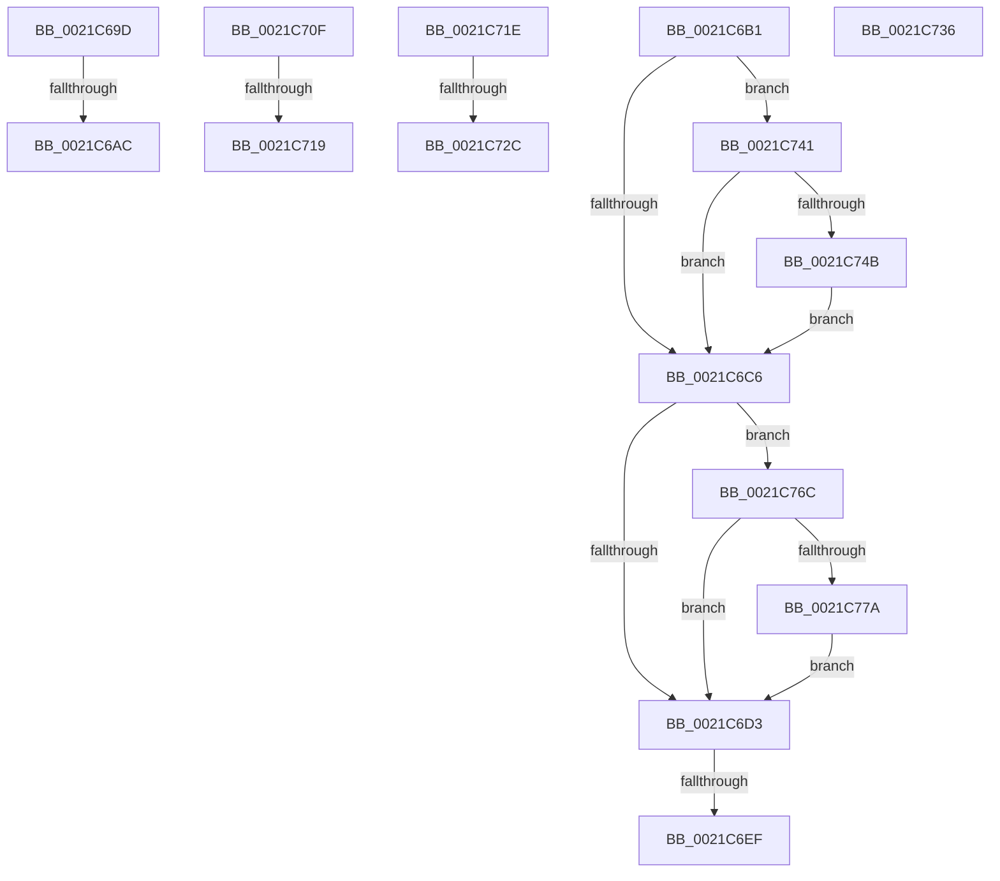

# sub_0021C69D

- RVA: `0x0021C69D`–`0x0021C78A` (길이 `237` bytes)
- VA: `0x000000014021C69D`
- 실행 섹션: `.text`
- PDB 이름 있음: `아니요`; PDB Function 태그: `아니요`
- unwind 정보 RVA: `0x0005EF28`
- 디코드: `54`개 명령, `237/237` bytes 표시
- 미해석 바이트: `0` (있으면 어셈블리에 `.byte`로 보존)

> 이 문서는 커널 이미지의 기계어와 PDB 기호를 분석해 생성했습니다. 4번과 5번은 함수 원형과 자료형을 바이너리 사용 방식에서 추정한 C 해석이며 원본 소스 복구 결과는 아닙니다.

## 1. Dependencies

- 직접 호출 지점: **4**; 고유 호출 대상: **4**
- 직접 호출자로 확인된 함수: **0**
- RIP 상대 이미지 참조: **1**

### Outgoing calls
- `0x0021C6E1` → [KiDeferredReadyThread](../39/KiDeferredReadyThread_function_00398640.md) (function, `0x00398640`)
- `0x0021C6FA` → [KiAcquirePrcbLocksForIsolationUnit](../30/KiAcquirePrcbLocksForIsolationUnit_function_0030ED60.md) (function, `0x0030ED60`)
- `0x0021C762` → [KiSetPriorityBoost](../39/KiSetPriorityBoost_function_00398A40.md) (function, `0x00398A40`)
- `0x0021C780` → [EtwTraceAntiStarvationBoost](../64/EtwTraceAntiStarvationBoost_function_0064F568.md) (function, `0x0064F568`)

### Direct callers
- 이 함수 시작 RVA로 연결되는 직접 call은 확인되지 않았습니다. 간접 호출은 완전히 역산할 수 없습니다.

### Static image references
- `0x0021C76C` → RVA `0x00FC6B08` (`ALMOSTRO`; read)

## 2. Other-region calls and transfers

- 다른 실행 섹션으로 향하는 call: **0**
- call이 아닌 외부 분기/꼬리 이동: **9**
  - `0x0021C6A6` → [sub_0021C284 + 0x1AC](Unknown_function_0021C284.md) (`tail-transfer`)
  - `0x0021C6AC` → [sub_0021C284 + 0x1BC](Unknown_function_0021C284.md) (`tail-transfer`)
  - `0x0021C6E9` → [sub_0021C284 + 0x18E](Unknown_function_0021C284.md) (`tail-transfer`)
  - `0x0021C70A` → [sub_006D68EC + 0x5](../6D/Unknown_function_006D68EC.md) (`tail-transfer`)
  - `0x0021C713` → [sub_0021BAB9 + 0x1A0](Unknown_function_0021BAB9.md) (`tail-transfer`)
  - `0x0021C719` → [sub_0021BAB9 + 0x3B](Unknown_function_0021BAB9.md) (`tail-transfer`)
  - `0x0021C726` → [sub_0021BDD6 + 0x1C](Unknown_function_0021BDD6.md) (`tail-transfer`)
  - `0x0021C731` → [sub_0021BDD6 + 0x13A](Unknown_function_0021BDD6.md) (`tail-transfer`)
  - `0x0021C73C` → [sub_0021C0DA + 0x90](Unknown_function_0021C0DA.md) (`tail-transfer`)

## 3. Assembly (complete function range)

```asm
0021C69D  F3 90                           pause
0021C69F  48 8B 43 40                     mov rax, qword ptr [rbx + 0x40]
0021C6A3  48 85 C0                        test rax, rax
0021C6A6  0F 84 84 FD FF FF               je 0x14021c430
0021C6AC  E9 8F FD FF FF                  jmp 0x14021c440
0021C6B1  44 0F BE B3 C3 00 00 00         movsx r14d, byte ptr [rbx + 0xc3]
0021C6B9  41 8B C5                        mov eax, r13d
0021C6BC  2B 83 B4 01 00 00               sub eax, dword ptr [rbx + 0x1b4]
0021C6C2  85 C0                           test eax, eax
0021C6C4  7F 7B                           jg 0x14021c741
0021C6C6  48 89 7B 40                     mov qword ptr [rbx + 0x40], rdi
0021C6CA  45 84 E4                        test r12b, r12b
0021C6CD  0F 85 99 00 00 00               jne 0x14021c76c
0021C6D3  4C 8B 64 24 38                  mov r12, qword ptr [rsp + 0x38]
0021C6D8  45 33 C0                        xor r8d, r8d
0021C6DB  49 8B CC                        mov rcx, r12
0021C6DE  48 8B D3                        mov rdx, rbx
0021C6E1  E8 5A BF 17 00                  call 0x140398640
0021C6E6  48 85 F6                        test rsi, rsi
0021C6E9  0F 85 23 FD FF FF               jne 0x14021c412
0021C6EF  4C 8D 44 24 30                  lea r8, [rsp + 0x30]
0021C6F4  49 8B CC                        mov rcx, r12
0021C6F7  8D 56 01                        lea edx, [rsi + 1]
0021C6FA  E8 61 26 0F 00                  call 0x14030ed60
0021C6FF  8B 55 77                        mov edx, dword ptr [rbp + 0x77]
0021C702  44 8B 7D BB                     mov r15d, dword ptr [rbp - 0x45]
0021C706  44 8B 6D 6F                     mov r13d, dword ptr [rbp + 0x6f]
0021C70A  E9 E2 A1 4B 00                  jmp 0x1406d68f1
0021C70F  4D 3B 6E 20                     cmp r13, qword ptr [r14 + 0x20]
0021C713  0F 82 40 F5 FF FF               jb 0x14021bc59
0021C719  E9 D6 F3 FF FF                  jmp 0x14021baf4
0021C71E  41 80 BE C3 00 00 00 10         cmp byte ptr [r14 + 0xc3], 0x10
0021C726  0F 8C C6 F6 FF FF               jl 0x14021bdf2
0021C72C  BB 7F 00 00 00                  mov ebx, 0x7f
0021C731  E9 DA F7 FF FF                  jmp 0x14021bf10
0021C736  41 BC 0F 00 00 00               mov r12d, 0xf
0021C73C  E9 29 FA FF FF                  jmp 0x14021c16a
0021C741  41 83 FE 0F                     cmp r14d, 0xf
0021C745  0F 8D 7B FF FF FF               jge 0x14021c6c6
0021C74B  4C 8B 4D 7F                     mov r9, qword ptr [rbp + 0x7f]
0021C74F  41 B8 0F 00 00 00               mov r8d, 0xf
0021C755  48 8B D3                        mov rdx, rbx
0021C758  44 89 7C 24 20                  mov dword ptr [rsp + 0x20], r15d
0021C75D  33 C9                           xor ecx, ecx
0021C75F  41 B4 01                        mov r12b, 1
0021C762  E8 D9 C2 17 00                  call 0x140398a40
0021C767  E9 5A FF FF FF                  jmp 0x14021c6c6
0021C76C  8B 05 96 A3 DA 00               mov eax, dword ptr [rip + 0xdaa396]
0021C772  A8 01                           test al, 1
0021C774  0F 84 59 FF FF FF               je 0x14021c6d3
0021C77A  41 8B D6                        mov edx, r14d
0021C77D  48 8B CB                        mov rcx, rbx
0021C780  E8 E3 2D 43 00                  call 0x14064f568
0021C785  E9 49 FF FF FF                  jmp 0x14021c6d3
```

## 4. C-style interpretation (structured pseudocode)

```c
__int64 __fastcall sub_0021C69D(__int64 a1, __int64 a2, int a3)
{
    unsigned int v_stack_p20;
    unsigned __int64 v_stack_p30;
    unsigned __int64 v_stack_p38;
}
```

## 5. (Beta) C Style

```c
int64_t sub_0021C69D(int64_t Arg1, int64_t Arg2, int32_t Arg3)
{
    uint32_t v_stack_p20;
    uint64_t v_stack_p30;
    uint64_t v_stack_p38;
}
```

## 6. Execution-region graph

[열기: 2D/3D 그래프와 함수 탐색 컨트롤 패널](../../../control-panel.html?section=text&rva=0x0021C69D&view=graph)

- 2D 그래프는 위에서 아래로 흐르고, 3D 그래프는 빈 공간을 드래그해 회전합니다. Shift+드래그는 이동, 휠은 확대·축소, 함수 노드 선택은 대상 보고서 이동입니다.

### Static fallback


