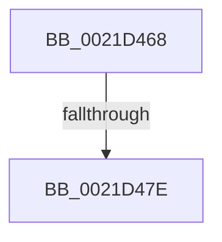

# sub_0021D468

- RVA: `0x0021D468`–`0x0021D488` (길이 `32` bytes)
- VA: `0x000000014021D468`
- 실행 섹션: `.text`
- PDB 이름 있음: `아니요`; PDB Function 태그: `아니요`
- unwind 정보 RVA: `0x0005EFCC`
- 디코드: `6`개 명령, `32/32` bytes 표시
- 미해석 바이트: `0` (있으면 어셈블리에 `.byte`로 보존)

> 이 문서는 커널 이미지의 기계어와 PDB 기호를 분석해 생성했습니다. 4번과 5번은 함수 원형과 자료형을 바이너리 사용 방식에서 추정한 C 해석이며 원본 소스 복구 결과는 아닙니다.

## 1. Dependencies

- 직접 호출 지점: **0**; 고유 호출 대상: **0**
- 직접 호출자로 확인된 함수: **0**
- RIP 상대 이미지 참조: **0**

### Outgoing calls
- 직접 디코드된 call 명령이 없습니다.

### Direct callers
- 이 함수 시작 RVA로 연결되는 직접 call은 확인되지 않았습니다. 간접 호출은 완전히 역산할 수 없습니다.

### Static image references
- 디코드된 RIP-relative 메모리 참조가 없습니다.

## 2. Other-region calls and transfers

- 다른 실행 섹션으로 향하는 call: **0**
- call이 아닌 외부 분기/꼬리 이동: **1**
  - `0x0021D47C` → [sub_0021D4CE](Unknown_function_0021D4CE.md) (`tail-transfer`)

## 3. Assembly (complete function range)

```asm
0021D468  4C 89 64 24 48                  mov qword ptr [rsp + 0x48], r12
0021D46D  48 8D 81 78 04 00 00            lea rax, [rcx + 0x478]
0021D474  44 0F B7 66 08                  movzx r12d, word ptr [rsi + 8]
0021D479  38 5E 0C                        cmp byte ptr [rsi + 0xc], bl
0021D47C  76 50                           jbe 0x14021d4ce
0021D47E  48 B9 FC FF FF FF FF FF FF 7F   movabs rcx, 0x7ffffffffffffffc
```

## 4. C-style interpretation (structured pseudocode)

```c
__int64 __fastcall sub_0021D468(__int64 a1)
{
    unsigned __int64 v_stack_p48;

    v_stack_p48 = v_r12;
    return a1 + 1144;
}
```

## 5. (Beta) C Style

```c
void *sub_0021D468(void *Arg1)
{
    uint8_t *arg1 = (uint8_t *)Arg1;

    uint64_t v_stack_p48;

    v_stack_p48 = local_r12;
    return Arg1 + 1144;
}
```

### 관측된 메모리 오프셋

구조체 형식이 확인되지 않은 접근은 인자 기준의 오프셋으로만 기록했습니다.

| 기준 인자 | 오프셋 표현 | 폭 (bit) | 접근 |
|---|---:|---:|---|
| `Arg1` | `+ 0x478` | `64` | `R` |

## 6. Execution-region graph

[열기: 2D/3D 그래프와 함수 탐색 컨트롤 패널](../../../control-panel.html?section=text&rva=0x0021D468&view=graph)

- 2D 그래프는 위에서 아래로 흐르고, 3D 그래프는 빈 공간을 드래그해 회전합니다. Shift+드래그는 이동, 휠은 확대·축소, 함수 노드 선택은 대상 보고서 이동입니다.

### Static fallback


