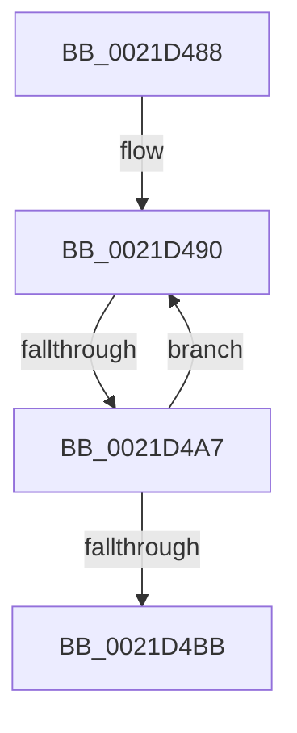

# sub_0021D488

- RVA: `0x0021D488`–`0x0021D4CE` (길이 `70` bytes)
- VA: `0x000000014021D488`
- 실행 섹션: `.text`
- PDB 이름 있음: `아니요`; PDB Function 태그: `아니요`
- unwind 정보 RVA: `0x0005EFE0`
- 디코드: `15`개 명령, `70/70` bytes 표시
- 미해석 바이트: `0` (있으면 어셈블리에 `.byte`로 보존)

> 이 문서는 커널 이미지의 기계어와 PDB 기호를 분석해 생성했습니다. 4번과 5번은 함수 원형과 자료형을 바이너리 사용 방식에서 추정한 C 해석이며 원본 소스 복구 결과는 아닙니다.

## 1. Dependencies

- 직접 호출 지점: **0**; 고유 호출 대상: **0**
- 직접 호출자로 확인된 함수: **0**
- RIP 상대 이미지 참조: **0**

### Outgoing calls
- 직접 디코드된 call 명령이 없습니다.

### Direct callers
- 이 함수 시작 RVA로 연결되는 직접 call은 확인되지 않았습니다. 간접 호출은 완전히 역산할 수 없습니다.

### Static image references
- 디코드된 RIP-relative 메모리 참조가 없습니다.

## 2. Other-region calls and transfers

- 다른 실행 섹션으로 향하는 call: **0**
- call이 아닌 외부 분기/꼬리 이동: **1**
  - `0x0021D4A1` → [sub_0021D622](Unknown_function_0021D622.md) (`tail-transfer`)

## 3. Assembly (complete function range)

```asm
0021D488  4C 89 7C 24 38                  mov qword ptr [rsp + 0x38], r15
0021D48D  0F 1F 00                        nop dword ptr [rax]
0021D490  8B C3                           mov eax, ebx
0021D492  49 8B 3C C6                     mov rdi, qword ptr [r14 + rax*8]
0021D496  48 89 BC 24 98 00 00 00         mov qword ptr [rsp + 0x98], rdi
0021D49E  48 85 FF                        test rdi, rdi
0021D4A1  0F 85 7B 01 00 00               jne 0x14021d622
0021D4A7  0F B6 46 0C                     movzx eax, byte ptr [rsi + 0xc]
0021D4AB  FF C3                           inc ebx
0021D4AD  48 B9 FC FF FF FF FF FF FF 7F   movabs rcx, 0x7ffffffffffffffc
0021D4B7  3B D8                           cmp ebx, eax
0021D4B9  72 D5                           jb 0x14021d490
0021D4BB  4C 8B 7C 24 38                  mov r15, qword ptr [rsp + 0x38]
0021D4C0  49 8D 85 78 04 00 00            lea rax, [r13 + 0x478]
0021D4C7  8B AC 24 88 00 00 00            mov ebp, dword ptr [rsp + 0x88]
```

## 4. C-style interpretation (structured pseudocode)

```c
__int64 __fastcall sub_0021D488(__int64 a1, __int64 a2, __int64 a3, __int64 a4, __int64 a5, __int64 a6, __int64 a7, __int64 a8, __int64 a9, __int64 a10, __int64 a11, __int64 a12, __int64 a13, __int64 a14, __int64 a15, __int64 a16, unsigned int a17)
{
    __int64 v_rbx;
    unsigned __int64 v_stack_p38;
    unsigned __int64 v_stack_p98;

    v_stack_p38 = v_r15;
loc_0021D490:
    v_stack_p98 = *(unsigned __int64 *)(v_r14 + (unsigned int)((unsigned int)(v_rbx)) * 8);
    v_rbx = (unsigned int)((v_rbx) + 1);
    if (((unsigned int)(v_rbx)) < ((unsigned int)(*(unsigned __int8 *)(v_rsi + 12)))) goto loc_0021D490;
    return v_r13 + 1144;
}
```

## 5. (Beta) C Style

```c
int64_t sub_0021D488(int64_t Arg1, int64_t Arg2, int64_t Arg3, int64_t Arg4, uint64_t Arg5, uint64_t Arg6, int64_t Arg7, uint64_t Arg8, uint64_t Arg9, uint64_t Arg10, uint64_t Arg11, uint64_t Arg12, uint64_t Arg13, uint64_t Arg14, uint64_t Arg15, uint64_t Arg16, uint32_t Arg17)
{
    int64_t local_rbx;
    uint64_t v_stack_p38;
    uint64_t v_stack_p98;

    v_stack_p38 = local_r15;
loc_0021D490:
    v_stack_p98 = *(uint64_t *)(local_r14 + (uint32_t)((uint32_t)(local_rbx)) * 8);
    local_rbx = (uint32_t)((local_rbx) + 1);
    if (((uint32_t)(local_rbx)) < ((uint32_t)(*(uint8_t *)(local_rsi + 0xC)))) goto loc_0021D490;
    return local_r13 + 1144;
}
```

## 6. Execution-region graph

[열기: 2D/3D 그래프와 함수 탐색 컨트롤 패널](../../../control-panel.html?section=text&rva=0x0021D488&view=graph)

- 2D 그래프는 위에서 아래로 흐르고, 3D 그래프는 빈 공간을 드래그해 회전합니다. Shift+드래그는 이동, 휠은 확대·축소, 함수 노드 선택은 대상 보고서 이동입니다.

### Static fallback


