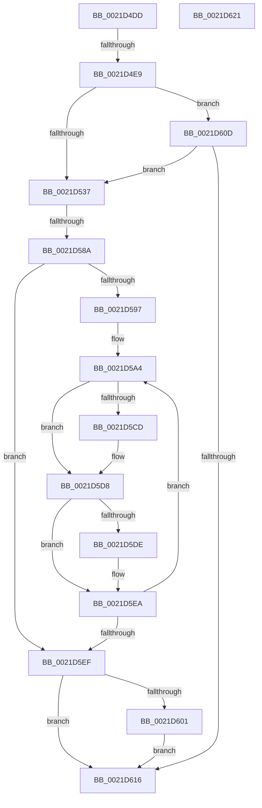

# sub_0021D4DD

- RVA: `0x0021D4DD`–`0x0021D622` (길이 `325` bytes)
- VA: `0x000000014021D4DD`
- 실행 섹션: `.text`
- PDB 이름 있음: `아니요`; PDB Function 태그: `아니요`
- unwind 정보 RVA: `0x0005F014`
- 디코드: `77`개 명령, `325/325` bytes 표시
- 미해석 바이트: `0` (있으면 어셈블리에 `.byte`로 보존)

> 이 문서는 커널 이미지의 기계어와 PDB 기호를 분석해 생성했습니다. 4번과 5번은 함수 원형과 자료형을 바이너리 사용 방식에서 추정한 C 해석이며 원본 소스 복구 결과는 아닙니다.

## 1. Dependencies

- 직접 호출 지점: **5**; 고유 호출 대상: **4**
- 직접 호출자로 확인된 함수: **0**
- RIP 상대 이미지 참조: **0**

### Outgoing calls
- `0x0021D574` → [KiAbProcessThreadLocks](../22/KiAbProcessThreadLocks_function_00221D30.md) (function, `0x00221D30`)
- `0x0021D5B9` → [KiDeferredReadySingleThread](../25/KiDeferredReadySingleThread_function_00252FE0.md) (function, `0x00252FE0`)
- `0x0021D5E5` → [KiFlushSoftwareInterruptBatch](../25/KiFlushSoftwareInterruptBatch_function_00252200.md) (function, `0x00252200`)
- `0x0021D5F6` → [KiFlushSoftwareInterruptBatch](../25/KiFlushSoftwareInterruptBatch_function_00252200.md) (function, `0x00252200`)
- `0x0021D606` → [KiCheckForThreadDispatch](../25/KiCheckForThreadDispatch_function_00250648.md) (function, `0x00250648`)

### Direct callers
- 이 함수 시작 RVA로 연결되는 직접 call은 확인되지 않았습니다. 간접 호출은 완전히 역산할 수 없습니다.

### Static image references
- 디코드된 RIP-relative 메모리 참조가 없습니다.

## 2. Other-region calls and transfers

- 다른 실행 섹션으로 향하는 call: **0**
- call이 아닌 외부 분기/꼬리 이동: **2**
  - `0x0021D4E3` → [sub_0021D6A9](Unknown_function_0021D6A9.md) (`tail-transfer`)
  - `0x0021D584` → [sub_0021D6CE](Unknown_function_0021D6CE.md) (`tail-transfer`)

## 3. Assembly (complete function range)

```asm
0021D4DD  48 8B 00                        mov rax, qword ptr [rax]
0021D4E0  48 85 C0                        test rax, rax
0021D4E3  0F 84 C0 01 00 00               je 0x14021d6a9
0021D4E9  0F B6 48 0C                     movzx ecx, byte ptr [rax + 0xc]
0021D4ED  41 B8 01 00 00 00               mov r8d, 1
0021D4F3  49 D3 E0                        shl r8, cl
0021D4F6  45 8B CA                        mov r9d, r10d
0021D4F9  0F B7 48 08                     movzx ecx, word ptr [rax + 8]
0021D4FD  41 FF C8                        dec r8d
0021D500  0F B7 50 0A                     movzx edx, word ptr [rax + 0xa]
0021D504  0B D1                           or edx, ecx
0021D506  44 3B C2                        cmp r8d, edx
0021D509  41 0F 94 C1                     sete r9b
0021D50D  49 8B 85 70 04 00 00            mov rax, qword ptr [r13 + 0x470]
0021D514  41 B8 01 00 00 00               mov r8d, 1
0021D51A  0F B6 48 0C                     movzx ecx, byte ptr [rax + 0xc]
0021D51E  0F B7 50 08                     movzx edx, word ptr [rax + 8]
0021D522  49 D3 E0                        shl r8, cl
0021D525  0F B7 48 0A                     movzx ecx, word ptr [rax + 0xa]
0021D529  41 FF C8                        dec r8d
0021D52C  0B CA                           or ecx, edx
0021D52E  44 3B C1                        cmp r8d, ecx
0021D531  0F 84 D6 00 00 00               je 0x14021d60d
0021D537  4C 89 94 24 80 00 00 00         mov qword ptr [rsp + 0x80], r10
0021D53F  4C 8D 8C 24 90 00 00 00         lea r9, [rsp + 0x90]
0021D547  65 48 8B 3C 25 20 00 00 00      mov rdi, qword ptr gs:[0x20]
0021D550  4C 8D 84 24 80 00 00 00         lea r8, [rsp + 0x80]
0021D558  BA 07 00 00 00                  mov edx, 7
0021D55D  4C 89 94 24 90 00 00 00         mov qword ptr [rsp + 0x90], r10
0021D565  49 8B CD                        mov rcx, r13
0021D568  48 8D 9F 70 91 00 00            lea rbx, [rdi + 0x9170]
0021D56F  48 89 5C 24 20                  mov qword ptr [rsp + 0x20], rbx
0021D574  E8 B7 47 00 00                  call 0x140221d30
0021D579  48 8B 8C 24 90 00 00 00         mov rcx, qword ptr [rsp + 0x90]
0021D581  48 85 C9                        test rcx, rcx
0021D584  0F 85 44 01 00 00               jne 0x14021d6ce
0021D58A  48 8B 9C 24 80 00 00 00         mov rbx, qword ptr [rsp + 0x80]
0021D592  48 85 DB                        test rbx, rbx
0021D595  74 58                           je 0x14021d5ef
0021D597  48 8B 03                        mov rax, qword ptr [rbx]
0021D59A  33 F6                           xor esi, esi
0021D59C  48 89 84 24 80 00 00 00         mov qword ptr [rsp + 0x80], rax
0021D5A4  48 8D 93 28 FF FF FF            lea rdx, [rbx - 0xd8]
0021D5AB  45 33 C9                        xor r9d, r9d
0021D5AE  4C 8D 84 24 80 00 00 00         lea r8, [rsp + 0x80]
0021D5B6  48 8B CF                        mov rcx, rdi
0021D5B9  E8 22 5A 03 00                  call 0x140252fe0
0021D5BE  48 8B 9C 24 80 00 00 00         mov rbx, qword ptr [rsp + 0x80]
0021D5C6  FF C6                           inc esi
0021D5C8  48 85 DB                        test rbx, rbx
0021D5CB  74 0B                           je 0x14021d5d8
0021D5CD  48 8B 03                        mov rax, qword ptr [rbx]
0021D5D0  48 89 84 24 80 00 00 00         mov qword ptr [rsp + 0x80], rax
0021D5D8  40 F6 C6 0F                     test sil, 0xf
0021D5DC  75 0C                           jne 0x14021d5ea
0021D5DE  48 8D 8F D8 35 00 00            lea rcx, [rdi + 0x35d8]
0021D5E5  E8 16 4C 03 00                  call 0x140252200
0021D5EA  48 85 DB                        test rbx, rbx
0021D5ED  75 B5                           jne 0x14021d5a4
0021D5EF  48 8D 8F D8 35 00 00            lea rcx, [rdi + 0x35d8]
0021D5F6  E8 05 4C 03 00                  call 0x140252200
0021D5FB  40 F6 C5 01                     test bpl, 1
0021D5FF  74 15                           je 0x14021d616
0021D601  B2 02                           mov dl, 2
0021D603  48 8B CF                        mov rcx, rdi
0021D606  E8 3D 30 03 00                  call 0x140250648
0021D60B  EB 09                           jmp 0x14021d616
0021D60D  45 85 C9                        test r9d, r9d
0021D610  0F 84 21 FF FF FF               je 0x14021d537
0021D616  48 83 C4 50                     add rsp, 0x50
0021D61A  41 5D                           pop r13
0021D61C  5F                              pop rdi
0021D61D  5E                              pop rsi
0021D61E  5D                              pop rbp
0021D61F  5B                              pop rbx
0021D620  C3                              ret
0021D621  CC                              int3
```

## 4. C-style interpretation (structured pseudocode)

```c
__int64 __fastcall sub_0021D4DD(__int64 a1, __int64 a2, __int64 a3, __int64 a4, __int64 a5, __int64 a6, __int64 a7, __int64 a8, __int64 a9, __int64 a10, __int64 a11, __int64 a12, __int64 a13, __int64 a14, __int64 a15, __int64 a16, __int64 a17, __int64 a18)
{
    __int64 result;
    __int64 v_rsi;
    __int64 v_rsp;
    unsigned __int64 v_stack_p20;
    unsigned __int64 v_stack_p80;
    unsigned __int64 v_stack_p90;

    a3 = (1) << ((unsigned __int8)(*(unsigned __int8 *)(*(unsigned __int64 *)(result) + 12)));
    a3 = (unsigned int)((a3) - 1);
    a2 = (unsigned int)((*(unsigned __int16 *)(*(unsigned __int64 *)(result) + 10)) | ((unsigned int)(*(unsigned __int16 *)(*(unsigned __int64 *)(result) + 8))));
    a4 = (((unsigned int)(a3)) == ((unsigned int)(a2))) ? 1 : 0;
    a3 = (1) << ((unsigned __int8)(*(unsigned __int8 *)(*(unsigned __int64 *)(v_r13 + 1136) + 12)));
    a3 = (unsigned int)((a3) - 1);
    a1 = (unsigned int)((*(unsigned __int16 *)(*(unsigned __int64 *)(v_r13 + 1136) + 10)) | ((unsigned int)(*(unsigned __int16 *)(*(unsigned __int64 *)(v_r13 + 1136) + 8))));
    if (((unsigned int)(a3)) == ((unsigned int)(a1))) goto loc_0021D60D;
loc_0021D537:
    v_stack_p80 = v_r10;
    v_stack_p90 = v_r10;
    v_stack_p20 = *(unsigned __int64 *)(gs_base + (0 + 32)) + 37232;
    result = KiAbProcessThreadLocks(v_r13, 7, a16, a18);
    if (a16 == 0) goto loc_0021D5EF;
    v_rsi = 0;
    v_stack_p80 = *(unsigned __int64 *)(a16);
loc_0021D5A4:
    a4 = 0;
    result = KiDeferredReadySingleThread(*(unsigned __int64 *)(gs_base + (0 + 32)), a16 - 216, a16, a4);
    v_rsi = (unsigned int)((v_rsi) + 1);
    if (a16 != 0) {
        result = *(unsigned __int64 *)(a16);
        v_stack_p80 = result;
    }
    if ((((unsigned __int8)(v_rsi)) & (15)) == 0) {
        a1 = *(unsigned __int64 *)(gs_base + (0 + 32)) + 13784;
        result = KiFlushSoftwareInterruptBatch(a1, a16 - 216, a16, a4);
    }
    if (a16 != 0) goto loc_0021D5A4;
loc_0021D5EF:
    result = KiFlushSoftwareInterruptBatch(*(unsigned __int64 *)(gs_base + (0 + 32)) + 13784, a16 - 216, a16, a4);
    if ((((unsigned __int8)(v_rbp)) & (1)) == 0) goto loc_0021D616;
    result = KiCheckForThreadDispatch(*(unsigned __int64 *)(gs_base + (0 + 32)), 2, a16, a4);
    goto loc_0021D616;
loc_0021D60D:
    if (0 == 0) goto loc_0021D537;
loc_0021D616:
    v_rsp = (v_rsp) + (80);
    return result;
}
```

## 5. (Beta) C Style

```c
int64_t sub_0021D4DD(int64_t Arg1, int64_t Arg2, int64_t Arg3, int64_t Arg4, uint64_t Arg5, uint64_t Arg6, uint64_t Arg7, uint64_t Arg8, uint64_t Arg9, uint64_t Arg10, uint64_t Arg11, uint64_t Arg12, uint64_t Arg13, uint64_t Arg14, uint64_t Arg15, int64_t Arg16, uint64_t Arg17, int64_t Arg18)
{
    int64_t result;
    int64_t local_rsi;
    int64_t local_rsp;
    uint64_t v_stack_p20;
    uint64_t v_stack_p80;
    uint64_t v_stack_p90;

    Arg3 = (1) << ((uint8_t)(*(uint8_t *)(*(uint64_t *)(result) + 0xC)));
    Arg3 = (uint32_t)((Arg3) - 1);
    Arg2 = (uint32_t)((*(uint16_t *)(*(uint64_t *)(result) + 0xA)) | ((uint32_t)(*(uint16_t *)(*(uint64_t *)(result) + 0x8))));
    Arg4 = (((uint32_t)(Arg3)) == ((uint32_t)(Arg2))) ? 1 : 0;
    Arg3 = (1) << ((uint8_t)(*(uint8_t *)(*(uint64_t *)(local_r13 + 0x470) + 0xC)));
    Arg3 = (uint32_t)((Arg3) - 1);
    Arg1 = (uint32_t)((*(uint16_t *)(*(uint64_t *)(local_r13 + 0x470) + 0xA)) | ((uint32_t)(*(uint16_t *)(*(uint64_t *)(local_r13 + 0x470) + 0x8))));
    if (((uint32_t)(Arg3)) == ((uint32_t)(Arg1))) goto loc_0021D60D;
loc_0021D537:
    v_stack_p80 = local_r10;
    v_stack_p90 = local_r10;
    v_stack_p20 = *(uint64_t *)(gs_base + (0 + 0x20)) + 37232;
    result = KiAbProcessThreadLocks(local_r13, 7, Arg16, Arg18);
    if (Arg16 == 0) goto loc_0021D5EF;
    local_rsi = 0;
    v_stack_p80 = *(uint64_t *)(Arg16);
loc_0021D5A4:
    Arg4 = 0;
    result = KiDeferredReadySingleThread(*(uint64_t *)(gs_base + (0 + 0x20)), Arg16 - 216, Arg16, Arg4);
    local_rsi = (uint32_t)((local_rsi) + 1);
    if (Arg16 != 0) {
        result = *(uint64_t *)(Arg16);
        v_stack_p80 = result;
    }
    if ((((uint8_t)(local_rsi)) & (15)) == 0) {
        Arg1 = *(uint64_t *)(gs_base + (0 + 0x20)) + 13784;
        result = KiFlushSoftwareInterruptBatch(Arg1, Arg16 - 216, Arg16, Arg4);
    }
    if (Arg16 != 0) goto loc_0021D5A4;
loc_0021D5EF:
    result = KiFlushSoftwareInterruptBatch(*(uint64_t *)(gs_base + (0 + 0x20)) + 13784, Arg16 - 216, Arg16, Arg4);
    if ((((uint8_t)(local_rbp)) & (1)) == 0) goto loc_0021D616;
    result = KiCheckForThreadDispatch(*(uint64_t *)(gs_base + (0 + 0x20)), 2, Arg16, Arg4);
    goto loc_0021D616;
loc_0021D60D:
    if (0 == 0) goto loc_0021D537;
loc_0021D616:
    local_rsp = (local_rsp) + (80);
    return result;
}
```

## 6. Execution-region graph

[열기: 2D/3D 그래프와 함수 탐색 컨트롤 패널](../../../control-panel.html?section=text&rva=0x0021D4DD&view=graph)

- 2D 그래프는 위에서 아래로 흐르고, 3D 그래프는 빈 공간을 드래그해 회전합니다. Shift+드래그는 이동, 휠은 확대·축소, 함수 노드 선택은 대상 보고서 이동입니다.

### Static fallback


