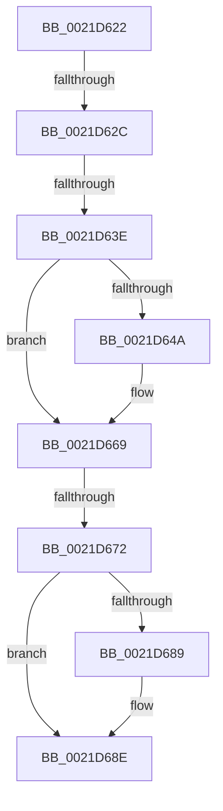

# sub_0021D622

- RVA: `0x0021D622`–`0x0021D6A9` (길이 `135` bytes)
- VA: `0x000000014021D622`
- 실행 섹션: `.text`
- PDB 이름 있음: `아니요`; PDB Function 태그: `아니요`
- unwind 정보 RVA: `0x0005F028`
- 디코드: `34`개 명령, `135/135` bytes 표시
- 미해석 바이트: `0` (있으면 어셈블리에 `.byte`로 보존)

> 이 문서는 커널 이미지의 기계어와 PDB 기호를 분석해 생성했습니다. 4번과 5번은 함수 원형과 자료형을 바이너리 사용 방식에서 추정한 C 해석이며 원본 소스 복구 결과는 아닙니다.

## 1. Dependencies

- 직접 호출 지점: **1**; 고유 호출 대상: **1**
- 직접 호출자로 확인된 함수: **0**
- RIP 상대 이미지 참조: **0**

### Outgoing calls
- `0x0021D65D` → [KiAbEntryFreeAndEnableInterrupts](../26/KiAbEntryFreeAndEnableInterrupts_function_002622D0.md) (function, `0x002622D0`)

### Direct callers
- 이 함수 시작 RVA로 연결되는 직접 call은 확인되지 않았습니다. 간접 호출은 완전히 역산할 수 없습니다.

### Static image references
- 디코드된 RIP-relative 메모리 참조가 없습니다.

## 2. Other-region calls and transfers

- 다른 실행 섹션으로 향하는 call: **0**
- call이 아닌 외부 분기/꼬리 이동: **4**
  - `0x0021D626` → [sub_0021D488 + 0x1F](Unknown_function_0021D488.md) (`tail-transfer`)
  - `0x0021D63C` → [sub_0021D6B4](Unknown_function_0021D6B4.md) (`tail-transfer`)
  - `0x0021D66C` → [sub_0021D488 + 0x1F](Unknown_function_0021D488.md) (`tail-transfer`)
  - `0x0021D6A4` → [sub_0021D488 + 0x1F](Unknown_function_0021D488.md) (`tail-transfer`)

## 3. Assembly (complete function range)

```asm
0021D622  40 F6 C7 02                     test dil, 2
0021D626  0F 85 7B FE FF FF               jne 0x14021d4a7
0021D62C  4C 6B F8 58                     imul r15, rax, 0x58
0021D630  48 8B C7                        mov rax, rdi
0021D633  4C 03 FE                        add r15, rsi
0021D636  48 C1 E8 38                     shr rax, 0x38
0021D63A  84 C0                           test al, al
0021D63C  78 76                           js 0x14021d6b4
0021D63E  49 8B 47 10                     mov rax, qword ptr [r15 + 0x10]
0021D642  48 23 F9                        and rdi, rcx
0021D645  48 85 C0                        test rax, rax
0021D648  74 1F                           je 0x14021d669
0021D64A  FA                              cli
0021D64B  45 33 C9                        xor r9d, r9d
0021D64E  4C 89 54 24 20                  mov qword ptr [rsp + 0x20], r10
0021D653  4C 8B C7                        mov r8, rdi
0021D656  49 8D 4F 10                     lea rcx, [r15 + 0x10]
0021D65A  49 8B D5                        mov rdx, r13
0021D65D  E8 6E 4C 04 00                  call 0x1402622d0
0021D662  41 0F AB DC                     bts r12d, ebx
0021D666  45 33 D2                        xor r10d, r10d
0021D669  48 85 FF                        test rdi, rdi
0021D66C  0F 84 35 FE FF FF               je 0x14021d4a7
0021D672  49 89 7F 10                     mov qword ptr [r15 + 0x10], rdi
0021D676  41 0F B3 DC                     btr r12d, ebx
0021D67A  41 80 67 18 BF                  and byte ptr [r15 + 0x18], 0xbf
0021D67F  F6 84 24 98 00 00 00 01         test byte ptr [rsp + 0x98], 1
0021D687  74 05                           je 0x14021d68e
0021D689  41 C6 47 19 01                  mov byte ptr [r15 + 0x19], 1
0021D68E  80 8C 24 9F 00 00 00 80         or byte ptr [rsp + 0x9f], 0x80
0021D696  48 8B 84 24 98 00 00 00         mov rax, qword ptr [rsp + 0x98]
0021D69E  8B CB                           mov ecx, ebx
0021D6A0  49 89 04 CE                     mov qword ptr [r14 + rcx*8], rax
0021D6A4  E9 FE FD FF FF                  jmp 0x14021d4a7
```

## 4. C-style interpretation (structured pseudocode)

```c
__int64 __fastcall sub_0021D622(__int64 a1, __int64 a2, __int64 a3, int a4, __int64 a5, __int64 a6, __int64 a7, __int64 a8, __int64 a9, __int64 a10, __int64 a11, __int64 a12, __int64 a13, __int64 a14, __int64 a15, __int64 a16, __int64 a17, __int64 a18, unsigned __int8 a19)
{
    __int64 result;
    __int64 v_r10;
    __int64 v_r15;
    __int64 v_rdi;
    unsigned __int64 v_stack_p20;
    unsigned __int8 v_stack_p9F;

    v_r15 = (v_r15) * (result);
    v_r15 = (v_r15) + (v_rsi);
    result = (v_rdi) >> (56);
    v_rdi = (v_rdi) & (a1);
    result = *(unsigned __int64 *)(v_r15 + 16);
    if (*(unsigned __int64 *)(v_r15 + 16) != 0) {
        a4 = 0;
        v_stack_p20 = v_r10;
        a3 = v_rdi;
        a1 = v_r15 + 16;
        a2 = v_r13;
        result = KiAbEntryFreeAndEnableInterrupts(a1, a2, a3, a4);
        v_r10 = 0;
    }
    *(unsigned __int64 *)(v_r15 + 16) = v_rdi;
    if (((a19) & (1)) != 0) {
        *(unsigned __int8 *)(v_r15 + 25) = 1;
    }
    *(unsigned __int64 *)(v_r14 + (unsigned int)((unsigned int)(v_rbx)) * 8) = a19;
}
```

## 5. (Beta) C Style

```c
int64_t sub_0021D622(int64_t Arg1, int64_t Arg2, int64_t Arg3, int32_t Arg4, uint64_t Arg5, uint64_t Arg6, uint64_t Arg7, uint64_t Arg8, uint64_t Arg9, uint64_t Arg10, uint64_t Arg11, uint64_t Arg12, uint64_t Arg13, uint64_t Arg14, uint64_t Arg15, uint64_t Arg16, uint64_t Arg17, uint64_t Arg18, uint8_t Arg19)
{
    int64_t result;
    int64_t local_r10;
    int64_t local_r15;
    int64_t local_rdi;
    uint64_t v_stack_p20;
    uint8_t v_stack_p9F;

    local_r15 = (local_r15) * (result);
    local_r15 = (local_r15) + (local_rsi);
    result = (local_rdi) >> (56);
    local_rdi = (local_rdi) & (Arg1);
    result = *(uint64_t *)(local_r15 + 0x10);
    if (*(uint64_t *)(local_r15 + 0x10) != 0) {
        Arg4 = 0;
        v_stack_p20 = local_r10;
        Arg3 = local_rdi;
        Arg1 = local_r15 + 16;
        Arg2 = local_r13;
        result = KiAbEntryFreeAndEnableInterrupts(Arg1, Arg2, Arg3, Arg4);
        local_r10 = 0;
    }
    *(uint64_t *)(local_r15 + 0x10) = local_rdi;
    if (((Arg19) & (1)) != 0) {
        *(uint8_t *)(local_r15 + 0x19) = 1;
    }
    *(uint64_t *)(local_r14 + (uint32_t)((uint32_t)(local_rbx)) * 8) = Arg19;
}
```

## 6. Execution-region graph

[열기: 2D/3D 그래프와 함수 탐색 컨트롤 패널](../../../control-panel.html?section=text&rva=0x0021D622&view=graph)

- 2D 그래프는 위에서 아래로 흐르고, 3D 그래프는 빈 공간을 드래그해 회전합니다. Shift+드래그는 이동, 휠은 확대·축소, 함수 노드 선택은 대상 보고서 이동입니다.

### Static fallback


