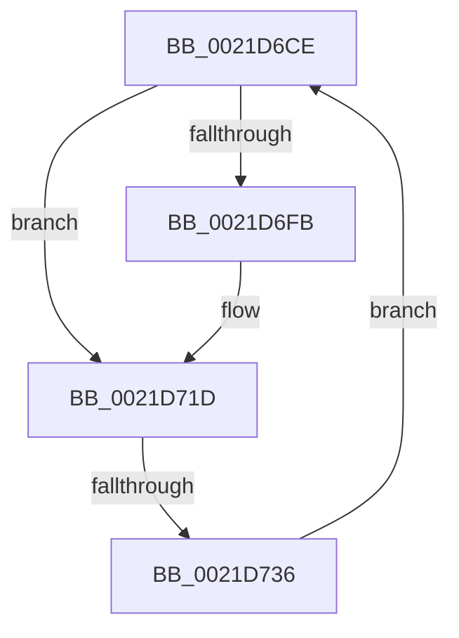

# sub_0021D6CE

- RVA: `0x0021D6CE`–`0x0021D738` (길이 `106` bytes)
- VA: `0x000000014021D6CE`
- 실행 섹션: `.text`
- PDB 이름 있음: `아니요`; PDB Function 태그: `아니요`
- unwind 정보 RVA: `0x0005F070`
- 디코드: `19`개 명령, `106/106` bytes 표시
- 미해석 바이트: `0` (있으면 어셈블리에 `.byte`로 보존)

> 이 문서는 커널 이미지의 기계어와 PDB 기호를 분석해 생성했습니다. 4번과 5번은 함수 원형과 자료형을 바이너리 사용 방식에서 추정한 C 해석이며 원본 소스 복구 결과는 아닙니다.

## 1. Dependencies

- 직접 호출 지점: **1**; 고유 호출 대상: **1**
- 직접 호출자로 확인된 함수: **0**
- RIP 상대 이미지 참조: **0**

### Outgoing calls
- `0x0021D718` → [KiAbProcessThreadLocks](../22/KiAbProcessThreadLocks_function_00221D30.md) (function, `0x00221D30`)

### Direct callers
- 이 함수 시작 RVA로 연결되는 직접 call은 확인되지 않았습니다. 간접 호출은 완전히 역산할 수 없습니다.

### Static image references
- 디코드된 RIP-relative 메모리 참조가 없습니다.

## 2. Other-region calls and transfers

- 다른 실행 섹션으로 향하는 call: **0**
- call이 아닌 외부 분기/꼬리 이동: **1**
  - `0x0021D730` → [sub_0021D4DD + 0xAD](Unknown_function_0021D4DD.md) (`tail-transfer`)

## 3. Assembly (complete function range)

```asm
0021D6CE  48 8B 01                        mov rax, qword ptr [rcx]
0021D6D1  48 8D B1 D8 FC FF FF            lea rsi, [rcx - 0x328]
0021D6D8  48 89 84 24 90 00 00 00         mov qword ptr [rsp + 0x90], rax
0021D6E0  48 C7 86 28 03 00 00 01 00 00 00  mov qword ptr [rsi + 0x328], 1
0021D6EB  F0 83 0C 24 00                  lock or dword ptr [rsp], 0
0021D6F0  0F B6 86 18 03 00 00            movzx eax, byte ptr [rsi + 0x318]
0021D6F7  84 C0                           test al, al
0021D6F9  74 22                           je 0x14021d71d
0021D6FB  4C 8D 8C 24 90 00 00 00         lea r9, [rsp + 0x90]
0021D703  48 89 5C 24 20                  mov qword ptr [rsp + 0x20], rbx
0021D708  4C 8D 84 24 80 00 00 00         lea r8, [rsp + 0x80]
0021D710  BA 04 00 00 00                  mov edx, 4
0021D715  48 8B CE                        mov rcx, rsi
0021D718  E8 13 46 00 00                  call 0x140221d30
0021D71D  66 F0 FF 8E 64 03 00 00         lock dec word ptr [rsi + 0x364]
0021D725  48 8B 8C 24 90 00 00 00         mov rcx, qword ptr [rsp + 0x90]
0021D72D  48 85 C9                        test rcx, rcx
0021D730  0F 84 54 FE FF FF               je 0x14021d58a
0021D736  EB 96                           jmp 0x14021d6ce
```

## 4. C-style interpretation (structured pseudocode)

```c
__int64 __fastcall sub_0021D6CE(__int64 a1, __int64 a2, __int64 a3, __int64 a4, __int64 a5, __int64 a6, __int64 a7, __int64 a8, __int64 a9, __int64 a10, __int64 a11, __int64 a12, __int64 a13, __int64 a14, __int64 a15, __int64 a16, __int64 a17, __int64 a18)
{
    __int64 result;
    unsigned int v_stack_p0;
    unsigned __int64 v_stack_p20;
    unsigned __int64 v_stack_p90;

    v_stack_p90 = *(unsigned __int64 *)(a1);
    *(unsigned __int64 *)(a1 - 808 + 808) = 1;
    result = *(unsigned __int8 *)(a1 - 808 + 792);
    if ((unsigned __int8)(*(unsigned __int8 *)(a1 - 808 + 792)) != 0) {
        a4 = a18;
        v_stack_p20 = v_rbx;
        a3 = a16;
        a2 = 4;
        a1 = a1 - 808;
        result = KiAbProcessThreadLocks(a1, a2, a3, a4);
    }
    goto loc_0021D6CE;
}
```

## 5. (Beta) C Style

```c
int64_t sub_0021D6CE(int64_t Arg1, int64_t Arg2, int64_t Arg3, int64_t Arg4, uint64_t Arg5, uint64_t Arg6, uint64_t Arg7, uint64_t Arg8, uint64_t Arg9, uint64_t Arg10, uint64_t Arg11, uint64_t Arg12, uint64_t Arg13, uint64_t Arg14, uint64_t Arg15, int64_t Arg16, uint64_t Arg17, int64_t Arg18)
{
    int64_t result;
    uint32_t v_stack_p0;
    uint64_t v_stack_p20;
    uint64_t v_stack_p90;

    v_stack_p90 = *(uint64_t *)(Arg1);
    *(uint64_t *)(Arg1 - 0x328 + 0x328) = 1;
    result = *(uint8_t *)(Arg1 - 0x328 + 0x318);
    if ((uint8_t)(*(uint8_t *)(Arg1 - 0x328 + 0x318)) != 0) {
        Arg4 = Arg18;
        v_stack_p20 = local_rbx;
        Arg3 = Arg16;
        Arg2 = 4;
        Arg1 = Arg1 - 808;
        result = KiAbProcessThreadLocks(Arg1, Arg2, Arg3, Arg4);
    }
    goto loc_0021D6CE;
}
```

## 6. Execution-region graph

[열기: 2D/3D 그래프와 함수 탐색 컨트롤 패널](../../../control-panel.html?section=text&rva=0x0021D6CE&view=graph)

- 2D 그래프는 위에서 아래로 흐르고, 3D 그래프는 빈 공간을 드래그해 회전합니다. Shift+드래그는 이동, 휠은 확대·축소, 함수 노드 선택은 대상 보고서 이동입니다.

### Static fallback


