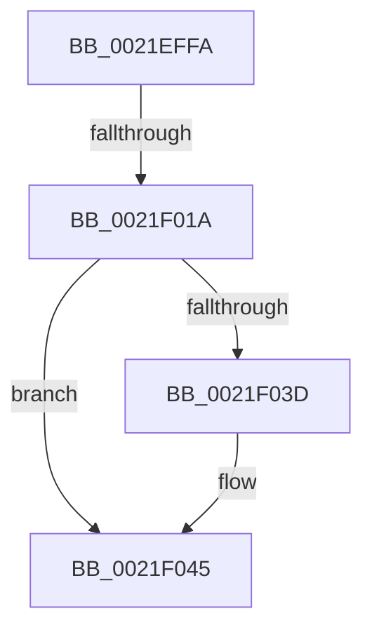

# sub_0021EFFA

- RVA: `0x0021EFFA`–`0x0021F053` (길이 `89` bytes)
- VA: `0x000000014021EFFA`
- 실행 섹션: `.text`
- PDB 이름 있음: `아니요`; PDB Function 태그: `아니요`
- unwind 정보 RVA: `0x0005F118`
- 디코드: `19`개 명령, `89/89` bytes 표시
- 미해석 바이트: `0` (있으면 어셈블리에 `.byte`로 보존)

> 이 문서는 커널 이미지의 기계어와 PDB 기호를 분석해 생성했습니다. 4번과 5번은 함수 원형과 자료형을 바이너리 사용 방식에서 추정한 C 해석이며 원본 소스 복구 결과는 아닙니다.

## 1. Dependencies

- 직접 호출 지점: **2**; 고유 호출 대상: **2**
- 직접 호출자로 확인된 함수: **0**
- RIP 상대 이미지 참조: **1**

### Outgoing calls
- `0x0021F034` → [KiAbThreadInsertList](KiAbThreadInsertList_function_0021F0E0.md) (function, `0x0021F0E0`)
- `0x0021F040` → [KiAbQueueAutoBoostDpc](../20/KiAbQueueAutoBoostDpc_function_002074D0.md) (function, `0x002074D0`)

### Direct callers
- 이 함수 시작 RVA로 연결되는 직접 call은 확인되지 않았습니다. 간접 호출은 완전히 역산할 수 없습니다.

### Static image references
- `0x0021F011` → RVA `0x00FC6D20` (`ALMOSTRO`; read)

## 2. Other-region calls and transfers

- 다른 실행 섹션으로 향하는 call: **0**
- call이 아닌 외부 분기/꼬리 이동: **2**
  - `0x0021F018` → [sub_0021F072](Unknown_function_0021F072.md) (`tail-transfer`)
  - `0x0021F051` → [sub_0021F053 + 0xD](Unknown_function_0021F053.md) (`tail-transfer`)

## 3. Assembly (complete function range)

```asm
0021EFFA  48 89 74 24 30                  mov qword ptr [rsp + 0x30], rsi
0021EFFF  48 89 7C 24 38                  mov qword ptr [rsp + 0x38], rdi
0021F004  44 0F 20 C7                     mov rdi, cr8
0021F008  B8 02 00 00 00                  mov eax, 2
0021F00D  44 0F 22 C0                     mov cr8, rax
0021F011  83 3D 08 7D DA 00 00            cmp dword ptr [rip + 0xda7d08], 0
0021F018  75 58                           jne 0x14021f072
0021F01A  65 48 8B 34 25 20 00 00 00      mov rsi, qword ptr gs:[0x20]
0021F023  4C 8D 83 28 03 00 00            lea r8, [rbx + 0x328]
0021F02A  48 8B CB                        mov rcx, rbx
0021F02D  48 8D 96 78 91 00 00            lea rdx, [rsi + 0x9178]
0021F034  E8 A7 00 00 00                  call 0x14021f0e0
0021F039  85 C0                           test eax, eax
0021F03B  74 08                           je 0x14021f045
0021F03D  48 8B CE                        mov rcx, rsi
0021F040  E8 8B 84 FE FF                  call 0x1402074d0
0021F045  83 3D D4 7C DA 00 00            cmp dword ptr [rip + 0xda7cd4], 0
0021F04C  48 8B 74 24 30                  mov rsi, qword ptr [rsp + 0x30]
0021F051  74 0D                           je 0x14021f060
```

## 4. C-style interpretation (structured pseudocode)

```c
__int64 __fastcall sub_0021EFFA(__int64 a1, __int64 a2, __int64 a3, __int64 a4, __int64 a5, __int64 a6)
{
    __int64 result;
    unsigned __int64 v_stack_p30;
    unsigned __int64 v_stack_p38;

    v_stack_p30 = v_rsi;
    v_stack_p38 = v_rdi;
    result = KiAbThreadInsertList(v_rbx, *(unsigned __int64 *)(gs_base + (0 + 32)) + 37240, v_rbx + 808, a4);
    if ((unsigned int)(result) != 0) {
        a1 = *(unsigned __int64 *)(gs_base + (0 + 32));
        result = KiAbQueueAutoBoostDpc(a1, *(unsigned __int64 *)(gs_base + (0 + 32)) + 37240, v_rbx + 808, a4);
    }
}
```

## 5. (Beta) C Style

```c
int64_t sub_0021EFFA(int64_t Arg1, int64_t Arg2, int64_t Arg3, int64_t Arg4, uint64_t Arg5, int64_t Arg6)
{
    int64_t result;
    uint64_t v_stack_p30;
    uint64_t v_stack_p38;

    v_stack_p30 = local_rsi;
    v_stack_p38 = local_rdi;
    result = KiAbThreadInsertList(local_rbx, *(uint64_t *)(gs_base + (0 + 0x20)) + 37240, local_rbx + 808, Arg4);
    if ((uint32_t)(result) != 0) {
        Arg1 = *(uint64_t *)(gs_base + (0 + 0x20));
        result = KiAbQueueAutoBoostDpc(Arg1, *(uint64_t *)(gs_base + (0 + 0x20)) + 37240, local_rbx + 808, Arg4);
    }
}
```

## 6. Execution-region graph

[열기: 2D/3D 그래프와 함수 탐색 컨트롤 패널](../../../control-panel.html?section=text&rva=0x0021EFFA&view=graph)

- 2D 그래프는 위에서 아래로 흐르고, 3D 그래프는 빈 공간을 드래그해 회전합니다. Shift+드래그는 이동, 휠은 확대·축소, 함수 노드 선택은 대상 보고서 이동입니다.

### Static fallback


