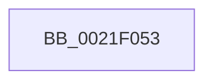

# sub_0021F053

- RVA: `0x0021F053`–`0x0021F072` (길이 `31` bytes)
- VA: `0x000000014021F053`
- 실행 섹션: `.text`
- PDB 이름 있음: `아니요`; PDB Function 태그: `아니요`
- unwind 정보 RVA: `0x0005F130`
- 디코드: `7`개 명령, `31/31` bytes 표시
- 미해석 바이트: `0` (있으면 어셈블리에 `.byte`로 보존)

> 이 문서는 커널 이미지의 기계어와 PDB 기호를 분석해 생성했습니다. 4번과 5번은 함수 원형과 자료형을 바이너리 사용 방식에서 추정한 C 해석이며 원본 소스 복구 결과는 아닙니다.

## 1. Dependencies

- 직접 호출 지점: **1**; 고유 호출 대상: **1**
- 직접 호출자로 확인된 함수: **0**
- RIP 상대 이미지 참조: **0**

### Outgoing calls
- `0x0021F05B` → [KiLowerIrqlProcessIrqlFlags](../4F/KiLowerIrqlProcessIrqlFlags_function_004F5698.md) (function, `0x004F5698`)

### Direct callers
- 이 함수 시작 RVA로 연결되는 직접 call은 확인되지 않았습니다. 간접 호출은 완전히 역산할 수 없습니다.

### Static image references
- 디코드된 RIP-relative 메모리 참조가 없습니다.

## 2. Other-region calls and transfers

- 다른 실행 섹션으로 향하는 call: **0**
- call이 아닌 외부 분기/꼬리 이동: **1**
  - `0x0021F06D` → [PsBoostThreadIoQoS + 0x14](PsBoostThreadIoQoS_function_0021EFC0.md) (`tail-transfer`)

## 3. Assembly (complete function range)

```asm
0021F053  44 0F 20 C1                     mov rcx, cr8
0021F057  40 0F B6 D7                     movzx edx, dil
0021F05B  E8 38 66 2D 00                  call 0x1404f5698
0021F060  40 0F B6 C7                     movzx eax, dil
0021F064  44 0F 22 C0                     mov cr8, rax
0021F068  48 8B 7C 24 38                  mov rdi, qword ptr [rsp + 0x38]
0021F06D  E9 62 FF FF FF                  jmp 0x14021efd4
```

## 4. C-style interpretation (structured pseudocode)

```c
__int64 __fastcall sub_0021F053(__int64 a1, __int64 a2, __int64 a3, __int64 a4, __int64 a5, __int64 a6, __int64 a7)
{
    __int64 result;

    result = KiLowerIrqlProcessIrqlFlags(v_cr8, (unsigned __int8)(v_rdi), a3, a4);
}
```

## 5. (Beta) C Style

```c
int64_t sub_0021F053(int64_t Arg1, int64_t Arg2, int64_t Arg3, int64_t Arg4, uint64_t Arg5, uint64_t Arg6, int64_t Arg7)
{
    int64_t result;

    result = KiLowerIrqlProcessIrqlFlags(v_cr8, (uint8_t)(local_rdi), Arg3, Arg4);
}
```

## 6. Execution-region graph

[열기: 2D/3D 그래프와 함수 탐색 컨트롤 패널](../../../control-panel.html?section=text&rva=0x0021F053&view=graph)

- 2D 그래프는 위에서 아래로 흐르고, 3D 그래프는 빈 공간을 드래그해 회전합니다. Shift+드래그는 이동, 휠은 확대·축소, 함수 노드 선택은 대상 보고서 이동입니다.

### Static fallback


