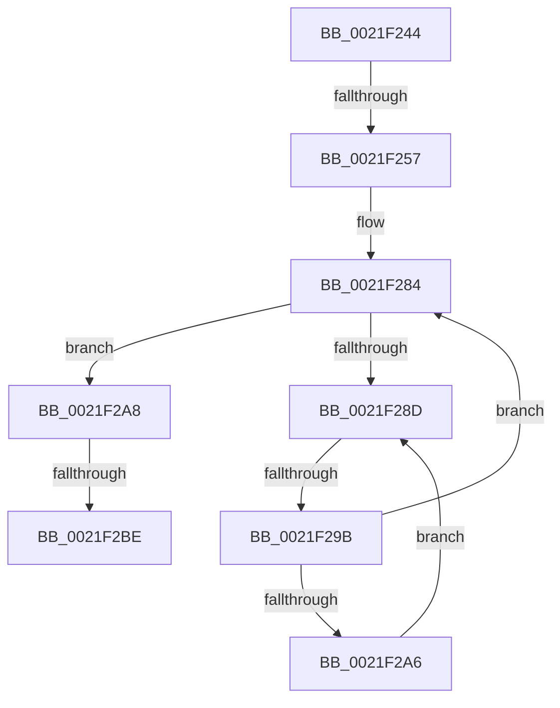

# sub_0021F244

- RVA: `0x0021F244`–`0x0021F2D7` (길이 `147` bytes)
- VA: `0x000000014021F244`
- 실행 섹션: `.text`
- PDB 이름 있음: `아니요`; PDB Function 태그: `아니요`
- unwind 정보 RVA: `0x0005F18C`
- 디코드: `37`개 명령, `147/147` bytes 표시
- 미해석 바이트: `0` (있으면 어셈블리에 `.byte`로 보존)

> 이 문서는 커널 이미지의 기계어와 PDB 기호를 분석해 생성했습니다. 4번과 5번은 함수 원형과 자료형을 바이너리 사용 방식에서 추정한 C 해석이며 원본 소스 복구 결과는 아닙니다.

## 1. Dependencies

- 직접 호출 지점: **1**; 고유 호출 대상: **1**
- 직접 호출자로 확인된 함수: **0**
- RIP 상대 이미지 참조: **1**

### Outgoing calls
- `0x0021F2D1` → [KeBugCheckEx](../4F/KeBugCheckEx_function_004FD660.md) (function, `0x004FD660`)

### Direct callers
- 이 함수 시작 RVA로 연결되는 직접 call은 확인되지 않았습니다. 간접 호출은 완전히 역산할 수 없습니다.

### Static image references
- `0x0021F28F` → RVA `0x00FC52AC` (`ALMOSTRO`; reference)

## 2. Other-region calls and transfers

- 다른 실행 섹션으로 향하는 call: **0**
- call이 아닌 외부 분기/꼬리 이동: **3**
  - `0x0021F251` → [sub_0021F36F](Unknown_function_0021F36F.md) (`tail-transfer`)
  - `0x0021F295` → [sub_0021F31C](Unknown_function_0021F31C.md) (`tail-transfer`)
  - `0x0021F2B8` → [sub_0021F36F + 0x8](Unknown_function_0021F36F.md) (`tail-transfer`)

## 3. Assembly (complete function range)

```asm
0021F244  48 89 74 24 70                  mov qword ptr [rsp + 0x70], rsi
0021F249  4C 89 74 24 68                  mov qword ptr [rsp + 0x68], r14
0021F24E  41 3A C4                        cmp al, r12b
0021F251  0F 8D 18 01 00 00               jge 0x14021f36f
0021F257  41 8B 11                        mov edx, dword ptr [r9]
0021F25A  41 8D 4C 24 FF                  lea ecx, [r12 - 1]
0021F25F  B8 01 00 00 00                  mov eax, 1
0021F264  4C 89 4C 24 58                  mov qword ptr [rsp + 0x58], r9
0021F269  D3 E0                           shl eax, cl
0021F26B  8B F7                           mov esi, edi
0021F26D  0B C2                           or eax, edx
0021F26F  44 88 64 24 54                  mov byte ptr [rsp + 0x54], r12b
0021F274  25 FF FF FF 3F                  and eax, 0x3fffffff
0021F279  81 E2 00 00 00 C0               and edx, 0xc0000000
0021F27F  33 C2                           xor eax, edx
0021F281  41 89 01                        mov dword ptr [r9], eax
0021F284  F0 48 0F BA 6B 40 00            lock bts qword ptr [rbx + 0x40], 0
0021F28B  73 1B                           jae 0x14021f2a8
0021F28D  FF C6                           inc esi
0021F28F  85 35 17 60 DA 00               test dword ptr [rip + 0xda6017], esi
0021F295  0F 84 81 00 00 00               je 0x14021f31c
0021F29B  F3 90                           pause
0021F29D  48 8B 43 40                     mov rax, qword ptr [rbx + 0x40]
0021F2A1  48 85 C0                        test rax, rax
0021F2A4  74 DE                           je 0x14021f284
0021F2A6  EB E5                           jmp 0x14021f28d
0021F2A8  49 8D 0C 1C                     lea rcx, [r12 + rbx]
0021F2AC  4D 8B C4                        mov r8, r12
0021F2AF  0F B6 81 38 03 00 00            movzx eax, byte ptr [rcx + 0x338]
0021F2B6  3C FF                           cmp al, 0xff
0021F2B8  0F 85 B9 00 00 00               jne 0x14021f377
0021F2BE  41 B9 01 00 00 00               mov r9d, 1
0021F2C4  48 89 7C 24 20                  mov qword ptr [rsp + 0x20], rdi
0021F2C9  48 8B D3                        mov rdx, rbx
0021F2CC  B9 57 01 00 00                  mov ecx, 0x157
0021F2D1  E8 8A E3 2D 00                  call 0x1404fd660
0021F2D6  CC                              int3
```

## 4. C-style interpretation (structured pseudocode)

```c
__int64 __fastcall sub_0021F244(__int64 a1, __int64 a2, __int64 a3, __int64 a4)
{
    __int64 result;
    __int64 v_rsi;
    unsigned __int64 v_stack_p20;
    unsigned __int8 v_stack_p54;
    unsigned __int64 v_stack_p58;
    unsigned __int64 v_stack_p68;
    unsigned __int64 v_stack_p70;

    v_stack_p70 = v_rsi;
    v_stack_p68 = v_r14;
    v_stack_p58 = a4;
    result = (unsigned int)((1) << ((unsigned __int8)(v_r12 - 1)));
    result = (unsigned int)((result) | ((unsigned int)((unsigned int)(*(unsigned int *)(a4)))));
    v_stack_p54 = (unsigned __int8)(v_r12);
    result = (unsigned int)((result) & (0x3FFFFFFFULL));
    a2 = (unsigned int)(((unsigned int)(*(unsigned int *)(a4))) & (0xC0000000ULL));
    result = (unsigned int)((result) ^ ((unsigned int)(a2)));
    *(unsigned int *)(a4) = (unsigned int)(result);
loc_0021F284:
    if (condition_is_above_or_equal) goto loc_0021F2A8;
loc_0021F28D:
    v_rsi = (unsigned int)(((unsigned int)((unsigned int)(v_rdi))) + 1);
    if (*(unsigned __int64 *)(v_rbx + 64) == 0) goto loc_0021F284;
    goto loc_0021F28D;
loc_0021F2A8:
    v_stack_p20 = v_rdi;
    result = KeBugCheckEx(343, v_rbx, v_r12, 1);
    return result;
}
```

## 5. (Beta) C Style

```c
int64_t sub_0021F244(int64_t Arg1, int64_t Arg2, int64_t Arg3, void *Arg4)
{
    uint8_t *arg4 = (uint8_t *)Arg4;

    int64_t result;
    int64_t local_rsi;
    uint64_t v_stack_p20;
    uint8_t v_stack_p54;
    uint64_t v_stack_p58;
    uint64_t v_stack_p68;
    uint64_t v_stack_p70;

    v_stack_p70 = local_rsi;
    v_stack_p68 = local_r14;
    v_stack_p58 = Arg4;
    result = (uint32_t)((1) << ((uint8_t)(local_r12 - 1)));
    result = (uint32_t)((result) | ((uint32_t)((uint32_t)(*(uint32_t *)(arg4)))));
    v_stack_p54 = (uint8_t)(local_r12);
    result = (uint32_t)((result) & (0x3FFFFFFFULL));
    Arg2 = (uint32_t)(((uint32_t)(*(uint32_t *)(arg4))) & (0xC0000000ULL));
    result = (uint32_t)((result) ^ ((uint32_t)(Arg2)));
    *(uint32_t *)(arg4) = (uint32_t)(result);
loc_0021F284:
    if (condition_is_above_or_equal) goto loc_0021F2A8;
loc_0021F28D:
    local_rsi = (uint32_t)(((uint32_t)((uint32_t)(local_rdi))) + 1);
    if (*(uint64_t *)(local_rbx + 0x40) == 0) goto loc_0021F284;
    goto loc_0021F28D;
loc_0021F2A8:
    v_stack_p20 = local_rdi;
    result = KeBugCheckEx(343, local_rbx, local_r12, 1);
    return result;
}
```

### 관측된 메모리 오프셋

구조체 형식이 확인되지 않은 접근은 인자 기준의 오프셋으로만 기록했습니다.

| 기준 인자 | 오프셋 표현 | 폭 (bit) | 접근 |
|---|---:|---:|---|
| `Arg4` | `+ 0x0` | `32` | `R` |
| `Arg4` | `+ 0x0` | `32` | `W` |

## 6. Execution-region graph

[열기: 2D/3D 그래프와 함수 탐색 컨트롤 패널](../../../control-panel.html?section=text&rva=0x0021F244&view=graph)

- 2D 그래프는 위에서 아래로 흐르고, 3D 그래프는 빈 공간을 드래그해 회전합니다. Shift+드래그는 이동, 휠은 확대·축소, 함수 노드 선택은 대상 보고서 이동입니다.

### Static fallback


