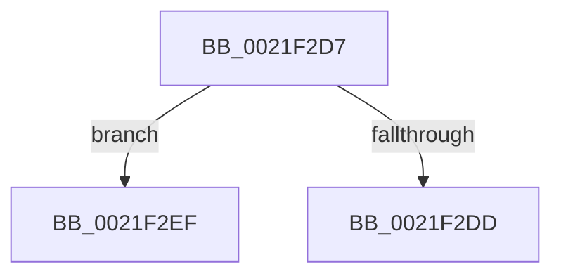

# sub_0021F2D7

- RVA: `0x0021F2D7`–`0x0021F31C` (길이 `69` bytes)
- VA: `0x000000014021F2D7`
- 실행 섹션: `.text`
- PDB 이름 있음: `아니요`; PDB Function 태그: `아니요`
- unwind 정보 RVA: `0x0005F1A4`
- 디코드: `17`개 명령, `69/69` bytes 표시
- 미해석 바이트: `0` (있으면 어셈블리에 `.byte`로 보존)

> 이 문서는 커널 이미지의 기계어와 PDB 기호를 분석해 생성했습니다. 4번과 5번은 함수 원형과 자료형을 바이너리 사용 방식에서 추정한 C 해석이며 원본 소스 복구 결과는 아닙니다.

## 1. Dependencies

- 직접 호출 지점: **1**; 고유 호출 대상: **1**
- 직접 호출자로 확인된 함수: **0**
- RIP 상대 이미지 참조: **0**

### Outgoing calls
- `0x0021F2DD` → [KiAbOwnerComputeCpuPriorityKey](KiAbOwnerComputeCpuPriorityKey_function_0021F090.md) (function, `0x0021F090`)

### Direct callers
- 이 함수 시작 RVA로 연결되는 직접 call은 확인되지 않았습니다. 간접 호출은 완전히 역산할 수 없습니다.

### Static image references
- 디코드된 RIP-relative 메모리 참조가 없습니다.

## 2. Other-region calls and transfers

- 다른 실행 섹션으로 향하는 call: **0**
- call이 아닌 외부 분기/꼬리 이동: **2**
  - `0x0021F2EA` → [KiAbSetMinimumThreadPriority + 0xAB](KiAbSetMinimumThreadPriority_function_0021F190.md) (`tail-transfer`)
  - `0x0021F317` → [KiAbSetMinimumThreadPriority + 0xAB](KiAbSetMinimumThreadPriority_function_0021F190.md) (`tail-transfer`)

## 3. Assembly (complete function range)

```asm
0021F2D7  40 38 79 09                     cmp byte ptr [rcx + 9], dil
0021F2DB  75 12                           jne 0x14021f2ef
0021F2DD  E8 AE FD FF FF                  call 0x14021f090
0021F2E2  4C 8B 84 24 B0 00 00 00         mov r8, qword ptr [rsp + 0xb0]
0021F2EA  E9 4C FF FF FF                  jmp 0x14021f23b
0021F2EF  0F B6 41 08                     movzx eax, byte ptr [rcx + 8]
0021F2F3  BA 1E 00 00 00                  mov edx, 0x1e
0021F2F8  83 E0 3F                        and eax, 0x3f
0021F2FB  48 6B C8 58                     imul rcx, rax, 0x58
0021F2FF  49 8B C0                        mov rax, r8
0021F302  48 2B C1                        sub rax, rcx
0021F305  48 8B 40 F0                     mov rax, qword ptr [rax - 0x10]
0021F309  0F B6 88 C3 00 00 00            movzx ecx, byte ptr [rax + 0xc3]
0021F310  3A CA                           cmp cl, dl
0021F312  8B C1                           mov eax, ecx
0021F314  0F 4F C2                        cmovg eax, edx
0021F317  E9 1F FF FF FF                  jmp 0x14021f23b
```

## 4. C-style interpretation (structured pseudocode)

```c
__int64 __fastcall sub_0021F2D7(__int64 a1, __int64 a2, __int64 a3, __int64 a4, __int64 a5, __int64 a6, __int64 a7, __int64 a8, __int64 a9, __int64 a10, __int64 a11, __int64 a12, __int64 a13, __int64 a14, __int64 a15, __int64 a16, __int64 a17, __int64 a18, __int64 a19, __int64 a20, __int64 a21, __int64 a22)
{
    __int64 result;

    if ((*(unsigned __int8 *)(a1 + 9)) != ((unsigned __int8)(v_rdi))) goto loc_0021F2EF;
    result = KiAbOwnerComputeCpuPriorityKey(a1, a2, a3, a4);
loc_0021F2EF:
    result = (unsigned int)((*(unsigned __int8 *)(a1 + 8)) & (63));
    a1 = (a1) * (result);
    result = (a22) - (a1);
    result = (unsigned int)((unsigned int)(*(unsigned __int8 *)(*(unsigned __int64 *)(result - 16) + 195)));
    if (((unsigned __int8)(*(unsigned __int8 *)(*(unsigned __int64 *)(result - 16) + 195))) > 30) { result = 30; }
}
```

## 5. (Beta) C Style

```c
int64_t sub_0021F2D7(void *Arg1, int64_t Arg2, void *Arg3, int64_t Arg4, uint64_t Arg5, uint64_t Arg6, uint64_t Arg7, uint64_t Arg8, uint64_t Arg9, uint64_t Arg10, uint64_t Arg11, uint64_t Arg12, uint64_t Arg13, uint64_t Arg14, uint64_t Arg15, uint64_t Arg16, uint64_t Arg17, uint64_t Arg18, uint64_t Arg19, uint64_t Arg20, uint64_t Arg21, int64_t Arg22)
{
    uint8_t *arg1 = (uint8_t *)Arg1;
    uint8_t *arg3 = (uint8_t *)Arg3;

    int64_t result;

    if ((*(uint8_t *)(arg1 + 0x9)) != ((uint8_t)(local_rdi))) goto loc_0021F2EF;
    result = KiAbOwnerComputeCpuPriorityKey(Arg1, Arg2, Arg3, Arg4);
loc_0021F2EF:
    result = (uint32_t)((*(uint8_t *)(arg1 + 0x8)) & (63));
    Arg1 = (Arg1) * (result);
    result = (Arg22) - (Arg1);
    result = (uint32_t)((uint32_t)(*(uint8_t *)(*(uint64_t *)(result - 0x10) + 0xC3)));
    if (((uint8_t)(*(uint8_t *)(*(uint64_t *)(result - 0x10) + 0xC3))) > 30) { result = 30; }
}
```

### 관측된 메모리 오프셋

구조체 형식이 확인되지 않은 접근은 인자 기준의 오프셋으로만 기록했습니다.

| 기준 인자 | 오프셋 표현 | 폭 (bit) | 접근 |
|---|---:|---:|---|
| `Arg1` | `+ 0x8` | `8` | `R` |
| `Arg1` | `+ 0x9` | `8` | `R` |
| `Arg3` | `- 0x10` | `64` | `R` |

## 6. Execution-region graph

[열기: 2D/3D 그래프와 함수 탐색 컨트롤 패널](../../../control-panel.html?section=text&rva=0x0021F2D7&view=graph)

- 2D 그래프는 위에서 아래로 흐르고, 3D 그래프는 빈 공간을 드래그해 회전합니다. Shift+드래그는 이동, 휠은 확대·축소, 함수 노드 선택은 대상 보고서 이동입니다.

### Static fallback


