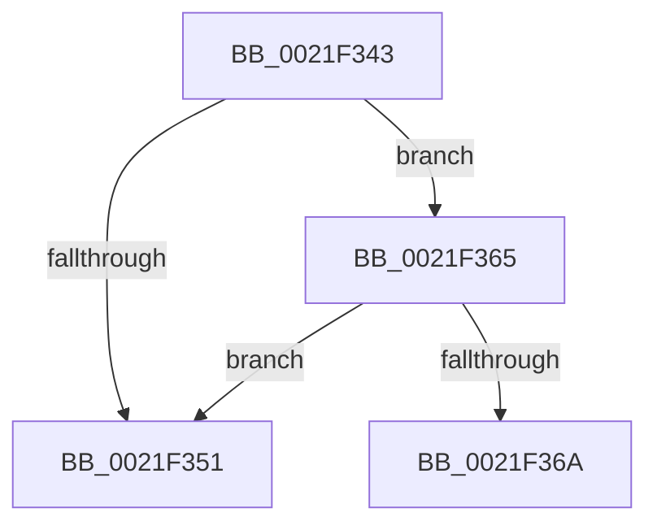

# sub_0021F343

- RVA: `0x0021F343`–`0x0021F36F` (길이 `44` bytes)
- VA: `0x000000014021F343`
- 실행 섹션: `.text`
- PDB 이름 있음: `아니요`; PDB Function 태그: `아니요`
- unwind 정보 RVA: `0x0005F1CC`
- 디코드: `10`개 명령, `44/44` bytes 표시
- 미해석 바이트: `0` (있으면 어셈블리에 `.byte`로 보존)

> 이 문서는 커널 이미지의 기계어와 PDB 기호를 분석해 생성했습니다. 4번과 5번은 함수 원형과 자료형을 바이너리 사용 방식에서 추정한 C 해석이며 원본 소스 복구 결과는 아닙니다.

## 1. Dependencies

- 직접 호출 지점: **0**; 고유 호출 대상: **0**
- 직접 호출자로 확인된 함수: **0**
- RIP 상대 이미지 참조: **0**

### Outgoing calls
- 직접 디코드된 call 명령이 없습니다.

### Direct callers
- 이 함수 시작 RVA로 연결되는 직접 call은 확인되지 않았습니다. 간접 호출은 완전히 역산할 수 없습니다.

### Static image references
- 디코드된 RIP-relative 메모리 참조가 없습니다.

## 2. Other-region calls and transfers

- 다른 실행 섹션으로 향하는 call: **0**
- call이 아닌 외부 분기/꼬리 이동: **2**
  - `0x0021F360` → [KiAbSetMinimumThreadPriority + 0x75](KiAbSetMinimumThreadPriority_function_0021F190.md) (`tail-transfer`)
  - `0x0021F36A` → [KiAbSetMinimumThreadPriority + 0x75](KiAbSetMinimumThreadPriority_function_0021F190.md) (`tail-transfer`)

## 3. Assembly (complete function range)

```asm
0021F343  65 48 8B 04 25 88 01 00 00      mov rax, qword ptr gs:[0x188]
0021F34C  48 3B D8                        cmp rbx, rax
0021F34F  75 14                           jne 0x14021f365
0021F351  83 BB E0 05 00 00 00            cmp dword ptr [rbx + 0x5e0], 0
0021F358  B8 02 00 00 00                  mov eax, 2
0021F35D  0F 45 E8                        cmovne ebp, eax
0021F360  E9 A0 FE FF FF                  jmp 0x14021f205
0021F365  83 FD 02                        cmp ebp, 2
0021F368  7C E7                           jl 0x14021f351
0021F36A  E9 96 FE FF FF                  jmp 0x14021f205
```

## 4. C-style interpretation (structured pseudocode)

```c
__int64 __fastcall sub_0021F343(void)
{
    __int64 v_rbp;

    if (v_rbx != (*(unsigned __int64 *)(gs_base + (0 + 392)))) goto loc_0021F365;
loc_0021F351:
    if ((*(unsigned int *)(v_rbx + 1504)) != 0) { v_rbp = 2; }
loc_0021F365:
    if (((unsigned int)(v_rbp)) < 2) goto loc_0021F351;
}
```

## 5. (Beta) C Style

```c
void sub_0021F343(void)
{
    int64_t local_rbp;

    if (local_rbx != (*(uint64_t *)(gs_base + (0 + 0x188)))) goto loc_0021F365;
loc_0021F351:
    if ((*(uint32_t *)(local_rbx + 0x5E0)) != 0) { local_rbp = 2; }
loc_0021F365:
    if (((uint32_t)(local_rbp)) < 2) goto loc_0021F351;
}
```

## 6. Execution-region graph

[열기: 2D/3D 그래프와 함수 탐색 컨트롤 패널](../../../control-panel.html?section=text&rva=0x0021F343&view=graph)

- 2D 그래프는 위에서 아래로 흐르고, 3D 그래프는 빈 공간을 드래그해 회전합니다. Shift+드래그는 이동, 휠은 확대·축소, 함수 노드 선택은 대상 보고서 이동입니다.

### Static fallback


