# sub_0021F36F

- RVA: `0x0021F36F`–`0x0021F691` (길이 `802` bytes)
- VA: `0x000000014021F36F`
- 실행 섹션: `.text`
- PDB 이름 있음: `아니요`; PDB Function 태그: `아니요`
- unwind 정보 RVA: `0x0005F1DC`
- 디코드: `185`개 명령, `802/802` bytes 표시
- 미해석 바이트: `0` (있으면 어셈블리에 `.byte`로 보존)

> 이 문서는 커널 이미지의 기계어와 PDB 기호를 분석해 생성했습니다. 4번과 5번은 함수 원형과 자료형을 바이너리 사용 방식에서 추정한 C 해석이며 원본 소스 복구 결과는 아닙니다.

## 1. Dependencies

- 직접 호출 지점: **11**; 고유 호출 대상: **8**
- 직접 호출자로 확인된 함수: **0**
- RIP 상대 이미지 참조: **3**

### Outgoing calls
- `0x0021F3A6` → [KiSetPriorityThread](../22/KiSetPriorityThread_function_00220E78.md) (function, `0x00220E78`)
- `0x0021F4F4` → [PsBoostThreadIoEx](../39/PsBoostThreadIoEx_function_00392C00.md) (function, `0x00392C00`)
- `0x0021F543` → [PsBoostThreadIoQoS](PsBoostThreadIoQoS_function_0021EFC0.md) (function, `0x0021EFC0`)
- `0x0021F590` → [PsBoostThreadIoEx](../39/PsBoostThreadIoEx_function_00392C00.md) (function, `0x00392C00`)
- `0x0021F5A2` → [KiAbThreadInsertList](KiAbThreadInsertList_function_0021F0E0.md) (function, `0x0021F0E0`)
- `0x0021F5B6` → [KiAbQueueAutoBoostDpc](../20/KiAbQueueAutoBoostDpc_function_002074D0.md) (function, `0x002074D0`)
- `0x0021F5D4` → [KiAbThreadInsertList](KiAbThreadInsertList_function_0021F0E0.md) (function, `0x0021F0E0`)
- `0x0021F5E8` → [KiAbQueueAutoBoostDpc](../20/KiAbQueueAutoBoostDpc_function_002074D0.md) (function, `0x002074D0`)
- `0x0021F600` → [KiCheckVpBackingLongSpinWaitHypercall](../30/KiCheckVpBackingLongSpinWaitHypercall_function_0030F490.md) (function, `0x0030F490`)
- `0x0021F60F` → [HvlNotifyLongSpinWait](../30/HvlNotifyLongSpinWait_function_0030F460.md) (function, `0x0030F460`)
- `0x0021F687` → [EtwTraceAutoBoostSetFloor](../22/EtwTraceAutoBoostSetFloor_function_00222EF0.md) (function, `0x00222EF0`)

### Direct callers
- 이 함수 시작 RVA로 연결되는 직접 call은 확인되지 않았습니다. 간접 호출은 완전히 역산할 수 없습니다.

### Static image references
- `0x0021F438` → RVA `0x00FC6B14` (`ALMOSTRO`; read)
- `0x0021F48C` → RVA `0x00FC52AC` (`ALMOSTRO`; reference)
- `0x0021F5F2` → RVA `0x00FC6AB8` (`ALMOSTRO`; read)

## 2. Other-region calls and transfers

- 다른 실행 섹션으로 향하는 call: **0**
- 별도 외부 분기/꼬리 이동을 확인하지 못했습니다.

## 3. Assembly (complete function range)

```asm
0021F36F  44 0F B6 64 24 54               movzx r12d, byte ptr [rsp + 0x54]
0021F375  EB 4B                           jmp 0x14021f3c2
0021F377  FE C0                           inc al
0021F379  88 81 38 03 00 00               mov byte ptr [rcx + 0x338], al
0021F37F  8B 83 58 03 00 00               mov eax, dword ptr [rbx + 0x358]
0021F385  44 0F AB E0                     bts eax, r12d
0021F389  89 83 58 03 00 00               mov dword ptr [rbx + 0x358], eax
0021F38F  0F BE 83 C3 00 00 00            movsx eax, byte ptr [rbx + 0xc3]
0021F396  41 3B C4                        cmp eax, r12d
0021F399  7D 16                           jge 0x14021f3b1
0021F39B  48 8B 94 24 C0 00 00 00         mov rdx, qword ptr [rsp + 0xc0]
0021F3A3  48 8B CB                        mov rcx, rbx
0021F3A6  E8 CD 1A 00 00                  call 0x140220e78
0021F3AB  41 BF 01 00 00 00               mov r15d, 1
0021F3B1  4C 8B 84 24 B0 00 00 00         mov r8, qword ptr [rsp + 0xb0]
0021F3B9  4C 8B 4C 24 58                  mov r9, qword ptr [rsp + 0x58]
0021F3BE  48 89 7B 40                     mov qword ptr [rbx + 0x40], rdi
0021F3C2  48 8B 83 20 02 00 00            mov rax, qword ptr [rbx + 0x220]
0021F3C9  49 8B F1                        mov rsi, r9
0021F3CC  8B 8B A0 05 00 00               mov ecx, dword ptr [rbx + 0x5a0]
0021F3D2  C1 E9 09                        shr ecx, 9
0021F3D5  83 E1 07                        and ecx, 7
0021F3D8  48 8B 90 A0 02 00 00            mov rdx, qword ptr [rax + 0x2a0]
0021F3DF  48 85 D2                        test rdx, rdx
0021F3E2  74 10                           je 0x14021f3f4
0021F3E4  8B 82 3C 04 00 00               mov eax, dword ptr [rdx + 0x43c]
0021F3EA  3B C8                           cmp ecx, eax
0021F3EC  7C 06                           jl 0x14021f3f4
0021F3EE  8B C8                           mov ecx, eax
0021F3F0  49 8D 70 50                     lea rsi, [r8 + 0x50]
0021F3F4  41 0F BE 45 01                  movsx eax, byte ptr [r13 + 1]
0021F3F9  4C 8B B4 24 D0 00 00 00         mov r14, qword ptr [rsp + 0xd0]
0021F401  3B C8                           cmp ecx, eax
0021F403  0F 8C D3 00 00 00               jl 0x14021f4dc
0021F409  41 0F BE 45 02                  movsx eax, byte ptr [r13 + 2]
0021F40E  8B CF                           mov ecx, edi
0021F410  39 8B E8 05 00 00               cmp dword ptr [rbx + 0x5e8], ecx
0021F416  4C 8B AC 24 B0 00 00 00         mov r13, qword ptr [rsp + 0xb0]
0021F41E  0F 94 C1                        sete cl
0021F421  3B C8                           cmp ecx, eax
0021F423  0F 8C 0B 01 00 00               jl 0x14021f534
0021F429  48 39 BC 24 C8 00 00 00         cmp qword ptr [rsp + 0xc8], rdi
0021F431  74 05                           je 0x14021f438
0021F433  45 85 FF                        test r15d, r15d
0021F436  75 32                           jne 0x14021f46a
0021F438  F7 05 D2 76 DA 00 00 10 00 00   test dword ptr [rip + 0xda76d2], 0x1000
0021F442  0F 85 D1 01 00 00               jne 0x14021f619
0021F448  4C 8B 74 24 68                  mov r14, qword ptr [rsp + 0x68]
0021F44D  45 84 E4                        test r12b, r12b
0021F450  48 8B 74 24 70                  mov rsi, qword ptr [rsp + 0x70]
0021F455  40 0F 95 C7                     setne dil
0021F459  8B C7                           mov eax, edi
0021F45B  48 83 C4 78                     add rsp, 0x78
0021F45F  41 5F                           pop r15
0021F461  41 5D                           pop r13
0021F463  41 5C                           pop r12
0021F465  5F                              pop rdi
0021F466  5D                              pop rbp
0021F467  5B                              pop rbx
0021F468  C3                              ret
0021F469  CC                              int3
0021F46A  0F B6 83 18 03 00 00            movzx eax, byte ptr [rbx + 0x318]
0021F471  84 C0                           test al, al
0021F473  74 C3                           je 0x14021f438
0021F475  4C 8D B3 28 03 00 00            lea r14, [rbx + 0x328]
0021F47C  44 8B FF                        mov r15d, edi
0021F47F  8B F7                           mov esi, edi
0021F481  F0 48 0F BA 6B 40 00            lock bts qword ptr [rbx + 0x40], 0
0021F488  73 1B                           jae 0x14021f4a5
0021F48A  FF C6                           inc esi
0021F48C  85 35 1A 5E DA 00               test dword ptr [rip + 0xda5e1a], esi
0021F492  0F 84 5A 01 00 00               je 0x14021f5f2
0021F498  F3 90                           pause
0021F49A  48 8B 43 40                     mov rax, qword ptr [rbx + 0x40]
0021F49E  48 85 C0                        test rax, rax
0021F4A1  74 DE                           je 0x14021f481
0021F4A3  EB E5                           jmp 0x14021f48a
0021F4A5  49 83 3E 01                     cmp qword ptr [r14], 1
0021F4A9  75 17                           jne 0x14021f4c2
0021F4AB  48 8B 8C 24 C8 00 00 00         mov rcx, qword ptr [rsp + 0xc8]
0021F4B3  41 BF 01 00 00 00               mov r15d, 1
0021F4B9  48 8B 01                        mov rax, qword ptr [rcx]
0021F4BC  49 89 06                        mov qword ptr [r14], rax
0021F4BF  4C 89 31                        mov qword ptr [rcx], r14
0021F4C2  48 89 7B 40                     mov qword ptr [rbx + 0x40], rdi
0021F4C6  45 85 FF                        test r15d, r15d
0021F4C9  0F 84 69 FF FF FF               je 0x14021f438
0021F4CF  66 F0 FF 83 64 03 00 00         lock inc word ptr [rbx + 0x364]
0021F4D7  E9 5C FF FF FF                  jmp 0x14021f438
0021F4DC  41 F7 01 00 00 00 40            test dword ptr [r9], 0x40000000
0021F4E3  0F 85 20 FF FF FF               jne 0x14021f409
0021F4E9  45 33 C9                        xor r9d, r9d
0021F4EC  45 33 C0                        xor r8d, r8d
0021F4EF  33 D2                           xor edx, edx
0021F4F1  48 8B CB                        mov rcx, rbx
0021F4F4  E8 07 37 17 00                  call 0x140392c00
0021F4F9  F0 09 3C 24                     lock or dword ptr [rsp], edi
0021F4FD  8B 83 5C 03 00 00               mov eax, dword ptr [rbx + 0x35c]
0021F503  85 C0                           test eax, eax
0021F505  75 10                           jne 0x14021f517
0021F507  4D 85 F6                        test r14, r14
0021F50A  75 79                           jne 0x14021f585
0021F50C  48 8B 84 24 D8 00 00 00         mov rax, qword ptr [rsp + 0xd8]
0021F514  83 08 01                        or dword ptr [rax], 1
0021F517  F0 FF 83 5C 03 00 00            lock inc dword ptr [rbx + 0x35c]
0021F51E  81 0E 00 00 00 40               or dword ptr [rsi], 0x40000000
0021F524  41 BF 01 00 00 00               mov r15d, 1
0021F52A  C6 44 24 55 02                  mov byte ptr [rsp + 0x55], 2
0021F52F  E9 D5 FE FF FF                  jmp 0x14021f409
0021F534  41 39 7D 50                     cmp dword ptr [r13 + 0x50], edi
0021F538  0F 8C EB FE FF FF               jl 0x14021f429
0021F53E  33 D2                           xor edx, edx
0021F540  48 8B CB                        mov rcx, rbx
0021F543  E8 78 FA FF FF                  call 0x14021efc0
0021F548  F0 09 3C 24                     lock or dword ptr [rsp], edi
0021F54C  8B 83 60 03 00 00               mov eax, dword ptr [rbx + 0x360]
0021F552  85 C0                           test eax, eax
0021F554  75 10                           jne 0x14021f566
0021F556  4D 85 F6                        test r14, r14
0021F559  75 65                           jne 0x14021f5c0
0021F55B  48 8B 84 24 D8 00 00 00         mov rax, qword ptr [rsp + 0xd8]
0021F563  83 08 02                        or dword ptr [rax], 2
0021F566  F0 FF 83 60 03 00 00            lock inc dword ptr [rbx + 0x360]
0021F56D  41 81 4D 50 00 00 00 80         or dword ptr [r13 + 0x50], 0x80000000
0021F575  41 BF 01 00 00 00               mov r15d, 1
0021F57B  44 88 7C 24 56                  mov byte ptr [rsp + 0x56], r15b
0021F580  E9 A4 FE FF FF                  jmp 0x14021f429
0021F585  45 33 C9                        xor r9d, r9d
0021F588  45 33 C0                        xor r8d, r8d
0021F58B  B2 01                           mov dl, 1
0021F58D  48 8B CB                        mov rcx, rbx
0021F590  E8 6B 36 17 00                  call 0x140392c00
0021F595  4C 8D 83 30 03 00 00            lea r8, [rbx + 0x330]
0021F59C  49 8B D6                        mov rdx, r14
0021F59F  48 8B CB                        mov rcx, rbx
0021F5A2  E8 39 FB FF FF                  call 0x14021f0e0
0021F5A7  85 C0                           test eax, eax
0021F5A9  0F 84 5A FE FF FF               je 0x14021f409
0021F5AF  49 8D 8E 90 6E FF FF            lea rcx, [r14 - 0x9170]
0021F5B6  E8 15 7F FE FF                  call 0x1402074d0
0021F5BB  E9 49 FE FF FF                  jmp 0x14021f409
0021F5C0  F0 FF 8B E4 05 00 00            lock dec dword ptr [rbx + 0x5e4]
0021F5C7  4C 8D 83 30 03 00 00            lea r8, [rbx + 0x330]
0021F5CE  49 8B D6                        mov rdx, r14
0021F5D1  48 8B CB                        mov rcx, rbx
0021F5D4  E8 07 FB FF FF                  call 0x14021f0e0
0021F5D9  85 C0                           test eax, eax
0021F5DB  0F 84 48 FE FF FF               je 0x14021f429
0021F5E1  49 8D 8E 90 6E FF FF            lea rcx, [r14 - 0x9170]
0021F5E8  E8 E3 7E FE FF                  call 0x1402074d0
0021F5ED  E9 37 FE FF FF                  jmp 0x14021f429
0021F5F2  8B 05 C0 74 DA 00               mov eax, dword ptr [rip + 0xda74c0]
0021F5F8  A8 40                           test al, 0x40
0021F5FA  0F 84 98 FE FF FF               je 0x14021f498
0021F600  E8 8B FE 0E 00                  call 0x14030f490
0021F605  84 C0                           test al, al
0021F607  0F 84 8B FE FF FF               je 0x14021f498
0021F60D  8B CE                           mov ecx, esi
0021F60F  E8 4C FE 0E 00                  call 0x14030f460
0021F614  E9 81 FE FF FF                  jmp 0x14021f49a
0021F619  39 7C 24 54                     cmp dword ptr [rsp + 0x54], edi
0021F61D  0F 84 25 FE FF FF               je 0x14021f448
0021F623  49 8B 55 00                     mov rdx, qword ptr [r13]
0021F627  48 B8 FC FF FF FF FF FF FF 7F   movabs rax, 0x7ffffffffffffffc
0021F631  48 23 D0                        and rdx, rax
0021F634  74 13                           je 0x14021f649
0021F636  41 38 7D 08                     cmp byte ptr [r13 + 8], dil
0021F63A  7C 0D                           jl 0x14021f649
0021F63C  48 B8 00 00 00 00 00 00 00 80   movabs rax, 0x8000000000000000
0021F646  48 0B D0                        or rdx, rax
0021F649  48 8B 84 24 D8 00 00 00         mov rax, qword ptr [rsp + 0xd8]
0021F651  45 0F B6 C4                     movzx r8d, r12b
0021F655  0F B6 4C 24 56                  movzx ecx, byte ptr [rsp + 0x56]
0021F65A  44 0F B6 4C 24 55               movzx r9d, byte ptr [rsp + 0x55]
0021F660  8B 00                           mov eax, dword ptr [rax]
0021F662  89 44 24 48                     mov dword ptr [rsp + 0x48], eax
0021F666  0F B6 84 24 B8 00 00 00         movzx eax, byte ptr [rsp + 0xb8]
0021F66E  88 44 24 38                     mov byte ptr [rsp + 0x38], al
0021F672  0F B6 44 24 50                  movzx eax, byte ptr [rsp + 0x50]
0021F677  40 88 6C 24 30                  mov byte ptr [rsp + 0x30], bpl
0021F67C  88 44 24 28                     mov byte ptr [rsp + 0x28], al
0021F680  88 4C 24 20                     mov byte ptr [rsp + 0x20], cl
0021F684  48 8B CB                        mov rcx, rbx
0021F687  E8 64 38 00 00                  call 0x140222ef0
0021F68C  E9 B7 FD FF FF                  jmp 0x14021f448
```

## 4. C-style interpretation (structured pseudocode)

```c
__int64 __fastcall sub_0021F36F(__int64 a1, __int64 a2, __int64 a3, __int64 a4, __int64 a5, __int64 a6, __int64 a7, __int64 a8, __int64 a9, unsigned __int8 a10, __int64 a11, __int64 a12, __int64 a13, __int64 a14, __int64 a15, __int64 a16, __int64 a17, __int64 a18, __int64 a19, __int64 a20, __int64 a21, __int64 a22, unsigned __int8 a23, __int64 a24, __int64 a25, __int64 a26, __int64 a27)
{
    __int64 result;
    __int64 v_r15;
    __int64 v_rdi;
    __int64 v_rsi;
    __int64 v_rsp;
    unsigned __int8 v_stack_p54;
    unsigned __int64 v_stack_p58;
    unsigned int v_stack_pA8;
    unsigned __int64 v_stack_pB0;
    unsigned __int64 v_stack_pC0;
    unsigned __int8 v_stack_pC8;
    unsigned __int8 v_stack_pD0;
    unsigned __int8 v_stack_pD8;
    unsigned __int8 v_stack_pE0;
    unsigned int v_stack_pF0;
    unsigned int v_stack_pFC;
    unsigned __int8 v_stack_pFD;
    unsigned __int8 v_stack_pFE;

    goto loc_0021F3C2;
loc_0021F3C2:
    a1 = (unsigned int)(((unsigned int)(*(unsigned int *)(v_rbx + 1440))) >> (9));
    a1 = (unsigned int)((a1) & (7));
    if (*(unsigned __int64 *)(*(unsigned __int64 *)(v_rbx + 544) + 672) == 0) goto loc_0021F3F4;
    v_rsi = a4;
    if (((unsigned int)(a1)) >= ((unsigned int)((unsigned int)(*(unsigned int *)(*(unsigned __int64 *)(*(unsigned __int64 *)(v_rbx + 544) + 672) + 1084))))) {
        a1 = (unsigned int)((unsigned int)(*(unsigned int *)(*(unsigned __int64 *)(*(unsigned __int64 *)(v_rbx + 544) + 672) + 1084)));
        v_rsi = a3 + 80;
    }
    if (((unsigned int)(a1)) < ((unsigned int)((__int8)(*(unsigned __int8 *)(v_r13 + 1))))) goto loc_0021F4DC;
loc_0021F409:
    a1 = ((*(unsigned int *)(v_rbx + 1512)) == ((unsigned int)((unsigned int)((unsigned int)(v_rdi))))) ? 1 : 0;
    if (((unsigned int)(a1)) < ((unsigned int)((__int8)(*(unsigned __int8 *)(v_r13 + 2))))) goto loc_0021F534;
loc_0021F429:
    if (a25 == v_rdi) goto loc_0021F438;
    if ((unsigned int)(v_r15) != 0) goto loc_0021F46A;
loc_0021F438:
    if (((*(unsigned int *)(v_rip + 14317266)) & (0x1000ULL)) != 0) goto loc_0021F619;
loc_0021F448:
    v_rdi = ((unsigned __int8)(v_stack_p54) != 0) ? 1 : 0;
    v_rsp = (v_rsp) + (120);
    return (unsigned int)((unsigned int)(v_rdi));
loc_0021F46A:
    if ((unsigned __int8)(*(unsigned __int8 *)(v_rbx + 792)) == 0) goto loc_0021F438;
loc_0021F481:
    if (condition_is_above_or_equal) goto loc_0021F4A5;
loc_0021F48A:
    v_rsi = (unsigned int)(((unsigned int)((unsigned int)(v_rdi))) + 1);
    if (((*(unsigned int *)(v_rip + 14310938)) & ((unsigned int)(v_rsi))) == 0) goto loc_0021F5F2;
loc_0021F498:
loc_0021F49A:
    if (*(unsigned __int64 *)(v_rbx + 64) == 0) goto loc_0021F481;
    goto loc_0021F48A;
loc_0021F4A5:
    result = *(unsigned __int64 *)(v_rbx + 64);
    v_r15 = (unsigned int)((unsigned int)(v_rdi));
    if ((*(unsigned __int64 *)(v_rbx + 808)) == 1) {
        a1 = a25;
        v_r15 = 1;
        result = *(unsigned __int64 *)(a1);
        *(unsigned __int64 *)(v_rbx + 808) = result;
        *(unsigned __int64 *)(a1) = v_rbx + 808;
    }
    *(unsigned __int64 *)(v_rbx + 64) = v_rdi;
    if ((unsigned int)(v_r15) == 0) goto loc_0021F438;
    goto loc_0021F438;
loc_0021F4DC:
    if (((*(unsigned int *)(a4)) & (0x40000000ULL)) != 0) goto loc_0021F409;
    a4 = 0;
    a3 = 0;
    a2 = 0;
    result = PsBoostThreadIoEx(v_rbx, a2, a3, a4);
    if ((unsigned int)((unsigned int)(*(unsigned int *)(v_rbx + 860))) != 0) goto loc_0021F517;
    if (v_rbx + 808 != 0) goto loc_0021F585;
loc_0021F517:
    v_stack_pFD = 2;
    goto loc_0021F409;
loc_0021F534:
    if ((*(unsigned int *)(a22 + 80)) < ((unsigned int)(v_rdi))) goto loc_0021F429;
    a2 = 0;
    result = PsBoostThreadIoQoS(v_rbx, a2, a3, a4);
    if ((unsigned int)((unsigned int)(*(unsigned int *)(v_rbx + 864))) != 0) goto loc_0021F566;
    if (v_rbx + 808 != 0) goto loc_0021F5C0;
loc_0021F566:
    v_stack_pFE = 1;
    goto loc_0021F429;
loc_0021F585:
    a4 = 0;
    a3 = 0;
    result = PsBoostThreadIoEx(v_rbx, 1, a3, a4);
    result = KiAbThreadInsertList(v_rbx, v_rbx + 808, v_rbx + 816, a4);
    if ((unsigned int)(result) == 0) goto loc_0021F409;
    result = KiAbQueueAutoBoostDpc(v_rbx + 808 - 37232, v_rbx + 808, v_rbx + 816, a4);
    goto loc_0021F409;
loc_0021F5C0:
    result = KiAbThreadInsertList(v_rbx, v_rbx + 808, v_rbx + 816, a4);
    if ((unsigned int)(result) == 0) goto loc_0021F429;
    result = KiAbQueueAutoBoostDpc(v_rbx + 808 - 37232, v_rbx + 808, v_rbx + 816, a4);
    goto loc_0021F429;
loc_0021F5F2:
    if ((((unsigned __int8)((unsigned int)(*(unsigned int *)(v_rip + 14316736)))) & (64)) == 0) goto loc_0021F498;
    result = KiCheckVpBackingLongSpinWaitHypercall(v_rbx + 808 - 37232, v_rbx + 808, v_rbx + 816, a4);
    if ((unsigned __int8)(result) == 0) goto loc_0021F498;
    result = HvlNotifyLongSpinWait((unsigned int)((unsigned int)(v_rsi)), v_rbx + 808, v_rbx + 816, a4);
    goto loc_0021F49A;
loc_0021F619:
    if (v_stack_pFC == ((unsigned int)(v_rdi))) goto loc_0021F448;
    a2 = (*(unsigned __int64 *)(a22)) & (result);
    if (condition_is_equal) goto loc_0021F649;
    if ((*(unsigned __int8 *)(a22 + 8)) >= ((unsigned __int8)(v_rdi))) {
        a2 = (a2) | (result);
    }
    v_stack_pF0 = (unsigned int)((unsigned int)(*(unsigned int *)(a27)));
    v_stack_pE0 = a23;
    v_stack_pD8 = (unsigned __int8)(v_rbp);
    v_stack_pD0 = a10;
    v_stack_pC8 = (unsigned __int8)(v_stack_pFE);
    result = EtwTraceAutoBoostSetFloor(v_rbx, a2, (unsigned __int8)(v_stack_p54), v_stack_pFD);
    goto loc_0021F448;
}
```

## 5. (Beta) C Style

```c
int64_t sub_0021F36F(int64_t Arg1, int64_t Arg2, void *Arg3, void *Arg4, uint64_t Arg5, uint64_t Arg6, uint64_t Arg7, uint64_t Arg8, uint64_t Arg9, uint8_t Arg10, uint64_t Arg11, uint64_t Arg12, int64_t Arg13, int64_t Arg14, uint64_t Arg15, uint64_t Arg16, uint64_t Arg17, uint64_t Arg18, uint64_t Arg19, uint64_t Arg20, uint64_t Arg21, void *Arg22, uint8_t Arg23, uint64_t Arg24, void *Arg25, int64_t Arg26, void *Arg27)
{
    uint8_t *arg3 = (uint8_t *)Arg3;
    uint8_t *arg4 = (uint8_t *)Arg4;
    uint8_t *arg22 = (uint8_t *)Arg22;
    uint8_t *arg25 = (uint8_t *)Arg25;
    uint8_t *arg27 = (uint8_t *)Arg27;

    int64_t result;
    int64_t local_r15;
    int64_t local_rdi;
    int64_t local_rsi;
    int64_t local_rsp;
    uint8_t v_stack_p54;
    uint64_t v_stack_p58;
    uint32_t v_stack_pA8;
    uint64_t v_stack_pB0;
    uint64_t v_stack_pC0;
    uint8_t v_stack_pC8;
    uint8_t v_stack_pD0;
    uint8_t v_stack_pD8;
    uint8_t v_stack_pE0;
    uint32_t v_stack_pF0;
    uint32_t v_stack_pFC;
    uint8_t v_stack_pFD;
    uint8_t v_stack_pFE;

    goto loc_0021F3C2;
loc_0021F3C2:
    Arg1 = (uint32_t)(((uint32_t)(*(uint32_t *)(local_rbx + 0x5A0))) >> (9));
    Arg1 = (uint32_t)((Arg1) & (7));
    if (*(uint64_t *)(*(uint64_t *)(local_rbx + 0x220) + 0x2A0) == 0) goto loc_0021F3F4;
    local_rsi = Arg4;
    if (((uint32_t)(Arg1)) >= ((uint32_t)((uint32_t)(*(uint32_t *)(*(uint64_t *)(*(uint64_t *)(local_rbx + 0x220) + 0x2A0) + 0x43C))))) {
        Arg1 = (uint32_t)((uint32_t)(*(uint32_t *)(*(uint64_t *)(*(uint64_t *)(local_rbx + 0x220) + 0x2A0) + 0x43C)));
        local_rsi = Arg3 + 80;
    }
    if (((uint32_t)(Arg1)) < ((uint32_t)((int8_t)(*(uint8_t *)(local_r13 + 0x1))))) goto loc_0021F4DC;
loc_0021F409:
    Arg1 = ((*(uint32_t *)(local_rbx + 0x5E8)) == ((uint32_t)((uint32_t)((uint32_t)(local_rdi))))) ? 1 : 0;
    if (((uint32_t)(Arg1)) < ((uint32_t)((int8_t)(*(uint8_t *)(local_r13 + 0x2))))) goto loc_0021F534;
loc_0021F429:
    if (Arg25 == local_rdi) goto loc_0021F438;
    if ((uint32_t)(local_r15) != 0) goto loc_0021F46A;
loc_0021F438:
    if (((*(uint32_t *)(v_rip + 0xDA76D2)) & (0x1000ULL)) != 0) goto loc_0021F619;
loc_0021F448:
    local_rdi = ((uint8_t)(v_stack_p54) != 0) ? 1 : 0;
    local_rsp = (local_rsp) + (120);
    return (uint32_t)((uint32_t)(local_rdi));
loc_0021F46A:
    if ((uint8_t)(*(uint8_t *)(local_rbx + 0x318)) == 0) goto loc_0021F438;
loc_0021F481:
    if (condition_is_above_or_equal) goto loc_0021F4A5;
loc_0021F48A:
    local_rsi = (uint32_t)(((uint32_t)((uint32_t)(local_rdi))) + 1);
    if (((*(uint32_t *)(v_rip + 0xDA5E1A)) & ((uint32_t)(local_rsi))) == 0) goto loc_0021F5F2;
loc_0021F498:
loc_0021F49A:
    if (*(uint64_t *)(local_rbx + 0x40) == 0) goto loc_0021F481;
    goto loc_0021F48A;
loc_0021F4A5:
    result = *(uint64_t *)(local_rbx + 0x40);
    local_r15 = (uint32_t)((uint32_t)(local_rdi));
    if ((*(uint64_t *)(local_rbx + 0x328)) == 1) {
        Arg1 = Arg25;
        local_r15 = 1;
        result = *(uint64_t *)(Arg1);
        *(uint64_t *)(local_rbx + 0x328) = result;
        *(uint64_t *)(Arg1) = local_rbx + 808;
    }
    *(uint64_t *)(local_rbx + 0x40) = local_rdi;
    if ((uint32_t)(local_r15) == 0) goto loc_0021F438;
    goto loc_0021F438;
loc_0021F4DC:
    if (((*(uint32_t *)(arg4)) & (0x40000000ULL)) != 0) goto loc_0021F409;
    Arg4 = 0;
    Arg3 = 0;
    Arg2 = 0;
    result = PsBoostThreadIoEx(local_rbx, Arg2, Arg3, Arg4);
    if ((uint32_t)((uint32_t)(*(uint32_t *)(local_rbx + 0x35C))) != 0) goto loc_0021F517;
    if (local_rbx + 808 != 0) goto loc_0021F585;
loc_0021F517:
    v_stack_pFD = 2;
    goto loc_0021F409;
loc_0021F534:
    if ((*(uint32_t *)(arg22 + 0x50)) < ((uint32_t)(local_rdi))) goto loc_0021F429;
    Arg2 = 0;
    result = PsBoostThreadIoQoS(local_rbx, Arg2, Arg3, Arg4);
    if ((uint32_t)((uint32_t)(*(uint32_t *)(local_rbx + 0x360))) != 0) goto loc_0021F566;
    if (local_rbx + 808 != 0) goto loc_0021F5C0;
loc_0021F566:
    v_stack_pFE = 1;
    goto loc_0021F429;
loc_0021F585:
    Arg4 = 0;
    Arg3 = 0;
    result = PsBoostThreadIoEx(local_rbx, 1, Arg3, Arg4);
    result = KiAbThreadInsertList(local_rbx, local_rbx + 808, local_rbx + 816, Arg4);
    if ((uint32_t)(result) == 0) goto loc_0021F409;
    result = KiAbQueueAutoBoostDpc(local_rbx + 808 - 37232, local_rbx + 808, local_rbx + 816, Arg4);
    goto loc_0021F409;
loc_0021F5C0:
    result = KiAbThreadInsertList(local_rbx, local_rbx + 808, local_rbx + 816, Arg4);
    if ((uint32_t)(result) == 0) goto loc_0021F429;
    result = KiAbQueueAutoBoostDpc(local_rbx + 808 - 37232, local_rbx + 808, local_rbx + 816, Arg4);
    goto loc_0021F429;
loc_0021F5F2:
    if ((((uint8_t)((uint32_t)(*(uint32_t *)(v_rip + 0xDA74C0)))) & (64)) == 0) goto loc_0021F498;
    result = KiCheckVpBackingLongSpinWaitHypercall(local_rbx + 808 - 37232, local_rbx + 808, local_rbx + 816, Arg4);
    if ((uint8_t)(result) == 0) goto loc_0021F498;
    result = HvlNotifyLongSpinWait((uint32_t)((uint32_t)(local_rsi)), local_rbx + 808, local_rbx + 816, Arg4);
    goto loc_0021F49A;
loc_0021F619:
    if (v_stack_pFC == ((uint32_t)(local_rdi))) goto loc_0021F448;
    Arg2 = (*(uint64_t *)(arg22)) & (result);
    if (condition_is_equal) goto loc_0021F649;
    if ((*(uint8_t *)(arg22 + 0x8)) >= ((uint8_t)(local_rdi))) {
        Arg2 = (Arg2) | (result);
    }
    v_stack_pF0 = (uint32_t)((uint32_t)(*(uint32_t *)(arg27)));
    v_stack_pE0 = Arg23;
    v_stack_pD8 = (uint8_t)(local_rbp);
    v_stack_pD0 = Arg10;
    v_stack_pC8 = (uint8_t)(v_stack_pFE);
    result = EtwTraceAutoBoostSetFloor(local_rbx, Arg2, (uint8_t)(v_stack_p54), v_stack_pFD);
    goto loc_0021F448;
}
```

### 관측된 메모리 오프셋

구조체 형식이 확인되지 않은 접근은 인자 기준의 오프셋으로만 기록했습니다.

| 기준 인자 | 오프셋 표현 | 폭 (bit) | 접근 |
|---|---:|---:|---|
| `Arg3` | `+ 0x50` | `64` | `R` |
| `Arg4` | `+ 0x0` | `32` | `R` |
| `Arg22` | `+ 0x0` | `64` | `R` |
| `Arg22` | `+ 0x8` | `8` | `R` |
| `Arg22` | `+ 0x50` | `32` | `R` |
| `Arg22` | `+ 0x50` | `32` | `R/W` |
| `Arg25` | `+ 0x0` | `64` | `R` |
| `Arg25` | `+ 0x0` | `64` | `W` |
| `Arg27` | `+ 0x0` | `32` | `R` |
| `Arg27` | `+ 0x0` | `32` | `R/W` |

## 6. Execution-region graph

[열기: 2D/3D 그래프와 함수 탐색 컨트롤 패널](../../../control-panel.html?section=text&rva=0x0021F36F&view=graph)

- 2D 그래프는 위에서 아래로 흐르고, 3D 그래프는 빈 공간을 드래그해 회전합니다. Shift+드래그는 이동, 휠은 확대·축소, 함수 노드 선택은 대상 보고서 이동입니다.

### Static fallback

```mermaid
flowchart TD
  bb_0021F36F[BB_0021F36F]
  bb_0021F377[BB_0021F377]
  bb_0021F39B[BB_0021F39B]
  bb_0021F3B1[BB_0021F3B1]
  bb_0021F3C2[BB_0021F3C2]
  bb_0021F3E4[BB_0021F3E4]
  bb_0021F3EE[BB_0021F3EE]
  bb_0021F3F4[BB_0021F3F4]
  bb_0021F409[BB_0021F409]
  bb_0021F429[BB_0021F429]
  bb_0021F433[BB_0021F433]
  bb_0021F438[BB_0021F438]
  bb_0021F448[BB_0021F448]
  bb_0021F469[BB_0021F469]
  bb_0021F46A[BB_0021F46A]
  bb_0021F475[BB_0021F475]
  bb_0021F481[BB_0021F481]
  bb_0021F48A[BB_0021F48A]
  bb_0021F498[BB_0021F498]
  bb_0021F49A[BB_0021F49A]
  bb_0021F4A3[BB_0021F4A3]
  bb_0021F4A5[BB_0021F4A5]
  bb_0021F4AB[BB_0021F4AB]
  bb_0021F4C2[BB_0021F4C2]
  bb_0021F4CF[BB_0021F4CF]
  bb_0021F4DC[BB_0021F4DC]
  bb_0021F4E9[BB_0021F4E9]
  bb_0021F507[BB_0021F507]
  bb_0021F50C[BB_0021F50C]
  bb_0021F517[BB_0021F517]
  bb_0021F534[BB_0021F534]
  bb_0021F53E[BB_0021F53E]
  bb_0021F556[BB_0021F556]
  bb_0021F55B[BB_0021F55B]
  bb_0021F566[BB_0021F566]
  bb_0021F585[BB_0021F585]
  bb_0021F5AF[BB_0021F5AF]
  bb_0021F5C0[BB_0021F5C0]
  bb_0021F5E1[BB_0021F5E1]
  bb_0021F5F2[BB_0021F5F2]
  bb_0021F600[BB_0021F600]
  bb_0021F60D[BB_0021F60D]
  bb_0021F619[BB_0021F619]
  bb_0021F623[BB_0021F623]
  bb_0021F636[BB_0021F636]
  bb_0021F63C[BB_0021F63C]
  bb_0021F649[BB_0021F649]
  bb_0021F36F -->|branch| bb_0021F3C2
  bb_0021F377 -->|branch| bb_0021F3B1
  bb_0021F377 -->|fallthrough| bb_0021F39B
  bb_0021F39B -->|flow| bb_0021F3B1
  bb_0021F3B1 -->|flow| bb_0021F3C2
  bb_0021F3C2 -->|branch| bb_0021F3F4
  bb_0021F3C2 -->|fallthrough| bb_0021F3E4
  bb_0021F3E4 -->|branch| bb_0021F3F4
  bb_0021F3E4 -->|fallthrough| bb_0021F3EE
  bb_0021F3EE -->|flow| bb_0021F3F4
  bb_0021F3F4 -->|branch| bb_0021F4DC
  bb_0021F3F4 -->|fallthrough| bb_0021F409
  bb_0021F409 -->|branch| bb_0021F534
  bb_0021F409 -->|fallthrough| bb_0021F429
  bb_0021F429 -->|branch| bb_0021F438
  bb_0021F429 -->|fallthrough| bb_0021F433
  bb_0021F433 -->|branch| bb_0021F46A
  bb_0021F433 -->|fallthrough| bb_0021F438
  bb_0021F438 -->|branch| bb_0021F619
  bb_0021F438 -->|fallthrough| bb_0021F448
  bb_0021F469 -->|flow| bb_0021F46A
  bb_0021F46A -->|branch| bb_0021F438
  bb_0021F46A -->|fallthrough| bb_0021F475
  bb_0021F475 -->|flow| bb_0021F481
  bb_0021F481 -->|branch| bb_0021F4A5
  bb_0021F481 -->|fallthrough| bb_0021F48A
  bb_0021F48A -->|branch| bb_0021F5F2
  bb_0021F48A -->|fallthrough| bb_0021F498
  bb_0021F498 -->|flow| bb_0021F49A
  bb_0021F49A -->|branch| bb_0021F481
  bb_0021F49A -->|fallthrough| bb_0021F4A3
  bb_0021F4A3 -->|branch| bb_0021F48A
  bb_0021F4A5 -->|branch| bb_0021F4C2
  bb_0021F4A5 -->|fallthrough| bb_0021F4AB
  bb_0021F4AB -->|flow| bb_0021F4C2
  bb_0021F4C2 -->|branch| bb_0021F438
  bb_0021F4C2 -->|fallthrough| bb_0021F4CF
  bb_0021F4CF -->|branch| bb_0021F438
  bb_0021F4DC -->|branch| bb_0021F409
  bb_0021F4DC -->|fallthrough| bb_0021F4E9
  bb_0021F4E9 -->|branch| bb_0021F517
  bb_0021F4E9 -->|fallthrough| bb_0021F507
  bb_0021F507 -->|branch| bb_0021F585
  bb_0021F507 -->|fallthrough| bb_0021F50C
  bb_0021F50C -->|flow| bb_0021F517
  bb_0021F517 -->|branch| bb_0021F409
  bb_0021F534 -->|branch| bb_0021F429
  bb_0021F534 -->|fallthrough| bb_0021F53E
  bb_0021F53E -->|branch| bb_0021F566
  bb_0021F53E -->|fallthrough| bb_0021F556
  bb_0021F556 -->|branch| bb_0021F5C0
  bb_0021F556 -->|fallthrough| bb_0021F55B
  bb_0021F55B -->|flow| bb_0021F566
  bb_0021F566 -->|branch| bb_0021F429
  bb_0021F585 -->|branch| bb_0021F409
  bb_0021F585 -->|fallthrough| bb_0021F5AF
  bb_0021F5AF -->|branch| bb_0021F409
  bb_0021F5C0 -->|branch| bb_0021F429
  bb_0021F5C0 -->|fallthrough| bb_0021F5E1
  bb_0021F5E1 -->|branch| bb_0021F429
  bb_0021F5F2 -->|branch| bb_0021F498
  bb_0021F5F2 -->|fallthrough| bb_0021F600
  bb_0021F600 -->|branch| bb_0021F498
  bb_0021F600 -->|fallthrough| bb_0021F60D
  bb_0021F60D -->|branch| bb_0021F49A
  bb_0021F619 -->|branch| bb_0021F448
  bb_0021F619 -->|fallthrough| bb_0021F623
  bb_0021F623 -->|branch| bb_0021F649
  bb_0021F623 -->|fallthrough| bb_0021F636
  bb_0021F636 -->|branch| bb_0021F649
  bb_0021F636 -->|fallthrough| bb_0021F63C
  bb_0021F63C -->|flow| bb_0021F649
  bb_0021F649 -->|branch| bb_0021F448
```


