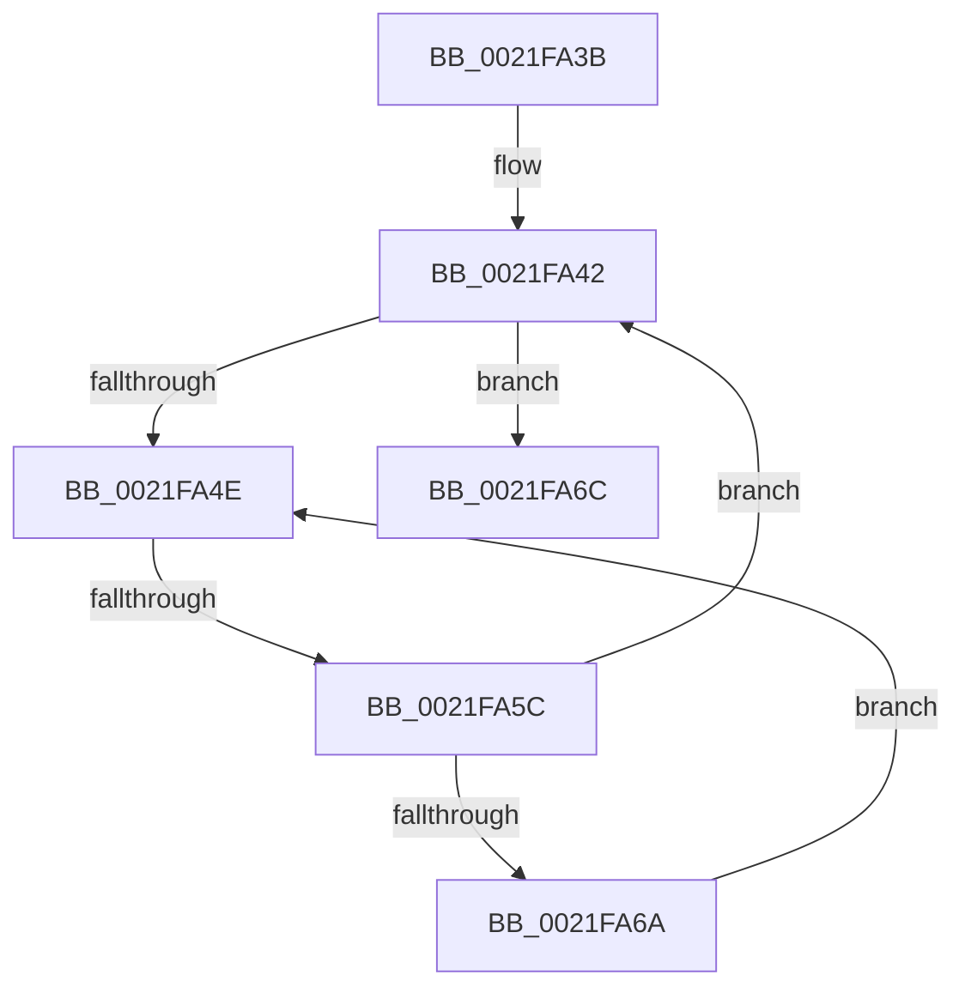

# sub_0021FA3B

- RVA: `0x0021FA3B`–`0x0021FA7D` (길이 `66` bytes)
- VA: `0x000000014021FA3B`
- 실행 섹션: `.text`
- PDB 이름 있음: `아니요`; PDB Function 태그: `아니요`
- unwind 정보 RVA: `0x0005F238`
- 디코드: `16`개 명령, `66/66` bytes 표시
- 미해석 바이트: `0` (있으면 어셈블리에 `.byte`로 보존)

> 이 문서는 커널 이미지의 기계어와 PDB 기호를 분석해 생성했습니다. 4번과 5번은 함수 원형과 자료형을 바이너리 사용 방식에서 추정한 C 해석이며 원본 소스 복구 결과는 아닙니다.

## 1. Dependencies

- 직접 호출 지점: **0**; 고유 호출 대상: **0**
- 직접 호출자로 확인된 함수: **0**
- RIP 상대 이미지 참조: **1**

### Outgoing calls
- 직접 디코드된 call 명령이 없습니다.

### Direct callers
- 이 함수 시작 RVA로 연결되는 직접 call은 확인되지 않았습니다. 간접 호출은 완전히 역산할 수 없습니다.

### Static image references
- `0x0021FA50` → RVA `0x00FC52AC` (`ALMOSTRO`; reference)

## 2. Other-region calls and transfers

- 다른 실행 섹션으로 향하는 call: **0**
- call이 아닌 외부 분기/꼬리 이동: **2**
  - `0x0021FA56` → [sub_0021FB57](Unknown_function_0021FB57.md) (`tail-transfer`)
  - `0x0021FA7B` → [sub_0021FA7D + 0x2E](Unknown_function_0021FA7D.md) (`tail-transfer`)

## 3. Assembly (complete function range)

```asm
0021FA3B  48 89 74 24 40                  mov qword ptr [rsp + 0x40], rsi
0021FA40  8B F5                           mov esi, ebp
0021FA42  F0 48 0F BA AF D0 83 00 00 00   lock bts qword ptr [rdi + 0x83d0], 0
0021FA4C  73 1E                           jae 0x14021fa6c
0021FA4E  FF C6                           inc esi
0021FA50  85 35 56 58 DA 00               test dword ptr [rip + 0xda5856], esi
0021FA56  0F 84 FB 00 00 00               je 0x14021fb57
0021FA5C  F3 90                           pause
0021FA5E  48 8B 87 D0 83 00 00            mov rax, qword ptr [rdi + 0x83d0]
0021FA65  48 85 C0                        test rax, rax
0021FA68  74 D8                           je 0x14021fa42
0021FA6A  EB E2                           jmp 0x14021fa4e
0021FA6C  48 8B 83 C8 02 00 00            mov rax, qword ptr [rbx + 0x2c8]
0021FA73  48 8B 74 24 40                  mov rsi, qword ptr [rsp + 0x40]
0021FA78  48 85 C0                        test rax, rax
0021FA7B  74 2E                           je 0x14021faab
```

## 4. C-style interpretation (structured pseudocode)

```c
__int64 __fastcall sub_0021FA3B(__int64 a1, __int64 a2, __int64 a3, __int64 a4, __int64 a5, __int64 a6, __int64 a7, __int64 a8)
{
    __int64 v_rsi;
    unsigned __int64 v_stack_p40;

    v_stack_p40 = v_rsi;
loc_0021FA42:
    if (condition_is_above_or_equal) goto loc_0021FA6C;
loc_0021FA4E:
    v_rsi = (unsigned int)(((unsigned int)((unsigned int)(v_rbp))) + 1);
    if (*(unsigned __int64 *)(v_rdi + 33744) == 0) goto loc_0021FA42;
    goto loc_0021FA4E;
loc_0021FA6C:
}
```

## 5. (Beta) C Style

```c
int64_t sub_0021FA3B(int64_t Arg1, int64_t Arg2, int64_t Arg3, int64_t Arg4, uint64_t Arg5, uint64_t Arg6, uint64_t Arg7, int64_t Arg8)
{
    int64_t local_rsi;
    uint64_t v_stack_p40;

    v_stack_p40 = local_rsi;
loc_0021FA42:
    if (condition_is_above_or_equal) goto loc_0021FA6C;
loc_0021FA4E:
    local_rsi = (uint32_t)(((uint32_t)((uint32_t)(local_rbp))) + 1);
    if (*(uint64_t *)(local_rdi + 0x83D0) == 0) goto loc_0021FA42;
    goto loc_0021FA4E;
loc_0021FA6C:
}
```

## 6. Execution-region graph

[열기: 2D/3D 그래프와 함수 탐색 컨트롤 패널](../../../control-panel.html?section=text&rva=0x0021FA3B&view=graph)

- 2D 그래프는 위에서 아래로 흐르고, 3D 그래프는 빈 공간을 드래그해 회전합니다. Shift+드래그는 이동, 휠은 확대·축소, 함수 노드 선택은 대상 보고서 이동입니다.

### Static fallback


