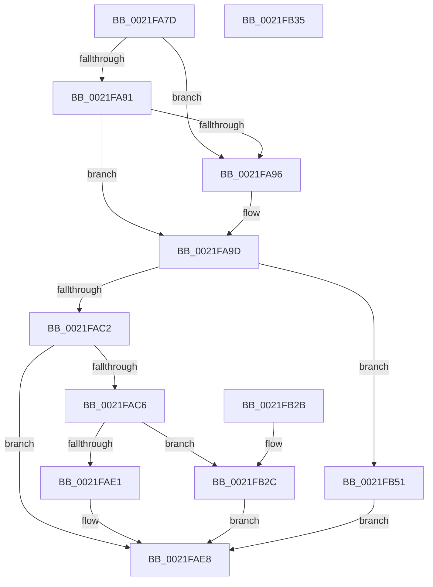

# sub_0021FA7D

- RVA: `0x0021FA7D`–`0x0021FB57` (길이 `218` bytes)
- VA: `0x000000014021FA7D`
- 실행 섹션: `.text`
- PDB 이름 있음: `아니요`; PDB Function 태그: `아니요`
- unwind 정보 RVA: `0x0005F24C`
- 디코드: `49`개 명령, `218/218` bytes 표시
- 미해석 바이트: `0` (있으면 어셈블리에 `.byte`로 보존)

> 이 문서는 커널 이미지의 기계어와 PDB 기호를 분석해 생성했습니다. 4번과 5번은 함수 원형과 자료형을 바이너리 사용 방식에서 추정한 C 해석이며 원본 소스 복구 결과는 아닙니다.

## 1. Dependencies

- 직접 호출 지점: **0**; 고유 호출 대상: **0**
- 직접 호출자로 확인된 함수: **0**
- RIP 상대 이미지 참조: **0**

### Outgoing calls
- 직접 디코드된 call 명령이 없습니다.

### Direct callers
- 이 함수 시작 RVA로 연결되는 직접 call은 확인되지 않았습니다. 간접 호출은 완전히 역산할 수 없습니다.

### Static image references
- 디코드된 RIP-relative 메모리 참조가 없습니다.

## 2. Other-region calls and transfers

- 다른 실행 섹션으로 향하는 call: **0**
- call이 아닌 외부 분기/꼬리 이동: **1**
  - `0x0021FB4C` → [KiSignalThread + 0x4D](KiSignalThread_function_0021F9E0.md) (`tail-transfer`)

## 3. Assembly (complete function range)

```asm
0021FA7D  48 8D 83 D8 00 00 00            lea rax, [rbx + 0xd8]
0021FA84  48 8B 08                        mov rcx, qword ptr [rax]
0021FA87  48 8B 50 08                     mov rdx, qword ptr [rax + 8]
0021FA8B  48 39 41 08                     cmp qword ptr [rcx + 8], rax
0021FA8F  75 05                           jne 0x14021fa96
0021FA91  48 39 02                        cmp qword ptr [rdx], rax
0021FA94  74 07                           je 0x14021fa9d
0021FA96  B9 03 00 00 00                  mov ecx, 3
0021FA9B  CD 29                           int 0x29
0021FA9D  48 89 0A                        mov qword ptr [rdx], rcx
0021FAA0  48 89 51 08                     mov qword ptr [rcx + 8], rdx
0021FAA4  48 89 AB C8 02 00 00            mov qword ptr [rbx + 0x2c8], rbp
0021FAAB  F0 48 21 AF D0 83 00 00         lock and qword ptr [rdi + 0x83d0], rbp
0021FAB3  0F B6 83 84 01 00 00            movzx eax, byte ptr [rbx + 0x184]
0021FABA  3C 01                           cmp al, 1
0021FABC  0F 84 8F 00 00 00               je 0x14021fb51
0021FAC2  3C 05                           cmp al, 5
0021FAC4  75 22                           jne 0x14021fae8
0021FAC6  48 B8 20 03 00 00 80 F7 FF FF   movabs rax, 0xfffff78000000320
0021FAD0  8B 08                           mov ecx, dword ptr [rax]
0021FAD2  2B 8B B4 01 00 00               sub ecx, dword ptr [rbx + 0x1b4]
0021FAD8  40 38 AB 87 01 00 00            cmp byte ptr [rbx + 0x187], bpl
0021FADF  74 4B                           je 0x14021fb2c
0021FAE1  48 01 8B E8 03 00 00            add qword ptr [rbx + 0x3e8], rcx
0021FAE8  C6 83 84 01 00 00 07            mov byte ptr [rbx + 0x184], 7
0021FAEF  48 8D 8B D8 00 00 00            lea rcx, [rbx + 0xd8]
0021FAF6  49 8B 86 08 2D 00 00            mov rax, qword ptr [r14 + 0x2d08]
0021FAFD  48 89 01                        mov qword ptr [rcx], rax
0021FB00  49 89 8E 08 2D 00 00            mov qword ptr [r14 + 0x2d08], rcx
0021FB07  4C 89 BB C8 00 00 00            mov qword ptr [rbx + 0xc8], r15
0021FB0E  48 89 AB D0 03 00 00            mov qword ptr [rbx + 0x3d0], rbp
0021FB15  B0 01                           mov al, 1
0021FB17  48 8B 5C 24 48                  mov rbx, qword ptr [rsp + 0x48]
0021FB1C  48 8B 6C 24 50                  mov rbp, qword ptr [rsp + 0x50]
0021FB21  48 83 C4 20                     add rsp, 0x20
0021FB25  41 5F                           pop r15
0021FB27  41 5E                           pop r14
0021FB29  5F                              pop rdi
0021FB2A  C3                              ret
0021FB2B  CC                              int3
0021FB2C  48 01 8B E0 03 00 00            add qword ptr [rbx + 0x3e0], rcx
0021FB33  EB B3                           jmp 0x14021fae8
0021FB35  8B 83 1C 02 00 00               mov eax, dword ptr [rbx + 0x21c]
0021FB3B  0F B6 C0                        movzx eax, al
0021FB3E  89 83 1C 02 00 00               mov dword ptr [rbx + 0x21c], eax
0021FB44  F0 FF 84 82 18 02 00 00         lock inc dword ptr [rdx + rax*4 + 0x218]
0021FB4C  E9 DC FE FF FF                  jmp 0x14021fa2d
0021FB51  83 4B 74 02                     or dword ptr [rbx + 0x74], 2
0021FB55  EB 91                           jmp 0x14021fae8
```

## 4. C-style interpretation (structured pseudocode)

```c
__int64 __fastcall sub_0021FA7D(__int64 a1, __int64 a2, __int64 a3, __int64 a4, __int64 a5, __int64 a6, __int64 a7, __int64 a8, __int64 a9, __int64 a10)
{
    __int64 v_rsp;

    if ((*(unsigned __int64 *)(*(unsigned __int64 *)(v_rbx + 216) + 8)) != (v_rbx + 216)) goto loc_0021FA96;
    if ((*(unsigned __int64 *)(*(unsigned __int64 *)(v_rbx + 216 + 8))) != (v_rbx + 216)) {
        a1 = 3;
    }
    *(unsigned __int64 *)(*(unsigned __int64 *)(v_rbx + 216 + 8)) = a1;
    *(unsigned __int64 *)(a1 + 8) = *(unsigned __int64 *)(v_rbx + 216 + 8);
    *(unsigned __int64 *)(v_rbx + 712) = v_rbp;
    if (((unsigned __int8)(*(unsigned __int8 *)(v_rbx + 388))) == 1) goto loc_0021FB51;
    if (((unsigned __int8)(*(unsigned __int8 *)(v_rbx + 388))) != 5) goto loc_0021FAE8;
    a1 = (unsigned int)(((unsigned int)(*(unsigned int *)(*(unsigned __int8 *)(v_rbx + 388)))) - (*(unsigned int *)(v_rbx + 436)));
    if ((*(unsigned __int8 *)(v_rbx + 391)) == ((unsigned __int8)(v_rbp))) goto loc_0021FB2C;
loc_0021FAE8:
    *(unsigned __int8 *)(v_rbx + 388) = 7;
    *(unsigned __int64 *)(v_rbx + 216) = *(unsigned __int64 *)(v_r14 + 11528);
    *(unsigned __int64 *)(v_r14 + 11528) = v_rbx + 216;
    *(unsigned __int64 *)(v_rbx + 200) = v_r15;
    *(unsigned __int64 *)(v_rbx + 976) = v_rbp;
    v_rsp = (v_rsp) + (32);
    return 1;
loc_0021FB2C:
    goto loc_0021FAE8;
loc_0021FB51:
    goto loc_0021FAE8;
}
```

## 5. (Beta) C Style

```c
int64_t sub_0021FA7D(int64_t Arg1, int64_t Arg2, int64_t Arg3, int64_t Arg4, uint64_t Arg5, uint64_t Arg6, uint64_t Arg7, uint64_t Arg8, int64_t Arg9, int64_t Arg10)
{
    int64_t local_rsp;

    if ((*(uint64_t *)(*(uint64_t *)(local_rbx + 0xD8) + 0x8)) != (local_rbx + 216)) goto loc_0021FA96;
    if ((*(uint64_t *)(*(uint64_t *)(local_rbx + 0xD8 + 0x8))) != (local_rbx + 216)) {
        Arg1 = 3;
    }
    *(uint64_t *)(*(uint64_t *)(local_rbx + 0xD8 + 0x8)) = Arg1;
    *(uint64_t *)(Arg1 + 0x8) = *(uint64_t *)(local_rbx + 0xD8 + 0x8);
    *(uint64_t *)(local_rbx + 0x2C8) = local_rbp;
    if (((uint8_t)(*(uint8_t *)(local_rbx + 0x184))) == 1) goto loc_0021FB51;
    if (((uint8_t)(*(uint8_t *)(local_rbx + 0x184))) != 5) goto loc_0021FAE8;
    Arg1 = (uint32_t)(((uint32_t)(*(uint32_t *)(*(uint8_t *)(local_rbx + 0x184)))) - (*(uint32_t *)(local_rbx + 0x1B4)));
    if ((*(uint8_t *)(local_rbx + 0x187)) == ((uint8_t)(local_rbp))) goto loc_0021FB2C;
loc_0021FAE8:
    *(uint8_t *)(local_rbx + 0x184) = 7;
    *(uint64_t *)(local_rbx + 0xD8) = *(uint64_t *)(local_r14 + 0x2D08);
    *(uint64_t *)(local_r14 + 0x2D08) = local_rbx + 216;
    *(uint64_t *)(local_rbx + 0xC8) = local_r15;
    *(uint64_t *)(local_rbx + 0x3D0) = local_rbp;
    local_rsp = (local_rsp) + (32);
    return 1;
loc_0021FB2C:
    goto loc_0021FAE8;
loc_0021FB51:
    goto loc_0021FAE8;
}
```

## 6. Execution-region graph

[열기: 2D/3D 그래프와 함수 탐색 컨트롤 패널](../../../control-panel.html?section=text&rva=0x0021FA7D&view=graph)

- 2D 그래프는 위에서 아래로 흐르고, 3D 그래프는 빈 공간을 드래그해 회전합니다. Shift+드래그는 이동, 휠은 확대·축소, 함수 노드 선택은 대상 보고서 이동입니다.

### Static fallback


