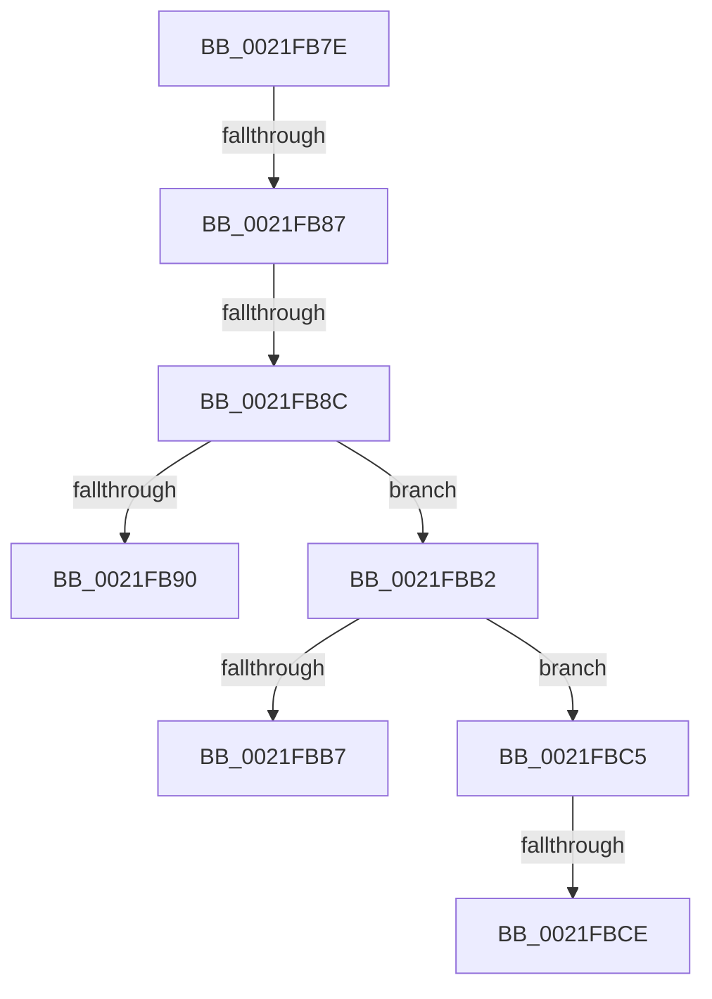

# sub_0021FB7E

- RVA: `0x0021FB7E`–`0x0021FBD8` (길이 `90` bytes)
- VA: `0x000000014021FB7E`
- 실행 섹션: `.text`
- PDB 이름 있음: `아니요`; PDB Function 태그: `아니요`
- unwind 정보 RVA: `0x0005F274`
- 디코드: `24`개 명령, `90/90` bytes 표시
- 미해석 바이트: `0` (있으면 어셈블리에 `.byte`로 보존)

> 이 문서는 커널 이미지의 기계어와 PDB 기호를 분석해 생성했습니다. 4번과 5번은 함수 원형과 자료형을 바이너리 사용 방식에서 추정한 C 해석이며 원본 소스 복구 결과는 아닙니다.

## 1. Dependencies

- 직접 호출 지점: **0**; 고유 호출 대상: **0**
- 직접 호출자로 확인된 함수: **0**
- RIP 상대 이미지 참조: **0**

### Outgoing calls
- 직접 디코드된 call 명령이 없습니다.

### Direct callers
- 이 함수 시작 RVA로 연결되는 직접 call은 확인되지 않았습니다. 간접 호출은 완전히 역산할 수 없습니다.

### Static image references
- 디코드된 RIP-relative 메모리 참조가 없습니다.

## 2. Other-region calls and transfers

- 다른 실행 섹션으로 향하는 call: **0**
- call이 아닌 외부 분기/꼬리 이동: **6**
  - `0x0021FB81` → [KiSignalThread + 0x30](KiSignalThread_function_0021F9E0.md) (`tail-transfer`)
  - `0x0021FB8A` → [sub_0021FA7D + 0x9A](Unknown_function_0021FA7D.md) (`tail-transfer`)
  - `0x0021FBAD` → [sub_0021FA7D + 0x98](Unknown_function_0021FA7D.md) (`tail-transfer`)
  - `0x0021FBC0` → [sub_0021FA7D + 0x9A](Unknown_function_0021FA7D.md) (`tail-transfer`)
  - `0x0021FBC8` → [sub_0021FA7D + 0x9A](Unknown_function_0021FA7D.md) (`tail-transfer`)
  - `0x0021FBD3` → [sub_0021FA7D + 0x9A](Unknown_function_0021FA7D.md) (`tail-transfer`)

## 3. Assembly (complete function range)

```asm
0021FB7E  83 FA 04                        cmp edx, 4
0021FB81  0F 84 89 FE FF FF               je 0x14021fa10
0021FB87  4D 85 C9                        test r9, r9
0021FB8A  74 8B                           je 0x14021fb17
0021FB8C  85 D2                           test edx, edx
0021FB8E  75 22                           jne 0x14021fbb2
0021FB90  80 E1 FA                        and cl, 0xfa
0021FB93  80 C9 02                        or cl, 2
0021FB96  88 4B 70                        mov byte ptr [rbx + 0x70], cl
0021FB99  33 ED                           xor ebp, ebp
0021FB9B  4C 89 BB C8 00 00 00            mov qword ptr [rbx + 0xc8], r15
0021FBA2  48 89 AB D0 03 00 00            mov qword ptr [rbx + 0x3d0], rbp
0021FBA9  41 88 69 11                     mov byte ptr [r9 + 0x11], bpl
0021FBAD  E9 63 FF FF FF                  jmp 0x14021fb15
0021FBB2  83 FA 05                        cmp edx, 5
0021FBB5  75 0E                           jne 0x14021fbc5
0021FBB7  80 E1 FE                        and cl, 0xfe
0021FBBA  80 C9 06                        or cl, 6
0021FBBD  88 4B 70                        mov byte ptr [rbx + 0x70], cl
0021FBC0  E9 52 FF FF FF                  jmp 0x14021fb17
0021FBC5  83 FA 03                        cmp edx, 3
0021FBC8  0F 85 49 FF FF FF               jne 0x14021fb17
0021FBCE  41 C6 41 11 02                  mov byte ptr [r9 + 0x11], 2
0021FBD3  E9 3F FF FF FF                  jmp 0x14021fb17
```

## 4. C-style interpretation (structured pseudocode)

```c
void __fastcall sub_0021FB7E(unsigned __int8 a1, int a2, __int64 a3, __int64 a4)
{
    __int64 v_rbp;

    if (a2 != 0) goto loc_0021FBB2;
    a1 = (unsigned __int8)((a1) & (250));
    a1 = (unsigned __int8)((a1) | (2));
    *(unsigned __int8 *)(v_rbx + 112) = a1;
    v_rbp = 0;
    *(unsigned __int64 *)(v_rbx + 200) = v_r15;
    *(unsigned __int64 *)(v_rbx + 976) = 0;
    *(unsigned __int8 *)(a4 + 17) = 0;
loc_0021FBB2:
    if (a2 != 5) goto loc_0021FBC5;
    a1 = (unsigned __int8)((a1) & (254));
    a1 = (unsigned __int8)((a1) | (6));
    *(unsigned __int8 *)(v_rbx + 112) = a1;
loc_0021FBC5:
    *(unsigned __int8 *)(a4 + 17) = 2;
}
```

## 5. (Beta) C Style

```c
void sub_0021FB7E(uint8_t Arg1, int32_t Arg2, int64_t Arg3, int64_t Arg4)
{
    int64_t local_rbp;

    if (Arg2 != 0) goto loc_0021FBB2;
    Arg1 = (uint8_t)((Arg1) & (250));
    Arg1 = (uint8_t)((Arg1) | (2));
    *(uint8_t *)(local_rbx + 0x70) = Arg1;
    local_rbp = 0;
    *(uint64_t *)(local_rbx + 0xC8) = local_r15;
    *(uint64_t *)(local_rbx + 0x3D0) = 0;
    *(uint8_t *)(Arg4 + 0x11) = 0;
loc_0021FBB2:
    if (Arg2 != 5) goto loc_0021FBC5;
    Arg1 = (uint8_t)((Arg1) & (254));
    Arg1 = (uint8_t)((Arg1) | (6));
    *(uint8_t *)(local_rbx + 0x70) = Arg1;
loc_0021FBC5:
    *(uint8_t *)(Arg4 + 0x11) = 2;
}
```

## 6. Execution-region graph

[열기: 2D/3D 그래프와 함수 탐색 컨트롤 패널](../../../control-panel.html?section=text&rva=0x0021FB7E&view=graph)

- 2D 그래프는 위에서 아래로 흐르고, 3D 그래프는 빈 공간을 드래그해 회전합니다. Shift+드래그는 이동, 휠은 확대·축소, 함수 노드 선택은 대상 보고서 이동입니다.

### Static fallback


