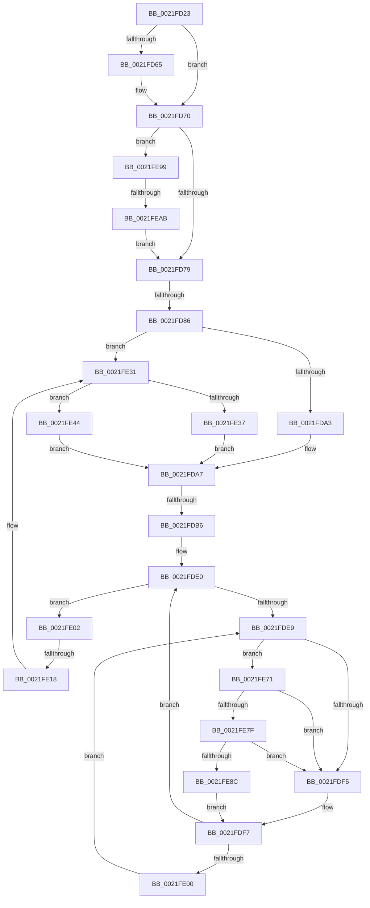

# sub_0021FD23

- RVA: `0x0021FD23`–`0x0021FEBB` (길이 `408` bytes)
- VA: `0x000000014021FD23`
- 실행 섹션: `.text`
- PDB 이름 있음: `아니요`; PDB Function 태그: `아니요`
- unwind 정보 RVA: `0x0005F2A4`
- 디코드: `96`개 명령, `408/408` bytes 표시
- 미해석 바이트: `0` (있으면 어셈블리에 `.byte`로 보존)

> 이 문서는 커널 이미지의 기계어와 PDB 기호를 분석해 생성했습니다. 4번과 5번은 함수 원형과 자료형을 바이너리 사용 방식에서 추정한 C 해석이며 원본 소스 복구 결과는 아닙니다.

## 1. Dependencies

- 직접 호출 지점: **4**; 고유 호출 대상: **4**
- 직접 호출자로 확인된 함수: **0**
- RIP 상대 이미지 참조: **2**

### Outgoing calls
- `0x0021FE2B` → [KeBugCheckEx](../4F/KeBugCheckEx_function_004FD660.md) (function, `0x004FD660`)
- `0x0021FE3A` → [KiAbOwnerComputeCpuPriorityKey](KiAbOwnerComputeCpuPriorityKey_function_0021F090.md) (function, `0x0021F090`)
- `0x0021FE7F` → [KiCheckVpBackingLongSpinWaitHypercall](../30/KiCheckVpBackingLongSpinWaitHypercall_function_0030F490.md) (function, `0x0030F490`)
- `0x0021FE8F` → [HvlNotifyLongSpinWait](../30/HvlNotifyLongSpinWait_function_0030F460.md) (function, `0x0030F460`)

### Direct callers
- 이 함수 시작 RVA로 연결되는 직접 call은 확인되지 않았습니다. 간접 호출은 완전히 역산할 수 없습니다.

### Static image references
- `0x0021FDEC` → RVA `0x00FC52AC` (`ALMOSTRO`; reference)
- `0x0021FE71` → RVA `0x00FC6AB8` (`ALMOSTRO`; read)

## 2. Other-region calls and transfers

- 다른 실행 섹션으로 향하는 call: **0**
- call이 아닌 외부 분기/꼬리 이동: **4**
  - `0x0021FD80` → [sub_00220023 + 0x1B5](../22/Unknown_function_00220023.md) (`tail-transfer`)
  - `0x0021FDB0` → [sub_0021FF3E + 0xE](Unknown_function_0021FF3E.md) (`tail-transfer`)
  - `0x0021FE12` → [sub_0021FF3E + 0x16](Unknown_function_0021FF3E.md) (`tail-transfer`)
  - `0x0021FEA5` → [sub_0021FF3E](Unknown_function_0021FF3E.md) (`tail-transfer`)

## 3. Assembly (complete function range)

```asm
0021FD23  4C 89 64 24 70                  mov qword ptr [rsp + 0x70], r12
0021FD28  48 6B C8 58                     imul rcx, rax, 0x58
0021FD2C  4C 89 7C 24 68                  mov qword ptr [rsp + 0x68], r15
0021FD31  48 2B D9                        sub rbx, rcx
0021FD34  48 8B 5B F0                     mov rbx, qword ptr [rbx - 0x10]
0021FD38  0F B6 83 C3 00 00 00            movzx eax, byte ptr [rbx + 0xc3]
0021FD3F  8B AB A0 05 00 00               mov ebp, dword ptr [rbx + 0x5a0]
0021FD45  88 84 24 B0 00 00 00            mov byte ptr [rsp + 0xb0], al
0021FD4C  48 8B 83 20 02 00 00            mov rax, qword ptr [rbx + 0x220]
0021FD53  C1 ED 09                        shr ebp, 9
0021FD56  83 E5 07                        and ebp, 7
0021FD59  48 8B 80 A0 02 00 00            mov rax, qword ptr [rax + 0x2a0]
0021FD60  48 85 C0                        test rax, rax
0021FD63  74 0B                           je 0x14021fd70
0021FD65  8B 80 3C 04 00 00               mov eax, dword ptr [rax + 0x43c]
0021FD6B  3B E8                           cmp ebp, eax
0021FD6D  0F 4D E8                        cmovge ebp, eax
0021FD70  41 3B EE                        cmp ebp, r14d
0021FD73  0F 8C 20 01 00 00               jl 0x14021fe99
0021FD79  83 BB E8 05 00 00 00            cmp dword ptr [rbx + 0x5e8], 0
0021FD80  0F 85 52 04 00 00               jne 0x1402201d8
0021FD86  C6 84 24 B8 00 00 00 01         mov byte ptr [rsp + 0xb8], 1
0021FD8E  F6 46 0B 01                     test byte ptr [rsi + 0xb], 1
0021FD92  44 8B FF                        mov r15d, edi
0021FD95  89 7C 24 54                     mov dword ptr [rsp + 0x54], edi
0021FD99  89 7C 24 58                     mov dword ptr [rsp + 0x58], edi
0021FD9D  0F 85 8E 00 00 00               jne 0x14021fe31
0021FDA3  0F B6 46 28                     movzx eax, byte ptr [rsi + 0x28]
0021FDA7  4C 0F BE 64 24 50               movsx r12, byte ptr [rsp + 0x50]
0021FDAD  41 3A C4                        cmp al, r12b
0021FDB0  0F 8D 96 01 00 00               jge 0x14021ff4c
0021FDB6  8B 56 50                        mov edx, dword ptr [rsi + 0x50]
0021FDB9  41 8D 4C 24 FF                  lea ecx, [r12 - 1]
0021FDBE  41 8B C2                        mov eax, r10d
0021FDC1  44 88 64 24 54                  mov byte ptr [rsp + 0x54], r12b
0021FDC6  D3 E0                           shl eax, cl
0021FDC8  44 8B F7                        mov r14d, edi
0021FDCB  0B C2                           or eax, edx
0021FDCD  81 E2 00 00 00 C0               and edx, 0xc0000000
0021FDD3  25 FF FF FF 3F                  and eax, 0x3fffffff
0021FDD8  33 C2                           xor eax, edx
0021FDDA  89 46 50                        mov dword ptr [rsi + 0x50], eax
0021FDDD  0F 1F 00                        nop dword ptr [rax]
0021FDE0  F0 48 0F BA 6B 40 00            lock bts qword ptr [rbx + 0x40], 0
0021FDE7  73 19                           jae 0x14021fe02
0021FDE9  41 FF C6                        inc r14d
0021FDEC  44 85 35 B9 54 DA 00            test dword ptr [rip + 0xda54b9], r14d
0021FDF3  74 7C                           je 0x14021fe71
0021FDF5  F3 90                           pause
0021FDF7  48 8B 43 40                     mov rax, qword ptr [rbx + 0x40]
0021FDFB  48 85 C0                        test rax, rax
0021FDFE  74 E0                           je 0x14021fde0
0021FE00  EB E7                           jmp 0x14021fde9
0021FE02  4A 8D 0C 23                     lea rcx, [rbx + r12]
0021FE06  4D 8B C4                        mov r8, r12
0021FE09  0F B6 81 38 03 00 00            movzx eax, byte ptr [rcx + 0x338]
0021FE10  3C FF                           cmp al, 0xff
0021FE12  0F 85 3C 01 00 00               jne 0x14021ff54
0021FE18  41 B9 01 00 00 00               mov r9d, 1
0021FE1E  48 89 7C 24 20                  mov qword ptr [rsp + 0x20], rdi
0021FE23  48 8B D3                        mov rdx, rbx
0021FE26  B9 57 01 00 00                  mov ecx, 0x157
0021FE2B  E8 30 D8 2D 00                  call 0x1404fd660
0021FE30  CC                              int3
0021FE31  80 7E 09 00                     cmp byte ptr [rsi + 9], 0
0021FE35  75 0D                           jne 0x14021fe44
0021FE37  48 8B CE                        mov rcx, rsi
0021FE3A  E8 51 F2 FF FF                  call 0x14021f090
0021FE3F  E9 63 FF FF FF                  jmp 0x14021fda7
0021FE44  0F B6 46 08                     movzx eax, byte ptr [rsi + 8]
0021FE48  BA 1E 00 00 00                  mov edx, 0x1e
0021FE4D  83 E0 3F                        and eax, 0x3f
0021FE50  48 6B C8 58                     imul rcx, rax, 0x58
0021FE54  48 8B C6                        mov rax, rsi
0021FE57  48 2B C1                        sub rax, rcx
0021FE5A  48 8B 40 F0                     mov rax, qword ptr [rax - 0x10]
0021FE5E  0F B6 88 C3 00 00 00            movzx ecx, byte ptr [rax + 0xc3]
0021FE65  3A CA                           cmp cl, dl
0021FE67  8B C1                           mov eax, ecx
0021FE69  0F 4F C2                        cmovg eax, edx
0021FE6C  E9 36 FF FF FF                  jmp 0x14021fda7
0021FE71  8B 05 41 6C DA 00               mov eax, dword ptr [rip + 0xda6c41]
0021FE77  A8 40                           test al, 0x40
0021FE79  0F 84 76 FF FF FF               je 0x14021fdf5
0021FE7F  E8 0C F6 0E 00                  call 0x14030f490
0021FE84  84 C0                           test al, al
0021FE86  0F 84 69 FF FF FF               je 0x14021fdf5
0021FE8C  41 8B CE                        mov ecx, r14d
0021FE8F  E8 CC F5 0E 00                  call 0x14030f460
0021FE94  E9 5E FF FF FF                  jmp 0x14021fdf7
0021FE99  65 48 8B 04 25 88 01 00 00      mov rax, qword ptr gs:[0x188]
0021FEA2  48 3B D8                        cmp rbx, rax
0021FEA5  0F 85 93 00 00 00               jne 0x14021ff3e
0021FEAB  83 BB E0 05 00 00 00            cmp dword ptr [rbx + 0x5e0], 0
0021FEB2  41 0F 45 EE                     cmovne ebp, r14d
0021FEB6  E9 BE FE FF FF                  jmp 0x14021fd79
```

## 4. C-style interpretation (structured pseudocode)

```c
__int64 __fastcall sub_0021FD23(__int64 a1, __int64 a2, __int64 a3, __int64 a4, __int64 a5, __int64 a6, __int64 a7, __int64 a8, __int64 a9, unsigned __int8 a10)
{
    __int64 result;
    __int64 v_r14;
    __int64 v_rbp;
    __int64 v_rbx;
    unsigned __int64 v_stack_p20;
    unsigned int v_stack_p54;
    unsigned int v_stack_p58;
    unsigned __int64 v_stack_p68;
    unsigned __int64 v_stack_p70;
    unsigned __int8 v_stack_pB0;
    unsigned __int8 v_stack_pB8;

    v_stack_p70 = v_r12;
    a1 = (a1) * (result);
    v_stack_p68 = v_r15;
    v_rbx = (v_rbx) - (a1);
    v_stack_pB0 = (unsigned __int8)(*(unsigned __int8 *)(*(unsigned __int64 *)(v_rbx - 16) + 195));
    v_rbp = (unsigned int)(((unsigned int)(*(unsigned int *)(*(unsigned __int64 *)(v_rbx - 16) + 1440))) >> (9));
    v_rbp = (unsigned int)((v_rbp) & (7));
    result = *(unsigned __int64 *)(*(unsigned __int64 *)(*(unsigned __int64 *)(v_rbx - 16) + 544) + 672);
    if (*(unsigned __int64 *)(*(unsigned __int64 *)(*(unsigned __int64 *)(v_rbx - 16) + 544) + 672) != 0) {
        result = *(unsigned int *)(*(unsigned __int64 *)(*(unsigned __int64 *)(*(unsigned __int64 *)(v_rbx - 16) + 544) + 672) + 1084);
        if (((unsigned int)(v_rbp)) >= ((unsigned int)(result))) { v_rbp = (unsigned int)(result); }
    }
    if (((unsigned int)(v_rbp)) < ((unsigned int)(v_r14))) goto loc_0021FE99;
loc_0021FD79:
    v_stack_pB8 = 1;
    v_stack_p54 = (unsigned int)(v_rdi);
    v_stack_p58 = (unsigned int)(v_rdi);
    if (((*(unsigned __int8 *)(v_rsi + 11)) & (1)) != 0) goto loc_0021FE31;
loc_0021FDA7:
    v_stack_p54 = (unsigned __int8)((__int8)(a10));
    result = (unsigned int)(((unsigned int)((unsigned int)(v_r10))) << ((unsigned __int8)((__int8)(a10) - 1)));
    result = (unsigned int)((result) | ((unsigned int)((unsigned int)(*(unsigned int *)(v_rsi + 80)))));
    a2 = (unsigned int)(((unsigned int)(*(unsigned int *)(v_rsi + 80))) & (0xC0000000ULL));
    result = (unsigned int)((result) & (0x3FFFFFFFULL));
    result = (unsigned int)((result) ^ ((unsigned int)(a2)));
    *(unsigned int *)(v_rsi + 80) = (unsigned int)(result);
loc_0021FDE0:
    if (condition_is_above_or_equal) goto loc_0021FE02;
loc_0021FDE9:
    v_r14 = (unsigned int)(((unsigned int)((unsigned int)(v_rdi))) + 1);
    if (((*(unsigned int *)(v_rip + 14308537)) & ((unsigned int)(v_r14))) == 0) goto loc_0021FE71;
loc_0021FDF5:
loc_0021FDF7:
    if (*(unsigned __int64 *)(*(unsigned __int64 *)(v_rbx - 16) + 64) == 0) goto loc_0021FDE0;
    goto loc_0021FDE9;
loc_0021FE02:
    v_stack_p20 = v_rdi;
    result = KeBugCheckEx(343, *(unsigned __int64 *)(v_rbx - 16), (__int8)(a10), 1);
loc_0021FE31:
    if ((*(unsigned __int8 *)(v_rsi + 9)) != 0) goto loc_0021FE44;
    result = KiAbOwnerComputeCpuPriorityKey(v_rsi, *(unsigned __int64 *)(v_rbx - 16), (__int8)(a10), 1);
    goto loc_0021FDA7;
loc_0021FE44:
    result = (unsigned int)((*(unsigned __int8 *)(v_rsi + 8)) & (63));
    a1 = (v_rsi) * (result);
    result = (v_rsi) - (a1);
    result = (unsigned int)((unsigned int)(*(unsigned __int8 *)(*(unsigned __int64 *)(result - 16) + 195)));
    if (((unsigned __int8)(*(unsigned __int8 *)(*(unsigned __int64 *)(result - 16) + 195))) > 30) { result = 30; }
    goto loc_0021FDA7;
loc_0021FE71:
    if ((((unsigned __int8)((unsigned int)(*(unsigned int *)(v_rip + 14314561)))) & (64)) == 0) goto loc_0021FDF5;
    result = KiCheckVpBackingLongSpinWaitHypercall(*(unsigned __int8 *)(*(unsigned __int64 *)(result - 16) + 195), 30, (__int8)(a10), 1);
    if ((unsigned __int8)(result) == 0) goto loc_0021FDF5;
    result = HvlNotifyLongSpinWait((unsigned int)((unsigned int)(v_r14)), 30, (__int8)(a10), 1);
    goto loc_0021FDF7;
loc_0021FE99:
    if ((*(unsigned int *)(*(unsigned __int64 *)(v_rbx - 16) + 1504)) != 0) { v_rbp = (unsigned int)(v_r14); }
    goto loc_0021FD79;
}
```

## 5. (Beta) C Style

```c
int64_t sub_0021FD23(int64_t Arg1, int64_t Arg2, int64_t Arg3, int64_t Arg4, uint64_t Arg5, uint64_t Arg6, uint64_t Arg7, uint64_t Arg8, uint64_t Arg9, void *Arg10)
{
    uint8_t *arg10 = (uint8_t *)Arg10;

    int64_t result;
    int64_t local_r14;
    int64_t local_rbp;
    int64_t local_rbx;
    uint64_t v_stack_p20;
    uint32_t v_stack_p54;
    uint32_t v_stack_p58;
    uint64_t v_stack_p68;
    uint64_t v_stack_p70;
    uint8_t v_stack_pB0;
    uint8_t v_stack_pB8;

    v_stack_p70 = local_r12;
    Arg1 = (Arg1) * (result);
    v_stack_p68 = local_r15;
    local_rbx = (local_rbx) - (Arg1);
    v_stack_pB0 = (uint8_t)(*(uint8_t *)(*(uint64_t *)(local_rbx - 0x10) + 0xC3));
    local_rbp = (uint32_t)(((uint32_t)(*(uint32_t *)(*(uint64_t *)(local_rbx - 0x10) + 0x5A0))) >> (9));
    local_rbp = (uint32_t)((local_rbp) & (7));
    result = *(uint64_t *)(*(uint64_t *)(*(uint64_t *)(local_rbx - 0x10) + 0x220) + 0x2A0);
    if (*(uint64_t *)(*(uint64_t *)(*(uint64_t *)(local_rbx - 0x10) + 0x220) + 0x2A0) != 0) {
        result = *(uint32_t *)(*(uint64_t *)(*(uint64_t *)(*(uint64_t *)(local_rbx - 0x10) + 0x220) + 0x2A0) + 0x43C);
        if (((uint32_t)(local_rbp)) >= ((uint32_t)(result))) { local_rbp = (uint32_t)(result); }
    }
    if (((uint32_t)(local_rbp)) < ((uint32_t)(local_r14))) goto loc_0021FE99;
loc_0021FD79:
    v_stack_pB8 = 1;
    v_stack_p54 = (uint32_t)(local_rdi);
    v_stack_p58 = (uint32_t)(local_rdi);
    if (((*(uint8_t *)(local_rsi + 0xB)) & (1)) != 0) goto loc_0021FE31;
loc_0021FDA7:
    v_stack_p54 = (uint8_t)((int8_t)(Arg10));
    result = (uint32_t)(((uint32_t)((uint32_t)(local_r10))) << ((uint8_t)((int8_t)(Arg10) - 1)));
    result = (uint32_t)((result) | ((uint32_t)((uint32_t)(*(uint32_t *)(local_rsi + 0x50)))));
    Arg2 = (uint32_t)(((uint32_t)(*(uint32_t *)(local_rsi + 0x50))) & (0xC0000000ULL));
    result = (uint32_t)((result) & (0x3FFFFFFFULL));
    result = (uint32_t)((result) ^ ((uint32_t)(Arg2)));
    *(uint32_t *)(local_rsi + 0x50) = (uint32_t)(result);
loc_0021FDE0:
    if (condition_is_above_or_equal) goto loc_0021FE02;
loc_0021FDE9:
    local_r14 = (uint32_t)(((uint32_t)((uint32_t)(local_rdi))) + 1);
    if (((*(uint32_t *)(v_rip + 0xDA54B9)) & ((uint32_t)(local_r14))) == 0) goto loc_0021FE71;
loc_0021FDF5:
loc_0021FDF7:
    if (*(uint64_t *)(*(uint64_t *)(local_rbx - 0x10) + 0x40) == 0) goto loc_0021FDE0;
    goto loc_0021FDE9;
loc_0021FE02:
    v_stack_p20 = local_rdi;
    result = KeBugCheckEx(343, *(uint64_t *)(local_rbx - 0x10), (int8_t)(Arg10), 1);
loc_0021FE31:
    if ((*(uint8_t *)(local_rsi + 0x9)) != 0) goto loc_0021FE44;
    result = KiAbOwnerComputeCpuPriorityKey(local_rsi, *(uint64_t *)(local_rbx - 0x10), (int8_t)(Arg10), 1);
    goto loc_0021FDA7;
loc_0021FE44:
    result = (uint32_t)((*(uint8_t *)(local_rsi + 0x8)) & (63));
    Arg1 = (local_rsi) * (result);
    result = (local_rsi) - (Arg1);
    result = (uint32_t)((uint32_t)(*(uint8_t *)(*(uint64_t *)(result - 0x10) + 0xC3)));
    if (((uint8_t)(*(uint8_t *)(*(uint64_t *)(result - 0x10) + 0xC3))) > 30) { result = 30; }
    goto loc_0021FDA7;
loc_0021FE71:
    if ((((uint8_t)((uint32_t)(*(uint32_t *)(v_rip + 0xDA6C41)))) & (64)) == 0) goto loc_0021FDF5;
    result = KiCheckVpBackingLongSpinWaitHypercall(*(uint8_t *)(*(uint64_t *)(result - 0x10) + 0xC3), 30, (int8_t)(Arg10), 1);
    if ((uint8_t)(result) == 0) goto loc_0021FDF5;
    result = HvlNotifyLongSpinWait((uint32_t)((uint32_t)(local_r14)), 30, (int8_t)(Arg10), 1);
    goto loc_0021FDF7;
loc_0021FE99:
    if ((*(uint32_t *)(*(uint64_t *)(local_rbx - 0x10) + 0x5E0)) != 0) { local_rbp = (uint32_t)(local_r14); }
    goto loc_0021FD79;
}
```

### 관측된 메모리 오프셋

구조체 형식이 확인되지 않은 접근은 인자 기준의 오프셋으로만 기록했습니다.

| 기준 인자 | 오프셋 표현 | 폭 (bit) | 접근 |
|---|---:|---:|---|
| `Arg10` | `- 0x1` | `32` | `R` |

## 6. Execution-region graph

[열기: 2D/3D 그래프와 함수 탐색 컨트롤 패널](../../../control-panel.html?section=text&rva=0x0021FD23&view=graph)

- 2D 그래프는 위에서 아래로 흐르고, 3D 그래프는 빈 공간을 드래그해 회전합니다. Shift+드래그는 이동, 휠은 확대·축소, 함수 노드 선택은 대상 보고서 이동입니다.

### Static fallback


