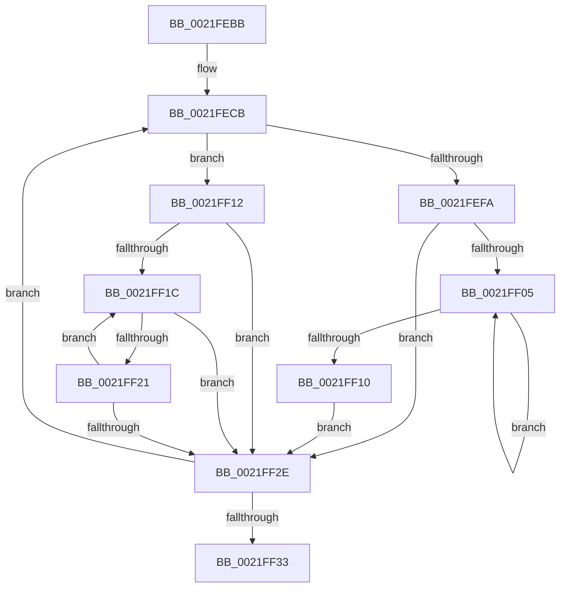

# sub_0021FEBB

- RVA: `0x0021FEBB`–`0x0021FF3E` (길이 `131` bytes)
- VA: `0x000000014021FEBB`
- 실행 섹션: `.text`
- PDB 이름 있음: `아니요`; PDB Function 태그: `아니요`
- unwind 정보 RVA: `0x0005F2BC`
- 디코드: `37`개 명령, `131/131` bytes 표시
- 미해석 바이트: `0` (있으면 어셈블리에 `.byte`로 보존)

> 이 문서는 커널 이미지의 기계어와 PDB 기호를 분석해 생성했습니다. 4번과 5번은 함수 원형과 자료형을 바이너리 사용 방식에서 추정한 C 해석이며 원본 소스 복구 결과는 아닙니다.

## 1. Dependencies

- 직접 호출 지점: **1**; 고유 호출 대상: **1**
- 직접 호출자로 확인된 함수: **0**
- RIP 상대 이미지 참조: **0**

### Outgoing calls
- `0x0021FEE9` → [KiAbSetMinimumThreadPriority](KiAbSetMinimumThreadPriority_function_0021F190.md) (function, `0x0021F190`)

### Direct callers
- 이 함수 시작 RVA로 연결되는 직접 call은 확인되지 않았습니다. 간접 호출은 완전히 역산할 수 없습니다.

### Static image references
- 디코드된 RIP-relative 메모리 참조가 없습니다.

## 2. Other-region calls and transfers

- 다른 실행 섹션으로 향하는 call: **0**
- call이 아닌 외부 분기/꼬리 이동: **1**
  - `0x0021FF39` → [KiAbIoBoostOwners + 0x5F](KiAbIoBoostOwners_function_0021FCB0.md) (`tail-transfer`)

## 3. Assembly (complete function range)

```asm
0021FEBB  48 8B BC 24 C0 00 00 00         mov rdi, qword ptr [rsp + 0xc0]
0021FEC3  48 8B AC 24 D0 00 00 00         mov rbp, qword ptr [rsp + 0xd0]
0021FECB  48 8D 44 24 58                  lea rax, [rsp + 0x58]
0021FED0  4D 8B CD                        mov r9, r13
0021FED3  48 89 44 24 28                  mov qword ptr [rsp + 0x28], rax
0021FED8  48 8D 4B F0                     lea rcx, [rbx - 0x10]
0021FEDC  4C 8B C7                        mov r8, rdi
0021FEDF  48 89 6C 24 20                  mov qword ptr [rsp + 0x20], rbp
0021FEE4  48 8D 54 24 50                  lea rdx, [rsp + 0x50]
0021FEE9  E8 A2 F2 FF FF                  call 0x14021f190
0021FEEE  48 8B 43 08                     mov rax, qword ptr [rbx + 8]
0021FEF2  48 8B CB                        mov rcx, rbx
0021FEF5  48 85 C0                        test rax, rax
0021FEF8  74 18                           je 0x14021ff12
0021FEFA  48 8B D8                        mov rbx, rax
0021FEFD  48 8B 00                        mov rax, qword ptr [rax]
0021FF00  48 85 C0                        test rax, rax
0021FF03  74 29                           je 0x14021ff2e
0021FF05  48 8B D8                        mov rbx, rax
0021FF08  48 8B 00                        mov rax, qword ptr [rax]
0021FF0B  48 85 C0                        test rax, rax
0021FF0E  75 F5                           jne 0x14021ff05
0021FF10  EB 1C                           jmp 0x14021ff2e
0021FF12  48 8B 5B 10                     mov rbx, qword ptr [rbx + 0x10]
0021FF16  48 83 E3 FC                     and rbx, 0xfffffffffffffffc
0021FF1A  74 12                           je 0x14021ff2e
0021FF1C  48 39 0B                        cmp qword ptr [rbx], rcx
0021FF1F  74 0D                           je 0x14021ff2e
0021FF21  48 8B CB                        mov rcx, rbx
0021FF24  48 8B 5B 10                     mov rbx, qword ptr [rbx + 0x10]
0021FF28  48 83 E3 FC                     and rbx, 0xfffffffffffffffc
0021FF2C  75 EE                           jne 0x14021ff1c
0021FF2E  48 85 DB                        test rbx, rbx
0021FF31  75 98                           jne 0x14021fecb
0021FF33  33 FF                           xor edi, edi
0021FF35  44 8D 53 01                     lea r10d, [rbx + 1]
0021FF39  E9 D1 FD FF FF                  jmp 0x14021fd0f
```

## 4. C-style interpretation (structured pseudocode)

```c
__int64 __fastcall sub_0021FEBB(__int64 a1, __int64 a2, __int64 a3, __int64 a4, __int64 a5, __int64 a6, __int64 a7, __int64 a8, __int64 a9, __int64 a10, __int64 a11, __int64 a12, __int64 a13, __int64 a14, __int64 a15, __int64 a16, __int64 a17, __int64 a18, __int64 a19, __int64 a20, __int64 a21, __int64 a22, __int64 a23, __int64 a24, __int64 a25, __int64 a26)
{
    __int64 result;
    __int64 v_rbx;
    __int64 v_rdi;
    unsigned __int64 v_stack_p20;
    unsigned __int64 v_stack_p28;

loc_0021FECB:
    v_stack_p28 = a11;
    v_stack_p20 = a26;
    result = KiAbSetMinimumThreadPriority(v_rbx - 16, a10, a24, v_r13);
    if (*(unsigned __int64 *)(v_rbx + 8) == 0) goto loc_0021FF12;
    if (*(unsigned __int64 *)(*(unsigned __int64 *)(v_rbx + 8)) == 0) goto loc_0021FF2E;
loc_0021FF05:
    if (*(unsigned __int64 *)(*(unsigned __int64 *)(*(unsigned __int64 *)(v_rbx + 8))) != 0) goto loc_0021FF05;
    goto loc_0021FF2E;
loc_0021FF12:
    v_rbx = (*(unsigned __int64 *)(*(unsigned __int64 *)(*(unsigned __int64 *)(v_rbx + 8)) + 16)) & (-4);
    if (condition_is_equal) goto loc_0021FF2E;
loc_0021FF1C:
    if ((*(unsigned __int64 *)(v_rbx)) == v_rbx) goto loc_0021FF2E;
    v_rbx = (*(unsigned __int64 *)(v_rbx + 16)) & (-4);
    if (condition_is_not_equal) goto loc_0021FF1C;
loc_0021FF2E:
    if (v_rbx != 0) goto loc_0021FECB;
    v_rdi = 0;
}
```

## 5. (Beta) C Style

```c
int64_t sub_0021FEBB(int64_t Arg1, int64_t Arg2, int64_t Arg3, int64_t Arg4, uint64_t Arg5, uint64_t Arg6, uint64_t Arg7, uint64_t Arg8, uint64_t Arg9, int64_t Arg10, int64_t Arg11, uint64_t Arg12, uint64_t Arg13, uint64_t Arg14, uint64_t Arg15, uint64_t Arg16, uint64_t Arg17, uint64_t Arg18, uint64_t Arg19, uint64_t Arg20, uint64_t Arg21, uint64_t Arg22, uint64_t Arg23, int64_t Arg24, uint64_t Arg25, int64_t Arg26)
{
    int64_t result;
    int64_t local_rbx;
    int64_t local_rdi;
    uint64_t v_stack_p20;
    uint64_t v_stack_p28;

loc_0021FECB:
    v_stack_p28 = Arg11;
    v_stack_p20 = Arg26;
    result = KiAbSetMinimumThreadPriority(local_rbx - 16, Arg10, Arg24, local_r13);
    if (*(uint64_t *)(local_rbx + 0x8) == 0) goto loc_0021FF12;
    if (*(uint64_t *)(*(uint64_t *)(local_rbx + 0x8)) == 0) goto loc_0021FF2E;
loc_0021FF05:
    if (*(uint64_t *)(*(uint64_t *)(*(uint64_t *)(local_rbx + 0x8))) != 0) goto loc_0021FF05;
    goto loc_0021FF2E;
loc_0021FF12:
    local_rbx = (*(uint64_t *)(*(uint64_t *)(*(uint64_t *)(local_rbx + 0x8)) + 0x10)) & (-4);
    if (condition_is_equal) goto loc_0021FF2E;
loc_0021FF1C:
    if ((*(uint64_t *)(local_rbx)) == local_rbx) goto loc_0021FF2E;
    local_rbx = (*(uint64_t *)(local_rbx + 0x10)) & (-4);
    if (condition_is_not_equal) goto loc_0021FF1C;
loc_0021FF2E:
    if (local_rbx != 0) goto loc_0021FECB;
    local_rdi = 0;
}
```

## 6. Execution-region graph

[열기: 2D/3D 그래프와 함수 탐색 컨트롤 패널](../../../control-panel.html?section=text&rva=0x0021FEBB&view=graph)

- 2D 그래프는 위에서 아래로 흐르고, 3D 그래프는 빈 공간을 드래그해 회전합니다. Shift+드래그는 이동, 휠은 확대·축소, 함수 노드 선택은 대상 보고서 이동입니다.

### Static fallback


