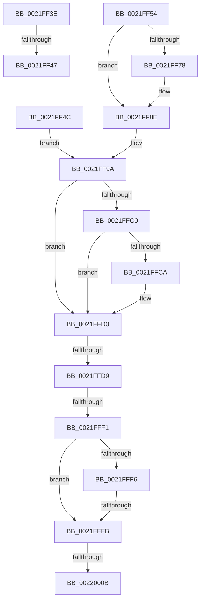

# sub_0021FF3E

- RVA: `0x0021FF3E`–`0x00220015` (길이 `215` bytes)
- VA: `0x000000014021FF3E`
- 실행 섹션: `.text`
- PDB 이름 있음: `아니요`; PDB Function 태그: `아니요`
- unwind 정보 RVA: `0x0005F2CC`
- 디코드: `49`개 명령, `215/215` bytes 표시
- 미해석 바이트: `0` (있으면 어셈블리에 `.byte`로 보존)

> 이 문서는 커널 이미지의 기계어와 PDB 기호를 분석해 생성했습니다. 4번과 5번은 함수 원형과 자료형을 바이너리 사용 방식에서 추정한 C 해석이며 원본 소스 복구 결과는 아닙니다.

## 1. Dependencies

- 직접 호출 지점: **1**; 고유 호출 대상: **1**
- 직접 호출자로 확인된 함수: **0**
- RIP 상대 이미지 참조: **1**

### Outgoing calls
- `0x0021FF83` → [KiSetPriorityThread](../22/KiSetPriorityThread_function_00220E78.md) (function, `0x00220E78`)

### Direct callers
- 이 함수 시작 RVA로 연결되는 직접 call은 확인되지 않았습니다. 간접 호출은 완전히 역산할 수 없습니다.

### Static image references
- `0x0021FFFB` → RVA `0x00FC6B14` (`ALMOSTRO`; read)

## 2. Other-region calls and transfers

- 다른 실행 섹션으로 향하는 call: **0**
- call이 아닌 외부 분기/꼬리 이동: **6**
  - `0x0021FF41` → [sub_0021FD23 + 0x188](Unknown_function_0021FD23.md) (`tail-transfer`)
  - `0x0021FF47` → [sub_0021FD23 + 0x56](Unknown_function_0021FD23.md) (`tail-transfer`)
  - `0x0021FFD7` → [sub_00220023 + 0x1F](../22/Unknown_function_00220023.md) (`tail-transfer`)
  - `0x0021FFEB` → [sub_00220023 + 0x78](../22/Unknown_function_00220023.md) (`tail-transfer`)
  - `0x0021FFF9` → [sub_00220023](../22/Unknown_function_00220023.md) (`tail-transfer`)
  - `0x00220005` → [sub_00220023 + 0x140](../22/Unknown_function_00220023.md) (`tail-transfer`)

## 3. Assembly (complete function range)

```asm
0021FF3E  41 3B EE                        cmp ebp, r14d
0021FF41  0F 8C 64 FF FF FF               jl 0x14021feab
0021FF47  E9 2D FE FF FF                  jmp 0x14021fd79
0021FF4C  44 0F B6 64 24 54               movzx r12d, byte ptr [rsp + 0x54]
0021FF52  EB 46                           jmp 0x14021ff9a
0021FF54  FE C0                           inc al
0021FF56  88 81 38 03 00 00               mov byte ptr [rcx + 0x338], al
0021FF5C  8B 83 58 03 00 00               mov eax, dword ptr [rbx + 0x358]
0021FF62  44 0F AB E0                     bts eax, r12d
0021FF66  89 83 58 03 00 00               mov dword ptr [rbx + 0x358], eax
0021FF6C  0F BE 83 C3 00 00 00            movsx eax, byte ptr [rbx + 0xc3]
0021FF73  41 3B C4                        cmp eax, r12d
0021FF76  7D 16                           jge 0x14021ff8e
0021FF78  48 8B 94 24 C0 00 00 00         mov rdx, qword ptr [rsp + 0xc0]
0021FF80  48 8B CB                        mov rcx, rbx
0021FF83  E8 F0 0E 00 00                  call 0x140220e78
0021FF88  41 BF 01 00 00 00               mov r15d, 1
0021FF8E  4C 8B AC 24 C8 00 00 00         mov r13, qword ptr [rsp + 0xc8]
0021FF96  48 89 7B 40                     mov qword ptr [rbx + 0x40], rdi
0021FF9A  48 8B 83 20 02 00 00            mov rax, qword ptr [rbx + 0x220]
0021FFA1  4C 8D 4E 50                     lea r9, [rsi + 0x50]
0021FFA5  8B 8B A0 05 00 00               mov ecx, dword ptr [rbx + 0x5a0]
0021FFAB  4D 8B F1                        mov r14, r9
0021FFAE  C1 E9 09                        shr ecx, 9
0021FFB1  83 E1 07                        and ecx, 7
0021FFB4  48 8B 90 A0 02 00 00            mov rdx, qword ptr [rax + 0x2a0]
0021FFBB  48 85 D2                        test rdx, rdx
0021FFBE  74 10                           je 0x14021ffd0
0021FFC0  8B 82 3C 04 00 00               mov eax, dword ptr [rdx + 0x43c]
0021FFC6  3B C8                           cmp ecx, eax
0021FFC8  7C 06                           jl 0x14021ffd0
0021FFCA  8B C8                           mov ecx, eax
0021FFCC  4C 8D 76 50                     lea r14, [rsi + 0x50]
0021FFD0  0F BE 44 24 51                  movsx eax, byte ptr [rsp + 0x51]
0021FFD5  3B C8                           cmp ecx, eax
0021FFD7  7C 69                           jl 0x140220042
0021FFD9  83 BB E8 05 00 00 00            cmp dword ptr [rbx + 0x5e8], 0
0021FFE0  0F BE 44 24 52                  movsx eax, byte ptr [rsp + 0x52]
0021FFE5  40 0F 94 C7                     sete dil
0021FFE9  3B F8                           cmp edi, eax
0021FFEB  0F 8C AA 00 00 00               jl 0x14022009b
0021FFF1  4D 85 ED                        test r13, r13
0021FFF4  74 05                           je 0x14021fffb
0021FFF6  45 85 FF                        test r15d, r15d
0021FFF9  75 28                           jne 0x140220023
0021FFFB  F7 05 0F 6B DA 00 00 10 00 00   test dword ptr [rip + 0xda6b0f], 0x1000
00220005  0F 85 58 01 00 00               jne 0x140220163
0022000B  4C 8B 64 24 70                  mov r12, qword ptr [rsp + 0x70]
00220010  4C 8B 7C 24 68                  mov r15, qword ptr [rsp + 0x68]
```

## 4. C-style interpretation (structured pseudocode)

```c
__int64 __fastcall sub_0021FF3E(__int64 a1)
{
    unsigned __int8 v_stack_p51;
    unsigned __int8 v_stack_p52;
    unsigned __int8 v_stack_p54;
    unsigned __int64 v_stack_p68;
    unsigned __int64 v_stack_p70;
    unsigned __int64 v_stack_pC0;
    unsigned __int64 v_stack_pC8;
}
```

## 5. (Beta) C Style

```c
int64_t sub_0021FF3E(int64_t Arg1)
{
    uint8_t v_stack_p51;
    uint8_t v_stack_p52;
    uint8_t v_stack_p54;
    uint64_t v_stack_p68;
    uint64_t v_stack_p70;
    uint64_t v_stack_pC0;
    uint64_t v_stack_pC8;
}
```

## 6. Execution-region graph

[열기: 2D/3D 그래프와 함수 탐색 컨트롤 패널](../../../control-panel.html?section=text&rva=0x0021FF3E&view=graph)

- 2D 그래프는 위에서 아래로 흐르고, 3D 그래프는 빈 공간을 드래그해 회전합니다. Shift+드래그는 이동, 휠은 확대·축소, 함수 노드 선택은 대상 보고서 이동입니다.

### Static fallback


