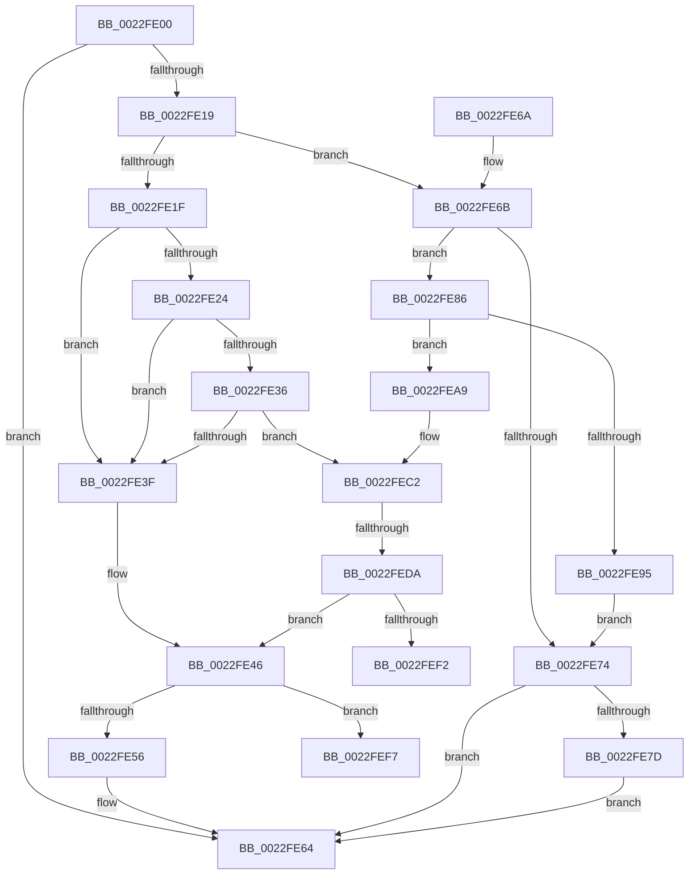

# CcRescheduleLazyWriteScanOnVolume

- RVA: `0x0022FE00`–`0x0022FF10` (길이 `272` bytes)
- VA: `0x000000014022FE00`
- 실행 섹션: `.text`
- PDB 이름 있음: `예`; PDB Function 태그: `예`
- unwind 정보 RVA: `0x00060204`
- 디코드: `63`개 명령, `272/272` bytes 표시
- 미해석 바이트: `0` (있으면 어셈블리에 `.byte`로 보존)

> 이 문서는 커널 이미지의 기계어와 PDB 기호를 분석해 생성했습니다. 4번과 5번은 함수 원형과 자료형을 바이너리 사용 방식에서 추정한 C 해석이며 원본 소스 복구 결과는 아닙니다.

## 1. Dependencies

- 직접 호출 지점: **4**; 고유 호출 대상: **3**
- 직접 호출자로 확인된 함수: **2**
- RIP 상대 이미지 참조: **3**

### Outgoing calls
- `0x0022FE5F` → [KeSetCoalescableTimer](KeSetCoalescableTimer_function_0022FFD0.md) (function, `0x0022FFD0`)
- `0x0022FEA2` → [KiSetTimerEx](../23/KiSetTimerEx_function_00232CB0.md) (function, `0x00232CB0`)
- `0x0022FEBC` → [KeBugCheckEx](../4F/KeBugCheckEx_function_004FD660.md) (function, `0x004FD660`)
- `0x0022FF0A` → [KeBugCheckEx](../4F/KeBugCheckEx_function_004FD660.md) (function, `0x004FD660`)

### Direct callers
- [CcLazyWriteScanVolume](../38/CcLazyWriteScanVolume_function_00388DC0.md) at `0x00389204`
- [CcLazyWriteScanVolume](../38/CcLazyWriteScanVolume_function_00388DC0.md) at `0x00389547`
- [CcCoalescingCallBackHelper](../3C/CcCoalescingCallBackHelper_function_003CA200.md) at `0x003CA318`

### Static image references
- `0x0022FE3F` → RVA `0x00E0A880` (`.data`; read)
- `0x0022FE95` → RVA `0x000262E0` (`.rdata`; read)
- `0x0022FEC2` → RVA `0x00FC6AA0` (`ALMOSTRO`; read)

## 2. Other-region calls and transfers

- 다른 실행 섹션으로 향하는 call: **0**
- call이 아닌 외부 분기/꼬리 이동: **2**
  - `0x0022FED4` → [sub_006D7366](../6D/Unknown_function_006D7366.md) (`tail-transfer`)
  - `0x0022FEF2` → [sub_006D7366 + 0x3](../6D/Unknown_function_006D7366.md) (`tail-transfer`)

## 3. Assembly (complete function range)

```asm
0022FE00  40 53                           push rbx
0022FE02  48 83 EC 30                     sub rsp, 0x30
0022FE06  48 8B D9                        mov rbx, rcx
0022FE09  48 81 C1 98 03 00 00            add rcx, 0x398
0022FE10  80 BB 94 04 00 00 00            cmp byte ptr [rbx + 0x494], 0
0022FE17  75 4B                           jne 0x14022fe64
0022FE19  80 79 41 00                     cmp byte ptr [rcx + 0x41], 0
0022FE1D  74 4C                           je 0x14022fe6b
0022FE1F  48 85 D2                        test rdx, rdx
0022FE22  74 1B                           je 0x14022fe3f
0022FE24  48 8B 02                        mov rax, qword ptr [rdx]
0022FE27  48 BA FF FF FF FF FF FF FF 7F   movabs rdx, 0x7fffffffffffffff
0022FE31  48 3B C2                        cmp rax, rdx
0022FE34  74 09                           je 0x14022fe3f
0022FE36  48 85 C0                        test rax, rax
0022FE39  0F 85 83 00 00 00               jne 0x14022fec2
0022FE3F  48 8B 15 3A AA BD 00            mov rdx, qword ptr [rip + 0xbdaa3a]
0022FE46  48 83 64 24 20 00               and qword ptr [rsp + 0x20], 0
0022FE4C  80 79 40 00                     cmp byte ptr [rcx + 0x40], 0
0022FE50  0F 84 A1 00 00 00               je 0x14022fef7
0022FE56  41 B9 E8 03 00 00               mov r9d, 0x3e8
0022FE5C  45 33 C0                        xor r8d, r8d
0022FE5F  E8 6C 01 00 00                  call 0x14022ffd0
0022FE64  48 83 C4 30                     add rsp, 0x30
0022FE68  5B                              pop rbx
0022FE69  C3                              ret
0022FE6A  CC                              int3
0022FE6B  80 BB D9 03 00 00 00            cmp byte ptr [rbx + 0x3d9], 0
0022FE72  74 12                           je 0x14022fe86
0022FE74  80 BB 94 04 00 00 00            cmp byte ptr [rbx + 0x494], 0
0022FE7B  75 E7                           jne 0x14022fe64
0022FE7D  C6 83 D9 03 00 00 01            mov byte ptr [rbx + 0x3d9], 1
0022FE84  EB DE                           jmp 0x14022fe64
0022FE86  48 83 64 24 20 00               and qword ptr [rsp + 0x20], 0
0022FE8C  80 BB D8 03 00 00 00            cmp byte ptr [rbx + 0x3d8], 0
0022FE93  74 14                           je 0x14022fea9
0022FE95  48 8B 15 44 64 DF FF            mov rdx, qword ptr [rip - 0x209bbc]
0022FE9C  45 33 C9                        xor r9d, r9d
0022FE9F  45 33 C0                        xor r8d, r8d
0022FEA2  E8 09 2E 00 00                  call 0x140232cb0
0022FEA7  EB CB                           jmp 0x14022fe74
0022FEA9  45 33 C9                        xor r9d, r9d
0022FEAC  BA CB 07 00 00                  mov edx, 0x7cb
0022FEB1  49 C7 C0 20 04 00 C0            mov r8, 0xffffffffc0000420
0022FEB8  41 8D 49 34                     lea ecx, [r9 + 0x34]
0022FEBC  E8 9F D7 2C 00                  call 0x1404fd660
0022FEC1  CC                              int3
0022FEC2  8B 15 D8 6B D9 00               mov edx, dword ptr [rip + 0xd96bd8]
0022FEC8  48 0F AF D0                     imul rdx, rax
0022FECC  B8 00 68 89 09                  mov eax, 0x9896800
0022FED1  48 3B D0                        cmp rdx, rax
0022FED4  0F 8F 8C 74 4A 00               jg 0x1406d7366
0022FEDA  48 81 FA 80 96 98 00            cmp rdx, 0x989680
0022FEE1  48 0F 4C 15 97 A9 BD 00         cmovl rdx, qword ptr [rip + 0xbda997]
0022FEE9  48 85 D2                        test rdx, rdx
0022FEEC  0F 8E 54 FF FF FF               jle 0x14022fe46
0022FEF2  E9 72 74 4A 00                  jmp 0x1406d7369
0022FEF7  45 33 C9                        xor r9d, r9d
0022FEFA  BA 6A 08 00 00                  mov edx, 0x86a
0022FEFF  49 C7 C0 20 04 00 C0            mov r8, 0xffffffffc0000420
0022FF06  41 8D 49 34                     lea ecx, [r9 + 0x34]
0022FF0A  E8 51 D7 2C 00                  call 0x1404fd660
0022FF0F  CC                              int3
```

## 4. C-style interpretation (structured pseudocode)

```c
__int64 __fastcall CcRescheduleLazyWriteScanOnVolume(__int64 a1, __int64 a2, int a3)
{
    __int64 result;
    __int64 v_rsp;
    unsigned __int64 v_stack_m18;
    unsigned __int64 v_stack_p20;

    v_rsp = (v_rsp) - (48);
    a1 = (a1) + (920);
    if ((*(unsigned __int8 *)(a1 + 1172)) != 0) goto loc_0022FE64;
    if ((*(unsigned __int8 *)(a1 + 65)) == 0) goto loc_0022FE6B;
    if (a2 == 0) goto loc_0022FE3F;
    if ((*(unsigned __int64 *)(a2)) == a2) goto loc_0022FE3F;
    if (*(unsigned __int64 *)(a2) != 0) goto loc_0022FEC2;
loc_0022FE3F:
loc_0022FE46:
    if ((*(unsigned __int8 *)(a1 + 64)) == 0) goto loc_0022FEF7;
    a3 = 0;
    result = KeSetCoalescableTimer(a1, *(unsigned __int64 *)(v_rip + 12429882), a3, 1000);
loc_0022FE64:
    v_rsp = (v_rsp) + (48);
    return result;
loc_0022FE6B:
    if ((*(unsigned __int8 *)(a1 + 985)) == 0) goto loc_0022FE86;
loc_0022FE74:
    if ((*(unsigned __int8 *)(a1 + 1172)) != 0) goto loc_0022FE64;
    *(unsigned __int8 *)(a1 + 985) = 1;
    goto loc_0022FE64;
loc_0022FE86:
    if ((*(unsigned __int8 *)(a1 + 984)) == 0) goto loc_0022FEA9;
    a4 = 0;
    a3 = 0;
    result = KiSetTimerEx(a1, *(unsigned __int64 *)(v_rip - 2137020), a3, a4);
    goto loc_0022FE74;
loc_0022FEA9:
    a4 = 0;
    result = KeBugCheckEx(a4 + 52, (unsigned int)(0x7CBULL), 0xFFFFFFFFC0000420ULL, a4);
loc_0022FEC2:
    a2 = ((unsigned int)(*(unsigned int *)(v_rip + 14248920))) * (result);
    if (a2 < 0x989680ULL) { a2 = *(unsigned __int64 *)(v_rip + 12429719); }
    if (condition_is_less_or_equal) goto loc_0022FE46;
loc_0022FEF7:
    a4 = 0;
    result = KeBugCheckEx(a4 + 52, (unsigned int)(0x86AULL), 0xFFFFFFFFC0000420ULL, a4);
    return result;
}
```

## 5. (Beta) C Style

```c
int64_t CcRescheduleLazyWriteScanOnVolume(void *Arg1, int64_t Arg2, int32_t Arg3)
{
    uint8_t *arg1 = (uint8_t *)Arg1;

    int64_t result;
    int64_t local_rsp;
    uint64_t v_stack_m18;
    uint64_t v_stack_p20;

    local_rsp = (local_rsp) - (48);
    Arg1 = (Arg1) + (920);
    if ((*(uint8_t *)(arg1 + 0x494)) != 0) goto loc_0022FE64;
    if ((*(uint8_t *)(arg1 + 0x41)) == 0) goto loc_0022FE6B;
    if (Arg2 == 0) goto loc_0022FE3F;
    if ((*(uint64_t *)(Arg2)) == Arg2) goto loc_0022FE3F;
    if (*(uint64_t *)(Arg2) != 0) goto loc_0022FEC2;
loc_0022FE3F:
loc_0022FE46:
    if ((*(uint8_t *)(arg1 + 0x40)) == 0) goto loc_0022FEF7;
    Arg3 = 0;
    result = KeSetCoalescableTimer(Arg1, *(uint64_t *)(v_rip + 0xBDAA3A), Arg3, 1000);
loc_0022FE64:
    local_rsp = (local_rsp) + (48);
    return result;
loc_0022FE6B:
    if ((*(uint8_t *)(arg1 + 0x3D9)) == 0) goto loc_0022FE86;
loc_0022FE74:
    if ((*(uint8_t *)(arg1 + 0x494)) != 0) goto loc_0022FE64;
    *(uint8_t *)(arg1 + 0x3D9) = 1;
    goto loc_0022FE64;
loc_0022FE86:
    if ((*(uint8_t *)(arg1 + 0x3D8)) == 0) goto loc_0022FEA9;
    a4 = 0;
    Arg3 = 0;
    result = KiSetTimerEx(Arg1, *(uint64_t *)(v_rip - 0x209BBC), Arg3, a4);
    goto loc_0022FE74;
loc_0022FEA9:
    a4 = 0;
    result = KeBugCheckEx(a4 + 52, (uint32_t)(0x7CBULL), 0xFFFFFFFFC0000420ULL, a4);
loc_0022FEC2:
    Arg2 = ((uint32_t)(*(uint32_t *)(v_rip + 0xD96BD8))) * (result);
    if (Arg2 < 0x989680ULL) { Arg2 = *(uint64_t *)(v_rip + 0xBDA997); }
    if (condition_is_less_or_equal) goto loc_0022FE46;
loc_0022FEF7:
    a4 = 0;
    result = KeBugCheckEx(a4 + 52, (uint32_t)(0x86AULL), 0xFFFFFFFFC0000420ULL, a4);
    return result;
}
```

### 관측된 메모리 오프셋

구조체 형식이 확인되지 않은 접근은 인자 기준의 오프셋으로만 기록했습니다.

| 기준 인자 | 오프셋 표현 | 폭 (bit) | 접근 |
|---|---:|---:|---|
| `Arg1` | `+ 0x41` | `8` | `R` |
| `Arg1` | `+ 0x3D8` | `8` | `R` |
| `Arg1` | `+ 0x3D9` | `8` | `R` |
| `Arg1` | `+ 0x3D9` | `8` | `W` |
| `Arg1` | `+ 0x494` | `8` | `R` |

## 6. Execution-region graph

[열기: 2D/3D 그래프와 함수 탐색 컨트롤 패널](../../../control-panel.html?section=text&rva=0x0022FE00&view=graph)

- 2D 그래프는 위에서 아래로 흐르고, 3D 그래프는 빈 공간을 드래그해 회전합니다. Shift+드래그는 이동, 휠은 확대·축소, 함수 노드 선택은 대상 보고서 이동입니다.

### Static fallback


