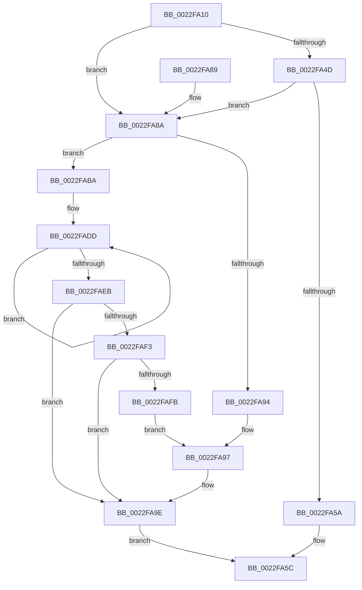

# CmpCompleteLazyWrite

- RVA: `0x0022FA10`–`0x0022FB00` (길이 `240` bytes)
- VA: `0x000000014022FA10`
- 실행 섹션: `.text`
- PDB 이름 있음: `예`; PDB Function 태그: `아니요`
- unwind 정보 RVA: `0x000601A0`
- 디코드: `64`개 명령, `240/240` bytes 표시
- 미해석 바이트: `0` (있으면 어셈블리에 `.byte`로 보존)

> 이 문서는 커널 이미지의 기계어와 PDB 기호를 분석해 생성했습니다. 4번과 5번은 함수 원형과 자료형을 바이너리 사용 방식에서 추정한 C 해석이며 원본 소스 복구 결과는 아닙니다.

## 1. Dependencies

- 직접 호출 지점: **3**; 고유 호출 대상: **3**
- 직접 호출자로 확인된 함수: **1**
- RIP 상대 이미지 참조: **0**

### Outgoing calls
- `0x0022FA39` → [KeAcquireSpinLockRaiseToDpc](../20/KeAcquireSpinLockRaiseToDpc_function_00208470.md) (function, `0x00208470`)
- `0x0022FA69` → [KeReleaseSpinLock](../39/KeReleaseSpinLock_function_00392BA0.md) (function, `0x00392BA0`)
- `0x0022FAB3` → [KeSetCoalescableTimer](KeSetCoalescableTimer_function_0022FFD0.md) (function, `0x0022FFD0`)

### Direct callers
- [CmpLazyWriteWorker](../66/CmpLazyWriteWorker_function_0066ADF0.md) at `0x0066AEB9`

### Static image references
- 디코드된 RIP-relative 메모리 참조가 없습니다.

## 2. Other-region calls and transfers

- 다른 실행 섹션으로 향하는 call: **0**
- 별도 외부 분기/꼬리 이동을 확인하지 못했습니다.

## 3. Assembly (complete function range)

```asm
0022FA10  48 8B C4                        mov rax, rsp
0022FA13  48 89 58 08                     mov qword ptr [rax + 8], rbx
0022FA17  48 89 68 10                     mov qword ptr [rax + 0x10], rbp
0022FA1B  48 89 70 18                     mov qword ptr [rax + 0x18], rsi
0022FA1F  48 89 78 20                     mov qword ptr [rax + 0x20], rdi
0022FA23  41 56                           push r14
0022FA25  48 83 EC 30                     sub rsp, 0x30
0022FA29  48 8D A9 98 00 00 00            lea rbp, [rcx + 0x98]
0022FA30  48 8B D9                        mov rbx, rcx
0022FA33  48 8B CD                        mov rcx, rbp
0022FA36  48 8B FA                        mov rdi, rdx
0022FA39  E8 32 8A FD FF                  call 0x140208470
0022FA3E  4C 8B 8B A8 00 00 00            mov r9, qword ptr [rbx + 0xa8]
0022FA45  44 8A F0                        mov r14b, al
0022FA48  48 85 FF                        test rdi, rdi
0022FA4B  75 3D                           jne 0x14022fa8a
0022FA4D  45 8A C1                        mov r8b, r9b
0022FA50  41 80 E0 07                     and r8b, 7
0022FA54  41 80 F8 03                     cmp r8b, 3
0022FA58  74 30                           je 0x14022fa8a
0022FA5A  33 F6                           xor esi, esi
0022FA5C  41 8A D6                        mov dl, r14b
0022FA5F  48 89 B3 A8 00 00 00            mov qword ptr [rbx + 0xa8], rsi
0022FA66  48 8B CD                        mov rcx, rbp
0022FA69  E8 32 31 16 00                  call 0x140392ba0
0022FA6E  48 8B 5C 24 40                  mov rbx, qword ptr [rsp + 0x40]
0022FA73  48 8B 6C 24 48                  mov rbp, qword ptr [rsp + 0x48]
0022FA78  48 8B 74 24 50                  mov rsi, qword ptr [rsp + 0x50]
0022FA7D  48 8B 7C 24 58                  mov rdi, qword ptr [rsp + 0x58]
0022FA82  48 83 C4 30                     add rsp, 0x30
0022FA86  41 5E                           pop r14
0022FA88  C3                              ret
0022FA89  CC                              int3
0022FA8A  BE 01 00 00 00                  mov esi, 1
0022FA8F  48 85 FF                        test rdi, rdi
0022FA92  74 26                           je 0x14022faba
0022FA94  48 8B 17                        mov rdx, qword ptr [rdi]
0022FA97  44 8B 83 B8 00 00 00            mov r8d, dword ptr [rbx + 0xb8]
0022FA9E  48 8D 43 40                     lea rax, [rbx + 0x40]
0022FAA2  45 8B C8                        mov r9d, r8d
0022FAA5  45 33 C0                        xor r8d, r8d
0022FAA8  48 89 44 24 20                  mov qword ptr [rsp + 0x20], rax
0022FAAD  48 F7 DA                        neg rdx
0022FAB0  48 8B CB                        mov rcx, rbx
0022FAB3  E8 18 05 00 00                  call 0x14022ffd0
0022FAB8  EB A2                           jmp 0x14022fa5c
0022FABA  BA 00 2D 31 01                  mov edx, 0x1312d00
0022FABF  41 B8 E8 03 00 00               mov r8d, 0x3e8
0022FAC5  49 83 E1 F8                     and r9, 0xfffffffffffffff8
0022FAC9  48 BF 08 00 00 00 80 F7 FF FF   movabs rdi, 0xfffff78000000008
0022FAD3  49 BB B0 03 00 00 80 F7 FF FF   movabs r11, 0xfffff780000003b0
0022FADD  4D 8B 13                        mov r10, qword ptr [r11]
0022FAE0  48 8B 0F                        mov rcx, qword ptr [rdi]
0022FAE3  49 8B 03                        mov rax, qword ptr [r11]
0022FAE6  4C 3B D0                        cmp r10, rax
0022FAE9  75 F2                           jne 0x14022fadd
0022FAEB  49 2B CA                        sub rcx, r10
0022FAEE  49 3B C9                        cmp rcx, r9
0022FAF1  73 AB                           jae 0x14022fa9e
0022FAF3  4C 2B C9                        sub r9, rcx
0022FAF6  4C 3B CA                        cmp r9, rdx
0022FAF9  76 A3                           jbe 0x14022fa9e
0022FAFB  49 8B D1                        mov rdx, r9
0022FAFE  EB 97                           jmp 0x14022fa97
```

## 4. C-style interpretation (structured pseudocode)

```c
__int64 __fastcall CmpCompleteLazyWrite(__int64 a1, __int64 a2)
{
    __int64 result;
    __int64 v_rsi;
    __int64 v_rsp;
    unsigned __int64 v_stack_p10;
    unsigned __int64 v_stack_p18;
    unsigned __int64 v_stack_p20;
    unsigned __int64 v_stack_p8;

    *(unsigned __int64 *)(v_rsp + 8) = v_rbx;
    *(unsigned __int64 *)(v_rsp + 16) = v_rbp;
    *(unsigned __int64 *)(v_rsp + 24) = v_rsi;
    *(unsigned __int64 *)(v_rsp + 32) = v_rdi;
    v_rsp = (v_rsp) - (48);
    result = KeAcquireSpinLockRaiseToDpc(a1 + 152, a2, a3, a4);
    if (a2 != 0) goto loc_0022FA8A;
    a3 = (unsigned __int8)(((unsigned __int8)(*(unsigned __int64 *)(a1 + 168))) & (7));
    if (((unsigned __int8)(a3)) == 3) goto loc_0022FA8A;
    v_rsi = 0;
loc_0022FA5C:
    *(unsigned __int64 *)(a1 + 168) = 0;
    result = KeReleaseSpinLock(a1 + 152, (unsigned __int8)((unsigned __int8)(result)), a3, *(unsigned __int64 *)(a1 + 168));
    v_rsp = (v_rsp) + (48);
    return result;
loc_0022FA8A:
    if (v_stack_p20 == 0) goto loc_0022FABA;
loc_0022FA97:
loc_0022FA9E:
    a3 = 0;
    v_stack_p20 = v_stack_p8 + 64;
    a2 = -(*(unsigned __int64 *)(v_stack_p20));
    result = KeSetCoalescableTimer(v_stack_p8, a2, a3, (unsigned int)((unsigned int)((unsigned int)(*(unsigned int *)(v_stack_p8 + 184)))));
    goto loc_0022FA5C;
loc_0022FABA:
    a4 = ((unsigned int)((unsigned int)((unsigned int)(*(unsigned int *)(v_stack_p8 + 184))))) & (-8);
loc_0022FADD:
    if ((*(unsigned __int64 *)(v_r11)) != (*(unsigned __int64 *)(v_r11))) goto loc_0022FADD;
    a1 = (*(unsigned __int64 *)(v_stack_p20)) - (*(unsigned __int64 *)(v_r11));
    if (a1 >= a4) goto loc_0022FA9E;
    a4 = (a4) - (a1);
    if (a4 <= ((unsigned int)(0x1312D00ULL))) goto loc_0022FA9E;
    goto loc_0022FA97;
}
```

## 5. (Beta) C Style

```c
int64_t CmpCompleteLazyWrite(void *Arg1, int64_t Arg2)
{
    uint8_t *arg1 = (uint8_t *)Arg1;

    int64_t result;
    int64_t local_rsi;
    int64_t local_rsp;
    uint64_t v_stack_p10;
    uint64_t v_stack_p18;
    uint64_t v_stack_p20;
    uint64_t v_stack_p8;

    *(uint64_t *)(local_rsp + 0x8) = local_rbx;
    *(uint64_t *)(local_rsp + 0x10) = local_rbp;
    *(uint64_t *)(local_rsp + 0x18) = local_rsi;
    *(uint64_t *)(local_rsp + 0x20) = local_rdi;
    local_rsp = (local_rsp) - (48);
    result = KeAcquireSpinLockRaiseToDpc(Arg1 + 152, Arg2, a3, a4);
    if (Arg2 != 0) goto loc_0022FA8A;
    a3 = (uint8_t)(((uint8_t)(*(uint64_t *)(arg1 + 0xA8))) & (7));
    if (((uint8_t)(a3)) == 3) goto loc_0022FA8A;
    local_rsi = 0;
loc_0022FA5C:
    *(uint64_t *)(arg1 + 0xA8) = 0;
    result = KeReleaseSpinLock(Arg1 + 152, (uint8_t)((uint8_t)(result)), a3, *(uint64_t *)(arg1 + 0xA8));
    local_rsp = (local_rsp) + (48);
    return result;
loc_0022FA8A:
    if (v_stack_p20 == 0) goto loc_0022FABA;
loc_0022FA97:
loc_0022FA9E:
    a3 = 0;
    v_stack_p20 = v_stack_p8 + 64;
    Arg2 = -(*(uint64_t *)(v_stack_p20));
    result = KeSetCoalescableTimer(v_stack_p8, Arg2, a3, (uint32_t)((uint32_t)((uint32_t)(*(uint32_t *)(v_stack_p8 + 0xB8)))));
    goto loc_0022FA5C;
loc_0022FABA:
    a4 = ((uint32_t)((uint32_t)((uint32_t)(*(uint32_t *)(v_stack_p8 + 0xB8))))) & (-8);
loc_0022FADD:
    if ((*(uint64_t *)(local_r11)) != (*(uint64_t *)(local_r11))) goto loc_0022FADD;
    Arg1 = (*(uint64_t *)(v_stack_p20)) - (*(uint64_t *)(local_r11));
    if (Arg1 >= a4) goto loc_0022FA9E;
    a4 = (a4) - (Arg1);
    if (a4 <= ((uint32_t)(0x1312D00ULL))) goto loc_0022FA9E;
    goto loc_0022FA97;
}
```

### 관측된 메모리 오프셋

구조체 형식이 확인되지 않은 접근은 인자 기준의 오프셋으로만 기록했습니다.

| 기준 인자 | 오프셋 표현 | 폭 (bit) | 접근 |
|---|---:|---:|---|
| `Arg1` | `+ 0x40` | `64` | `R` |
| `Arg1` | `+ 0x98` | `64` | `R` |
| `Arg1` | `+ 0xA8` | `64` | `R` |
| `Arg1` | `+ 0xA8` | `64` | `W` |
| `Arg1` | `+ 0xB8` | `32` | `R` |

## 6. Execution-region graph

[열기: 2D/3D 그래프와 함수 탐색 컨트롤 패널](../../../control-panel.html?section=text&rva=0x0022FA10&view=graph)

- 2D 그래프는 위에서 아래로 흐르고, 3D 그래프는 빈 공간을 드래그해 회전합니다. Shift+드래그는 이동, 휠은 확대·축소, 함수 노드 선택은 대상 보고서 이동입니다.

### Static fallback


