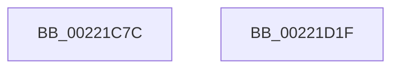

# EtwTraceAutoBoostProcessLockEntry

- RVA: `0x00221C7C`–`0x00221D20` (길이 `164` bytes)
- VA: `0x0000000140221C7C`
- 실행 섹션: `.text`
- PDB 이름 있음: `예`; PDB Function 태그: `아니요`
- unwind 정보 RVA: `0x0005F638`
- 디코드: `37`개 명령, `164/164` bytes 표시
- 미해석 바이트: `0` (있으면 어셈블리에 `.byte`로 보존)

> 이 문서는 커널 이미지의 기계어와 PDB 기호를 분석해 생성했습니다. 4번과 5번은 함수 원형과 자료형을 바이너리 사용 방식에서 추정한 C 해석이며 원본 소스 복구 결과는 아닙니다.

## 1. Dependencies

- 직접 호출 지점: **4**; 고유 호출 대상: **4**
- 직접 호출자로 확인된 함수: **4**
- RIP 상대 이미지 참조: **1**

### Outgoing calls
- `0x00221CAA` → [Feature_Servicing_AutoBoostEtwEventingFixes__private_IsEnabledPreCheckWithReporting](Feature_Servicing_AutoBoostEtwEventingFixes__private_IsEnabledPreCheckWithReporting_function_00222FE0.md) (function, `0x00222FE0`)
- `0x00221CB1` → [Feature_Servicing_AutoBoostEtwEventingFixes__private_IsEnabledWithReporting](Feature_Servicing_AutoBoostEtwEventingFixes__private_IsEnabledWithReporting_function_00222FF0.md) (function, `0x00222FF0`)
- `0x00221D07` → [EtwTraceSiloKernelEvent](EtwTraceSiloKernelEvent_function_002242A0.md) (function, `0x002242A0`)
- `0x00221D14` → [_security_check_cookie](../6A/_security_check_cookie_function_006AC640.md) (function, `0x006AC640`)

### Direct callers
- [KiAbConvertWaiterToOwnerEntry](../21/KiAbConvertWaiterToOwnerEntry_function_00219430.md) at `0x00219825`
- [sub_00221FB6](Unknown_function_00221FB6.md) at `0x002223ED`
- [sub_00221FB6](Unknown_function_00221FB6.md) at `0x00222495`
- [KiAbDeferredProcessingWorker](../30/KiAbDeferredProcessingWorker_function_0030DEB0.md) at `0x0030E476`
- [KiAbDeferredProcessingWorker](../30/KiAbDeferredProcessingWorker_function_0030DEB0.md) at `0x0030E55D`
- [KiAbForceProcessLockEntry](../41/KiAbForceProcessLockEntry_function_00419078.md) at `0x004191E5`

### Static image references
- `0x00221C82` → RVA `0x00E0A740` (`.data`; read)

## 2. Other-region calls and transfers

- 다른 실행 섹션으로 향하는 call: **0**
- 별도 외부 분기/꼬리 이동을 확인하지 못했습니다.

## 3. Assembly (complete function range)

```asm
00221C7C  40 53                           push rbx
00221C7E  48 83 EC 60                     sub rsp, 0x60
00221C82  48 8B 05 B7 8A BE 00            mov rax, qword ptr [rip + 0xbe8ab7]
00221C89  48 33 C4                        xor rax, rsp
00221C8C  48 89 44 24 50                  mov qword ptr [rsp + 0x50], rax
00221C91  8B 81 10 05 00 00               mov eax, dword ptr [rcx + 0x510]
00221C97  48 8B D9                        mov rbx, rcx
00221C9A  33 C9                           xor ecx, ecx
00221C9C  48 89 54 24 30                  mov qword ptr [rsp + 0x30], rdx
00221CA1  89 44 24 38                     mov dword ptr [rsp + 0x38], eax
00221CA5  44 89 44 24 3C                  mov dword ptr [rsp + 0x3c], r8d
00221CAA  E8 31 13 00 00                  call 0x140222fe0
00221CAF  33 C9                           xor ecx, ecx
00221CB1  E8 3A 13 00 00                  call 0x140222ff0
00221CB6  83 64 24 4C 00                  and dword ptr [rsp + 0x4c], 0
00221CBB  48 8D 4C 24 30                  lea rcx, [rsp + 0x30]
00221CC0  48 89 4C 24 40                  mov qword ptr [rsp + 0x40], rcx
00221CC5  F7 D8                           neg eax
00221CC7  48 8B 8B 20 02 00 00            mov rcx, qword ptr [rbx + 0x220]
00221CCE  41 B9 00 10 00 A0               mov r9d, 0xa0001000
00221CD4  1B D2                           sbb edx, edx
00221CD6  C7 44 24 48 10 00 00 00         mov dword ptr [rsp + 0x48], 0x10
00221CDE  81 E2 00 04 00 00               and edx, 0x400
00221CE4  41 B8 01 00 00 00               mov r8d, 1
00221CEA  81 C2 02 1A 60 00               add edx, 0x601a02
00221CF0  48 8B 89 F0 05 00 00            mov rcx, qword ptr [rcx + 0x5f0]
00221CF7  89 54 24 28                     mov dword ptr [rsp + 0x28], edx
00221CFB  48 8D 54 24 40                  lea rdx, [rsp + 0x40]
00221D00  66 C7 44 24 20 4E 05            mov word ptr [rsp + 0x20], 0x54e
00221D07  E8 94 25 00 00                  call 0x1402242a0
00221D0C  48 8B 4C 24 50                  mov rcx, qword ptr [rsp + 0x50]
00221D11  48 33 CC                        xor rcx, rsp
00221D14  E8 27 A9 48 00                  call 0x1406ac640
00221D19  48 83 C4 60                     add rsp, 0x60
00221D1D  5B                              pop rbx
00221D1E  C3                              ret
00221D1F  CC                              int3
```

## 4. C-style interpretation (structured pseudocode)

```c
__int64 __fastcall EtwTraceAutoBoostProcessLockEntry(__int64 a1, __int64 a2, int a3)
{
    __int64 result;
    __int64 v_rsp;
    unsigned __int64 v_stack_m18;
    unsigned int v_stack_m1C;
    unsigned int v_stack_m20;
    unsigned __int64 v_stack_m28;
    unsigned int v_stack_m2C;
    unsigned int v_stack_m30;
    unsigned __int64 v_stack_m38;
    unsigned int v_stack_m40;
    unsigned __int16 v_stack_m48;

    v_rsp = (v_rsp) - (96);
    result = (*(unsigned __int64 *)(v_rip + 12487351)) ^ (v_rsp);
    v_stack_m18 = result;
    a1 = 0;
    v_stack_m38 = a2;
    v_stack_m30 = (unsigned int)((unsigned int)(*(unsigned int *)(a1 + 1296)));
    v_stack_m2C = a3;
    result = Feature_Servicing_AutoBoostEtwEventingFixes__private_IsEnabledPreCheckWithReporting(a1, a2, a3, a4);
    a1 = 0;
    result = Feature_Servicing_AutoBoostEtwEventingFixes__private_IsEnabledWithReporting(a1, a2, a3, a4);
    v_stack_m28 = v_stack_m38;
    result = (unsigned int)(-(result));
    v_stack_m20 = 16;
    a2 = (unsigned int)((a2) & (0x400ULL));
    a2 = (unsigned int)((a2) + (0x601A02ULL));
    v_stack_m40 = (unsigned int)(a2);
    v_stack_m48 = 0x54EULL;
    result = EtwTraceSiloKernelEvent(*(unsigned __int64 *)(*(unsigned __int64 *)(a1 + 544) + 1520), v_stack_m28, 1, (unsigned int)(0xA0001000ULL));
    a1 = (v_stack_m18) ^ (v_rsp);
    result = _security_check_cookie(a1, v_stack_m28, 1, (unsigned int)(0xA0001000ULL));
    v_rsp = (v_rsp) + (96);
    return result;
}
```

## 5. (Beta) C Style

```c
int64_t EtwTraceAutoBoostProcessLockEntry(void *Arg1, int64_t Arg2, int32_t Arg3)
{
    uint8_t *arg1 = (uint8_t *)Arg1;

    int64_t result;
    int64_t local_rsp;
    uint64_t v_stack_m18;
    uint32_t v_stack_m1C;
    uint32_t v_stack_m20;
    uint64_t v_stack_m28;
    uint32_t v_stack_m2C;
    uint32_t v_stack_m30;
    uint64_t v_stack_m38;
    uint32_t v_stack_m40;
    uint16_t v_stack_m48;

    local_rsp = (local_rsp) - (96);
    result = (*(uint64_t *)(v_rip + 0xBE8AB7)) ^ (local_rsp);
    v_stack_m18 = result;
    Arg1 = 0;
    v_stack_m38 = Arg2;
    v_stack_m30 = (uint32_t)((uint32_t)(*(uint32_t *)(arg1 + 0x510)));
    v_stack_m2C = Arg3;
    result = Feature_Servicing_AutoBoostEtwEventingFixes__private_IsEnabledPreCheckWithReporting(Arg1, Arg2, Arg3, a4);
    Arg1 = 0;
    result = Feature_Servicing_AutoBoostEtwEventingFixes__private_IsEnabledWithReporting(Arg1, Arg2, Arg3, a4);
    v_stack_m28 = v_stack_m38;
    result = (uint32_t)(-(result));
    v_stack_m20 = 16;
    Arg2 = (uint32_t)((Arg2) & (0x400ULL));
    Arg2 = (uint32_t)((Arg2) + (0x601A02ULL));
    v_stack_m40 = (uint32_t)(Arg2);
    v_stack_m48 = 0x54EULL;
    result = EtwTraceSiloKernelEvent(*(uint64_t *)(*(uint64_t *)(arg1 + 0x220) + 0x5F0), v_stack_m28, 1, (uint32_t)(0xA0001000ULL));
    Arg1 = (v_stack_m18) ^ (local_rsp);
    result = _security_check_cookie(Arg1, v_stack_m28, 1, (uint32_t)(0xA0001000ULL));
    local_rsp = (local_rsp) + (96);
    return result;
}
```

### 관측된 메모리 오프셋

구조체 형식이 확인되지 않은 접근은 인자 기준의 오프셋으로만 기록했습니다.

| 기준 인자 | 오프셋 표현 | 폭 (bit) | 접근 |
|---|---:|---:|---|
| `Arg1` | `+ 0x220` | `64` | `R` |
| `Arg1` | `+ 0x510` | `32` | `R` |

## 6. Execution-region graph

[열기: 2D/3D 그래프와 함수 탐색 컨트롤 패널](../../../control-panel.html?section=text&rva=0x00221C7C&view=graph)

- 2D 그래프는 위에서 아래로 흐르고, 3D 그래프는 빈 공간을 드래그해 회전합니다. Shift+드래그는 이동, 휠은 확대·축소, 함수 노드 선택은 대상 보고서 이동입니다.

### Static fallback


