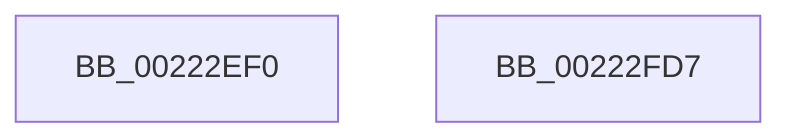

# EtwTraceAutoBoostSetFloor

- RVA: `0x00222EF0`–`0x00222FD8` (길이 `232` bytes)
- VA: `0x0000000140222EF0`
- 실행 섹션: `.text`
- PDB 이름 있음: `예`; PDB Function 태그: `아니요`
- unwind 정보 RVA: `0x0005F6F8`
- 디코드: `62`개 명령, `232/232` bytes 표시
- 미해석 바이트: `0` (있으면 어셈블리에 `.byte`로 보존)

> 이 문서는 커널 이미지의 기계어와 PDB 기호를 분석해 생성했습니다. 4번과 5번은 함수 원형과 자료형을 바이너리 사용 방식에서 추정한 C 해석이며 원본 소스 복구 결과는 아닙니다.

## 1. Dependencies

- 직접 호출 지점: **4**; 고유 호출 대상: **4**
- 직접 호출자로 확인된 함수: **3**
- RIP 상대 이미지 참조: **1**

### Outgoing calls
- `0x00222F63` → [Feature_Servicing_AutoBoostEtwEventingFixes__private_IsEnabledPreCheckWithReporting](Feature_Servicing_AutoBoostEtwEventingFixes__private_IsEnabledPreCheckWithReporting_function_00222FE0.md) (function, `0x00222FE0`)
- `0x00222F6A` → [Feature_Servicing_AutoBoostEtwEventingFixes__private_IsEnabledWithReporting](Feature_Servicing_AutoBoostEtwEventingFixes__private_IsEnabledWithReporting_function_00222FF0.md) (function, `0x00222FF0`)
- `0x00222FBB` → [EtwTraceSiloKernelEvent](EtwTraceSiloKernelEvent_function_002242A0.md) (function, `0x002242A0`)
- `0x00222FC7` → [_security_check_cookie](../6A/_security_check_cookie_function_006AC640.md) (function, `0x006AC640`)

### Direct callers
- [sub_0021F36F](../21/Unknown_function_0021F36F.md) at `0x0021F687`
- [sub_00220023](Unknown_function_00220023.md) at `0x002201CE`
- [sub_002209D5](Unknown_function_002209D5.md) at `0x00220B80`

### Static image references
- `0x00222EFD` → RVA `0x00E0A740` (`.data`; read)

## 2. Other-region calls and transfers

- 다른 실행 섹션으로 향하는 call: **0**
- 별도 외부 분기/꼬리 이동을 확인하지 못했습니다.

## 3. Assembly (complete function range)

```asm
00222EF0  48 89 5C 24 10                  mov qword ptr [rsp + 0x10], rbx
00222EF5  55                              push rbp
00222EF6  48 8B EC                        mov rbp, rsp
00222EF9  48 83 EC 60                     sub rsp, 0x60
00222EFD  48 8B 05 3C 78 BE 00            mov rax, qword ptr [rip + 0xbe783c]
00222F04  48 33 C4                        xor rax, rsp
00222F07  48 89 45 F0                     mov qword ptr [rbp - 0x10], rax
00222F0B  8B 81 10 05 00 00               mov eax, dword ptr [rcx + 0x510]
00222F11  48 8B D9                        mov rbx, rcx
00222F14  89 45 D8                        mov dword ptr [rbp - 0x28], eax
00222F17  41 80 E1 07                     and r9b, 7
00222F1B  8A 45 38                        mov al, byte ptr [rbp + 0x38]
00222F1E  88 45 DD                        mov byte ptr [rbp - 0x23], al
00222F21  8A 45 48                        mov al, byte ptr [rbp + 0x48]
00222F24  48 89 55 D0                     mov qword ptr [rbp - 0x30], rdx
00222F28  02 C0                           add al, al
00222F2A  8A 55 30                        mov dl, byte ptr [rbp + 0x30]
00222F2D  80 E2 01                        and dl, 1
00222F30  44 88 45 DC                     mov byte ptr [rbp - 0x24], r8b
00222F34  0A D0                           or dl, al
00222F36  8A 45 40                        mov al, byte ptr [rbp + 0x40]
00222F39  24 07                           and al, 7
00222F3B  C0 E2 03                        shl dl, 3
00222F3E  0A D0                           or dl, al
00222F40  8A 45 58                        mov al, byte ptr [rbp + 0x58]
00222F43  C0 E2 03                        shl dl, 3
00222F46  24 03                           and al, 3
00222F48  41 0A D1                        or dl, r9b
00222F4B  C0 E0 02                        shl al, 2
00222F4E  88 55 DE                        mov byte ptr [rbp - 0x22], dl
00222F51  65 8A 0C 25 3C 3A 00 00         mov cl, byte ptr gs:[0x3a3c]
00222F59  80 E1 01                        and cl, 1
00222F5C  0A C8                           or cl, al
00222F5E  88 4D DF                        mov byte ptr [rbp - 0x21], cl
00222F61  33 C9                           xor ecx, ecx
00222F63  E8 78 00 00 00                  call 0x140222fe0
00222F68  33 C9                           xor ecx, ecx
00222F6A  E8 81 00 00 00                  call 0x140222ff0
00222F6F  83 65 EC 00                     and dword ptr [rbp - 0x14], 0
00222F73  48 8D 4D D0                     lea rcx, [rbp - 0x30]
00222F77  48 89 4D E0                     mov qword ptr [rbp - 0x20], rcx
00222F7B  F7 D8                           neg eax
00222F7D  48 8B 8B 20 02 00 00            mov rcx, qword ptr [rbx + 0x220]
00222F84  41 B9 00 10 00 A0               mov r9d, 0xa0001000
00222F8A  1B D2                           sbb edx, edx
00222F8C  C7 45 E8 10 00 00 00            mov dword ptr [rbp - 0x18], 0x10
00222F93  81 E2 00 04 00 00               and edx, 0x400
00222F99  41 B8 01 00 00 00               mov r8d, 1
00222F9F  81 C2 02 0A 60 00               add edx, 0x600a02
00222FA5  48 8B 89 F0 05 00 00            mov rcx, qword ptr [rcx + 0x5f0]
00222FAC  89 54 24 28                     mov dword ptr [rsp + 0x28], edx
00222FB0  48 8D 55 E0                     lea rdx, [rbp - 0x20]
00222FB4  66 C7 44 24 20 42 05            mov word ptr [rsp + 0x20], 0x542
00222FBB  E8 E0 12 00 00                  call 0x1402242a0
00222FC0  48 8B 4D F0                     mov rcx, qword ptr [rbp - 0x10]
00222FC4  48 33 CC                        xor rcx, rsp
00222FC7  E8 74 96 48 00                  call 0x1406ac640
00222FCC  48 8B 5C 24 78                  mov rbx, qword ptr [rsp + 0x78]
00222FD1  48 83 C4 60                     add rsp, 0x60
00222FD5  5D                              pop rbp
00222FD6  C3                              ret
00222FD7  CC                              int3
```

## 4. C-style interpretation (structured pseudocode)

```c
__int64 __fastcall EtwTraceAutoBoostSetFloor(__int64 a1, __int64 a2, unsigned __int8 a3, unsigned __int8 a4, unsigned __int8 a5, unsigned __int8 a6, unsigned __int8 a7, unsigned __int8 a8, __int64 a9, unsigned __int8 a10)
{
    __int64 result;
    __int64 v_rsp;
    unsigned __int64 v_stack_m18;
    unsigned int v_stack_m1C;
    unsigned int v_stack_m20;
    unsigned __int64 v_stack_m28;
    unsigned __int8 v_stack_m29;
    unsigned __int8 v_stack_m2A;
    unsigned __int8 v_stack_m2B;
    unsigned __int8 v_stack_m2C;
    unsigned int v_stack_m30;
    unsigned __int64 v_stack_m38;
    unsigned int v_stack_m40;
    unsigned __int16 v_stack_m48;
    unsigned __int64 v_stack_p10;

    v_stack_p10 = v_rbx;
    v_rsp = (v_rsp) - (96);
    result = (*(unsigned __int64 *)(v_rip + 12482620)) ^ (v_rsp);
    v_stack_m18 = result;
    v_stack_m30 = (unsigned int)((unsigned int)(*(unsigned int *)(a1 + 1296)));
    a4 = (unsigned __int8)((a4) & (7));
    v_stack_m2B = a6;
    v_stack_m38 = a2;
    result = (unsigned __int8)((a8) + (a8));
    a2 = (unsigned __int8)((a5) & (1));
    v_stack_m2C = a3;
    a2 = (unsigned __int8)((a2) | ((unsigned __int8)(result)));
    result = (unsigned __int8)((a7) & (7));
    a2 = (unsigned __int8)((a2) << (3));
    a2 = (unsigned __int8)((a2) | ((unsigned __int8)(result)));
    a2 = (unsigned __int8)((a2) << (3));
    result = (unsigned __int8)((a10) & (3));
    a2 = (unsigned __int8)((a2) | (a4));
    result = (unsigned __int8)((result) << (2));
    v_stack_m2A = (unsigned __int8)(a2);
    a1 = (unsigned __int8)((*(unsigned __int8 *)(gs_base + (0 + 14908))) & (1));
    a1 = (unsigned __int8)((a1) | ((unsigned __int8)(result)));
    v_stack_m29 = (unsigned __int8)(a1);
    a1 = 0;
    result = Feature_Servicing_AutoBoostEtwEventingFixes__private_IsEnabledPreCheckWithReporting(a1, a2, a3, a4);
    a1 = 0;
    result = Feature_Servicing_AutoBoostEtwEventingFixes__private_IsEnabledWithReporting(a1, a2, a3, a4);
    v_stack_m28 = v_stack_m38;
    result = (unsigned int)(-(result));
    v_stack_m20 = 16;
    a2 = (unsigned int)((a2) & (0x400ULL));
    a2 = (unsigned int)((a2) + (0x600A02ULL));
    v_stack_m40 = (unsigned int)(a2);
    v_stack_m48 = 0x542ULL;
    result = EtwTraceSiloKernelEvent(*(unsigned __int64 *)(*(unsigned __int64 *)(a1 + 544) + 1520), v_stack_m28, 1, (unsigned int)(0xA0001000ULL));
    a1 = (v_stack_m18) ^ (v_rsp);
    result = _security_check_cookie(a1, v_stack_m28, 1, (unsigned int)(0xA0001000ULL));
    v_rsp = (v_rsp) + (96);
    return result;
}
```

## 5. (Beta) C Style

```c
int64_t EtwTraceAutoBoostSetFloor(void *Arg1, int64_t Arg2, uint8_t Arg3, uint8_t Arg4, uint8_t Arg5, uint8_t Arg6, uint8_t Arg7, uint8_t Arg8, uint64_t Arg9, uint8_t Arg10)
{
    uint8_t *arg1 = (uint8_t *)Arg1;

    int64_t result;
    int64_t local_rsp;
    uint64_t v_stack_m18;
    uint32_t v_stack_m1C;
    uint32_t v_stack_m20;
    uint64_t v_stack_m28;
    uint8_t v_stack_m29;
    uint8_t v_stack_m2A;
    uint8_t v_stack_m2B;
    uint8_t v_stack_m2C;
    uint32_t v_stack_m30;
    uint64_t v_stack_m38;
    uint32_t v_stack_m40;
    uint16_t v_stack_m48;
    uint64_t v_stack_p10;

    v_stack_p10 = local_rbx;
    local_rsp = (local_rsp) - (96);
    result = (*(uint64_t *)(v_rip + 0xBE783C)) ^ (local_rsp);
    v_stack_m18 = result;
    v_stack_m30 = (uint32_t)((uint32_t)(*(uint32_t *)(arg1 + 0x510)));
    Arg4 = (uint8_t)((Arg4) & (7));
    v_stack_m2B = Arg6;
    v_stack_m38 = Arg2;
    result = (uint8_t)((Arg8) + (Arg8));
    Arg2 = (uint8_t)((Arg5) & (1));
    v_stack_m2C = Arg3;
    Arg2 = (uint8_t)((Arg2) | ((uint8_t)(result)));
    result = (uint8_t)((Arg7) & (7));
    Arg2 = (uint8_t)((Arg2) << (3));
    Arg2 = (uint8_t)((Arg2) | ((uint8_t)(result)));
    Arg2 = (uint8_t)((Arg2) << (3));
    result = (uint8_t)((Arg10) & (3));
    Arg2 = (uint8_t)((Arg2) | (Arg4));
    result = (uint8_t)((result) << (2));
    v_stack_m2A = (uint8_t)(Arg2);
    Arg1 = (uint8_t)((*(uint8_t *)(gs_base + (0 + 0x3A3C))) & (1));
    Arg1 = (uint8_t)((Arg1) | ((uint8_t)(result)));
    v_stack_m29 = (uint8_t)(Arg1);
    Arg1 = 0;
    result = Feature_Servicing_AutoBoostEtwEventingFixes__private_IsEnabledPreCheckWithReporting(Arg1, Arg2, Arg3, Arg4);
    Arg1 = 0;
    result = Feature_Servicing_AutoBoostEtwEventingFixes__private_IsEnabledWithReporting(Arg1, Arg2, Arg3, Arg4);
    v_stack_m28 = v_stack_m38;
    result = (uint32_t)(-(result));
    v_stack_m20 = 16;
    Arg2 = (uint32_t)((Arg2) & (0x400ULL));
    Arg2 = (uint32_t)((Arg2) + (0x600A02ULL));
    v_stack_m40 = (uint32_t)(Arg2);
    v_stack_m48 = 0x542ULL;
    result = EtwTraceSiloKernelEvent(*(uint64_t *)(*(uint64_t *)(arg1 + 0x220) + 0x5F0), v_stack_m28, 1, (uint32_t)(0xA0001000ULL));
    Arg1 = (v_stack_m18) ^ (local_rsp);
    result = _security_check_cookie(Arg1, v_stack_m28, 1, (uint32_t)(0xA0001000ULL));
    local_rsp = (local_rsp) + (96);
    return result;
}
```

### 관측된 메모리 오프셋

구조체 형식이 확인되지 않은 접근은 인자 기준의 오프셋으로만 기록했습니다.

| 기준 인자 | 오프셋 표현 | 폭 (bit) | 접근 |
|---|---:|---:|---|
| `Arg1` | `+ 0x220` | `64` | `R` |
| `Arg1` | `+ 0x510` | `32` | `R` |

## 6. Execution-region graph

[열기: 2D/3D 그래프와 함수 탐색 컨트롤 패널](../../../control-panel.html?section=text&rva=0x00222EF0&view=graph)

- 2D 그래프는 위에서 아래로 흐르고, 3D 그래프는 빈 공간을 드래그해 회전합니다. Shift+드래그는 이동, 휠은 확대·축소, 함수 노드 선택은 대상 보고서 이동입니다.

### Static fallback


