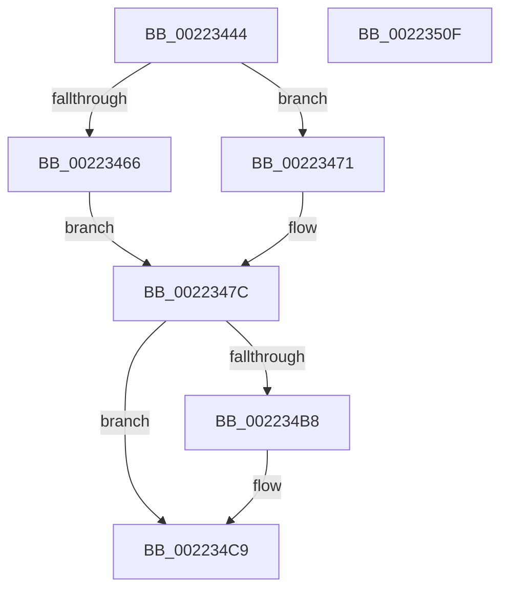

# EtwTraceReadyQueueInsertion

- RVA: `0x00223444`–`0x00223510` (길이 `204` bytes)
- VA: `0x0000000140223444`
- 실행 섹션: `.text`
- PDB 이름 있음: `예`; PDB Function 태그: `아니요`
- unwind 정보 RVA: `0x0005F764`
- 디코드: `51`개 명령, `204/204` bytes 표시
- 미해석 바이트: `0` (있으면 어셈블리에 `.byte`로 보존)

> 이 문서는 커널 이미지의 기계어와 PDB 기호를 분석해 생성했습니다. 4번과 5번은 함수 원형과 자료형을 바이너리 사용 방식에서 추정한 C 해석이며 원본 소스 복구 결과는 아닙니다.

## 1. Dependencies

- 직접 호출 지점: **2**; 고유 호출 대상: **2**
- 직접 호출자로 확인된 함수: **8**
- RIP 상대 이미지 참조: **1**

### Outgoing calls
- `0x002234F0` → [EtwTraceSiloKernelEvent](EtwTraceSiloKernelEvent_function_002242A0.md) (function, `0x002242A0`)
- `0x002234FC` → [_security_check_cookie](../6A/_security_check_cookie_function_006AC640.md) (function, `0x006AC640`)

### Direct callers
- [KiDeferGroupSchedulingPreemption](../20/KiDeferGroupSchedulingPreemption_function_0020076C.md) at `0x002010CB`
- [KiQueueReadyThread](../21/KiQueueReadyThread_function_0021C7B0.md) at `0x0021D2C3`
- [sub_00254461](../25/Unknown_function_00254461.md) at `0x00254611`
- [KiSearchForNewThreadsForRescheduleContext](../25/KiSearchForNewThreadsForRescheduleContext_function_00258620.md) at `0x002597F2`
- [KiAttemptToScheduleThreadToBusyIsolationUnit](../25/KiAttemptToScheduleThreadToBusyIsolationUnit_function_00259B00.md) at `0x0025A800`
- [KiMoveScbThreadsToNewReadylist](../30/KiMoveScbThreadsToNewReadylist_function_003099AC.md) at `0x00309BB7`
- [KiGroupSchedulingGenerationEnd](../30/KiGroupSchedulingGenerationEnd_function_0030A9B4.md) at `0x0030B117`
- [KiRemoveThreadFromSchedulingGroup](../35/KiRemoveThreadFromSchedulingGroup_function_00356514.md) at `0x00356622`

### Static image references
- `0x00223451` → RVA `0x00E0A740` (`.data`; read)

## 2. Other-region calls and transfers

- 다른 실행 섹션으로 향하는 call: **0**
- 별도 외부 분기/꼬리 이동을 확인하지 못했습니다.

## 3. Assembly (complete function range)

```asm
00223444  48 89 5C 24 10                  mov qword ptr [rsp + 0x10], rbx
00223449  55                              push rbp
0022344A  48 8B EC                        mov rbp, rsp
0022344D  48 83 EC 70                     sub rsp, 0x70
00223451  48 8B 05 E8 72 BE 00            mov rax, qword ptr [rip + 0xbe72e8]
00223458  48 33 C4                        xor rax, rsp
0022345B  48 89 45 F0                     mov qword ptr [rbp - 0x10], rax
0022345F  33 DB                           xor ebx, ebx
00223461  4D 85 C9                        test r9, r9
00223464  75 0B                           jne 0x140223471
00223466  44 8A DB                        mov r11b, bl
00223469  44 8B D3                        mov r10d, ebx
0022346C  44 8B CB                        mov r9d, ebx
0022346F  EB 0B                           jmp 0x14022347c
00223471  45 8A 59 0C                     mov r11b, byte ptr [r9 + 0xc]
00223475  4D 8B 11                        mov r10, qword ptr [r9]
00223478  45 8B 49 08                     mov r9d, dword ptr [r9 + 8]
0022347C  8B 81 10 05 00 00               mov eax, dword ptr [rcx + 0x510]
00223482  45 85 C9                        test r9d, r9d
00223485  89 45 C0                        mov dword ptr [rbp - 0x40], eax
00223488  0F B6 C3                        movzx eax, bl
0022348B  44 88 45 C8                     mov byte ptr [rbp - 0x38], r8b
0022348F  41 B8 01 00 00 00               mov r8d, 1
00223495  41 0F 45 C0                     cmovne eax, r8d
00223499  88 5D CB                        mov byte ptr [rbp - 0x35], bl
0022349C  88 45 CA                        mov byte ptr [rbp - 0x36], al
0022349F  48 8D 45 C0                     lea rax, [rbp - 0x40]
002234A3  48 89 45 D0                     mov qword ptr [rbp - 0x30], rax
002234A7  89 55 C4                        mov dword ptr [rbp - 0x3c], edx
002234AA  44 88 5D C9                     mov byte ptr [rbp - 0x37], r11b
002234AE  48 C7 45 D8 0C 00 00 00         mov qword ptr [rbp - 0x28], 0xc
002234B6  74 11                           je 0x1402234c9
002234B8  4C 89 55 E0                     mov qword ptr [rbp - 0x20], r10
002234BC  41 B8 02 00 00 00               mov r8d, 2
002234C2  44 89 4D E8                     mov dword ptr [rbp - 0x18], r9d
002234C6  89 5D EC                        mov dword ptr [rbp - 0x14], ebx
002234C9  48 8B 89 20 02 00 00            mov rcx, qword ptr [rcx + 0x220]
002234D0  48 8D 55 D0                     lea rdx, [rbp - 0x30]
002234D4  C7 44 24 28 02 0E 60 00         mov dword ptr [rsp + 0x28], 0x600e02
002234DC  41 B9 00 08 00 A0               mov r9d, 0xa0000800
002234E2  66 C7 44 24 20 4C 05            mov word ptr [rsp + 0x20], 0x54c
002234E9  48 8B 89 F0 05 00 00            mov rcx, qword ptr [rcx + 0x5f0]
002234F0  E8 AB 0D 00 00                  call 0x1402242a0
002234F5  48 8B 4D F0                     mov rcx, qword ptr [rbp - 0x10]
002234F9  48 33 CC                        xor rcx, rsp
002234FC  E8 3F 91 48 00                  call 0x1406ac640
00223501  48 8B 9C 24 88 00 00 00         mov rbx, qword ptr [rsp + 0x88]
00223509  48 83 C4 70                     add rsp, 0x70
0022350D  5D                              pop rbp
0022350E  C3                              ret
0022350F  CC                              int3
```

## 4. C-style interpretation (structured pseudocode)

```c
__int64 __fastcall EtwTraceReadyQueueInsertion(__int64 a1, int a2, unsigned __int8 a3, __int64 a4)
{
    __int64 result;
    __int64 v_rbx;
    __int64 v_rsp;
    unsigned __int64 v_stack_m18;
    unsigned int v_stack_m1C;
    unsigned int v_stack_m20;
    unsigned __int64 v_stack_m28;
    unsigned __int64 v_stack_m30;
    unsigned __int64 v_stack_m38;
    unsigned __int8 v_stack_m3D;
    unsigned __int8 v_stack_m3E;
    unsigned __int8 v_stack_m3F;
    unsigned __int8 v_stack_m40;
    unsigned int v_stack_m44;
    unsigned int v_stack_m48;
    unsigned int v_stack_m50;
    unsigned __int16 v_stack_m58;
    unsigned __int64 v_stack_p10;

    v_stack_p10 = v_rbx;
    v_rsp = (v_rsp) - (112);
    result = (*(unsigned __int64 *)(v_rip + 12481256)) ^ (v_rsp);
    v_stack_m18 = result;
    v_rbx = 0;
    if (a4 != 0) goto loc_00223471;
    goto loc_0022347C;
loc_00223471:
loc_0022347C:
    v_stack_m48 = (unsigned int)((unsigned int)(*(unsigned int *)(a1 + 1296)));
    v_stack_m40 = a3;
    result = 0;
    if ((unsigned int)((unsigned int)(*(unsigned int *)(0 + 8))) != 0) { result = 1; }
    v_stack_m3D = 0;
    v_stack_m3E = (unsigned __int8)(result);
    v_stack_m38 = v_stack_m48;
    v_stack_m44 = a2;
    v_stack_m3F = (unsigned __int8)(*(unsigned __int8 *)(0 + 12));
    v_stack_m30 = 12;
    if ((unsigned int)((unsigned int)(*(unsigned int *)(0 + 8))) != 0) {
        v_stack_m28 = *(unsigned __int64 *)(0);
        a3 = 2;
        v_stack_m20 = (unsigned int)((unsigned int)(*(unsigned int *)(0 + 8)));
        v_stack_m1C = 0;
    }
    v_stack_m50 = 0x600E02ULL;
    v_stack_m58 = 0x54CULL;
    result = EtwTraceSiloKernelEvent(*(unsigned __int64 *)(*(unsigned __int64 *)(a1 + 544) + 1520), v_stack_m38, a3, (unsigned int)(0xA0000800ULL));
    a1 = (v_stack_m18) ^ (v_rsp);
    result = _security_check_cookie(a1, v_stack_m38, a3, (unsigned int)(0xA0000800ULL));
    v_rsp = (v_rsp) + (112);
    return result;
}
```

## 5. (Beta) C Style

```c
int64_t EtwTraceReadyQueueInsertion(void *Arg1, int32_t Arg2, uint8_t Arg3, int64_t Arg4)
{
    uint8_t *arg1 = (uint8_t *)Arg1;

    int64_t result;
    int64_t local_rbx;
    int64_t local_rsp;
    uint64_t v_stack_m18;
    uint32_t v_stack_m1C;
    uint32_t v_stack_m20;
    uint64_t v_stack_m28;
    uint64_t v_stack_m30;
    uint64_t v_stack_m38;
    uint8_t v_stack_m3D;
    uint8_t v_stack_m3E;
    uint8_t v_stack_m3F;
    uint8_t v_stack_m40;
    uint32_t v_stack_m44;
    uint32_t v_stack_m48;
    uint32_t v_stack_m50;
    uint16_t v_stack_m58;
    uint64_t v_stack_p10;

    v_stack_p10 = local_rbx;
    local_rsp = (local_rsp) - (112);
    result = (*(uint64_t *)(v_rip + 0xBE72E8)) ^ (local_rsp);
    v_stack_m18 = result;
    local_rbx = 0;
    if (Arg4 != 0) goto loc_00223471;
    goto loc_0022347C;
loc_00223471:
loc_0022347C:
    v_stack_m48 = (uint32_t)((uint32_t)(*(uint32_t *)(arg1 + 0x510)));
    v_stack_m40 = Arg3;
    result = 0;
    if ((uint32_t)((uint32_t)(*(uint32_t *)(0 + 0x8))) != 0) { result = 1; }
    v_stack_m3D = 0;
    v_stack_m3E = (uint8_t)(result);
    v_stack_m38 = v_stack_m48;
    v_stack_m44 = Arg2;
    v_stack_m3F = (uint8_t)(*(uint8_t *)(0 + 0xC));
    v_stack_m30 = 12;
    if ((uint32_t)((uint32_t)(*(uint32_t *)(0 + 0x8))) != 0) {
        v_stack_m28 = *(uint64_t *)(0);
        Arg3 = 2;
        v_stack_m20 = (uint32_t)((uint32_t)(*(uint32_t *)(0 + 0x8)));
        v_stack_m1C = 0;
    }
    v_stack_m50 = 0x600E02ULL;
    v_stack_m58 = 0x54CULL;
    result = EtwTraceSiloKernelEvent(*(uint64_t *)(*(uint64_t *)(arg1 + 0x220) + 0x5F0), v_stack_m38, Arg3, (uint32_t)(0xA0000800ULL));
    Arg1 = (v_stack_m18) ^ (local_rsp);
    result = _security_check_cookie(Arg1, v_stack_m38, Arg3, (uint32_t)(0xA0000800ULL));
    local_rsp = (local_rsp) + (112);
    return result;
}
```

### 관측된 메모리 오프셋

구조체 형식이 확인되지 않은 접근은 인자 기준의 오프셋으로만 기록했습니다.

| 기준 인자 | 오프셋 표현 | 폭 (bit) | 접근 |
|---|---:|---:|---|
| `Arg1` | `+ 0x220` | `64` | `R` |
| `Arg1` | `+ 0x510` | `32` | `R` |

## 6. Execution-region graph

[열기: 2D/3D 그래프와 함수 탐색 컨트롤 패널](../../../control-panel.html?section=text&rva=0x00223444&view=graph)

- 2D 그래프는 위에서 아래로 흐르고, 3D 그래프는 빈 공간을 드래그해 회전합니다. Shift+드래그는 이동, 휠은 확대·축소, 함수 노드 선택은 대상 보고서 이동입니다.

### Static fallback


