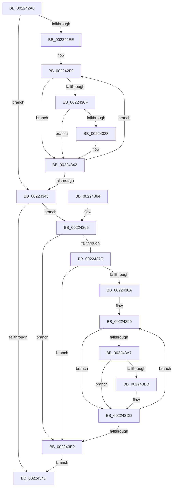

# EtwTraceSiloKernelEvent

- RVA: `0x002242A0`–`0x002243EC` (길이 `332` bytes)
- VA: `0x00000001402242A0`
- 실행 섹션: `.text`
- PDB 이름 있음: `예`; PDB Function 태그: `아니요`
- unwind 정보 RVA: `0x0005F8E8`
- 디코드: `88`개 명령, `332/332` bytes 표시
- 미해석 바이트: `0` (있으면 어셈블리에 `.byte`로 보존)

> 이 문서는 커널 이미지의 기계어와 PDB 기호를 분석해 생성했습니다. 4번과 5번은 함수 원형과 자료형을 바이너리 사용 방식에서 추정한 C 해석이며 원본 소스 복구 결과는 아닙니다.

## 1. Dependencies

- 직접 호출 지점: **3**; 고유 호출 대상: **2**
- 직접 호출자로 확인된 함수: **17**
- RIP 상대 이미지 참조: **1**

### Outgoing calls
- `0x0022433D` → [EtwpLogKernelEvent](../25/EtwpLogKernelEvent_function_0025CC00.md) (function, `0x0025CC00`)
- `0x0022436D` → [PsGetServerSiloGlobals](PsGetServerSiloGlobals_function_002250A0.md) (function, `0x002250A0`)
- `0x002243D8` → [EtwpLogKernelEvent](../25/EtwpLogKernelEvent_function_0025CC00.md) (function, `0x0025CC00`)

### Direct callers
- [EtwTraceAutoBoostEntryExhaustion](../21/EtwTraceAutoBoostEntryExhaustion_function_00210B04.md) at `0x00210B85`
- [EtwTraceAutoBoostProcessLockEntry](EtwTraceAutoBoostProcessLockEntry_function_00221C7C.md) at `0x00221D07`
- [EtwTraceAutoBoostSetFloor](EtwTraceAutoBoostSetFloor_function_00222EF0.md) at `0x00222FBB`
- [EtwTraceAutoBoostClearFloor](EtwTraceAutoBoostClearFloor_function_0022302C.md) at `0x002230AE`
- [EtwTraceReadyQueueInsertion](EtwTraceReadyQueueInsertion_function_00223444.md) at `0x002234F0`
- [EtwpTraceIoInit](EtwpTraceIoInit_function_002241C0.md) at `0x00224265`
- [EtwTracePageFault](../2A/EtwTracePageFault_function_002A2E74.md) at `0x002A2F44`
- [EtwTracePageFault](../2A/EtwTracePageFault_function_002A2E74.md) at `0x002A3042`
- [EtwTraceScheduleThread](../30/EtwTraceScheduleThread_function_0030B74C.md) at `0x0030B7F8`
- [EtwTraceAutoBoostConvertWaiterToOwner](../4D/EtwTraceAutoBoostConvertWaiterToOwner_function_004DAF98.md) at `0x004DB023`
- [EtwpProfileInterrupt](../65/EtwpProfileInterrupt_function_00650A00.md) at `0x00650B15`
- [EtwpTraceRedirectedIo](../65/EtwpTraceRedirectedIo_function_00651190.md) at `0x00651211`
- [EtwpLogProcessPerfCtrs](../../page/7B/EtwpLogProcessPerfCtrs_function_007B85C0.md) at `0x007B8677`
- [PerfInfoLogVirtualFree](../../page/88/PerfInfoLogVirtualFree_function_00880B98.md) at `0x00880C06`
- [EtwpWriteProcessEvent](../../page/8A/EtwpWriteProcessEvent_function_008A420C.md) at `0x008A4359`
- [PerfLogImageLoad](../../page/8D/PerfLogImageLoad_function_008D6DE0.md) at `0x008D7063`
- [EtwTraceThread](../../page/90/EtwTraceThread_function_00905700.md) at `0x0090595A`
- [PerfInfoLogVirtualAlloc](../../page/A4/PerfInfoLogVirtualAlloc_function_00A45754.md) at `0x00A457DB`
- [PerfInfoLogVirtualAlloc](../../page/A4/PerfInfoLogVirtualAlloc_function_00A45754.md) at `0x00A4584F`

### Static image references
- `0x002242B6` → RVA `0x00FC6AA8` (`ALMOSTRO`; read)

## 2. Other-region calls and transfers

- 다른 실행 섹션으로 향하는 call: **0**
- 별도 외부 분기/꼬리 이동을 확인하지 못했습니다.

## 3. Assembly (complete function range)

```asm
002242A0  48 89 5C 24 18                  mov qword ptr [rsp + 0x18], rbx
002242A5  48 89 6C 24 20                  mov qword ptr [rsp + 0x20], rbp
002242AA  56                              push rsi
002242AB  57                              push rdi
002242AC  41 54                           push r12
002242AE  41 56                           push r14
002242B0  41 57                           push r15
002242B2  48 83 EC 30                     sub rsp, 0x30
002242B6  48 8B 1D EB 27 DA 00            mov rbx, qword ptr [rip + 0xda27eb]
002242BD  41 8B F0                        mov esi, r8d
002242C0  44 8B B4 24 88 00 00 00         mov r14d, dword ptr [rsp + 0x88]
002242C8  48 8B EA                        mov rbp, rdx
002242CB  44 0F B7 BC 24 80 00 00 00      movzx r15d, word ptr [rsp + 0x80]
002242D4  4C 8B E1                        mov r12, rcx
002242D7  41 8B F9                        mov edi, r9d
002242DA  8B 9B A8 11 00 00               mov ebx, dword ptr [rbx + 0x11a8]
002242E0  44 0F BC D3                     bsf r10d, ebx
002242E4  C7 44 24 60 00 00 00 00         mov dword ptr [rsp + 0x60], 0
002242EC  74 5A                           je 0x140224348
002242EE  66 90                           nop
002242F0  48 8B 15 B1 27 DA 00            mov rdx, qword ptr [rip + 0xda27b1]
002242F7  8D 43 FF                        lea eax, [rbx - 1]
002242FA  23 D8                           and ebx, eax
002242FC  41 8B C2                        mov eax, r10d
002242FF  48 C1 E0 05                     shl rax, 5
00224303  48 8D 8A CC 11 00 00            lea rcx, [rdx + 0x11cc]
0022430A  48 03 C8                        add rcx, rax
0022430D  74 33                           je 0x140224342
0022430F  48 8B C7                        mov rax, rdi
00224312  48 C1 E8 1D                     shr rax, 0x1d
00224316  8B 0C 81                        mov ecx, dword ptr [rcx + rax*4]
00224319  23 CF                           and ecx, edi
0022431B  F7 C1 FF FF FF 1F               test ecx, 0x1fffffff
00224321  74 1F                           je 0x140224342
00224323  46 0F B6 84 52 98 11 00 00      movzx r8d, byte ptr [rdx + r10*2 + 0x1198]
0022432C  44 8B CE                        mov r9d, esi
0022432F  44 89 74 24 28                  mov dword ptr [rsp + 0x28], r14d
00224334  48 8B CD                        mov rcx, rbp
00224337  66 44 89 7C 24 20               mov word ptr [rsp + 0x20], r15w
0022433D  E8 BE 88 03 00                  call 0x14025cc00
00224342  44 0F BC D3                     bsf r10d, ebx
00224346  75 A8                           jne 0x1402242f0
00224348  4D 85 E4                        test r12, r12
0022434B  75 18                           jne 0x140224365
0022434D  48 8B 5C 24 70                  mov rbx, qword ptr [rsp + 0x70]
00224352  48 8B 6C 24 78                  mov rbp, qword ptr [rsp + 0x78]
00224357  48 83 C4 30                     add rsp, 0x30
0022435B  41 5F                           pop r15
0022435D  41 5E                           pop r14
0022435F  41 5C                           pop r12
00224361  5F                              pop rdi
00224362  5E                              pop rsi
00224363  C3                              ret
00224364  CC                              int3
00224365  49 8B CC                        mov rcx, r12
00224368  4C 89 6C 24 68                  mov qword ptr [rsp + 0x68], r13
0022436D  E8 2E 0D 00 00                  call 0x1402250a0
00224372  4C 8B A8 40 03 00 00            mov r13, qword ptr [rax + 0x340]
00224379  4D 85 ED                        test r13, r13
0022437C  74 64                           je 0x1402243e2
0022437E  41 8B 9D A8 11 00 00            mov ebx, dword ptr [r13 + 0x11a8]
00224385  0F BC CB                        bsf ecx, ebx
00224388  74 58                           je 0x1402243e2
0022438A  66 0F 1F 44 00 00               nop word ptr [rax + rax]
00224390  8B D1                           mov edx, ecx
00224392  8D 43 FF                        lea eax, [rbx - 1]
00224395  48 C1 E1 05                     shl rcx, 5
00224399  23 D8                           and ebx, eax
0022439B  48 81 C1 CC 11 00 00            add rcx, 0x11cc
002243A2  49 03 CD                        add rcx, r13
002243A5  74 36                           je 0x1402243dd
002243A7  48 8B C7                        mov rax, rdi
002243AA  48 C1 E8 1D                     shr rax, 0x1d
002243AE  8B 0C 81                        mov ecx, dword ptr [rcx + rax*4]
002243B1  23 CF                           and ecx, edi
002243B3  F7 C1 FF FF FF 1F               test ecx, 0x1fffffff
002243B9  74 22                           je 0x1402243dd
002243BB  45 0F B6 84 55 98 11 00 00      movzx r8d, byte ptr [r13 + rdx*2 + 0x1198]
002243C4  44 8B CE                        mov r9d, esi
002243C7  49 8B D5                        mov rdx, r13
002243CA  44 89 74 24 28                  mov dword ptr [rsp + 0x28], r14d
002243CF  48 8B CD                        mov rcx, rbp
002243D2  66 44 89 7C 24 20               mov word ptr [rsp + 0x20], r15w
002243D8  E8 23 88 03 00                  call 0x14025cc00
002243DD  0F BC CB                        bsf ecx, ebx
002243E0  75 AE                           jne 0x140224390
002243E2  4C 8B 6C 24 68                  mov r13, qword ptr [rsp + 0x68]
002243E7  E9 61 FF FF FF                  jmp 0x14022434d
```

## 4. C-style interpretation (structured pseudocode)

```c
__int64 __fastcall EtwTraceSiloKernelEvent(__int64 a1, __int64 a2, int a3, int a4, unsigned __int16 a5, unsigned int a6)
{
    __int64 result;
    __int64 v_rbx;
    __int64 v_rsp;
    unsigned int v_stack_m30;
    unsigned __int16 v_stack_m38;
    unsigned __int64 v_stack_p18;
    unsigned __int64 v_stack_p20;
    unsigned int v_stack_p28;
    unsigned __int64 v_stack_p68;
    unsigned int v_stack_p8;

    v_stack_p18 = v_rbx;
    v_stack_p20 = v_rbp;
    v_rsp = (v_rsp) - (48);
    v_stack_p8 = 0;
    if (condition_is_equal) goto loc_00224348;
loc_002242F0:
    v_rbx = (unsigned int)(((unsigned int)(*(unsigned int *)(*(unsigned __int64 *)(v_rip + 14297067) + 4520))) & ((unsigned int)((unsigned int)(*(unsigned int *)(*(unsigned __int64 *)(v_rip + 14297067) + 4520)) - 1)));
    result = ((unsigned int)((unsigned int)(v_r10))) << (5);
    a1 = (*(unsigned __int64 *)(v_rip + 14297009) + 4556) + (result);
    if (condition_is_equal) goto loc_00224342;
    result = ((unsigned int)(a4)) >> (29);
    a1 = (unsigned int)(((unsigned int)(*(unsigned int *)(a1 + result * 4))) & ((unsigned int)((unsigned int)(a4))));
    if ((((unsigned int)(a1)) & (0x1FFFFFFFULL)) != 0) {
        a3 = *(unsigned __int8 *)(*(unsigned __int64 *)(v_rip + 14297009) + v_r10 * 2 + 4504);
        a4 = (unsigned int)((unsigned int)(a3));
        v_stack_m30 = (unsigned int)((unsigned int)(a6));
        a1 = a2;
        v_stack_m38 = a5;
        result = EtwpLogKernelEvent(a1, *(unsigned __int64 *)(v_rip + 14297009), a3, a4);
    }
    if ((((unsigned int)(a1)) & (0x1FFFFFFFULL)) != 0) goto loc_002242F0;
loc_00224348:
    if (a1 != 0) goto loc_00224365;
loc_0022434D:
    v_rsp = (v_rsp) + (48);
    return result;
loc_00224365:
    v_stack_p68 = v_r13;
    result = PsGetServerSiloGlobals(a1, *(unsigned __int64 *)(v_rip + 14297009), a3, a4);
    if (*(unsigned __int64 *)(result + 832) == 0) goto loc_002243E2;
    if (*(unsigned __int64 *)(result + 832) == 0) goto loc_002243E2;
loc_00224390:
    a1 = (a1) << (5);
    v_rbx = (unsigned int)(((unsigned int)(*(unsigned int *)(*(unsigned __int64 *)(result + 832) + 4520))) & ((unsigned int)((unsigned int)(*(unsigned int *)(*(unsigned __int64 *)(result + 832) + 4520)) - 1)));
    a1 = (a1) + (0x11CCULL);
    a1 = (a1) + (*(unsigned __int64 *)(result + 832));
    if (condition_is_equal) goto loc_002243DD;
    result = ((unsigned int)(a4)) >> (29);
    a1 = (unsigned int)(((unsigned int)(*(unsigned int *)(a1 + result * 4))) & ((unsigned int)((unsigned int)(a4))));
    if ((((unsigned int)(a1)) & (0x1FFFFFFFULL)) != 0) {
        a3 = *(unsigned __int8 *)(*(unsigned __int64 *)(result + 832) + (unsigned int)((unsigned int)(a1)) * 2 + 4504);
        a4 = (unsigned int)((unsigned int)(a3));
        a2 = *(unsigned __int64 *)(result + 832);
        v_stack_p28 = (unsigned int)((unsigned int)(a6));
        a1 = v_stack_p20;
        v_stack_p20 = a5;
        result = EtwpLogKernelEvent(a1, a2, a3, a4);
    }
    if ((((unsigned int)(a1)) & (0x1FFFFFFFULL)) != 0) goto loc_00224390;
loc_002243E2:
    goto loc_0022434D;
}
```

## 5. (Beta) C Style

```c
int64_t EtwTraceSiloKernelEvent(int64_t Arg1, int64_t Arg2, int32_t Arg3, int32_t Arg4, uint16_t Arg5, uint32_t Arg6)
{
    int64_t result;
    int64_t local_rbx;
    int64_t local_rsp;
    uint32_t v_stack_m30;
    uint16_t v_stack_m38;
    uint64_t v_stack_p18;
    uint64_t v_stack_p20;
    uint32_t v_stack_p28;
    uint64_t v_stack_p68;
    uint32_t v_stack_p8;

    v_stack_p18 = local_rbx;
    v_stack_p20 = local_rbp;
    local_rsp = (local_rsp) - (48);
    v_stack_p8 = 0;
    if (condition_is_equal) goto loc_00224348;
loc_002242F0:
    local_rbx = (uint32_t)(((uint32_t)(*(uint32_t *)(*(uint64_t *)(v_rip + 0xDA27EB) + 0x11A8))) & ((uint32_t)((uint32_t)(*(uint32_t *)(*(uint64_t *)(v_rip + 0xDA27EB) + 0x11A8)) - 1)));
    result = ((uint32_t)((uint32_t)(local_r10))) << (5);
    Arg1 = (*(uint64_t *)(v_rip + 0xDA27B1) + 4556) + (result);
    if (condition_is_equal) goto loc_00224342;
    result = ((uint32_t)(Arg4)) >> (29);
    Arg1 = (uint32_t)(((uint32_t)(*(uint32_t *)(Arg1 + result * 4))) & ((uint32_t)((uint32_t)(Arg4))));
    if ((((uint32_t)(Arg1)) & (0x1FFFFFFFULL)) != 0) {
        Arg3 = *(uint8_t *)(*(uint64_t *)(v_rip + 0xDA27B1) + local_r10 * 2 + 0x1198);
        Arg4 = (uint32_t)((uint32_t)(Arg3));
        v_stack_m30 = (uint32_t)((uint32_t)(Arg6));
        Arg1 = Arg2;
        v_stack_m38 = Arg5;
        result = EtwpLogKernelEvent(Arg1, *(uint64_t *)(v_rip + 0xDA27B1), Arg3, Arg4);
    }
    if ((((uint32_t)(Arg1)) & (0x1FFFFFFFULL)) != 0) goto loc_002242F0;
loc_00224348:
    if (Arg1 != 0) goto loc_00224365;
loc_0022434D:
    local_rsp = (local_rsp) + (48);
    return result;
loc_00224365:
    v_stack_p68 = local_r13;
    result = PsGetServerSiloGlobals(Arg1, *(uint64_t *)(v_rip + 0xDA27B1), Arg3, Arg4);
    if (*(uint64_t *)(result + 0x340) == 0) goto loc_002243E2;
    if (*(uint64_t *)(result + 0x340) == 0) goto loc_002243E2;
loc_00224390:
    Arg1 = (Arg1) << (5);
    local_rbx = (uint32_t)(((uint32_t)(*(uint32_t *)(*(uint64_t *)(result + 0x340) + 0x11A8))) & ((uint32_t)((uint32_t)(*(uint32_t *)(*(uint64_t *)(result + 0x340) + 0x11A8)) - 1)));
    Arg1 = (Arg1) + (0x11CCULL);
    Arg1 = (Arg1) + (*(uint64_t *)(result + 0x340));
    if (condition_is_equal) goto loc_002243DD;
    result = ((uint32_t)(Arg4)) >> (29);
    Arg1 = (uint32_t)(((uint32_t)(*(uint32_t *)(Arg1 + result * 4))) & ((uint32_t)((uint32_t)(Arg4))));
    if ((((uint32_t)(Arg1)) & (0x1FFFFFFFULL)) != 0) {
        Arg3 = *(uint8_t *)(*(uint64_t *)(result + 0x340) + (uint32_t)((uint32_t)(Arg1)) * 2 + 0x1198);
        Arg4 = (uint32_t)((uint32_t)(Arg3));
        Arg2 = *(uint64_t *)(result + 0x340);
        v_stack_p28 = (uint32_t)((uint32_t)(Arg6));
        Arg1 = v_stack_p20;
        v_stack_p20 = Arg5;
        result = EtwpLogKernelEvent(Arg1, Arg2, Arg3, Arg4);
    }
    if ((((uint32_t)(Arg1)) & (0x1FFFFFFFULL)) != 0) goto loc_00224390;
loc_002243E2:
    goto loc_0022434D;
}
```

## 6. Execution-region graph

[열기: 2D/3D 그래프와 함수 탐색 컨트롤 패널](../../../control-panel.html?section=text&rva=0x002242A0&view=graph)

- 2D 그래프는 위에서 아래로 흐르고, 3D 그래프는 빈 공간을 드래그해 회전합니다. Shift+드래그는 이동, 휠은 확대·축소, 함수 노드 선택은 대상 보고서 이동입니다.

### Static fallback


