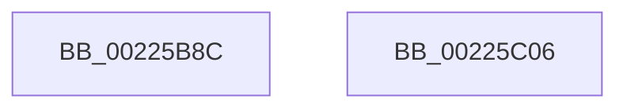

# EtwWriteKMSecurityEvent

- RVA: `0x00225B8C`–`0x00225C07` (길이 `123` bytes)
- VA: `0x0000000140225B8C`
- 실행 섹션: `.text`
- PDB 이름 있음: `예`; PDB Function 태그: `아니요`
- unwind 정보 RVA: `0x0005FAF4`
- 디코드: `26`개 명령, `123/123` bytes 표시
- 미해석 바이트: `0` (있으면 어셈블리에 `.byte`로 보존)

> 이 문서는 커널 이미지의 기계어와 PDB 기호를 분석해 생성했습니다. 4번과 5번은 함수 원형과 자료형을 바이너리 사용 방식에서 추정한 C 해석이며 원본 소스 복구 결과는 아닙니다.

## 1. Dependencies

- 직접 호출 지점: **2**; 고유 호출 대상: **2**
- 직접 호출자로 확인된 함수: **2**
- RIP 상대 이미지 참조: **0**

### Outgoing calls
- `0x00225B96` → [PsGetCurrentServerSiloGlobals](../2F/PsGetCurrentServerSiloGlobals_function_002FE1F0.md) (function, `0x002FE1F0`)
- `0x00225BF9` → [EtwpEventWriteFull](EtwpEventWriteFull_function_00225C10.md) (function, `0x00225C10`)

### Direct callers
- [AdtpWriteToEtwEx](../45/AdtpWriteToEtwEx_function_004595EC.md) at `0x004597B8`
- [AdtpWriteToEtw](../../page/AF/AdtpWriteToEtw_function_00AF98B0.md) at `0x00AF9C84`

### Static image references
- 디코드된 RIP-relative 메모리 참조가 없습니다.

## 2. Other-region calls and transfers

- 다른 실행 섹션으로 향하는 call: **0**
- 별도 외부 분기/꼬리 이동을 확인하지 못했습니다.

## 3. Assembly (complete function range)

```asm
00225B8C  48 81 EC 98 00 00 00            sub rsp, 0x98
00225B93  4C 8B D1                        mov r10, rcx
00225B96  E8 55 86 0D 00                  call 0x1402fe1f0
00225B9B  48 8B 90 40 03 00 00            mov rdx, qword ptr [rax + 0x340]
00225BA2  33 C0                           xor eax, eax
00225BA4  48 89 84 24 80 00 00 00         mov qword ptr [rsp + 0x80], rax
00225BAC  48 89 44 24 78                  mov qword ptr [rsp + 0x78], rax
00225BB1  66 89 44 24 70                  mov word ptr [rsp + 0x70], ax
00225BB6  48 89 44 24 68                  mov qword ptr [rsp + 0x68], rax
00225BBB  48 8D 4A 18                     lea rcx, [rdx + 0x18]
00225BBF  0F B7 92 F0 10 00 00            movzx edx, word ptr [rdx + 0x10f0]
00225BC6  48 89 44 24 60                  mov qword ptr [rsp + 0x60], rax
00225BCB  48 89 44 24 58                  mov qword ptr [rsp + 0x58], rax
00225BD0  4C 89 4C 24 50                  mov qword ptr [rsp + 0x50], r9
00225BD5  45 33 C9                        xor r9d, r9d
00225BD8  44 89 44 24 48                  mov dword ptr [rsp + 0x48], r8d
00225BDD  45 33 C0                        xor r8d, r8d
00225BE0  48 89 44 24 40                  mov qword ptr [rsp + 0x40], rax
00225BE5  48 89 44 24 38                  mov qword ptr [rsp + 0x38], rax
00225BEA  66 89 44 24 30                  mov word ptr [rsp + 0x30], ax
00225BEF  66 89 44 24 28                  mov word ptr [rsp + 0x28], ax
00225BF4  4C 89 54 24 20                  mov qword ptr [rsp + 0x20], r10
00225BF9  E8 12 00 00 00                  call 0x140225c10
00225BFE  48 81 C4 98 00 00 00            add rsp, 0x98
00225C05  C3                              ret
00225C06  CC                              int3
```

## 4. C-style interpretation (structured pseudocode)

```c
__int64 __fastcall EtwWriteKMSecurityEvent(__int64 a1, __int64 a2, int a3, __int64 a4)
{
    __int64 result;
    __int64 v_rsp;
    unsigned __int64 v_stack_m18;
    unsigned __int64 v_stack_m20;
    unsigned __int16 v_stack_m28;
    unsigned __int64 v_stack_m30;
    unsigned __int64 v_stack_m38;
    unsigned __int64 v_stack_m40;
    unsigned __int64 v_stack_m48;
    unsigned int v_stack_m50;
    unsigned __int64 v_stack_m58;
    unsigned __int64 v_stack_m60;
    unsigned __int16 v_stack_m68;
    unsigned __int16 v_stack_m70;
    unsigned __int64 v_stack_m78;

    v_rsp = (v_rsp) - (152);
    result = PsGetCurrentServerSiloGlobals(a1, a2, a3, a4);
    result = 0;
    v_stack_m18 = 0;
    v_stack_m20 = 0;
    v_stack_m28 = 0;
    v_stack_m30 = 0;
    v_stack_m38 = 0;
    v_stack_m40 = 0;
    v_stack_m48 = a4;
    a4 = 0;
    v_stack_m50 = a3;
    a3 = 0;
    v_stack_m58 = 0;
    v_stack_m60 = 0;
    v_stack_m68 = 0;
    v_stack_m70 = 0;
    v_stack_m78 = a1;
    result = EtwpEventWriteFull(*(unsigned __int64 *)(result + 832) + 24, *(unsigned __int16 *)(*(unsigned __int64 *)(result + 832) + 4336), a3, a4);
    v_rsp = (v_rsp) + (152);
    return result;
}
```

## 5. (Beta) C Style

```c
int64_t EtwWriteKMSecurityEvent(int64_t Arg1, int64_t Arg2, int32_t Arg3, int64_t Arg4)
{
    int64_t result;
    int64_t local_rsp;
    uint64_t v_stack_m18;
    uint64_t v_stack_m20;
    uint16_t v_stack_m28;
    uint64_t v_stack_m30;
    uint64_t v_stack_m38;
    uint64_t v_stack_m40;
    uint64_t v_stack_m48;
    uint32_t v_stack_m50;
    uint64_t v_stack_m58;
    uint64_t v_stack_m60;
    uint16_t v_stack_m68;
    uint16_t v_stack_m70;
    uint64_t v_stack_m78;

    local_rsp = (local_rsp) - (152);
    result = PsGetCurrentServerSiloGlobals(Arg1, Arg2, Arg3, Arg4);
    result = 0;
    v_stack_m18 = 0;
    v_stack_m20 = 0;
    v_stack_m28 = 0;
    v_stack_m30 = 0;
    v_stack_m38 = 0;
    v_stack_m40 = 0;
    v_stack_m48 = Arg4;
    Arg4 = 0;
    v_stack_m50 = Arg3;
    Arg3 = 0;
    v_stack_m58 = 0;
    v_stack_m60 = 0;
    v_stack_m68 = 0;
    v_stack_m70 = 0;
    v_stack_m78 = Arg1;
    result = EtwpEventWriteFull(*(uint64_t *)(result + 0x340) + 24, *(uint16_t *)(*(uint64_t *)(result + 0x340) + 0x10F0), Arg3, Arg4);
    local_rsp = (local_rsp) + (152);
    return result;
}
```

## 6. Execution-region graph

[열기: 2D/3D 그래프와 함수 탐색 컨트롤 패널](../../../control-panel.html?section=text&rva=0x00225B8C&view=graph)

- 2D 그래프는 위에서 아래로 흐르고, 3D 그래프는 빈 공간을 드래그해 회전합니다. Shift+드래그는 이동, 휠은 확대·축소, 함수 노드 선택은 대상 보고서 이동입니다.

### Static fallback


