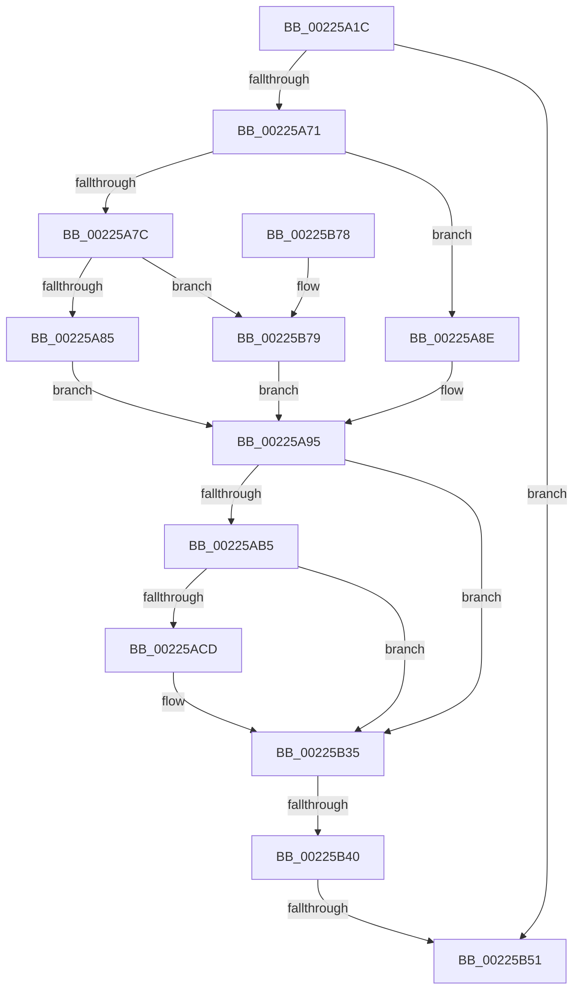

# EtwpDiskProvTraceDisk

- RVA: `0x00225A1C`–`0x00225B85` (길이 `361` bytes)
- VA: `0x0000000140225A1C`
- 실행 섹션: `.text`
- PDB 이름 있음: `예`; PDB Function 태그: `예`
- unwind 정보 RVA: `0x0005FABC`
- 디코드: `89`개 명령, `361/361` bytes 표시
- 미해석 바이트: `0` (있으면 어셈블리에 `.byte`로 보존)

> 이 문서는 커널 이미지의 기계어와 PDB 기호를 분석해 생성했습니다. 4번과 5번은 함수 원형과 자료형을 바이너리 사용 방식에서 추정한 C 해석이며 원본 소스 복구 결과는 아닙니다.

## 1. Dependencies

- 직접 호출 지점: **3**; 고유 호출 대상: **3**
- 직접 호출자로 확인된 함수: **1**
- RIP 상대 이미지 참조: **5**

### Outgoing calls
- `0x00225AC4` → [EtwpLevelKeywordEnabled](../2F/EtwpLevelKeywordEnabled_function_002FD110.md) (function, `0x002FD110`)
- `0x00225B30` → [EtwpEventWriteFull](EtwpEventWriteFull_function_00225C10.md) (function, `0x00225C10`)
- `0x00225B58` → [_security_check_cookie](../6A/_security_check_cookie_function_006AC640.md) (function, `0x006AC640`)

### Direct callers
- [EtwpTraceIo](EtwpTraceIo_function_00224400.md) at `0x002246CC`
- [EtwpTraceIo](EtwpTraceIo_function_00224400.md) at `0x00224704`

### Static image references
- `0x00225A38` → RVA `0x00E0A740` (`.data`; read)
- `0x00225A46` → RVA `0x00EFF9F8` (`.data`; read)
- `0x00225A85` → RVA `0x00010590` (`.rdata`; read)
- `0x00225A8E` → RVA `0x00010580` (`.rdata`; read)
- `0x00225B79` → RVA `0x000105A0` (`.rdata`; read)

## 2. Other-region calls and transfers

- 다른 실행 섹션으로 향하는 call: **0**
- call이 아닌 외부 분기/꼬리 이동: **2**
  - `0x00225B3A` → [sub_006D6BDE](../6D/Unknown_function_006D6BDE.md) (`tail-transfer`)
  - `0x00225B4B` → [sub_006D6BDE + 0x8E](../6D/Unknown_function_006D6BDE.md) (`tail-transfer`)

## 3. Assembly (complete function range)

```asm
00225A1C  48 89 5C 24 08                  mov qword ptr [rsp + 8], rbx
00225A21  55                              push rbp
00225A22  56                              push rsi
00225A23  57                              push rdi
00225A24  41 54                           push r12
00225A26  41 55                           push r13
00225A28  41 56                           push r14
00225A2A  41 57                           push r15
00225A2C  48 8D 6C 24 D9                  lea rbp, [rsp - 0x27]
00225A31  48 81 EC C0 00 00 00            sub rsp, 0xc0
00225A38  48 8B 05 01 4D BE 00            mov rax, qword ptr [rip + 0xbe4d01]
00225A3F  48 33 C4                        xor rax, rsp
00225A42  48 89 45 1F                     mov qword ptr [rbp + 0x1f], rax
00225A46  48 8B 1D AB 9F CD 00            mov rbx, qword ptr [rip + 0xcd9fab]
00225A4D  45 33 ED                        xor r13d, r13d
00225A50  4C 89 6D F7                     mov qword ptr [rbp - 9], r13
00225A54  0F 57 C0                        xorps xmm0, xmm0
00225A57  4D 8B E1                        mov r12, r9
00225A5A  4D 8B F8                        mov r15, r8
00225A5D  4C 8B F2                        mov r14, rdx
00225A60  0F 11 45 FF                     movups xmmword ptr [rbp - 1], xmm0
00225A64  0F 11 45 0F                     movups xmmword ptr [rbp + 0xf], xmm0
00225A68  48 85 DB                        test rbx, rbx
00225A6B  0F 84 E0 00 00 00               je 0x140225b51
00225A71  0F B7 C9                        movzx ecx, cx
00225A74  81 E9 0A 01 00 00               sub ecx, 0x10a
00225A7A  74 12                           je 0x140225a8e
00225A7C  83 F9 04                        cmp ecx, 4
00225A7F  0F 85 F4 00 00 00               jne 0x140225b79
00225A85  48 8D 3D 04 AB DE FF            lea rdi, [rip - 0x2154fc]
00225A8C  EB 07                           jmp 0x140225a95
00225A8E  48 8D 3D EB AA DE FF            lea rdi, [rip - 0x215515]
00225A95  83 42 08 FC                     add dword ptr [rdx + 8], -4
00225A99  48 8B 43 70                     mov rax, qword ptr [rbx + 0x70]
00225A9D  48 8D 48 1C                     lea rcx, [rax + 0x1c]
00225AA1  48 F7 D8                        neg rax
00225AA4  48 1B F6                        sbb rsi, rsi
00225AA7  48 23 F1                        and rsi, rcx
00225AAA  66 44 39 6B 64                  cmp word ptr [rbx + 0x64], r13w
00225AAF  0F 84 80 00 00 00               je 0x140225b35
00225AB5  48 8B 4B 20                     mov rcx, qword ptr [rbx + 0x20]
00225AB9  4C 8B 47 08                     mov r8, qword ptr [rdi + 8]
00225ABD  48 83 C1 60                     add rcx, 0x60
00225AC1  8A 57 04                        mov dl, byte ptr [rdi + 4]
00225AC4  E8 47 76 0D 00                  call 0x1402fd110
00225AC9  84 C0                           test al, al
00225ACB  74 68                           je 0x140225b35
00225ACD  0F B7 53 64                     movzx edx, word ptr [rbx + 0x64]
00225AD1  48 8D 45 F7                     lea rax, [rbp - 9]
00225AD5  48 8B 4B 20                     mov rcx, qword ptr [rbx + 0x20]
00225AD9  45 33 C9                        xor r9d, r9d
00225ADC  48 89 84 24 80 00 00 00         mov qword ptr [rsp + 0x80], rax
00225AE4  45 33 C0                        xor r8d, r8d
00225AE7  0F B7 43 62                     movzx eax, word ptr [rbx + 0x62]
00225AEB  48 89 74 24 78                  mov qword ptr [rsp + 0x78], rsi
00225AF0  66 89 44 24 70                  mov word ptr [rsp + 0x70], ax
00225AF5  48 8D 45 FF                     lea rax, [rbp - 1]
00225AF9  4C 89 6C 24 68                  mov qword ptr [rsp + 0x68], r13
00225AFE  48 89 44 24 60                  mov qword ptr [rsp + 0x60], rax
00225B03  4C 89 7C 24 58                  mov qword ptr [rsp + 0x58], r15
00225B08  4C 89 74 24 50                  mov qword ptr [rsp + 0x50], r14
00225B0D  C7 44 24 48 01 00 00 00         mov dword ptr [rsp + 0x48], 1
00225B15  4C 89 6C 24 40                  mov qword ptr [rsp + 0x40], r13
00225B1A  4C 89 64 24 38                  mov qword ptr [rsp + 0x38], r12
00225B1F  66 44 89 6C 24 30               mov word ptr [rsp + 0x30], r13w
00225B25  66 44 89 6C 24 28               mov word ptr [rsp + 0x28], r13w
00225B2B  48 89 7C 24 20                  mov qword ptr [rsp + 0x20], rdi
00225B30  E8 DB 00 00 00                  call 0x140225c10
00225B35  66 44 39 6B 66                  cmp word ptr [rbx + 0x66], r13w
00225B3A  0F 85 9E 10 4B 00               jne 0x1406d6bde
00225B40  48 8B 43 20                     mov rax, qword ptr [rbx + 0x20]
00225B44  4C 39 A8 90 02 00 00            cmp qword ptr [rax + 0x290], r13
00225B4B  0F 85 1B 11 4B 00               jne 0x1406d6c6c
00225B51  48 8B 4D 1F                     mov rcx, qword ptr [rbp + 0x1f]
00225B55  48 33 CC                        xor rcx, rsp
00225B58  E8 E3 6A 48 00                  call 0x1406ac640
00225B5D  48 8B 9C 24 00 01 00 00         mov rbx, qword ptr [rsp + 0x100]
00225B65  48 81 C4 C0 00 00 00            add rsp, 0xc0
00225B6C  41 5F                           pop r15
00225B6E  41 5E                           pop r14
00225B70  41 5D                           pop r13
00225B72  41 5C                           pop r12
00225B74  5F                              pop rdi
00225B75  5E                              pop rsi
00225B76  5D                              pop rbp
00225B77  C3                              ret
00225B78  CC                              int3
00225B79  48 8D 3D 20 AA DE FF            lea rdi, [rip - 0x2155e0]
00225B80  E9 10 FF FF FF                  jmp 0x140225a95
```

## 4. C-style interpretation (structured pseudocode)

```c
__int64 __fastcall EtwpDiskProvTraceDisk(unsigned __int16 a1, __int64 a2, __int64 a3, __int64 a4)
{
    __int64 result;
    __int64 v_r13;
    __int64 v_rsi;
    __int64 v_rsp;
    unsigned __int64 v_stack_m40;
    unsigned __int64 v_stack_m50;
    unsigned __int64 v_stack_m5F;
    unsigned __int64 v_stack_m60;
    unsigned __int64 v_stack_m68;
    unsigned __int64 v_stack_m78;
    unsigned __int64 v_stack_m80;
    unsigned __int16 v_stack_m88;
    unsigned __int64 v_stack_m90;
    unsigned __int64 v_stack_m98;
    unsigned __int64 v_stack_mA0;
    unsigned __int64 v_stack_mA8;
    unsigned int v_stack_mB0;
    unsigned __int64 v_stack_mB8;
    unsigned __int64 v_stack_mC0;
    unsigned __int16 v_stack_mC8;
    unsigned __int16 v_stack_mD0;
    unsigned __int64 v_stack_mD8;
    unsigned __int64 v_stack_p8;

    v_stack_p8 = v_rbx;
    v_rsp = (v_rsp) - (192);
    result = (*(unsigned __int64 *)(v_rip + 12471553)) ^ (v_rsp);
    v_stack_m40 = result;
    v_r13 = 0;
    v_stack_m68 = 0;
    v_stack_m60 = v_xmm0;
    v_stack_m50 = v_xmm0;
    if (*(unsigned __int64 *)(v_rip + 13475755) == 0) goto loc_00225B51;
    a1 = (unsigned int)((a1) - (266));
    if (condition_is_equal) goto loc_00225A8E;
    if (a1 != 4) goto loc_00225B79;
    goto loc_00225A95;
loc_00225A8E:
loc_00225A95:
    result = -(*(unsigned __int64 *)(*(unsigned __int64 *)(v_rip + 13475755) + 112));
    v_rsi = (v_rsi) & (*(unsigned __int64 *)(*(unsigned __int64 *)(v_rip + 13475755) + 112) + 28);
    if ((*(unsigned __int16 *)(*(unsigned __int64 *)(v_rip + 13475755) + 100)) == 0) goto loc_00225B35;
    a1 = (*(unsigned __int64 *)(*(unsigned __int64 *)(v_rip + 13475755) + 32)) + (96);
    result = EtwpLevelKeywordEnabled(a1, *(unsigned __int8 *)(v_rip - 2184469 + 4), *(unsigned __int64 *)(v_rip - 2184469 + 8), a4);
    if ((unsigned __int8)(result) != 0) {
        a2 = *(unsigned __int16 *)(*(unsigned __int64 *)(v_rip + 13475755) + 100);
        result = v_stack_m68;
        a1 = *(unsigned __int64 *)(*(unsigned __int64 *)(v_rip + 13475755) + 32);
        a4 = 0;
        v_stack_m78 = result;
        a3 = 0;
        result = *(unsigned __int16 *)(*(unsigned __int64 *)(v_rip + 13475755) + 98);
        v_stack_m80 = v_rsi;
        v_stack_m88 = (unsigned __int16)(result);
        result = v_stack_m60;
        v_stack_m90 = 0;
        v_stack_m98 = result;
        v_stack_mA0 = 0;
        v_stack_mA8 = a2;
        v_stack_mB0 = 1;
        v_stack_mB8 = 0;
        v_stack_mC0 = 0;
        v_stack_mC8 = 0;
        v_stack_mD0 = 0;
        v_stack_mD8 = v_rip - 2184469;
        result = EtwpEventWriteFull(a1, a2, a3, a4);
    }
loc_00225B51:
    a1 = (v_stack_m40) ^ (v_rsp);
    result = _security_check_cookie(a1, a2, a3, a4);
    v_rsp = (v_rsp) + (192);
    return result;
loc_00225B79:
    goto loc_00225A95;
}
```

## 5. (Beta) C Style

```c
int64_t EtwpDiskProvTraceDisk(uint16_t Arg1, void *Arg2, int64_t Arg3, int64_t Arg4)
{
    uint8_t *arg2 = (uint8_t *)Arg2;

    int64_t result;
    int64_t local_r13;
    int64_t local_rsi;
    int64_t local_rsp;
    uint64_t v_stack_m40;
    uint64_t v_stack_m50;
    uint64_t v_stack_m5F;
    uint64_t v_stack_m60;
    uint64_t v_stack_m68;
    uint64_t v_stack_m78;
    uint64_t v_stack_m80;
    uint16_t v_stack_m88;
    uint64_t v_stack_m90;
    uint64_t v_stack_m98;
    uint64_t v_stack_mA0;
    uint64_t v_stack_mA8;
    uint32_t v_stack_mB0;
    uint64_t v_stack_mB8;
    uint64_t v_stack_mC0;
    uint16_t v_stack_mC8;
    uint16_t v_stack_mD0;
    uint64_t v_stack_mD8;
    uint64_t v_stack_p8;

    v_stack_p8 = local_rbx;
    local_rsp = (local_rsp) - (192);
    result = (*(uint64_t *)(v_rip + 0xBE4D01)) ^ (local_rsp);
    v_stack_m40 = result;
    local_r13 = 0;
    v_stack_m68 = 0;
    v_stack_m60 = v_xmm0;
    v_stack_m50 = v_xmm0;
    if (*(uint64_t *)(v_rip + 0xCD9FAB) == 0) goto loc_00225B51;
    Arg1 = (uint32_t)((Arg1) - (266));
    if (condition_is_equal) goto loc_00225A8E;
    if (Arg1 != 4) goto loc_00225B79;
    goto loc_00225A95;
loc_00225A8E:
loc_00225A95:
    result = -(*(uint64_t *)(*(uint64_t *)(v_rip + 0xCD9FAB) + 0x70));
    local_rsi = (local_rsi) & (*(uint64_t *)(*(uint64_t *)(v_rip + 0xCD9FAB) + 0x70) + 28);
    if ((*(uint16_t *)(*(uint64_t *)(v_rip + 0xCD9FAB) + 0x64)) == 0) goto loc_00225B35;
    Arg1 = (*(uint64_t *)(*(uint64_t *)(v_rip + 0xCD9FAB) + 0x20)) + (96);
    result = EtwpLevelKeywordEnabled(Arg1, *(uint8_t *)(v_rip - 0x215515 + 0x4), *(uint64_t *)(v_rip - 0x215515 + 0x8), Arg4);
    if ((uint8_t)(result) != 0) {
        Arg2 = *(uint16_t *)(*(uint64_t *)(v_rip + 0xCD9FAB) + 0x64);
        result = v_stack_m68;
        Arg1 = *(uint64_t *)(*(uint64_t *)(v_rip + 0xCD9FAB) + 0x20);
        Arg4 = 0;
        v_stack_m78 = result;
        Arg3 = 0;
        result = *(uint16_t *)(*(uint64_t *)(v_rip + 0xCD9FAB) + 0x62);
        v_stack_m80 = local_rsi;
        v_stack_m88 = (uint16_t)(result);
        result = v_stack_m60;
        v_stack_m90 = 0;
        v_stack_m98 = result;
        v_stack_mA0 = 0;
        v_stack_mA8 = Arg2;
        v_stack_mB0 = 1;
        v_stack_mB8 = 0;
        v_stack_mC0 = 0;
        v_stack_mC8 = 0;
        v_stack_mD0 = 0;
        v_stack_mD8 = v_rip - 2184469;
        result = EtwpEventWriteFull(Arg1, Arg2, Arg3, Arg4);
    }
loc_00225B51:
    Arg1 = (v_stack_m40) ^ (local_rsp);
    result = _security_check_cookie(Arg1, Arg2, Arg3, Arg4);
    local_rsp = (local_rsp) + (192);
    return result;
loc_00225B79:
    goto loc_00225A95;
}
```

### 관측된 메모리 오프셋

구조체 형식이 확인되지 않은 접근은 인자 기준의 오프셋으로만 기록했습니다.

| 기준 인자 | 오프셋 표현 | 폭 (bit) | 접근 |
|---|---:|---:|---|
| `Arg2` | `+ 0x8` | `32` | `R/W` |

## 6. Execution-region graph

[열기: 2D/3D 그래프와 함수 탐색 컨트롤 패널](../../../control-panel.html?section=text&rva=0x00225A1C&view=graph)

- 2D 그래프는 위에서 아래로 흐르고, 3D 그래프는 빈 공간을 드래그해 회전합니다. Shift+드래그는 이동, 휠은 확대·축소, 함수 노드 선택은 대상 보고서 이동입니다.

### Static fallback


